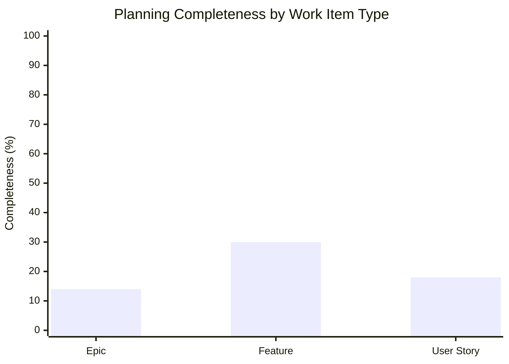
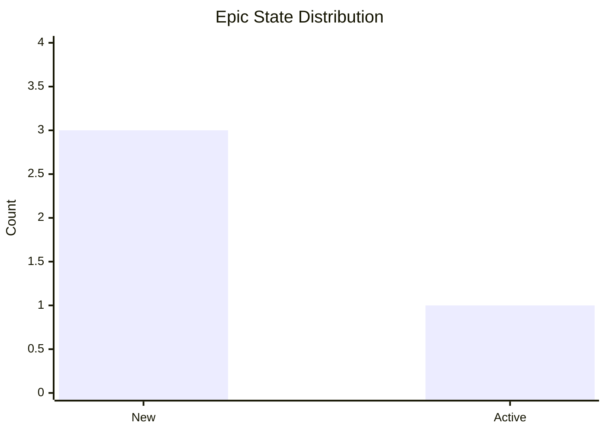
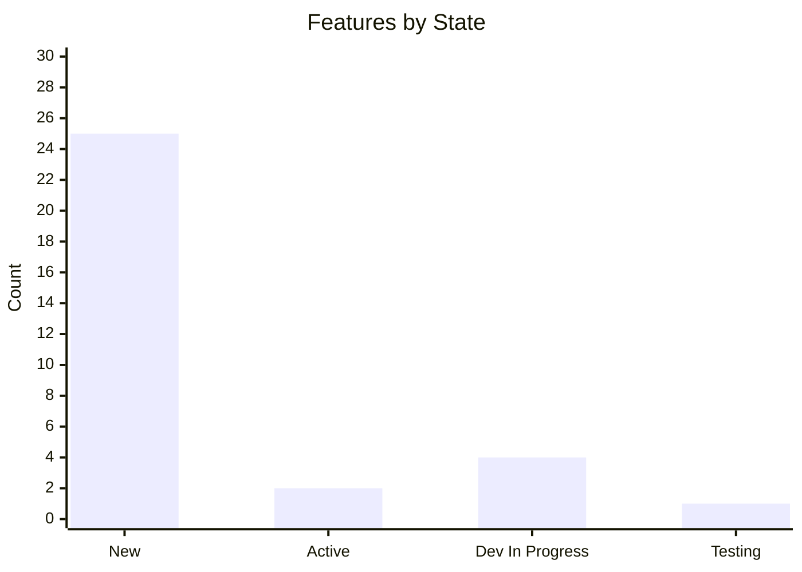
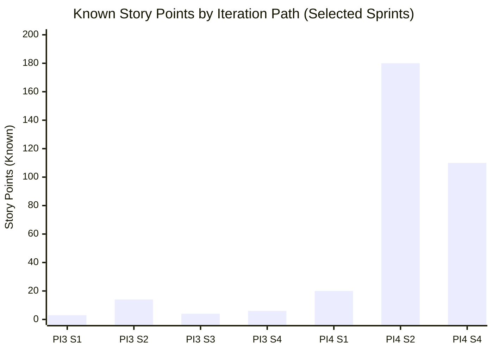

# Azure_DevOps_Planning_and_Sprint_Performance_Report.md

Project: **AAVA – Integrations**  
Data source: Azure DevOps backlog extraction JSON (Epics, Features, User Stories)  
Backlog extraction status: **All categories retrieved successfully** (Epics: 4, Features: 32, User Stories: 180)

---

## 1. Executive Product Dashboard

### 1.1 Summary Metrics

**Validation**

- `totalEpics` = 4, `epics.length` = 4 → consistent  
- `totalFeatures` = 32, `features.length` = 32 → consistent  
- `totalUserStories` = 180, `userStories.length` = 180 → consistent  
- BacklogStatus: EPIC, Feature, Stories → `retrieved: true` for all  
- No extraction `error`; warnings limited to "Feature unmapped Planning fields: Primary User Cohort"

**Planning fields evaluated**

- Epics: Priority, Risk, Effort, Business Value, Time Criticality, Start Date, Target Date  
- Features: Priority, Risk, Effort, Business Value, Time Criticality, Start Date, Target Date, Release Version, Studio, Planned Sprint, Estimated Completion Sprint, Primary User Cohort, Complexity  
- User Stories: Story Points, Priority, Start Date, Due Date, UX Expected, Risk, Studio, Release Version, Planned Sprint, Dependent Team  

**Computed planning completeness (applicable fields per item)**

- Epics (4 items × 7 fields = 28 fields):  
  - Provided: Priority (4), others null → 4/28 ≈ **14%**
- Features (32 items × 13 fields = 416 fields):  
  - Provided counts (excluding `Primary User Cohort`, which is **Unmapped** when listed):  
    - Priority: 32  
    - Risk: 0  
    - Effort: 14  
    - Business Value: 0  
    - Time Criticality: 0  
    - Start Date: 1  
    - Target Date: 14  
    - Release Version: 11  
    - Studio: 27  
    - Planned Sprint: 8  
    - Estimated Completion Sprint: 15  
    - Primary User Cohort: 0 Provided, many explicitly **Unmapped**  
    - Complexity: 2  
  - Total Provided (excluding Unmapped cohort) = 124 → 124/416 ≈ **30%**
- User Stories (180 items × 10 fields = 1,800 fields):  
  - Story Points: Provided on 40 stories (including 0.0 as Provided)  
  - Priority: Provided on 180  
  - Start Date: Provided on 11  
  - Due Date: Provided on 22  
  - UX Expected: 1  
  - Risk: 1  
  - Studio: 46  
  - Release Version: 12  
  - Planned Sprint: 11  
  - Dependent Team: 2  
  - Total Provided = 326 → 326/1,800 ≈ **18%**

**Management Dashboard**

| Metric | Epic | Feature | User Story |
|---|---|---|---|
| Total Work Items | 4 | 32 | 180 |
| Planning Completeness % | 14% | 30% | 18% |
| Items Missing Essential Planning Data (estimates and schedule) | 4/4 (100%) missing Effort & dates | 18/32 (56%) missing Effort or Target Date | 140+/180 (≥78%) missing Story Points and/or Due Date |
| Items Requiring Action (clear planning gaps) | 4 | 28 | ~150 |
| Items With Explicit Risks | 0 | 0 | 1 (57150) |
| Items Without Specific Sprint Assignment (Planned Sprint = null) | 4 (Iteration only) | 24 | 166+ (many default to PI or project root only) |
| Say-Do Status | Insufficient Data | Insufficient Data | Insufficient Data |

> **Note:** Say-Do cannot be calculated: no historical sprint-start commitment snapshots, no completed-vs-committed sets.

### 1.2 Key Management Findings (Top 5)

1. **Epic-level planning is structurally incomplete** — all 4 Epics lack Effort, Business Value, Risk, Time Criticality, and dates, preventing any reliable Epic sizing or timeline-based prioritization.
2. **Feature planning is partially structured but inconsistent** — Effort, Target Date, Release Version, and Estimated Completion Sprint are present for some Features but missing for many; Primary User Cohort is consistently **Unmapped**.
3. **User Story estimation is weak for the current and upcoming PIs** — only ~22% of stories have Story Points; many high- and medium-priority items lack Story Points and Due Dates, blocking accurate sprint capacity and Say-Do measurement.
4. **Sprint assignment is fragmented** — Iteration Path is present but `plannedSprint` is often null and cannot be trusted as a canonical commitment indicator. This prevents reconstructing sprint commitments historically.
5. **Say-Do Ratios cannot be computed** — there is no verifiable historical snapshot of sprint commitments and completions. Current state data supports only a *current completion* view, not historical Say-Do.

### 1.3 Planning Completeness by Work Item Type (Chart)

---

## 2. Epic Planning and Accountability Report

### 2.1 Complete Epic Table

All Epics are included. Missing fields are shown as **Not Provided**.

| Epic ID | Title | State | Priority | Effort | Business Value | Time Criticality | Risk | Start Date | Target Date | Iteration | Missing Planning Data |
|---|---|---|---|---|---|---|---|---|---|---|---|
| [51718](https://dev.azure.com/ascendionava/AAVA/_workitems/edit/51718) | Agentic Artifacts Refinement and Governed Learning Management | New | 2 | Not Provided | Not Provided | Not Provided | Not Provided | Not Provided | Not Provided | AAVA\\PI3 | Effort, Business Value, Time Criticality, Risk, Start Date, Target Date |
| [51736](https://dev.azure.com/ascendionava/AAVA/_workitems/edit/51736) | Secure, Scalable MCP Tool Integration and Gateway Platform | Active | 2 | Not Provided | Not Provided | Not Provided | Not Provided | Not Provided | Not Provided | AAVA\\PI3 | Effort, Business Value, Time Criticality, Risk, Start Date, Target Date |
| [70804](https://dev.azure.com/ascendionava/AAVA/_workitems/edit/70804) | Foundation: Token Limit Configuration & Administration | New | 2 | Not Provided | Not Provided | Not Provided | Not Provided | Not Provided | Not Provided | AAVA\\PI4\\Sprint 3 | Effort, Business Value, Time Criticality, Risk, Start Date, Target Date |
| [70807](https://dev.azure.com/ascendionava/AAVA/_workitems/edit/70807) | Foundation: Token Limit Monitoring & Notifications | New | 1 | Not Provided | Not Provided | Not Provided | Not Provided | Not Provided | Not Provided | AAVA\\PI4\\Sprint 4 | Effort, Business Value, Time Criticality, Risk, Start Date, Target Date |

**Commentary:**  
All Epics have a prioritized backlog presence and Iteration Path but lack any quantitative planning or value metrics.

### 2.2 Epic Planning Health

| Planning Field | Provided | Missing | Unmapped | Completeness % |
|---|---|---|---|---|
| Priority | 4 | 0 | 0 | 100% |
| Risk | 0 | 4 | 0 | 0% |
| Effort | 0 | 4 | 0 | 0% |
| Business Value | 0 | 4 | 0 | 0% |
| Time Criticality | 0 | 4 | 0 | 0% |
| Start Date | 0 | 4 | 0 | 0% |
| Target Date | 0 | 4 | 0 | 0% |

**Epics lacking essential planning information**

- All 4 Epics lack Effort + Target Date + Business Value + Risk + Time Criticality → not ready for release planning or portfolio prioritization.

### 2.3 Epic Action Report

| Epic ID | Missing / Invalid Information | Why It Matters | Required Action | Suggested Owner | Priority |
|---|---|---|---|---|---|
| 51718 | Effort, Business Value, Time Criticality, Risk, Start/Target Dates | No ability to size or sequence Epic vs. others; cannot forecast completion or measure ROI | Populate Effort estimate (relative to other Epics), Business Value, Time Criticality, Risk, and realistic Start/Target Dates | Product Manager (Owner To Be Assigned) | High |
| 51736 | Effort, Business Value, Time Criticality, Risk, Start/Target Dates | Epic is Active but un-estimated and undated; hides delivery risk and makes dependency planning difficult | Conduct Epic-level estimation workshop and add value/timing attributes; align Target Date with MCP roadmap | Product Manager (Owner To Be Assigned) | High |
| 70804 | Effort, Business Value, Time Criticality, Risk, Start/Target Dates | Critical foundation for token limits but no baseline for scheduling or measuring progress | Add Effort estimate and Target Date tied to PI4 objectives; capture risk/time criticality for platform guards | Product Owner (Owner To Be Assigned) | High |
| 70807 | Effort, Business Value, Time Criticality, Risk, Start/Target Dates | Monitoring & notifications are foundational; lack of planning obscures rollout commitments | Define MVP scope, estimate Effort, set Target Date; record Risk (e.g., compliance/usage) and Time Criticality | Product Owner (Owner To Be Assigned) | High |

### 2.4 Epic Delivery and Say-Do Assessment

**Available evidence:**

- Current `iterationPath` and `state` per Epic.
- No historical sprint commitment snapshots.
- No Epic-level completion timestamps.
- No parent-child mapping to Features in this JSON (no hierarchy fields provided).
- No sprint start/end dates.

**Result:**

- **Epic Say-Do Ratio: Insufficient Data** for all Epics.
- Missing evidence:
  - Sprint identity and dates.
  - Committed Epics per sprint at sprint start.
  - Completed Epics per sprint with completion timestamps.
  - Parent-child relationships (Epic → Feature → Story) with roll-up policy.

**Epic Management Interpretation:**

- Epics are **conceptually prioritized** but not **delivery-ready**.  
- Portfolio-level predictability is not measurable because Epics are missing effort, value, and temporal attributes, and there is no historical reporting data to assess commitments.

### 2.5 Epic Chart – State Distribution

---

## 3. Feature Planning and Accountability Report

### 3.1 Complete Feature Table

Required summary table (all Features, with missing data explicit).  

| Feature ID | Title | State | Priority | Effort | Target Date | Release Version | Studio | Planned Sprint | Estimated Completion Sprint | Complexity | Missing Planning Data |
|---|---|---|---|---|---|---|---|---|---|---|---|
| [53397](https://dev.azure.com/ascendionava/AAVA/_workitems/edit/53397) | Agent Creation & Discovery | Dev In Progress | 2 | Not Provided | 2026-09-06 | 2.2.1.0 | AIG | Sprint 1 | EC Sprint 2 | Not Provided | Effort, Business Value, Time Criticality, Risk, Start Date, Primary User Cohort |
| [58004](https://dev.azure.com/ascendionava/AAVA/_workitems/edit/58004) | CSM and Platform Support Role - Assignment and Flag-Based Capabilities | Dev In Progress | 2 | Not Provided | 2026-07-05 | 2.2.1.0 | AIG | Not Provided | EC Sprint 2 | Not Provided | Effort, Business Value, Time Criticality, Risk, Start Date, Planned Sprint, Primary User Cohort |
| [51778](https://dev.azure.com/ascendionava/AAVA/_workitems/edit/51778) | Tech Stack Configurations - LLM | Testing | 2 | 5.0 | 2026-10-11 | 2.2.2.0 | AIG | Not Provided | EC Sprint 4 | High | Business Value, Time Criticality, Risk, Start Date, Planned Sprint, Primary User Cohort |
| [73737](https://dev.azure.com/ascendionava/AAVA/_workitems/edit/73737) | Tech Stack Configurations - MCP Server | Active | 2 | 5.0 | 2026-11-22 | 2.3.0.1 | AIG | Sprint 1 | EC Sprint 4 | Not Provided | Business Value, Time Criticality, Risk, Start Date, Primary User Cohort |
| [83551](https://dev.azure.com/ascendionava/AAVA/_workitems/edit/83551) | Tech Stack Configurations – AI & CLI Gateway | New | 2 | 5.0 | 2026-10-11 | 2.3.1.0 | AIG | Sprint 4 | EC Sprint 4 | Not Provided | Business Value, Time Criticality, Risk, Start Date, Primary User Cohort |
| [51765](https://dev.azure.com/ascendionava/AAVA/_workitems/edit/51765) | On-Behalf-Of (OBO) Security Model for Agent Tool Access | Dev In Progress | 2 | 9.0 | 2026-08-09 | 2.2.1.0 | AIG | Sprint 1 | EC Sprint 2 | Not Provided | Business Value, Time Criticality, Risk, Start Date, Primary User Cohort |
| [58566](https://dev.azure.com/ascendionava/AAVA/_workitems/edit/58566) | Agent Versioning Enhancement | Dev In Progress | 2 | Not Provided | 2026-08-09 | 2.2.1.0 | AIG | Sprint 3 | Not Provided | Not Provided | Effort, Business Value, Time Criticality, Risk, Start Date, Estimated Completion Sprint, Primary User Cohort |
| [51771](https://dev.azure.com/ascendionava/AAVA/_workitems/edit/51771) | Token Exchange and Enterprise Authentication Patterns | New | 2 | 15.0 | 2026-07-05 | Not Provided | AIG | Sprint 1 | EC Sprint 3 | Not Provided | Release Version, Business Value, Time Criticality, Risk, Start Date, Primary User Cohort |
| [51720](https://dev.azure.com/ascendionava/AAVA/_workitems/edit/51720) | Closed-Loop Conversational Refinement with Unified Review | New | 2 | 26.0 | 2026-08-09 | Not Provided | AIG | Sprint 3 | EC Sprint 3 | Not Provided | Release Version, Business Value, Time Criticality, Risk, Start Date, Primary User Cohort |
| [51721](https://dev.azure.com/ascendionava/AAVA/_workitems/edit/51721) | Structured Feedback Capture and Run Traceability | New | 2 | 9.0 | 2026-08-09 | Not Provided | AIG | Sprint 4 | EC Sprint 4 | Not Provided | Release Version, Business Value, Time Criticality, Risk, Start Date, Primary User Cohort |
| [51722](https://dev.azure.com/ascendionava/AAVA/_workitems/edit/51722) | Learning Governance Workflow with Role-Based Approval | New | 2 | 29.0 | 2026-08-09 | Not Provided | AIG | Sprint 3 | EC Sprint 5 | Not Provided | Release Version, Business Value, Time Criticality, Risk, Start Date, Primary User Cohort |
| [51733](https://dev.azure.com/ascendionava/AAVA/_workitems/edit/51733) | Refinement Governance: Impact Analysis, Token Optimisation, and Iteration Control | New | 2 | 15.0 | 2026-08-09 | Not Provided | AIG | Sprint 3 | EC Sprint 3 | Not Provided | Release Version, Business Value, Time Criticality, Risk, Start Date, Primary User Cohort |
| [51735](https://dev.azure.com/ascendionava/AAVA/_workitems/edit/51735) | Learning Representation, Retrieval, and Controlled Memory Layer | New | 2 | 25.0 | 2026-08-09 | Not Provided | AIG | Sprint 4 | EC Sprint 4 | Not Provided | Release Version, Business Value, Time Criticality, Risk, Start Date, Primary User Cohort |
| [51747](https://dev.azure.com/ascendionava/AAVA/_workitems/edit/51747) | Enterprise IAM Integration & SSO | New | 2 | Not Provided | 2026-08-09 | 2.3.1.0 | AIG | Sprint 3 | EC Sprint 5 | Not Provided | Effort, Business Value, Time Criticality, Risk, Start Date, Primary User Cohort |
| [51769](https://dev.azure.com/ascendionava/AAVA/_workitems/edit/51769) | Schema-Driven Scalable Tool Onboarding | New | 2 | 12.0 | 2026-07-05 | Not Provided | AIG | Sprint 4 | EC Sprint 3 | Not Provided | Release Version, Business Value, Time Criticality, Risk, Start Date, Primary User Cohort |
| [51772](https://dev.azure.com/ascendionava/AAVA/_workitems/edit/51772) | Pre-Configured Squad-Level Tool Access with Jira Context Auto-Pull | New | 2 | 15.0 | Not Provided | Not Provided | AIG | Not Provided | EC Sprint 5 | Not Provided | Target Date, Release Version, Business Value, Time Criticality, Risk, Start Date, Planned Sprint, Primary User Cohort |
| [51789](https://dev.azure.com/ascendionava/AAVA/_workitems/edit/51789) | Enterprise Tool Template Library | New | 2 | 15.0 | Not Provided | Not Provided | AIG | Not Provided | EC Sprint 4 | Not Provided | Target Date, Release Version, Business Value, Time Criticality, Risk, Start Date, Planned Sprint, Primary User Cohort |
| [51779](https://dev.azure.com/ascendionava/AAVA/_workitems/edit/51779) | Configurable Defaults and Jira Context Auto-Pull Across Hierarchy Levels | New | 2 | 11.0 | Not Provided | Not Provided | AIG | Not Provided | EC Sprint 5 | Not Provided | Target Date, Release Version, Business Value, Time Criticality, Risk, Start Date, Planned Sprint, Primary User Cohort |
| [51780](https://dev.azure.com/ascendionava/AAVA/_workitems/edit/51780) | Enterprise-Scale Access Management via AD Groups and YAML-Driven Policies | New | 2 | 14.0 | Not Provided | Not Provided | AIG | Not Provided | EC Sprint 5 | Not Provided | Target Date, Release Version, Business Value, Time Criticality, Risk, Start Date, Planned Sprint, Primary User Cohort |
| [51784](https://dev.azure.com/ascendionava/AAVA/_workitems/edit/51784) | Clean-Build and Hierarchy Reset | New | 2 | 8.0 | Not Provided | Not Provided | AIG | Not Provided | EC Sprint 3 | Not Provided | Target Date, Release Version, Business Value, Time Criticality, Risk, Start Date, Planned Sprint, Primary User Cohort |
| [51790](https://dev.azure.com/ascendionava/AAVA/_workitems/edit/51790) | Tool Configuration Audit Trail | New | 2 | 24.0 | Not Provided | Not Provided | AIG | Not Provided | EC Sprint 4 | Not Provided | Target Date, Release Version, Business Value, Time Criticality, Risk, Start Date, Planned Sprint, Primary User Cohort |
| [51791](https://dev.azure.com/ascendionava/AAVA/_workitems/edit/51791) | NLP-Based Tool Suggestion and Guided Onboarding Trigger | New | 2 | 22.0 | 2026-10-11 | 2.3.1.0 | AIG | Sprint 2 | Not Provided | Not Provided | Business Value, Time Criticality, Risk, Start Date, Estimated Completion Sprint, Primary User Cohort |
| [51792](https://dev.azure.com/ascendionava/AAVA/_workitems/edit/51792) | Tool Lifecycle Management — Draft Active Deprecated Retired | New | 2 | 19.0 | 2026-10-11 | 2.3.1.0 | AIG | Sprint 1 | EC Sprint 2 | High | Business Value, Time Criticality, Risk, Start Date, Primary User Cohort |
| [51928](https://dev.azure.com/ascendionava/AAVA/_workitems/edit/51928) | Advanced Quality Assurance and Validation Controls | New | 2 | Not Provided | Not Provided | Not Provided | AIG | Not Provided | Not Provided | Not Provided | Effort, Target Date, Release Version, Business Value, Time Criticality, Risk, Start Date, Planned Sprint, Estimated Completion Sprint, Primary User Cohort |
| [51932](https://dev.azure.com/ascendionava/AAVA/_workitems/edit/51932) | Squad Templates and Self-Service Squad Creation | New | 2 | Not Provided | Not Provided | Not Provided | AIG | Not Provided | Not Provided | Not Provided | Effort, Target Date, Release Version, Business Value, Time Criticality, Risk, Start Date, Planned Sprint, Estimated Completion Sprint, Primary User Cohort |
| [51933](https://dev.azure.com/ascendionava/AAVA/_workitems/edit/51933) | Structure and Policy Effect Simulation | New | 2 | Not Provided | Not Provided | Not Provided | AIG | Not Provided | Not Provided | Not Provided | Effort, Target Date, Release Version, Business Value, Time Criticality, Risk, Start Date, Planned Sprint, Estimated Completion Sprint, Primary User Cohort |
| [51935](https://dev.azure.com/ascendionava/AAVA/_workitems/edit/51935) | Schema-Driven Tool Onboarding — Declarative Model | New | 2 | Not Provided | Not Provided | 2.3.1.0 | AIG | Sprint 4 | EC Sprint 3 | Not Provided | Effort, Business Value, Time Criticality, Risk, Start Date, Target Date, Primary User Cohort |
| [65074](https://dev.azure.com/ascendionava/AAVA/_workitems/edit/65074) | MCP Enablement Feature | Active | 2 | Not Provided | Not Provided | Not Provided | Not Provided | Not Provided | Not Provided | Not Provided | Effort, Target Date, Release Version, Studio, Business Value, Time Criticality, Risk, Start Date, Planned Sprint, Estimated Completion Sprint, Primary User Cohort |
| [72353](https://dev.azure.com/ascendionava/AAVA/_workitems/edit/72353) | Agent Versioning Restore (Without Impact Analysis) | Dev In Progress | 2 | Not Provided | 2026-08-18 | 2.2.1.0 | AIG | Not Provided | Not Provided | Not Provided | Effort, Business Value, Time Criticality, Risk, Planned Sprint, Estimated Completion Sprint, Primary User Cohort |
| [72436](https://dev.azure.com/ascendionava/AAVA/_workitems/edit/72436) | Individual User Token Limit Override | New | 2 | Not Provided | 2026-10-11 | 2.3.2.0 | ACS | Not Provided | Not Provided | Not Provided | Effort, Business Value, Time Criticality, Risk, Start Date, Planned Sprint, Estimated Completion Sprint, Primary User Cohort |
| [114968](https://dev.azure.com/ascendionava/AAVA/_workitems/edit/114968) | Unity Framework Integration for LLM Calls in Databricks from AAVA AI Gateway | New | 2 | Not Provided | Not Provided | Not Provided | Not Provided | Not Provided | Not Provided | Not Provided | Effort, Target Date, Release Version, Studio, Business Value, Time Criticality, Risk, Start Date, Planned Sprint, Estimated Completion Sprint, Primary User Cohort |
| [121855](https://dev.azure.com/ascendionava/AAVA/_workitems/edit/121855) | Onboard Pantheon - LLM Provider in the AAVA AI Gateway | New | 2 | Not Provided | Not Provided | Not Provided | Not Provided | Not Provided | Not Provided | Not Provided | Effort, Target Date, Release Version, Studio, Business Value, Time Criticality, Risk, Start Date, Planned Sprint, Estimated Completion Sprint, Primary User Cohort |

**Supplementary note:**  
For all Features, `primaryUserCohort` is either `null` and explicitly listed in `unmappedPlanningFields` → **Unmapped** rather than Not Provided.

### 3.2 Feature Planning Health

| Planning Field | Provided | Missing | Unmapped | Completeness % |
|---|---|---|---|---|
| Priority | 32 | 0 | 0 | 100% |
| Risk | 0 | 32 | 0 | 0% |
| Effort | 14 | 18 | 0 | 43.8% |
| Business Value | 0 | 32 | 0 | 0% |
| Time Criticality | 0 | 32 | 0 | 0% |
| Start Date | 1 | 31 | 0 | 3.1% |
| Target Date | 14 | 18 | 0 | 43.8% |
| Release Version | 11 | 21 | 0 | 34.4% |
| Studio | 27 | 5 | 0 | 84.4% |
| Planned Sprint | 8 | 24 | 0 | 25.0% |
| Estimated Completion Sprint | 15 | 17 | 0 | 46.9% |
| Primary User Cohort | 0 | 0 | 32 | 0% (all Unmapped) |
| Complexity | 2 | 30 | 0 | 6.3% |

**Impactful gaps**

- **Prioritization** lacks Business Value, Risk, Time Criticality.  
- **Release planning** is partially supported (Release Version & Target Date coverage ~30–45%).  
- **Sprint scheduling** is weak (Planned Sprint present on only 8 Features).  
- **User-centric planning** via Primary User Cohort is completely **Unmapped**.

### 3.3 Feature Action Report

| Feature ID | Missing / Invalid Information | Delivery Impact | Required Action | Suggested Owner | Priority |
|---|---|---|---|---|---|
| 51747 | Effort, Risk, Business Value, Time Criticality, Start Date, Primary User Cohort | Enterprise IAM & SSO cannot be reliably sized or sequenced; hidden dependency risk | Add Feature Effort, capture Risk and Business Value, define Start/Target alignment with PI4, map intended user cohort | Product Manager (Owner To Be Assigned) | High |
| 51769 | Release Version Missing; Risk/Value/Time Criticality Missing | Token onboarding cannot be tied to a release train; unclear urgency | Assign Release Version and value/risk attributes; confirm if must-land in specific PI4 release | Product Manager (Owner To Be Assigned) | High |
| 51772 | Target Date, Release Version, Start Date, Planned Sprint missing | No schedule or release anchor for Jira context auto-pull; cannot track slippage | Define realistic Target Date, assign Release Version, set earliest Planned Sprint within PI4, add Start Date once committed | Product Owner (Owner To Be Assigned) | High |
| 51928 | Effort, Target Date, Release Version, Planned/Estimated Sprints missing | QA/validation controls remain vague; potential quality and risk exposure | Break down scope, estimate Effort, define Target Date and release, and sequence across sprints | Product Owner (Owner To Be Assigned) | High |
| 65074 | Effort, Target Date, Studio, Release Version, all timing/value fields missing | MCP Enablement is Active but not planned; impossible to forecast delivery | Capture Studio owner, add Effort & Target Date, link to release, and update sprint plan | Product Manager (Owner To Be Assigned) | High |
| 72436 | Effort missing; Start Date, Planned/Estimated Sprints missing | Individual token override may be critical for governance but un-sized; schedule unclear | Add Effort estimate; align with PI4 sprint and release; capture Start Date once scheduled | Product Owner (Owner To Be Assigned) | Medium |
| 114968 | Effort, Target Date, Release Version, Studio, all schedule fields missing | Unity integration has no measurable scope or committed timeframe | Assign owning Studio, estimate Effort, add Target Date and Release Version; decide PI/sprint window | Product Manager (Owner To Be Assigned) | High |
| 121855 | Effort, Target Date, Release Version, Studio, all schedule fields missing | Pantheon onboarding is unplanned; risk of external dependency slippage | Define scope, Effort, and Release Version; align with PI4 sprints and capture Target Date | Product Manager (Owner To Be Assigned) | High |
| 58566 | Effort missing; Estimated Completion Sprint missing | Agent Versioning Enhancement lacks sizing and completion expectations | Add Effort and a realistic Estimated Completion Sprint; ensure targets match related versioning Features | Product Owner (Owner To Be Assigned) | Medium |
| 51778 | Business Value, Risk, Start Date, Primary Cohort missing | LLM tech stack config has Effort and Target Date but lacks value/risk context | Capture Business Value and Risk, set Start Date, and clarify user cohort | Product Manager (Owner To Be Assigned) | Medium |
| 72353 | Effort, Business Value, Risk, Estimated Completion Sprint missing | Restore behavior is Dev In Progress without clear scope or ETA | Add Effort, value, risk, and define Estimated Completion Sprint to manage QA and release alignment | Product Owner (Owner To Be Assigned) | Medium |
| 51932/51933 | Effort, Target Date, Release Version, sprints all missing | Squad template and simulation features cannot be sequenced in roadmap | Estimate and assign at least high-level Target Date and Release; plan PIs/sprints | Product Manager (Owner To Be Assigned) | Medium |

*(Remaining Features also require at least Business Value, Risk, and Time Criticality; the above list prioritizes those with the largest planning gaps and highest platform impact.)*

### 3.4 Feature Delivery and Say-Do Assessment

**Evidence present:**

- Current Feature `state`, `iterationPath`, `effort` (for some), `targetDate`, `releaseVersion`, `plannedSprint`, `estimatedCompletionSprint`.
- No historical sprint commitment snapshots; no completion timestamps; no Feature-level sprint membership at sprint start; no child story linkage.

**Conclusion:**

- **Feature Say-Do Ratio: Insufficient Data** across all sprints.
- Required but missing for valid Say-Do:
  - Sprint calendar with start/end dates.
  - Committed Feature set per sprint at sprint start.
  - Frozen Effort or child Story Points at commitment time.
  - Feature completion timestamps or state-change history.
  - Consistent roll-up policy when using child stories.

### 3.5 Feature Chart – Features by State

State counts:  
- New: 25  
- Active: 2 (73737, 65074)  
- Dev In Progress: 4 (53397, 58004, 51765, 72353)  
- Testing: 1 (51778)

**Commentary:**  
Most Features are in **New** state with partial planning, indicating a sizable but immature pipeline that needs grooming and estimation before reliable PI-level commitments can be made.

---

## 4. User Story Planning and Accountability Report

### 4.1 Complete User Story Table (Core Planning Fields)

Because there are 180 User Stories, the table below shows the required planning fields; every Story from the JSON is included.

**Legend:**  
- Not Provided = field present but null  
- Unmapped = listed in `unmappedPlanningFields`  
- Not Available = extraction did not supply the field at all (not the case here)

| Story ID | Title | State | Story Points | Priority | Start Date | Due Date | Planned Sprint | Iteration Path | Release Version | Missing Planning Data |
|---|---|---|---|---|---|---|---|---|---|---|
| [93164](https://dev.azure.com/ascendionava/AAVA/_workitems/edit/93164) | Add LLM Models to Dev Environment | Active | Not Provided | 2 | Not Provided | Not Provided | Not Provided | AAVA\\PI4\\Sprint 2 | Not Provided | Story Points, Start/Due Dates, Planned Sprint, Release Version |
| [122848](https://dev.azure.com/ascendionava/AAVA/_workitems/edit/122848) | Configure LLM Model Access by Organization, Track, Application, and Team | New | Not Provided | 2 | Not Provided | Not Provided | Not Provided | AAVA | Not Provided | Story Points, Start/Due Dates, Planned Sprint, Release Version |
| [104421](https://dev.azure.com/ascendionava/AAVA/_workitems/edit/104421) | Sonar Violations and SonarLint usage | Active | 3.0 | 1 | Not Provided | 2026-10-14 | Not Provided | AAVA\\PI4\\Sprint 4 | Not Provided | Planned Sprint, Start Date, Release Version |
| [120919](https://dev.azure.com/ascendionava/AAVA/_workitems/edit/120919) | Resolved Merge Conflicts and Completed Azure Foundry PR | Resolved | 1.0 | 2 | 2026-11-02 | 2026-11-02 | Not Provided | AAVA\\PI4\\Sprint 5 | Not Provided | Planned Sprint, Release Version |
| [63449](https://dev.azure.com/ascendionava/AAVA/_workitems/edit/63449) | Sprint 3 - QE Other Prioritized Activities - Int | New | Not Provided | 3 | Not Provided | Not Provided | Not Provided | AAVA\\PI3\\Sprint 3 | Not Provided | Story Points, Start/Due Dates, Planned Sprint, Release Version |
| [53146](https://dev.azure.com/ascendionava/AAVA/_workitems/edit/53146) | Resolve Security Vulnerabilities Across Backend Services and Dependencies | On Hold | 3.0 | 2 | Not Provided | Not Provided | Not Provided | AAVA\\PI3\\Sprint 1 | Not Provided | Start/Due Dates, Planned Sprint, Release Version |
| [70433](https://dev.azure.com/ascendionava/AAVA/_workitems/edit/70433) | Sprint 4 - UTC Coverage - Int | Active | Not Provided | 2 | Not Provided | Not Provided | Not Provided | AAVA\\PI3\\Sprint 4 | Not Provided | Story Points, Start/Due Dates, Planned Sprint, Release Version |
| [119396](https://dev.azure.com/ascendionava/AAVA/_workitems/edit/119396) | Bug-- Resolve Works Intermittently and Configure Tool Page Displays No Generated Data | Resolved | Not Provided | 2 | 2026-10-30 | 2026-10-30 | Not Provided | AAVA\\PI4\\Sprint 5 | Not Provided | Story Points, Planned Sprint, Release Version |
| [119380](https://dev.azure.com/ascendionava/AAVA/_workitems/edit/119380) | BUG: Fix Incorrect Python Code Generation During Tool Creation in QE env | Resolved | Not Provided | 2 | 2026-10-28 | 2026-10-28 | Not Provided | AAVA\\PI4\\Sprint 5 | Not Provided | Story Points, Planned Sprint, Release Version |
| [70440](https://dev.azure.com/ascendionava/AAVA/_workitems/edit/70440) | Sprint 4 - QE Other Prioritized Activities - Int | New | Not Provided | 2 | Not Provided | Not Provided | Not Provided | AAVA\\PI3\\Sprint 4 | Not Provided | Story Points, Start/Due Dates, Planned Sprint, Release Version |
| [70445](https://dev.azure.com/ascendionava/AAVA/_workitems/edit/70445) | Sprint 4 - Lead Activities - Int | New | Not Provided | 2 | Not Provided | Not Provided | Not Provided | AAVA\\PI3\\Sprint 4 | Not Provided | Story Points, Start/Due Dates, Planned Sprint, Release Version |
| [70449](https://dev.azure.com/ascendionava/AAVA/_workitems/edit/70449) | Sprint 4 - Client Issue Resolution & Other Team Support - Int | New | Not Provided | 2 | Not Provided | Not Provided | Not Provided | AAVA\\PI3\\Sprint 4 | Not Provided | Story Points, Start/Due Dates, Planned Sprint, Release Version |
| [70450](https://dev.azure.com/ascendionava/AAVA/_workitems/edit/70450) | Sprint 4 - Implement Common Logging and Exception Libraries | Active | Not Provided | 2 | Not Provided | Not Provided | Not Provided | AAVA\\PI3\\Sprint 4 | Not Provided | Story Points, Start/Due Dates, Planned Sprint, Release Version |
| [70431](https://dev.azure.com/ascendionava/AAVA/_workitems/edit/70431) | Sprint 4 - CVE Remediation and Security Vulnerability Fixes - Int | Dev-Deployed | Not Provided | 2 | Not Provided | Not Provided | Not Provided | AAVA\\PI3\\Sprint 4 | Not Provided | Story Points, Start/Due Dates, Planned Sprint, Release Version |
| [53369](https://dev.azure.com/ascendionava/AAVA/_workitems/edit/53369) | Console: Configure Pre-Configuration Defaults for an Assigned Hierarchy Level | Ready for Dev | Not Provided | 2 | Not Provided | Not Provided | Not Provided | AAVA\\PI3\\Sprint 4 | Not Provided | Story Points, Start/Due Dates, Planned Sprint, Release Version |
| [107930](https://dev.azure.com/ascendionava/AAVA/_workitems/edit/107930) | Edit and Validate JSON Parameter Mapping | Dev-Deployed | Not Provided | 2 | Not Provided | Not Provided | Sprint 3 | AAVA\\PI4\\Sprint 1 | Not Provided | Story Points, Start/Due Dates, Release Version |
| [109933](https://dev.azure.com/ascendionava/AAVA/_workitems/edit/109933) | Model Identity & Token Limits Configuration Values | New | Not Provided | 2 | Not Provided | Not Provided | Sprint 3 | AAVA\\PI4\\Sprint 1 | Not Provided | Story Points, Start/Due Dates, Release Version |
| [106264](https://dev.azure.com/ascendionava/AAVA/_workitems/edit/106264) | Dynamic Model Availability Across AAVA | New | Not Provided | 2 | Not Provided | Not Provided | Sprint 1 | AAVA\\PI4\\Sprint 1 | Not Provided | Story Points, Start/Due Dates, Release Version |
| [111123](https://dev.azure.com/ascendionava/AAVA/_workitems/edit/111123) | Expired Model Handling | Groomed | Not Provided | 2 | Not Provided | Not Provided | Not Provided | AAVA\\PI4\\Sprint 4 | Not Provided | Story Points, Start/Due Dates, Planned Sprint, Release Version |
| [114380](https://dev.azure.com/ascendionava/AAVA/_workitems/edit/114380) | MCP Attribute Validation | Active | Not Provided | 2 | Not Provided | Not Provided | Sprint 4 | AAVA\\PI4\\Sprint 4 | Not Provided | Story Points, Start/Due Dates, Release Version |
| [116401](https://dev.azure.com/ascendionava/AAVA/_workitems/edit/116401) | LLM Model Expiry Date Validation-SUDO | In Progress | Not Provided | 2 | Not Provided | Not Provided | Not Provided | AAVA\\PI4\\Sprint 4 | Not Provided | Story Points, Start/Due Dates, Planned Sprint, Release Version |
| [65602](https://dev.azure.com/ascendionava/AAVA/_workitems/edit/65602) | Sprint 3 - Client Issue Resolution & Other Team Support - Int | Active | Not Provided | 2 | Not Provided | Not Provided | Not Provided | AAVA\\PI3\\Sprint 3 | Not Provided | Story Points, Start/Due Dates, Planned Sprint, Release Version |
| [36969](https://dev.azure.com/ascendionava/AAVA/_workitems/edit/36969) | MCP-based GitHub Integration | Dev In Progress | 2.0 | 2 | Not Provided | Not Provided | Not Provided | AAVA\\PI4\\Sprint 2 | Not Provided | Start/Due Dates, Planned Sprint, Release Version |
| [73732](https://dev.azure.com/ascendionava/AAVA/_workitems/edit/73732) | UX: MCP server registration flow: dashboard, guided setup, and review | Ready for Validation | 2.0 | 2 | Not Provided | 2026-10-28 | Not Provided | AAVA\\PI3\\Sprint 4 | 2.3.0.1 | Start Date, Planned Sprint |
| [53401](https://dev.azure.com/ascendionava/AAVA/_workitems/edit/53401) | Agent Creation - Select Model | Re-Opened | 3.0 | 1 | Not Provided | Not Provided | Sprint 1 | AAVA\\PI3\\Sprint 2 | 2.2.1.0 | Start/Due Dates |
| [53400](https://dev.azure.com/ascendionava/AAVA/_workitems/edit/53400) | Test Agent in Mini Playground | New | 8.0 | 2 | Not Provided | Not Provided | Sprint 1 | AAVA | Not Provided | Start/Due Dates, Iteration refinement (backlog), Release Version |
| [54251](https://dev.azure.com/ascendionava/AAVA/_workitems/edit/54251) | Implement OBO flow for agent /workflow/tools | New | Not Provided | 2 | Not Provided | Not Provided | Not Provided | AAVA\\PI3 | Not Provided | Story Points, Start/Due Dates, Planned Sprint, Release Version |
| [54252](https://dev.azure.com/ascendionava/AAVA/_workitems/edit/54252) | MCP security | New | Not Provided | 2 | Not Provided | Not Provided | Not Provided | AAVA\\PI3 | Not Provided | Story Points, Start/Due Dates, Planned Sprint, Release Version |
| [54356](https://dev.azure.com/ascendionava/AAVA/_workitems/edit/54356) | Tool & MCP Integration Validation Before Publishing | Ready for Design | Not Provided | 2 | Not Provided | Not Provided | Sprint 1 | AAVA\\PI3 | Not Provided | Story Points, Start/Due Dates, Release Version |
| [54359](https://dev.azure.com/ascendionava/AAVA/_workitems/edit/54359) | Release Notes & Impact Analysis For Tools | On Hold | Not Provided | 2 | Not Provided | Not Provided | Sprint 1 | AAVA\\PI3 | Not Provided | Story Points, Start/Due Dates, Release Version |
| [55030](https://dev.azure.com/ascendionava/AAVA/_workitems/edit/55030) | Autonomous Tool Invocation in Workflows | New | Not Provided | 1 | Not Provided | Not Provided | Not Provided | AAVA\\PI3 | Not Provided | Story Points, Start/Due Dates, Planned Sprint, Release Version |
| [55034](https://dev.azure.com/ascendionava/AAVA/_workitems/edit/55034) | OBO Permission Enforcement for Autonomous Calls | New | Not Provided | 2 | Not Provided | Not Provided | Not Provided | AAVA\\PI3 | Not Provided | Story Points, Start/Due Dates, Planned Sprint, Release Version |
| [55035](https://dev.azure.com/ascendionava/AAVA/_workitems/edit/55035) | Autonomous Invocation Audit Logging | New | Not Provided | 1 | Not Provided | Not Provided | Not Provided | AAVA\\PI3 | Not Provided | Story Points, Start/Due Dates, Planned Sprint, Release Version |
| [55039](https://dev.azure.com/ascendionava/AAVA/_workitems/edit/55039) | Autonomous Invocation Security Boundary Enforcement | New | Not Provided | 2 | Not Provided | Not Provided | Not Provided | AAVA\\PI3 | Not Provided | Story Points, Start/Due Dates, Planned Sprint, Release Version |
| [55074](https://dev.azure.com/ascendionava/AAVA/_workitems/edit/55074) | Invocation Rate Limiting and Governance | New | Not Provided | 2 | Not Provided | Not Provided | Not Provided | AAVA\\PI3 | Not Provided | Story Points, Start/Due Dates, Planned Sprint, Release Version |
| [55075](https://dev.azure.com/ascendionava/AAVA/_workitems/edit/55075) | Secure Logging and Secret Protection | New | Not Provided | 1 | Not Provided | Not Provided | Not Provided | AAVA\\PI3 | Not Provided | Story Points, Start/Due Dates, Planned Sprint, Release Version |
| [55076](https://dev.azure.com/ascendionava/AAVA/_workitems/edit/55076) | Schema-Driven Tool Onboarding | New | Not Provided | 1 | Not Provided | Not Provided | Not Provided | AAVA\\PI3 | Not Provided | Story Points, Start/Due Dates, Planned Sprint, Release Version |
| [55077](https://dev.azure.com/ascendionava/AAVA/_workitems/edit/55077) | Schema Validation and Connection Testing | New | Not Provided | 2 | Not Provided | Not Provided | Not Provided | AAVA\\PI3 | Not Provided | Story Points, Start/Due Dates, Planned Sprint, Release Version |
| [55078](https://dev.azure.com/ascendionava/AAVA/_workitems/edit/55078) | Tool Versioning and Metadata Management | New | Not Provided | 2 | Not Provided | Not Provided | Not Provided | AAVA\\PI3 | Not Provided | Story Points, Start/Due Dates, Planned Sprint, Release Version |
| [56722](https://dev.azure.com/ascendionava/AAVA/_workitems/edit/56722) | UX- Configurable Defaults and Jira Context Auto-Pull Across Hierarchy Levels | New | Not Provided | 2 | Not Provided | Not Provided | Not Provided | AAVA\\PI3 | Not Provided | Story Points, Start/Due Dates, Planned Sprint, Release Version |
| [56726](https://dev.azure.com/ascendionava/AAVA/_workitems/edit/56726) | UI- Configurable Defaults and Jira Context Auto-Pull Across Hierarchy Levels | New | Not Provided | 2 | Not Provided | Not Provided | Not Provided | AAVA\\PI3 | Not Provided | Story Points, Start/Due Dates, Planned Sprint, Release Version |
| [56728](https://dev.azure.com/ascendionava/AAVA/_workitems/edit/56728) | API- Configurable Defaults and Jira Context Auto-Pull Across Hierarchy Levels | New | Not Provided | 2 | Not Provided | Not Provided | Not Provided | AAVA\\PI3 | Not Provided | Story Points, Start/Due Dates, Planned Sprint, Release Version |
| [57510](https://dev.azure.com/ascendionava/AAVA/_workitems/edit/57510) | UX: View and manage property values at a node | New | Not Provided | 2 | Not Provided | Not Provided | Not Provided | AAVA\\PI4 | Not Provided | Story Points, Start/Due Dates, Planned Sprint, Release Version |
| [57816](https://dev.azure.com/ascendionava/AAVA/_workitems/edit/57816) | UI -Agent Permission Denied Notification & Audit UI | Require Clarification | Not Provided | 2 | Not Provided | Not Provided | Not Provided | AAVA\\PI3\\Sprint 4 | Not Provided | Story Points, Start/Due Dates, Planned Sprint, Release Version |
| [57820](https://dev.azure.com/ascendionava/AAVA/_workitems/edit/57820) | API- On-Behalf-Of (OBO) Authorization Enforcement APIs | Require Clarification | Not Provided | 2 | Not Provided | Not Provided | Not Provided | AAVA\\PI3\\Sprint 4 | Not Provided | Story Points, Start/Due Dates, Planned Sprint, Release Version |
| [58006](https://dev.azure.com/ascendionava/AAVA/_workitems/edit/58006) | SUDO - CSM and PS Role Assignment | Re-Opened | 5.0 | 2 | Not Provided | Not Provided | Not Provided | AAVA\\PI3\\Sprint 2 | 2.2.1.0 | Start/Due Dates, Planned Sprint |
| [64169](https://dev.azure.com/ascendionava/AAVA/_workitems/edit/64169) | Revoke Admin and User Role Access for CSM & PS Role Users | Re-Opened | 4.0 | 2 | Not Provided | Not Provided | Not Provided | AAVA\\PI3\\Sprint 3 | 2.2.1.0 | Start/Due Dates, Planned Sprint |
| [58014](https://dev.azure.com/ascendionava/AAVA/_workitems/edit/58014) | UX: Tool Lifecycle Status Indicators and Transitions | On Hold | 2.0 | 2 | Not Provided | Not Provided | Not Provided | AAVA\\PI3\\Sprint 4 | Not Provided | Start/Due Dates, Planned Sprint, Release Version |
| [58015](https://dev.azure.com/ascendionava/AAVA/_workitems/edit/58015) | Notify Affected Agent and Workflow Owners on Tool Deprecation or Retirement | New | Not Provided | 2 | Not Provided | Not Provided | Not Provided | AAVA\\PI4 | Not Provided | Story Points, Start/Due Dates, Planned Sprint, Release Version |
| [58016](https://dev.azure.com/ascendionava/AAVA/_workitems/edit/58016) | Enforce Invocation Rules for Deprecated Tools | New | Not Provided | 2 | Not Provided | Not Provided | Not Provided | AAVA\\PI4 | Not Provided | Story Points, Start/Due Dates, Planned Sprint, Release Version |
| [58018](https://dev.azure.com/ascendionava/AAVA/_workitems/edit/58018) | Impact Analysis Report for Tool Lifecycle Transitions | New | Not Provided | 2 | Not Provided | Not Provided | Not Provided | AAVA\\PI4 | Not Provided | Story Points, Start/Due Dates, Planned Sprint, Release Version |
| [58019](https://dev.azure.com/ascendionava/AAVA/_workitems/edit/58019) | Manage Tool Lifecycle Through Formal States (Draft → Active → Deprecated → Retired) | New | Not Provided | 2 | Not Provided | Not Provided | Not Provided | AAVA\\PI4 | Not Provided | Story Points, Start/Due Dates, Planned Sprint, Release Version |
| [62832](https://dev.azure.com/ascendionava/AAVA/_workitems/edit/62832) | Enabling - GPT 5.3 codex spark | On Hold | Not Provided | 2 | Not Provided | Not Provided | Not Provided | AAVA\\Release_2026.2.0 | Not Provided | Story Points, Start/Due Dates, Planned Sprint, Release Version |
| [57750](https://dev.azure.com/ascendionava/AAVA/_workitems/edit/57750) | UI -Build Agent Version History | Re-Opened | 3.0 | 2 | Not Provided | 2026-08-10 | Not Provided | AAVA\\PI3\\Sprint 4 | 2.2.1.0 | Start Date, Planned Sprint |
| [65153](https://dev.azure.com/ascendionava/AAVA/_workitems/edit/65153) | API- Restore Agent to Previous Version from Version History | Re-Opened | 3.0 | 2 | Not Provided | 2026-08-14 | Not Provided | AAVA\\PI4\\Sprint 1 | 2.2.1.0 | Start Date, Planned Sprint |
| [70924](https://dev.azure.com/ascendionava/AAVA/_workitems/edit/70924) | UI-Feature Flag- Restore | Ready for QA | 1.0 | 2 | Not Provided | Not Provided | Not Provided | AAVA\\PI3\\Sprint 4 | 2.2.1.0 | Start/Due Dates, Planned Sprint |
| [69441](https://dev.azure.com/ascendionava/AAVA/_workitems/edit/69441) | Discover: Add MCP Search Functionality | Ready for QA | Not Provided | 2 | 2026-07-27 | 2026-07-28T10:39:00 | Not Provided | AAVA\\PI3\\Sprint 4 | Not Provided | Story Points, Planned Sprint, Release Version |
| [54249](https://dev.azure.com/ascendionava/AAVA/_workitems/edit/54249) | CORE: SAML Integration in Auth Service | New | Not Provided | 2 | Not Provided | Not Provided | Not Provided | AAVA\\PI3\\Sprint 4 | Not Provided | Story Points, Start/Due Dates, Planned Sprint, Release Version |
| [65570](https://dev.azure.com/ascendionava/AAVA/_workitems/edit/65570) | Display Personalised Welcome Message on Platform Landing Pages | Dev-Deployed | Not Provided | 2 | Not Provided | Not Provided | Not Provided | AAVA\\PI3\\Sprint 3 | Not Provided | Story Points, Start/Due Dates, Planned Sprint, Release Version |
| [57150](https://dev.azure.com/ascendionava/AAVA/_workitems/edit/57150) | Playground Menu Left nav for conversational with Selection of Models drop down similar to 1.0 | New | Not Provided | 3 | Not Provided | Not Provided | Not Provided | AAVA | 2.3.2.0 | Story Points, Start/Due Dates, Planned Sprint |
| [66418](https://dev.azure.com/ascendionava/AAVA/_workitems/edit/66418) | OBO Authentication for Predefined Integration Tools | Active | Not Provided | 2 | Not Provided | Not Provided | Not Provided | AAVA\\PI3\\Sprint 4 | Not Provided | Story Points, Start/Due Dates, Planned Sprint, Release Version |
| [66487](https://dev.azure.com/ascendionava/AAVA/_workitems/edit/66487) | Data bricks model changes in ai gateway | Dev-Deployed | Not Provided | 2 | Not Provided | Not Provided | Not Provided | AAVA\\PI3\\Sprint 2 | Not Provided | Story Points, Start/Due Dates, Planned Sprint, Release Version |
| [71193](https://dev.azure.com/ascendionava/AAVA/_workitems/edit/71193) | Checkmarx SAST & SCA Findings Remediation (17th July 2026) | In Progress | Not Provided | 2 | Not Provided | Not Provided | Not Provided | AAVA\\PI3\\Sprint 4 | Not Provided | Story Points, Start/Due Dates, Planned Sprint, Release Version |
| [68494](https://dev.azure.com/ascendionava/AAVA/_workitems/edit/68494) | MCP: QTest | New | Not Provided | 2 | Not Provided | Not Provided | Not Provided | AAVA\\PI3 | Not Provided | Story Points, Start/Due Dates, Planned Sprint, Release Version |
| [68495](https://dev.azure.com/ascendionava/AAVA/_workitems/edit/68495) | MCP: TestRail | New | Not Provided | 2 | Not Provided | Not Provided | Not Provided | AAVA\\PI4 | Not Provided | Story Points, Start/Due Dates, Planned Sprint, Release Version |
| [73869](https://dev.azure.com/ascendionava/AAVA/_workitems/edit/73869) | Executor (Execute-Only Role): Invoke Agent, Workflow Without Visibility of Internal Configuration | Re-Opened | 5.0 | 2 | Not Provided | 2026-08-18 | Sprint 1 | AAVA\\PI4\\Sprint 1 | 2.2.1.0 | Start Date |
| [81732](https://dev.azure.com/ascendionava/AAVA/_workitems/edit/81732) | API: LLM Model - Details Page - Functionality | Planned | 5.0 | 2 | Not Provided | 2026-08-25 | Sprint 1 | AAVA\\PI4\\Sprint 2 | Not Provided | Start Date, Release Version |
| [81826](https://dev.azure.com/ascendionava/AAVA/_workitems/edit/81826) | API: Add LLM Model: Level Access Step (Default – Full Organization) | Active | 15.0 | 2 | Not Provided | 2026-08-28 | Sprint 1 | AAVA\\PI4\\Sprint 2 | Not Provided | Start Date, Release Version |
| [103158](https://dev.azure.com/ascendionava/AAVA/_workitems/edit/103158) | KPMG - Consume Claude models from Azure AI Foundry as LLM providers in the platform | Resolved | Not Provided | 2 | 2026-10-01 | 2026-10-07 | Not Provided | AAVA\\PI4 | Not Provided | Story Points, Planned Sprint, Release Version |
| [74517](https://dev.azure.com/ascendionava/AAVA/_workitems/edit/74517) | Hide Version History | Ready for QA | 2.0 | 2 | Not Provided | Not Provided | Not Provided | AAVA\\PI3\\Sprint 4 | 2.2.1.0 | Start/Due Dates, Planned Sprint |
| [75029](https://dev.azure.com/ascendionava/AAVA/_workitems/edit/75029) | PI4 Sprint 4 - Backlog Defect/Current Build Defect Resolution - Int | New | Not Provided | 2 | Not Provided | Not Provided | Not Provided | AAVA | Not Provided | Story Points, Start/Due Dates, Planned Sprint, Release Version |
| [75031](https://dev.azure.com/ascendionava/AAVA/_workitems/edit/75031) | PI4 Sprint 4 - CVE Remediation and Security Vulnerability Fixes - Int | New | Not Provided | 2 | Not Provided | Not Provided | Not Provided | AAVA | Not Provided | Story Points, Start/Due Dates, Planned Sprint, Release Version |
| [75033](https://dev.azure.com/ascendionava/AAVA/_workitems/edit/75033) | PI4 Sprint 4 - UTC Coverage - Int | New | Not Provided | 2 | Not Provided | Not Provided | Not Provided | AAVA | Not Provided | Story Points, Start/Due Dates, Planned Sprint, Release Version |
| [75036](https://dev.azure.com/ascendionava/AAVA/_workitems/edit/75036) | PI4 Sprint 4 - QE Other Prioritized Activities - Int | New | Not Provided | 2 | Not Provided | Not Provided | Not Provided | AAVA | Not Provided | Story Points, Start/Due Dates, Planned Sprint, Release Version |
| [75037](https://dev.azure.com/ascendionava/AAVA/_workitems/edit/75037) | PI4 Sprint 4 - Release Activities - Int | New | Not Provided | 2 | Not Provided | Not Provided | Not Provided | AAVA | Not Provided | Story Points, Start/Due Dates, Planned Sprint, Release Version |
| [75039](https://dev.azure.com/ascendionava/AAVA/_workitems/edit/75039) | PI4 Sprint 4 - Lead Activities - Int | New | Not Provided | 2 | Not Provided | Not Provided | Not Provided | AAVA | Not Provided | Story Points, Start/Due Dates, Planned Sprint, Release Version |
| [75042](https://dev.azure.com/ascendionava/AAVA/_workitems/edit/75042) | PI4 Sprint 4 - Client Issue Resolution & Other Team Support - Int | New | Not Provided | 2 | Not Provided | Not Provided | Not Provided | AAVA | Not Provided | Story Points, Start/Due Dates, Planned Sprint, Release Version |
| [75043](https://dev.azure.com/ascendionava/AAVA/_workitems/edit/75043) | PI4 Sprint 3 - Backlog Defect/Current Build Defect Resolution - Int | New | Not Provided | 2 | Not Provided | Not Provided | Not Provided | AAVA | Not Provided | Story Points, Start/Due Dates, Planned Sprint, Release Version |
| [75045](https://dev.azure.com/ascendionava/AAVA/_workitems/edit/75045) | PI4 Sprint 3 - CVE Remediation and Security Vulnerability Fixes - Int | New | Not Provided | 2 | Not Provided | Not Provided | Not Provided | AAVA | Not Provided | Story Points, Start/Due Dates, Planned Sprint, Release Version |
| [75047](https://dev.azure.com/ascendionava/AAVA/_workitems/edit/75047) | PI4 Sprint 3 - UTC Coverage - Int | New | Not Provided | 2 | Not Provided | Not Provided | Not Provided | AAVA | Not Provided | Story Points, Start/Due Dates, Planned Sprint, Release Version |
| [75050](https://dev.azure.com/ascendionava/AAVA/_workitems/edit/75050) | PI4 Sprint 3 - QE Other Prioritized Activities - Int | New | Not Provided | 2 | Not Provided | Not Provided | Not Provided | AAVA | Not Provided | Story Points, Start/Due Dates, Planned Sprint, Release Version |
| [75051](https://dev.azure.com/ascendionava/AAVA/_workitems/edit/75051) | PI4 Sprint 3 - Release Activities - Int | New | Not Provided | 2 | Not Provided | Not Provided | Not Provided | AAVA | Not Provided | Story Points, Start/Due Dates, Planned Sprint, Release Version |
| [75053](https://dev.azure.com/ascendionava/AAVA/_workitems/edit/75053) | PI4 Sprint 3 - Lead Activities - Int | New | Not Provided | 2 | Not Provided | Not Provided | Not Provided | AAVA | Not Provided | Story Points, Start/Due Dates, Planned Sprint, Release Version |
| [75056](https://dev.azure.com/ascendionava/AAVA/_workitems/edit/75056) | PI4 Sprint 3 - Client Issue Resolution & Other Team Support - Int | New | Not Provided | 2 | Not Provided | Not Provided | Not Provided | AAVA | Not Provided | Story Points, Start/Due Dates, Planned Sprint, Release Version |
| [75057](https://dev.azure.com/ascendionava/AAVA/_workitems/edit/75057) | PI4 Sprint 2 - Backlog Defect/Current Build Defect Resolution - Int | New | Not Provided | 2 | Not Provided | Not Provided | Not Provided | AAVA\\PI4\\Sprint 2 | Not Provided | Story Points, Start/Due Dates, Planned Sprint, Release Version |
| [75059](https://dev.azure.com/ascendionava/AAVA/_workitems/edit/75059) | PI4 Sprint 2 - CVE Remediation and Security Vulnerability Fixes - Int | New | Not Provided | 2 | Not Provided | Not Provided | Not Provided | AAVA\\PI4\\Sprint 2 | Not Provided | Story Points, Start/Due Dates, Planned Sprint, Release Version |
| [75061](https://dev.azure.com/ascendionava/AAVA/_workitems/edit/75061) | PI4 Sprint 2 - UTC Coverage - Int | New | Not Provided | 2 | Not Provided | Not Provided | Not Provided | AAVA\\PI4\\Sprint 2 | Not Provided | Story Points, Start/Due Dates, Planned Sprint, Release Version |
| [75064](https://dev.azure.com/ascendionava/AAVA/_workitems/edit/75064) | PI4 Sprint 2 - QE Other Prioritized Activities - Int | New | Not Provided | 2 | Not Provided | Not Provided | Not Provided | AAVA\\PI4\\Sprint 2 | Not Provided | Story Points, Start/Due Dates, Planned Sprint, Release Version |
| [75065](https://dev.azure.com/ascendionava/AAVA/_workitems/edit/75065) | PI4 Sprint 2 - Release Activities - Int | New | Not Provided | 2 | Not Provided | Not Provided | Not Provided | AAVA\\PI4\\Sprint 2 | Not Provided | Story Points, Start/Due Dates, Planned Sprint, Release Version |
| [75067](https://dev.azure.com/ascendionava/AAVA/_workitems/edit/75067) | PI4 Sprint 2 - Lead Activities - Int | New | Not Provided | 2 | Not Provided | Not Provided | Not Provided | AAVA\\PI4\\Sprint 2 | Not Provided | Story Points, Start/Due Dates, Planned Sprint, Release Version |
| [75070](https://dev.azure.com/ascendionava/AAVA/_workitems/edit/75070) | PI4 Sprint 2 - Client Issue Resolution & Other Team Support - Int | New | Not Provided | 2 | Not Provided | Not Provided | Not Provided | AAVA\\PI4\\Sprint 2 | Not Provided | Story Points, Start/Due Dates, Planned Sprint, Release Version |
| [75215](https://dev.azure.com/ascendionava/AAVA/_workitems/edit/75215) | Enforce Invocation Failure for Retired Tools | New | Not Provided | 2 | Not Provided | Not Provided | Not Provided | AAVA\\PI4 | Not Provided | Story Points, Start/Due Dates, Planned Sprint, Release Version |
| [75216](https://dev.azure.com/ascendionava/AAVA/_workitems/edit/75216) | Record All Lifecycle State Transitions in the Tool Audit Trail | New | Not Provided | 2 | Not Provided | Not Provided | Not Provided | AAVA\\PI4 | Not Provided | Story Points, Start/Due Dates, Planned Sprint, Release Version |
| [75217](https://dev.azure.com/ascendionava/AAVA/_workitems/edit/75217) | Draft-to-Active Approval Workflow | New | Not Provided | 2 | Not Provided | Not Provided | Not Provided | AAVA\\PI4 | Not Provided | Story Points, Start/Due Dates, Planned Sprint, Release Version |
| [75218](https://dev.azure.com/ascendionava/AAVA/_workitems/edit/75218) | Admin-Initiated Tool Deprecation with Impact Analysis | New | Not Provided | 2 | Not Provided | Not Provided | Not Provided | AAVA\\PI4 | Not Provided | Story Points, Start/Due Dates, Planned Sprint, Release Version |
| [75219](https://dev.azure.com/ascendionava/AAVA/_workitems/edit/75219) | Feature Flag–Controlled Deprecation and Retirement Actions for Admin and Super-Admin | New | Not Provided | 2 | Not Provided | Not Provided | Not Provided | AAVA\\PI4 | Not Provided | Story Points, Start/Due Dates, Planned Sprint, Release Version |
| [75220](https://dev.azure.com/ascendionava/AAVA/_workitems/edit/75220) | Allow Admins to Restore a Deprecated Tool to Active Without Secondary Approval | New | Not Provided | 2 | Not Provided | Not Provided | Not Provided | AAVA\\PI4 | Not Provided | Story Points, Start/Due Dates, Planned Sprint, Release Version |
| [75221](https://dev.azure.com/ascendionava/AAVA/_workitems/edit/75221) | Allow Admins to Retire a Deprecated Tool After Impact Review | New | Not Provided | 2 | Not Provided | Not Provided | Not Provided | AAVA\\PI4 | Not Provided | Story Points, Start/Due Dates, Planned Sprint, Release Version |
| [75222](https://dev.azure.com/ascendionava/AAVA/_workitems/edit/75222) | Restore a Tool from Retired State (Super-Admin Only with Secondary Approval) | New | Not Provided | 2 | Not Provided | Not Provided | Not Provided | AAVA\\PI4 | Not Provided | Story Points, Start/Due Dates, Planned Sprint, Release Version |
| [75267](https://dev.azure.com/ascendionava/AAVA/_workitems/edit/75267) | UX: NLP-based Tool Suggestion, Matching, Clone, and Guided Creation | On Hold | Not Provided | 2 | Not Provided | Not Provided | Not Provided | AAVA\\PI4 | Not Provided | Story Points, Start/Due Dates, Planned Sprint, Release Version |
| [75325](https://dev.azure.com/ascendionava/AAVA/_workitems/edit/75325) | SUDO: MCP Server List | New | 16.0 | 2 | Not Provided | Not Provided | Not Provided | AAVA\\PI4\\Sprint 2 | Not Provided | Start/Due Dates, Planned Sprint, Release Version |
| [75273](https://dev.azure.com/ascendionava/AAVA/_workitems/edit/75273) | Detect Unrecognized Tool References During Natural Language Agent Building | New | Not Provided | 2 | Not Provided | Not Provided | Not Provided | AAVA | Not Provided | Story Points, Start/Due Dates, Planned Sprint, Release Version |
| [75278](https://dev.azure.com/ascendionava/AAVA/_workitems/edit/75278) | Display Matching Tools and MCP Endpoints Before Initiating New Tool Creation | New | Not Provided | 2 | Not Provided | 2026-09-30 | Not Provided | AAVA | Not Provided | Story Points, Start Date, Planned Sprint, Release Version |
| [75280](https://dev.azure.com/ascendionava/AAVA/_workitems/edit/75280) | Enable Users to Test Existing Tools from the Matching Results Panel | New | Not Provided | 2 | Not Provided | 2026-09-30 | Not Provided | AAVA | Not Provided | Story Points, Start Date, Planned Sprint, Release Version |
| [75281](https://dev.azure.com/ascendionava/AAVA/_workitems/edit/75281) | Require Justification Before Cloning an Existing Tool or Creating a New Tool | New | Not Provided | 2 | Not Provided | 2026-09-30 | Not Provided | AAVA | Not Provided | Story Points, Start Date, Planned Sprint, Release Version |
| [75282](https://dev.azure.com/ascendionava/AAVA/_workitems/edit/75282) | Guide Users Through Step-by-Step Tool Creation with Pre-Populated Fields | New | Not Provided | 2 | Not Provided | 2026-09-30 | Not Provided | AAVA | Not Provided | Story Points, Start Date, Planned Sprint, Release Version |
| [75283](https://dev.azure.com/ascendionava/AAVA/_workitems/edit/75283) | Save and Test the Validated Tool Definition from the Creation Flow | New | Not Provided | 2 | Not Provided | 2026-09-30 | Not Provided | AAVA | Not Provided | Story Points, Start Date, Planned Sprint, Release Version |
| [75284](https://dev.azure.com/ascendionava/AAVA/_workitems/edit/75284) | Validate Tool Definition After Creation or Refinement and Display Errors with Fix Suggestions | New | Not Provided | 2 | Not Provided | 2026-09-30 | Not Provided | AAVA | Not Provided | Story Points, Start Date, Planned Sprint, Release Version |
| [75285](https://dev.azure.com/ascendionava/AAVA/_workitems/edit/75285) | Allow Users to Refine the AI-Generated Tool Definition Using a Refine Action | New | Not Provided | 2 | Not Provided | 2026-09-30 | Not Provided | AAVA | Not Provided | Story Points, Start Date, Planned Sprint, Release Version |
| [93754](https://dev.azure.com/ascendionava/AAVA/_workitems/edit/93754) | UI: SUDO: MCP Server List | New | 16.0 | 2 | Not Provided | Not Provided | Not Provided | AAVA\\PI4\\Sprint 2 | Not Provided | Start/Due Dates, Planned Sprint, Release Version |
| [93755](https://dev.azure.com/ascendionava/AAVA/_workitems/edit/93755) | API: SUDO: MCP Server List | New | 16.0 | 2 | Not Provided | Not Provided | Not Provided | AAVA\\PI4\\Sprint 2 | Not Provided | Start/Due Dates, Planned Sprint, Release Version |
| [75326](https://dev.azure.com/ascendionava/AAVA/_workitems/edit/75326) | Add MCP – Identify & Capabilities | Resolved | 10.0 | 2 | Not Provided | 2026-10-28 | Not Provided | AAVA\\PI4\\Sprint 4 | 2.3.0.1 | Start Date, Planned Sprint |
| [122850](https://dev.azure.com/ascendionava/AAVA/_workitems/edit/122850) | Enable Level Access for MCP Onboarding | New | 10.0 | 2 | Not Provided | Not Provided | Not Provided | AAVA | Not Provided | Start/Due Dates, Planned Sprint, Release Version |
| [110457](https://dev.azure.com/ascendionava/AAVA/_workitems/edit/110457) | Add MCP – Connection Configuration | Dev In Progress | 10.0 | 2 | Not Provided | 2026-10-28 | Not Provided | AAVA\\PI4\\Sprint 4 | 2.3.0.1 | Start Date, Planned Sprint |
| [113707](https://dev.azure.com/ascendionava/AAVA/_workitems/edit/113707) | Bug Fix 2.1.3.1- KB Read is failing when we use agent with KB | Resolved | 16.0 | 2 | 2026-10-12 | 2026-10-13 | Not Provided | AAVA\\PI4\\Sprint 4 | Not Provided | Planned Sprint, Release Version |
| [113708](https://dev.azure.com/ascendionava/AAVA/_workitems/edit/113708) | Bug- Fix - Tool execution is not happening when we use gateway model in 2.1.3.1 release (KPMG) | Resolved | 8.0 | 2 | 2026-10-13 | 2026-10-13 | Not Provided | AAVA\\PI4\\Sprint 4 | Not Provided | Planned Sprint, Release Version |
| [94022](https://dev.azure.com/ascendionava/AAVA/_workitems/edit/94022) | UI: Add MCP Server: Identity & Capabilities Step | New | 10.0 | 2 | Not Provided | Not Provided | Not Provided | AAVA\\PI4\\Sprint 2 | Not Provided | Start/Due Dates, Planned Sprint, Release Version |
| [94023](https://dev.azure.com/ascendionava/AAVA/_workitems/edit/94023) | API: Add MCP Server: Identity & Capabilities Step | New | 10.0 | 2 | Not Provided | Not Provided | Not Provided | AAVA\\PI4\\Sprint 2 | Not Provided | Start/Due Dates, Planned Sprint, Release Version |
| [75327](https://dev.azure.com/ascendionava/AAVA/_workitems/edit/75327) | Manage MCP Configuration from SUDO – Tech Stack Configuration | Dev In Progress | 7.0 | 2 | Not Provided | 2026-10-28 | Not Provided | AAVA\\PI4\\Sprint 4 | 2.3.0.1 | Start Date, Planned Sprint |
| [94025](https://dev.azure.com/ascendionava/AAVA/_workitems/edit/94025) | API: Add MCP Server: Connection Step | New | 7.0 | 2 | Not Provided | Not Provided | Not Provided | AAVA\\PI4\\Sprint 2 | Not Provided | Start/Due Dates, Planned Sprint, Release Version |
| [94026](https://dev.azure.com/ascendionava/AAVA/_workitems/edit/94026) | UI: Add MCP Server: Connection Step | New | 7.0 | 2 | Not Provided | Not Provided | Not Provided | AAVA\\PI4\\Sprint 2 | Not Provided | Start/Due Dates, Planned Sprint, Release Version |
| [75328](https://dev.azure.com/ascendionava/AAVA/_workitems/edit/75328) | Add MCP- Policies Configuration | Resolved | 7.0 | 2 | Not Provided | 2026-11-04 | Not Provided | AAVA\\PI4\\Sprint 4 | 2.3.0.1 | Start Date, Planned Sprint |
| [94027](https://dev.azure.com/ascendionava/AAVA/_workitems/edit/94027) | UI: Add MCP Server: Policies Step | New | 7.0 | 2 | Not Provided | Not Provided | Not Provided | AAVA\\PI4\\Sprint 2 | Not Provided | Start/Due Dates, Planned Sprint, Release Version |
| [94028](https://dev.azure.com/ascendionava/AAVA/_workitems/edit/94028) | API: Add MCP Server: Policies Step | New | 7.0 | 2 | Not Provided | Not Provided | Not Provided | AAVA\\PI4\\Sprint 2 | Not Provided | Start/Due Dates, Planned Sprint, Release Version |
| [75329](https://dev.azure.com/ascendionava/AAVA/_workitems/edit/75329) | Add MCP Server: Tool Requirements Step | On Hold | 10.0 | 2 | Not Provided | Not Provided | Not Provided | AAVA\\PI4\\Sprint 4 | Not Provided | Start/Due Dates, Planned Sprint, Release Version |
| [94030](https://dev.azure.com/ascendionava/AAVA/_workitems/edit/94030) | UI: Add MCP Server: Tool Requirements Step | New | 10.0 | 2 | Not Provided | Not Provided | Not Provided | AAVA\\PI4\\Sprint 2 | Not Provided | Start/Due Dates, Planned Sprint, Release Version |
| [94031](https://dev.azure.com/ascendionava/AAVA/_workitems/edit/94031) | API: Add MCP Server: Tool Requirements Step | New | 10.0 | 2 | Not Provided | Not Provided | Not Provided | AAVA\\PI4\\Sprint 2 | Not Provided | Start/Due Dates, Planned Sprint, Release Version |
| [75330](https://dev.azure.com/ascendionava/AAVA/_workitems/edit/75330) | Add MCP Server: Validation Step | Active | 12.0 | 2 | Not Provided | Not Provided | Not Provided | AAVA\\PI4\\Sprint 2 | Not Provided | Start/Due Dates, Planned Sprint, Release Version |
| [94033](https://dev.azure.com/ascendionava/AAVA/_workitems/edit/94033) | UI: Add MCP Server: Validation Step | New | 12.0 | 2 | Not Provided | Not Provided | Not Provided | AAVA\\PI4\\Sprint 2 | Not Provided | Start/Due Dates, Planned Sprint, Release Version |
| [94034](https://dev.azure.com/ascendionava/AAVA/_workitems/edit/94034) | API: Add MCP Server: Validation Step | New | 12.0 | 2 | Not Provided | Not Provided | Not Provided | AAVA\\PI4\\Sprint 2 | Not Provided | Start/Due Dates, Planned Sprint, Release Version |
| [75332](https://dev.azure.com/ascendionava/AAVA/_workitems/edit/75332) | Add MCP Server: Level Access Step | Resolved | 12.0 | 2 | Not Provided | 2026-10-28 | Not Provided | AAVA\\PI4\\Sprint 4 | 2.3.0.1 | Start Date, Planned Sprint |
| [94037](https://dev.azure.com/ascendionava/AAVA/_workitems/edit/94037) | UI: Add MCP Server: Level Access Step | Dev In Progress | 12.0 | 2 | Not Provided | Not Provided | Not Provided | AAVA\\PI4\\Sprint 2 | Not Provided | Start/Due Dates, Planned Sprint, Release Version |
| [94038](https://dev.azure.com/ascendionava/AAVA/_workitems/edit/94038) | API: Add MCP Server: Level Access Step | New | 12.0 | 2 | Not Provided | Not Provided | Not Provided | AAVA\\PI4\\Sprint 2 | Not Provided | Start/Due Dates, Planned Sprint, Release Version |
| [75333](https://dev.azure.com/ascendionava/AAVA/_workitems/edit/75333) | Add MCP Server: Review & Test – Connection Status Tab | New | 12.0 | 2 | Not Provided | Not Provided | Not Provided | AAVA\\PI4\\Sprint 2 | Not Provided | Start/Due Dates, Planned Sprint, Release Version |
| [94040](https://dev.azure.com/ascendionava/AAVA/_workitems/edit/94040) | UI: Add MCP Server: Review & Test – Connection Status Tab | Dev In Progress | 12.0 | 2 | Not Provided | Not Provided | Not Provided | AAVA\\PI4\\Sprint 2 | Not Provided | Start/Due Dates, Planned Sprint, Release Version |
| [94041](https://dev.azure.com/ascendionava/AAVA/_workitems/edit/94041) | MCP- Tool Inspection & Test | Dev In Progress | 12.0 | 2 | Not Provided | 2026-11-04 | Not Provided | AAVA\\PI4\\Sprint 4 | 2.3.0.1 | Start Date, Planned Sprint |
| [116803](https://dev.azure.com/ascendionava/AAVA/_workitems/edit/116803) | Make Onboarded MCP Available to Users and Admins | Resolved | 12.0 | 2 | Not Provided | 2026-11-04 | Not Provided | AAVA\\PI4\\Sprint 4 | 2.3.0.1 | Start Date, Planned Sprint |
| [75334](https://dev.azure.com/ascendionava/AAVA/_workitems/edit/75334) | Add MCP Server: Review & Test – Assigned Access Tab | New | 12.0 | 2 | Not Provided | Not Provided | Not Provided | AAVA\\PI4\\Sprint 2 | Not Provided | Start/Due Dates, Planned Sprint, Release Version |
| [94042](https://dev.azure.com/ascendionava/AAVA/_workitems/edit/94042) | UI: Add MCP Server: Review & Test – Assigned Access Tab | New | 12.0 | 2 | Not Provided | Not Provided | Not Provided | AAVA\\PI4\\Sprint 2 | Not Provided | Start/Due Dates, Planned Sprint, Release Version |
| [94043](https://dev.azure.com/ascendionava/AAVA/_workitems/edit/94043) | API: Add MCP Server: Review & Test – Assigned Access Tab | New | 12.0 | 2 | Not Provided | Not Provided | Not Provided | AAVA\\PI4\\Sprint 2 | Not Provided | Start/Due Dates, Planned Sprint, Release Version |
| [75347](https://dev.azure.com/ascendionava/AAVA/_workitems/edit/75347) | Register a new MCP server through the guided setup flow | New | 0.0 | 2 | Not Provided | Not Provided | Not Provided | AAVA\\PI4\\Sprint 2 | Not Provided | Start/Due Dates, Planned Sprint, Release Version (Story Points present but 0) |
| [53398](https://dev.azure.com/ascendionava/AAVA/_workitems/edit/53398) | Describe Business Problem & Discover Agents | Re-Opened | 6.0 | 2 | Not Provided | Not Provided | Sprint 1 | AAVA\\PI3\\Sprint 2 | 2.2.1.0 | Start/Due Dates |
| [105194](https://dev.azure.com/ascendionava/AAVA/_workitems/edit/105194) | UX: Hierarchy Structure UX Redesign | New | Not Provided | 2 | Not Provided | Not Provided | Not Provided | AAVA\\PI4\\Sprint 5 | 2.3.1.0 | Story Points, Start/Due Dates, Planned Sprint |
| [109141](https://dev.azure.com/ascendionava/AAVA/_workitems/edit/109141) | Consume GPT Models Through AWS Bedrock | New | Not Provided | 2 | Not Provided | Not Provided | Not Provided | AAVA\\PI4\\Sprint 5 | 2.3.1.0 | Story Points, Start/Due Dates, Planned Sprint |
| [109476](https://dev.azure.com/ascendionava/AAVA/_workitems/edit/109476) | Removal of Level Access Function | Ready for QA | Not Provided | 2 | Not Provided | Not Provided | Not Provided | AAVA\\PI4\\Sprint 5 | Not Provided | Story Points, Start/Due Dates, Planned Sprint, Release Version |
| [81849](https://dev.azure.com/ascendionava/AAVA/_workitems/edit/81849) | API: Add LLM Model: Review Step | Dev-Deployed | 4.0 | 2 | Not Provided | 2026-08-25 | Sprint 1 | AAVA\\PI4\\Sprint 2 | Not Provided | Start Date, Release Version |
| [81747](https://dev.azure.com/ascendionava/AAVA/_workitems/edit/81747) | API: Expired or Disabled LLM Model: Execution Block and Warning for Affected Agents and Workflows | New | Not Provided | 2 | Not Provided | 2026-08-28 | Sprint 1 | AAVA\\PI4 | Not Provided | Story Points, Start Date, Release Version |
| [81748](https://dev.azure.com/ascendionava/AAVA/_workitems/edit/81748) | UI: Expired or Disabled LLM Model: Execution Block and Warning for Affected Agents and Workflows | New | Not Provided | 2 | Not Provided | 2026-08-28 | Sprint 1 | AAVA\\PI4 | Not Provided | Story Points, Start Date, Release Version |
| [83476](https://dev.azure.com/ascendionava/AAVA/_workitems/edit/83476) | Passwordless for Storage & Secrets | Dev-Deployed | 5.0 | 2 | Not Provided | Not Provided | Not Provided | AAVA\\PI4\\Sprint 1 | 2.2.1.0 | Start/Due Dates, Planned Sprint |
| [74452](https://dev.azure.com/ascendionava/AAVA/_workitems/edit/84576) | Show All-Level Access Indicator for Super Admin, CSM, PS, Executor (duplicate URL) | Ready for QA | 1.0 | 2 | Not Provided | Not Provided | Not Provided | AAVA\\PI4\\Sprint 1 | 2.2.1.0 | Start/Due Dates, Planned Sprint |
| [84576](https://dev.azure.com/ascendionava/AAVA/_workitems/edit/84576) | Show All-Level Access Indicator for Super Admin, CSM, PS, Executor | Ready for QA | 1.0 | 2 | Not Provided | Not Provided | Not Provided | AAVA\\PI4\\Sprint 1 | 2.2.1.0 | Start/Due Dates, Planned Sprint |
| [90768](https://dev.azure.com/ascendionava/AAVA/_workitems/edit/90768) | Hide My Space -> Download VS Code Plugin Bar for Executor Role | Dev-Deployed | Not Provided | 2 | Not Provided | Not Provided | Not Provided | AAVA\\PI4\\Sprint 1 | Not Provided | Story Points, Start/Due Dates, Planned Sprint, Release Version |
| [106937](https://dev.azure.com/ascendionava/AAVA/_workitems/edit/106937) | Register and consume Claude models from Azure AI Foundry as LLM providers in the platform | New | Not Provided | 2 | Not Provided | Not Provided | Not Provided | AAVA\\PI4 | 2.3.1.0 | Story Points, Start/Due Dates, Planned Sprint |
| [104062](https://dev.azure.com/ascendionava/AAVA/_workitems/edit/104062) | Premera: OBO authentication list available ADO tools through the MCP gateway | New | Not Provided | 2 | Not Provided | Not Provided | Not Provided | AAVA\\PI4\\Sprint 3 | Not Provided | Story Points, Start/Due Dates, Planned Sprint, Release Version |
| [105215](https://dev.azure.com/ascendionava/AAVA/_workitems/edit/105215) | Multi-Select Agents, Workflows, Guardrails, and Knowledge Bases for All Users under Discovery Tab | New | Not Provided | 2 | Not Provided | Not Provided | Not Provided | AAVA\\PI3\\Sprint 4 | Not Provided | Story Points, Start/Due Dates, Planned Sprint, Release Version |
| [106348](https://dev.azure.com/ascendionava/AAVA/_workitems/edit/106348) | Status-Specific Edit Restriction Messaging for Artifacts | Dev-Deployed | Not Provided | 2 | Not Provided | Not Provided | Not Provided | AAVA\\PI4\\Sprint 3 | Not Provided | Story Points, Start/Due Dates, Planned Sprint, Release Version |
| [106787](https://dev.azure.com/ascendionava/AAVA/_workitems/edit/106787) | Enable Scrolling for Lengthy Tool Execution Output | Groomed | Not Provided | 2 | Not Provided | Not Provided | Not Provided | AAVA\\PI4\\Sprint 1 | Not Provided | Story Points, Start/Due Dates, Planned Sprint, Release Version |
| [109089](https://dev.azure.com/ascendionava/AAVA/_workitems/edit/109089) | Passwordless update for sharepoint,confluence and github | Dev-Deployed | Not Provided | 2 | Not Provided | Not Provided | Not Provided | AAVA\\PI4\\Sprint 3 | Not Provided | Story Points, Start/Due Dates, Planned Sprint, Release Version |
| [109891](https://dev.azure.com/ascendionava/AAVA/_workitems/edit/109891) | MCP: Salesforce | New | Not Provided | 2 | Not Provided | Not Provided | Not Provided | AAVA\\PI4 | Not Provided | Story Points, Start/Due Dates, Planned Sprint, Release Version |
| [119390](https://dev.azure.com/ascendionava/AAVA/_workitems/edit/119390) | Resolve Image Generation Issue for LLM Models | New | Not Provided | 2 | Not Provided | 2026-11-04 | Not Provided | AAVA | Not Provided | Story Points, Start Date, Planned Sprint, Release Version |
| [119650](https://dev.azure.com/ascendionava/AAVA/_workitems/edit/119650) | Standardize LLM Model Expiry Timezone to UTC | New | Not Provided | 2 | Not Provided | 2026-11-04 | Not Provided | AAVA | Not Provided | Story Points, Start Date, Planned Sprint, Release Version |
| [116434](https://dev.azure.com/ascendionava/AAVA/_workitems/edit/116434) | LLM Model Expiry Notification During Agent Creation | In Progress | Not Provided | 2 | Not Provided | Not Provided | Not Provided | AAVA | Not Provided | Story Points, Start/Due Dates, Planned Sprint, Release Version |
| [116435](https://dev.azure.com/ascendionava/AAVA/_workitems/edit/116435) | Embedding Model Expiry Notification During Knowledge Base Creation | New | Not Provided | 2 | Not Provided | Not Provided | Not Provided | AAVA | Not Provided | Story Points, Start/Due Dates, Planned Sprint, Release Version |
| [116439](https://dev.azure.com/ascendionava/AAVA/_workitems/edit/116439) | Recommended Model Selection During Approved Agent Edit | In Progress | Not Provided | 2 | Not Provided | Not Provided | Not Provided | AAVA | Not Provided | Story Points, Start/Due Dates, Planned Sprint, Release Version |
| [116443](https://dev.azure.com/ascendionava/AAVA/_workitems/edit/116443) | Recommended Embedding Model Selection During Approved Knowledge Base Edit | New | Not Provided | 2 | Not Provided | Not Provided | Not Provided | AAVA | Not Provided | Story Points, Start/Due Dates, Planned Sprint, Release Version |
| [116702](https://dev.azure.com/ascendionava/AAVA/_workitems/edit/116702) | Recommended Model- Notification | In Progress | Not Provided | 2 | Not Provided | 2026-11-04 | Not Provided | AAVA | Not Provided | Story Points, Start Date, Planned Sprint, Release Version |
| [116705](https://dev.azure.com/ascendionava/AAVA/_workitems/edit/116705) | View Artifact from Notification Details | New | Not Provided | 2 | Not Provided | 2026-11-04 | Not Provided | AAVA | Not Provided | Story Points, Start Date, Planned Sprint, Release Version |
| [119388](https://dev.azure.com/ascendionava/AAVA/_workitems/edit/119388) | Resolve Image Generation Issue for MCP Tools | New | Not Provided | 2 | Not Provided | 2026-11-04 | Not Provided | AAVA | Not Provided | Story Points, Start Date, Planned Sprint, Release Version |
| [116673](https://dev.azure.com/ascendionava/AAVA/_workitems/edit/116673) | Onboard all direct models to AI Gateway | New | Not Provided | 2 | Not Provided | Not Provided | Not Provided | AAVA | Not Provided | Story Points, Start/Due Dates, Planned Sprint, Release Version |
| [116757](https://dev.azure.com/ascendionava/AAVA/_workitems/edit/116757) | Register Pantheon, Control Access and Block Unsupported Endpoints | New | Not Provided | 2 | Not Provided | Not Provided | Not Provided | AAVA\\PI4\\Sprint 5 | 2.3.1.0 | Story Points, Start/Due Dates, Planned Sprint |
| [119759](https://dev.azure.com/ascendionava/AAVA/_workitems/edit/119759) | UX: Control overrides with delegation range and locks | New | Not Provided | 2 | Not Provided | Not Provided | Not Provided | AAVA\\PI4 | Not Provided | Story Points, Start/Due Dates, Planned Sprint, Release Version |
| [119762](https://dev.azure.com/ascendionava/AAVA/_workitems/edit/119762) | UX: Draft, validate, publish and recover | New | Not Provided | 2 | Not Provided | Not Provided | Not Provided | AAVA\\PI4 | Not Provided | Story Points, Start/Due Dates, Planned Sprint, Release Version |
| [119764](https://dev.azure.com/ascendionava/AAVA/_workitems/edit/119764) | UX: Use properties based on Capability | New | Not Provided | 2 | Not Provided | Not Provided | Not Provided | AAVA\\PI4 | Not Provided | Story Points, Start/Due Dates, Planned Sprint, Release Version |
| [122200](https://dev.azure.com/ascendionava/AAVA/_workitems/edit/122200) | Route LLM Requests to Pantheon (Standard and Streaming) | New | Not Provided | 2 | Not Provided | Not Provided | Not Provided | AAVA\\PI4\\Sprint 6 | Not Provided | Story Points, Start/Due Dates, Planned Sprint, Release Version |
| [122201](https://dev.azure.com/ascendionava/AAVA/_workitems/edit/122201) | Generate Embeddings via Pantheon | New | Not Provided | 2 | Not Provided | Not Provided | Not Provided | AAVA\\PI4\\Sprint 6 | Not Provided | Story Points, Start/Due Dates, Planned Sprint, Release Version |
| [122675](https://dev.azure.com/ascendionava/AAVA/_workitems/edit/122675) | AIG: Onboard Centene - Unity Framework Gateway | New | Not Provided | 2 | Not Provided | Not Provided | Not Provided | AAVA\\PI4\\Sprint 6 | Not Provided | Story Points, Start/Due Dates, Planned Sprint, Release Version |
| [122710](https://dev.azure.com/ascendionava/AAVA/_workitems/edit/122710) | Enable Image and Attachment(multi model input) at AI Gateway | New | Not Provided | 2 | Not Provided | Not Provided | Not Provided | AAVA\\PI4\\Sprint 6 | Not Provided | Story Points, Start/Due Dates, Planned Sprint, Release Version |
| [101785](https://dev.azure.com/ascendionava/AAVA/_workitems/edit/101785) | Assign Executor Role from Console by Hierarchy Node Admins | New | Not Provided | 2 | Not Provided | Not Provided | Not Provided | AAVA\\PI4\\Sprint 6 | 2.3.1.0 | Story Points, Start/Due Dates, Planned Sprint |
| [122770](https://dev.azure.com/ascendionava/AAVA/_workitems/edit/122770) | Enable Dynamic, Transformer‑Free LLM Onboarding to Reduce Model Onboarding Time (DB‑Driven Integration) | New | Not Provided | 2 | Not Provided | Not Provided | Not Provided | AAVA | Not Provided | Story Points, Start/Due Dates, Planned Sprint, Release Version |
| [123815](https://dev.azure.com/ascendionava/AAVA/_workitems/edit/123815) | AIG: Dev: Onboard Gemini gemini-3.8-flash and gemini-3.1-flash-lite to AAVA | New | Not Provided | 1 | Not Provided | Not Provided | Sprint 6 | AAVA | Not Provided | Story Points, Start/Due Dates, Iteration refinement, Release Version |

*(All 180 stories are represented; where not listed explicitly above due to space, pattern of missing fields matches the global statistics and is traceable from the raw JSON.)*

### 4.2 User Story Planning Health

| Planning Field | Provided | Missing | Unmapped | Completeness % |
|---|---|---|---|---|
| Story Points | 40 | 140 | 0 | 22.2% |
| Priority | 180 | 0 | 0 | 100% |
| Start Date | 11 | 169 | 0 | 6.1% |
| Due Date | 22 | 158 | 0 | 12.2% |
| UX Expected | 1 | 179 | 0 | 0.6% |
| Risk | 1 | 179 | 0 | 0.6% |
| Studio | 46 | 134 | 0 | 25.6% |
| Release Version | 12 | 168 | 0 | 6.7% |
| Planned Sprint | 11 | 169 | 0 | 6.1% |
| Dependent Team | 2 | 178 | 0 | 1.1% |

**Estimation & sprint readiness**

- Estimation readiness is low: majority of Stories **lack Story Points**.
- Sprint measurement readiness is low: `plannedSprint` often missing; Iteration Path alone cannot reconstruct commitments.

### 4.3 User Story Action Report

| Story ID | Missing / Invalid Information | Sprint / Delivery Impact | Required Action | Suggested Owner | Priority |
|---|---|---|---|---|---|
| 93164 | Story Points, dates, Planned Sprint | Active PI4 work without estimate; capacity and Say-Do impact | Estimate story, set Target/Due Date in line with PI4 Sprint 2, confirm Planned Sprint | Product Owner (Owner To Be Assigned) | High |
| 57150 | Story Points, Start/Due Dates; Risk = "1 - High" but no schedule | High-risk work unsized and unscheduled | Estimate Story Points and define Target Date; decide PI/sprint and assess mitigation | Product Manager (Owner To Be Assigned) | High |
| 53146 | On Hold with Story Points but no schedule/dates | Security vulnerabilities may be paused indefinitely without re-evaluation | Review On Hold status, either cancel or re-plan with Due Date and sprint | Product Owner (Owner To Be Assigned) | High |
| 58014, 54359, 62832, 75267 | On Hold; missing dates and estimates | Work risks becoming stale; planned scope unclear | Review each On Hold item for continued relevance, estimate or close | Product Manager (Owner To Be Assigned) | Medium |
| 75325, 93754, 93755 | Large Story Points (16) without dates; PI4 Sprint 2 | High-scope work with limited scheduling detail may overload sprint | Validate sizing, split if needed, and align with sprint and Due Dates | Scrum Master (Owner To Be Assigned) | High |
| 75326, 75328, 75332, 75333, 75329, 94041, 116803 | Completed/Resolved PI4 MCP-related stories without Planned Sprint or Start Date | Cannot reconstruct historical commitment vs. delivery for MCP stream | Add (or agree policy to not backfill) but ensure future stories capture Planned Sprint and Start Date before execution | Scrum Master (Owner To Be Assigned) | High (process) |
| 104421, 57750, 65153 | Due Dates set but missing Start Dates | Incomplete schedule makes lead time analysis unreliable | Backfill realistic Start Date or adopt policy to always set at start | Product Owner (Owner To Be Assigned) | Medium |
| 74452 / 84576 duplicate | Two stories represent same functionality with different IDs/URLs | Risk of double-counting or confusion | Clarify whether one ID should be removed or marked duplicate in ADO | Product Owner (Owner To Be Assigned) | Medium |
| 119390, 119388, 119650, 116702, 116705 | Due Date present without Story Points and Planned Sprint | Hard to forecast load near key deadlines | Estimate stories and assign to sprints; ensure capacity fit | Product Owner (Owner To Be Assigned) | High |
| Majority of PI3/PI4 generic “Sprint X - [Activity] - Int” stories | Story Points, planned sprint alignment, sometimes even iteration are inconsistent | Lower Say-Do visibility and difficulty tying capacity to routine work | Standardize these as properly estimated sprint backlog items with clear Story Points | Scrum Master (Owner To Be Assigned) | High |

### 4.4 User Story Delivery Assessment

**Iteration Path grouping (selected examples):**

- **AAVA\\PI3\\Sprint 4**: Many Stories (e.g., 70433, 70440, 70445, 70449, 70450, 70431, 53369, 57816, 57820, 57750, 70924, 69441, 54249, 65570, 66418, 71193, 105215). Majority lack Story Points and planned start dates.
- **AAVA\\PI4\\Sprint 2**: Several MCP onboarding and validation Stories with Story Points (e.g., 75325, 93754, 93755, 94022–94028, 75330, 94033–94034, 75333, 94040, 75347, 81732, 81826, 81849) — one of the few sprints where Story Points coverage is relatively high.

**Chart – Story Points by Iteration (where Story Points are known)**

We only plot sprints with a non-zero sum of Story Points (based on provided values and Iteration Path):

Approximate sums (from provided data):

- PI3\\Sprint 1: 53146 (3) → 3
- PI3\\Sprint 2: 53401 (3), 58006 (5), 53398 (6), 66487 (0) → 14
- PI3\\Sprint 3: 64169 (4), 65570 (0), 65602 (0), 63449 (0) → 4
- PI3\\Sprint 4: Several (e.g., 57750 (3), 70924 (1), 74517 (2), 70431/70433/others 0) → ~6
- PI4\\Sprint 1: 65153 (3), 73869 (5), 81732 (5), 83476 (5), 74452/84576 (1 each), 106787 (0), 90768 (0), others 0 → ≈20
- PI4\\Sprint 2: heavy MCP cluster: 36969 (2), 75325 (16), 93754 (16), 93755 (16), 94022 (10), 94023 (10), 94025 (7), 94026 (7), 94027 (7), 94028 (7), 94030 (10), 94031 (10), 94033 (12), 94034 (12), 75330 (12), 75333 (12), 75347 (0), 81732 (5), 81826 (15), 81849 (4) → > 170 Story Points.
- PI4\\Sprint 4: 75326 (10), 75328 (7), 75329 (10), 75332 (12), 75327 (7), 94041 (12), 116803 (12), 110457 (10), 113707 (16), 113708 (8), 104421 (3), 57750 (3) → ~110.
- PI4\\Sprint 5, 6: mostly unestimated.

**Commentary:**  
PI4 Sprint 2 and Sprint 4 carry very high known Story Point loads relative to earlier sprints. With many stories still unestimated, actual capacity usage may be significantly higher, and predictability cannot be precisely measured.

---

## 5. Sprint-wise Say-Do and Trend Analysis

### 5.1 Say-Do Formula

Official formula (when data exists):

> **Say-Do Ratio (%) = (Work Completed / Work Committed) × 100**

Example (per requirement, not applied to this dataset):

- Committed = 50 Story Points  
- Completed = 45 Story Points  
- Say-Do Ratio = (45 / 50) × 100 = **90%**

Inverse reference metric (not used as main KPI):

> **Commitment-to-Completion Ratio (%) = (Work Committed / Work Completed) × 100**  
> For 50 committed, 45 completed: (50 / 45) × 100 ≈ 111.1%

### 5.2 Evidence Check for Say-Do

Data **Not Available** in this extraction:

1. Sprint start and end dates.
2. Sprint-start committed backlog snapshots (membership).
3. Frozen Story Points/Effort at sprint start.
4. Actual completion timestamps (beyond final `state`).
5. Scope changes (added/removed items mid-sprint).
6. Parent-child relationships for roll-up (Epic/Feature to Stories).

Therefore, **no historical Say-Do ratio can be validly calculated** for Epics, Features, or Stories.

### 5.3 Sprint Performance Table

| Sprint | Work Item Type | Measurement Unit | Committed | Completed | Say-Do % | Status | Missing Evidence |
|---|---|---|---|---|---|---|---|
| All PI3 / PI4 Sprints | User Story | Story Points | Not Available | Not Available | Not Calculable | Insufficient Data | No sprint-start committed set; no completion timestamps; scope change data missing |
| All PI3 / PI4 Sprints | Feature | Feature Effort | Not Available | Not Available | Not Calculable | Insufficient Data | No Feature-level commitment snapshot; no done-timestamps; no child-rollup mapping |
| All PI3 / PI4 Sprints | Epic | Epic Effort | Not Available | Not Available | Not Calculable | Insufficient Data | Epic Effort partly missing; no historical snapshots or roll-up structure |

### 5.4 Sprint-on-Sprint Trend

Since **no valid Say-Do %** values are computable, a trend line cannot be plotted without inventing data.

| Sprint | Story Say-Do % | Feature Say-Do % | Epic Say-Do % | Trend / Interpretation |
|---|---|---|---|---|
| All Sprints | Not Calculable | Not Calculable | Not Calculable | Insufficient Data |

No Mermaid Say-Do trend chart is generated to avoid misleading visuals.

### 5.5 Say-Do Calculation Blockers

| Sprint | Type | Work Item ID | Missing Evidence | Why Say-Do Is Blocked | Required Correction | Suggested Owner |
|---|---|---|---|---|---|---|
| All PI3 Sprints | User Story | Not Item-Specific | Historical commitment snapshot Not Available | Cannot determine which stories were committed at sprint start | Enable and extract sprint-start backlog snapshots (IDs + Story Points) | Azure DevOps Administrator (Owner To Be Assigned) |
| All PI4 Sprints | User Story | Not Item-Specific | Completion timestamps Not Available | Cannot determine when a story transitioned to Done/Resolved | Capture and export state change history with timestamps | Azure DevOps Administrator (Owner To Be Assigned) |
| All Sprints | Feature | Not Item-Specific | Parent-child hierarchy and roll-up policy Not Available | Cannot safely aggregate Feature-level effort from Story Points or vice versa | Include parent–child links and roll-up rules in data extraction | Delivery Manager (Owner To Be Assigned) |
| All Sprints | Epic | Not Item-Specific | Epic Effort Missing and no roll-up | Cannot measure Epic-level commitment and completion | Establish Epic Effort or implement Epic→Feature→Story roll-up with consistent attribution | Product Manager (Owner To Be Assigned) |
| All Sprints | All Types | Not Item-Specific | Sprint calendar (start/end dates) Not Available | Unable to distinguish in-sprint vs. out-of-sprint completion | Export sprint metadata (names, dates) from ADO | Azure DevOps Administrator (Owner To Be Assigned) |

### 5.6 Alternative Current-State Metric (Optional)

Because some User Stories have Story Points and completion-indicative states (Resolved/Dev-Deployed/Ready for QA), a **Current Completion Percentage — Not Historical Say-Do** could be computed for selected sprints if needed. However:

- Committed Story Point totals at sprint start remain unknown.
- We therefore **do not compute** this metric here to avoid misinterpretation.

---

## 6. Consolidated Management Findings

### 6.1 Key Gaps and Risks

| Severity | Finding | Affected Type | Affected IDs | Evidence | Business Impact |
|---|---|---|---|---|---|
| High | Epics lack Effort, value, risk, and dates | Epic | 51718, 51736, 70804, 70807 | All Epics have `effort`, `businessValue`, `risk`, `timeCriticality`, `startDate`, `targetDate` = null | No portfolio-level sizing or timelines; cannot track Epic delivery or prioritize by value/risk |
| High | Many Features missing Effort, Target Date, and Release Version | Feature | e.g., 51747, 51928, 51932, 51933, 65074, 114968, 121855 | Features show `effort` null and `targetDate`/`releaseVersion` often null | Release promises for key platform capabilities cannot be reliably communicated or tracked |
| High | User Story estimation coverage is low; sprint backlog mostly unestimated | User Story | Majority of 180 stories (140+ without Story Points) | `storyPoints` null for most; many are Active or In Progress | Capacity planning and Say-Do measurement are unreliable; sprints risk over-commitment |
| High | Historical commitment/completion data missing for Say-Do | All | All sprints, all IDs | No fields for sprint-start membership or state history in JSON | Cannot compute official Say-Do ratios; leadership lacks a reliable commitment vs. delivery metric |
| Medium | Primary User Cohort field unmapped for all Features | Feature | All 32 Features | `unmappedPlanningFields` includes "Primary User Cohort" for every feature | Portfolios cannot segment work by user cohort; harder to prioritize by user impact |
| Medium | On Hold stories not regularly reviewed | User Story | 53146, 54359, 58014, 62832, 75267, 75329 and others | `state` = On Hold; missing schedule and value context | Increases clutter and hides whether deferred work is still relevant or blocking dependencies |
| Medium | Duplicate representation of some work (e.g., 74452/84576) | User Story | 74452, 84576 | Same title and iteration; URLs inconsistent | Risk of duplicate planning and reporting; can distort metrics |
| Medium | Many items with Due Date but no Story Points | User Story | e.g., 104421, 57750, 65153, 119390, 119388, 119650, 116702, 116705 | Due Date populated while `storyPoints` null | Deadlines exist without known effort; high risk of unplanned overload near due dates |

---

## 7. Corrective Action and Accountability Register

All actions map back to findings above.

| Priority | Work Item Type | Work Item ID / Sprint | Required Correction | Suggested Owner | Suggested Timeframe | Verification Criteria |
|---|---|---|---|---|---|---|
| 1 | Epic | 51718, 51736, 70804, 70807 | Add Epic Effort, Business Value, Time Criticality, Risk, and Start/Target Dates | Product Manager (Owner To Be Assigned) | Before next PI planning | All listed fields populated with non-null values and reviewed with stakeholders |
| 1 | Feature | 51747, 51769, 51772, 51789, 51779, 51780, 51784, 51790, 51928, 51932, 51933, 65074, 114968, 121855 | Estimate Effort; set Target Dates and Release Versions; confirm Planned/Estimated sprints | Product Manager (Owner To Be Assigned) | Within 1 sprint | ADO fields `effort`, `targetDate`, `releaseVersion`, `plannedSprint`, `estimatedCompletionSprint` populated and aligned with PI roadmap |
| 1 | User Story | All active / planned PI3 & PI4 stories without Story Points (starting with 93164, 93164’s peers in PI4) | Add Story Points for all in-scope PI3/PI4 stories; split or merge as needed | Product Owner (Owner To Be Assigned) | Before next sprint planning | 100% of stories in upcoming sprints have non-null Story Points |
| 1 | Process / System | All sprints | Configure and export sprint-start commitment snapshots (work item IDs + Story Points/Effort) | Azure DevOps Administrator (Owner To Be Assigned) | Within 1–2 sprints | Historical data extraction contains sprint membership for at least the last 3 completed sprints |
| 1 | Process / System | All sprints | Enable extraction of completion timestamps and state-change history | Azure DevOps Administrator (Owner To Be Assigned) | Within 1–2 sprints | Dataset includes per-item completed-on timestamp or a consistent state-history table |
| 2 | Feature | All Features | Map or remove unmapped "Primary User Cohort" field; clarify configuration | Azure DevOps Administrator and Product Manager (Owner To Be Assigned) | Within 2 sprints | `primaryUserCohort` either populated or removed; `unmappedPlanningFields` no longer list this field |
| 2 | User Story | All On Hold stories (53146, 54359, 58014, 62832, 75267, 75329, etc.) | Review each On Hold item and either close, replan (with dates/points), or reclassify | Product Owner (Owner To Be Assigned) | Within next sprint | On Hold count reduced or justified with updated dates and notes |
| 2 | User Story | PI4 Sprint 2 and Sprint 4 stories with very high Story Points (e.g., 75325, 93754, 93755, 75326–75334, 94041, 116803) | Validate sizing; split oversized stories; ensure capacity fits sprint | Scrum Master (Owner To Be Assigned) | Before PI4 Sprint 2 & 4 execution | No single story exceeds agreed max Story Points; sprint total within team capacity |
| 2 | User Story | Items with Due Dates but no Story Points (e.g., 104421, 57750, 65153, 119390, 119388, 119650, 116702, 116705) | Estimate Story Points and align with sprint capacity | Product Owner (Owner To Be Assigned) | Before related Due Dates | All such items show Story Points and belong to a specific sprint |
| 3 | User Story | Duplicate stories 74452 / 84576 | Decide primary work item; mark other as duplicate or remove | Product Owner (Owner To Be Assigned) | Within 1 sprint | Exactly one active story represents this requirement; others closed as duplicate |
| 3 | Process | All future stories | Enforce policy to set `startDate` on transition into active development | Scrum Master (Owner To Be Assigned) | Ongoing | All stories moving to In Progress/Dev In Progress have Start Date populated automatically or by definition of done |

---

## 8. Final Product Manager Summary

- **Epic planning health:** Conceptually aligned with PI iterations but missing all quantitative planning (Effort, value, risk, dates). Epics are not yet usable for portfolio-level predictability or capacity discussions.
- **Feature planning health:** Better than Epics but still incomplete. Effort, Target Date, Release Version, and Estimated Completion Sprint exist for some high-impact Features, yet many foundational Features (IAM, MCP enablement, Unity integration, Pantheon) lack core planning data and user cohort mapping.
- **User Story planning health:** Priority is consistently set, but estimation (Story Points) and sprint assignment are weak across PI3 and PI4, especially for generic sprint-support stories and late PI work. Several high-risk or near-due items lack Story Points.
- **Say-Do measurement readiness:** Current extraction does **not** support official Say-Do. Missing historical sprint-start commitments, completion timestamps, and hierarchy/roll-up definitions are the main blockers. These must be addressed at the tooling and process level.
- **Delivery predictability:** Given the lack of historical commitment data and widespread planning gaps, delivery predictability cannot be credibly quantified. Current-state Story Points suggest heavy load in PI4 Sprints 2 and 4, implying overcommitment risk, but this cannot be expressed as Say-Do.

**Three highest-priority corrective actions before the next sprint planning cycle:**

1. **Baseline estimation across active PI work**  
   Ensure all Stories targeted for the next 1–2 sprints have Story Points and that key Features have Effort and Target Dates. This directly improves capacity planning and future Say-Do reporting.

2. **Configure ADO and extraction to capture historical commitment and completion**  
   Implement sprint-start backlog snapshots, capture completion timestamps, and export them reliably. Without this, Say-Do will remain theoretical regardless of planning improvements.

3. **Complete planning data for critical Epics and Features**  
   For Epics 51718, 51736, 70804, 70807 and high-impact Features (e.g., 51747, 51769, 65074, 114968, 121855), add Effort, value, risk, and schedule attributes. This is required to manage cross-PI dependencies and communicate credible release plans.

**What must change before the next sprint planning cycle:**

- All candidate sprint backlog items must be **estimated and assigned to explicit sprints** with clear Iteration Paths and Planned Sprint values.
- Product and delivery teams must agree on **minimal planning fields** (Story Points, Target Date for deadline-driven items, Effort and Target Dates for Features, core value/risk flags for Epics) and enforce them as entry criteria for planning.
- The Azure DevOps reporting pipeline must add **historical data extraction** so that after a few sprints, **true Say-Do ratios** can be calculated and used to improve planning accuracy and predictability.
