# Azure_DevOps_Planning_and_Sprint_Performance_Report.md

## 1. Complete Epic Planning Details

| Epic ID | Title | Work Item Type | Tag | State | Area Path | Iteration Path | Priority | Risk | Effort | Business Value | Time Criticality | Start Date | Target Date | Work Item URL | Unmapped Planning Fields |
| --- | --- | --- | --- | --- | --- | --- | --- | --- | --- | --- | --- | --- | --- | --- | --- |
| 51718 | Agentic Artifacts Refinement and Governed Learning Management | Epic | Epic | New | AAVA\\Integrations | AAVA\\PI3 | 2 | Not Provided | Not Provided | Not Provided | Not Provided | Not Provided | Not Provided | [51718](https://dev.azure.com/ascendionava/AAVA/_workitems/edit/51718) | Not Provided |
| 51736 | Secure, Scalable MCP Tool Integration and Gateway Platform | Epic | Epic | Active | AAVA\\Integrations | AAVA\\PI3 | 2 | Not Provided | Not Provided | Not Provided | Not Provided | Not Provided | Not Provided | [51736](https://dev.azure.com/ascendionava/AAVA/_workitems/edit/51736) | Not Provided |
| 70804 | Foundation: Token Limit Configuration & Administration | Epic | Epic | New | AAVA\\Integrations | AAVA\\PI4\\Sprint 3 | 2 | Not Provided | Not Provided | Not Provided | Not Provided | Not Provided | Not Provided | [70804](https://dev.azure.com/ascendionava/AAVA/_workitems/edit/70804) | Not Provided |
| 70807 | Foundation: Token Limit Monitoring & Notifications | Epic | Epic | New | AAVA\\Integrations | AAVA\\PI4\\Sprint 4 | 1 | Not Provided | Not Provided | Not Provided | Not Provided | Not Provided | Not Provided | [70807](https://dev.azure.com/ascendionava/AAVA/_workitems/edit/70807) | Not Provided |

## 2. Complete Feature Planning Details

| Feature ID | Title | Work Item Type | Tag | State | Area Path | Iteration Path | Priority | Risk | Effort | Business Value | Time Criticality | Start Date | Target Date | Release Version | Studio | Planned Sprint | Estimated Completion Sprint | Primary User Cohort | Complexity | Work Item URL | Unmapped Planning Fields |
| --- | --- | --- | --- | --- | --- | --- | --- | --- | --- | --- | --- | --- | --- | --- | --- | --- | --- | --- | --- | --- | --- |
| 53397 | Agent Creation & Discovery | Feature | Feature | Dev In Progress | AAVA\\Integrations | AAVA\\PI3\\Sprint 4 | 2 | Not Provided | Not Provided | Not Provided | Not Provided | Not Provided | 2026-09-06T00:00:00Z | 2.2.1.0 | AIG | Sprint 1 | EC Sprint 2 | Not Provided | Not Provided | [53397](https://dev.azure.com/ascendionava/AAVA/_workitems/edit/53397) | Primary User Cohort |
| 58004 | CSM and Platform Support Role - Assignment and Flag-Based Capabilities | Feature | Feature | Dev In Progress | AAVA\\Integrations | AAVA\\PI3\\Sprint 2 | 2 | Not Provided | Not Provided | Not Provided | Not Provided | Not Provided | 2026-07-05T00:00:00Z | 2.2.1.0 | AIG | Not Provided | EC Sprint 2 | Not Provided | Not Provided | [58004](https://dev.azure.com/ascendionava/AAVA/_workitems/edit/58004) | Primary User Cohort |
| 51778 | Tech Stack Configurations - LLM | Feature | Feature | Testing | AAVA\\Integrations | AAVA\\PI4\\Sprint 3 | 2 | Not Provided | 5.0 | Not Provided | Not Provided | Not Provided | 2026-10-11T00:00:00Z | 2.2.2.0 | AIG | Not Provided | EC Sprint 4 | Not Provided | High | [51778](https://dev.azure.com/ascendionava/AAVA/_workitems/edit/51778) | Primary User Cohort |
| 73737 | Tech Stack Configurations - MCP Server | Feature | Feature | Active | AAVA\\Integrations | AAVA\\PI4\\Sprint 2 | 2 | Not Provided | 5.0 | Not Provided | Not Provided | Not Provided | 2026-11-22T00:00:00Z | 2.3.0.1 | AIG | Sprint 1 | EC Sprint 4 | Not Provided | Not Provided | [73737](https://dev.azure.com/ascendionava/AAVA/_workitems/edit/73737) | Primary User Cohort |
| 83551 | Tech Stack Configurations – AI & CLI Gateway | Feature | Feature | New | AAVA\\Integrations | AAVA\\PI4\\Sprint 4 | 2 | Not Provided | 5.0 | Not Provided | Not Provided | Not Provided | 2026-10-11T00:00:00Z | 2.3.1.0 | AIG | Sprint 4 | EC Sprint 4 | Not Provided | Not Provided | [83551](https://dev.azure.com/ascendionava/AAVA/_workitems/edit/83551) | Primary User Cohort |
| 51765 | On-Behalf-Of (OBO) Security Model for Agent Tool Access | Feature | Feature | Dev In Progress | AAVA\\Integrations | AAVA\\PI3\\Sprint 3 | 2 | Not Provided | 9.0 | Not Provided | Not Provided | Not Provided | 2026-08-09T00:00:00Z | 2.2.1.0 | AIG | Sprint 1 | EC Sprint 2 | Not Provided | Not Provided | [51765](https://dev.azure.com/ascendionava/AAVA/_workitems/edit/51765) | Primary User Cohort |
| 58566 | Agent Versioning Enhancement | Feature | Feature | Dev In Progress | AAVA\\Integrations | AAVA\\PI3\\Sprint 4 | 2 | Not Provided | Not Provided | Not Provided | Not Provided | Not Provided | 2026-08-09T00:00:00Z | 2.2.1.0 | AIG | Sprint 3 | Not Provided | Not Provided | Not Provided | [58566](https://dev.azure.com/ascendionava/AAVA/_workitems/edit/58566) | Primary User Cohort |
| 51771 | Token Exchange and Enterprise Authentication Patterns | Feature | Feature | New | AAVA\\Integrations | AAVA | 2 | Not Provided | 15.0 | Not Provided | Not Provided | Not Provided | 2026-07-05T00:00:00Z | Not Provided | AIG | Sprint 1 | EC Sprint 3 | Not Provided | Not Provided | [51771](https://dev.azure.com/ascendionava/AAVA/_workitems/edit/51771) | Primary User Cohort |
| 51720 | Closed-Loop Conversational Refinement with Unified Review | Feature | Feature | New | AAVA\\Integrations | AAVA\\AAVA BACKLOG | 2 | Not Provided | 26.0 | Not Provided | Not Provided | Not Provided | 2026-08-09T00:00:00Z | Not Provided | AIG | Sprint 3 | EC Sprint 3 | Not Provided | Not Provided | [51720](https://dev.azure.com/ascendionava/AAVA/_workitems/edit/51720) | Primary User Cohort |
| 51721 | Structured Feedback Capture and Run Traceability | Feature | Feature | New | AAVA\\Integrations | AAVA\\AAVA BACKLOG | 2 | Not Provided | 9.0 | Not Provided | Not Provided | Not Provided | 2026-08-09T00:00:00Z | Not Provided | AIG | Sprint 4 | EC Sprint 4 | Not Provided | Not Provided | [51721](https://dev.azure.com/ascendionava/AAVA/_workitems/edit/51721) | Primary User Cohort |
| 51722 | Learning Governance Workflow with Role-Based Approval | Feature | Feature | New | AAVA\\Integrations | AAVA\\AAVA BACKLOG | 2 | Not Provided | 29.0 | Not Provided | Not Provided | Not Provided | 2026-08-09T00:00:00Z | Not Provided | AIG | Sprint 3 | EC Sprint 5 | Not Provided | Not Provided | [51722](https://dev.azure.com/ascendionava/AAVA/_workitems/edit/51722) | Primary User Cohort |
| 51733 | Refinement Governance: Impact Analysis, Token Optimisation, and Iteration Control | Feature | Feature | New | AAVA\\Integrations | AAVA\\AAVA BACKLOG | 2 | Not Provided | 15.0 | Not Provided | Not Provided | Not Provided | 2026-08-09T00:00:00Z | Not Provided | AIG | Sprint 3 | EC Sprint 3 | Not Provided | Not Provided | [51733](https://dev.azure.com/ascendionava/AAVA/_workitems/edit/51733) | Primary User Cohort |
| 51735 | Learning Representation, Retrieval, and Controlled Memory Layer | Feature | Feature | New | AAVA\\Integrations | AAVA\\AAVA BACKLOG | 2 | Not Provided | 25.0 | Not Provided | Not Provided | Not Provided | 2026-08-09T00:00:00Z | Not Provided | AIG | Sprint 4 | EC Sprint 4 | Not Provided | Not Provided | [51735](https://dev.azure.com/ascendionava/AAVA/_workitems/edit/51735) | Primary User Cohort |
| 51747 | Enterprise IAM Integration & SSO | Feature | Feature | New | AAVA\\Integrations | AAVA\\PI4 | 2 | Not Provided | Not Provided | Not Provided | Not Provided | Not Provided | 2026-08-09T00:00:00Z | 2.3.1.0 | AIG | Sprint 3 | EC Sprint 5 | Not Provided | Not Provided | [51747](https://dev.azure.com/ascendionava/AAVA/_workitems/edit/51747) | Primary User Cohort |
| 51769 | Schema-Driven Scalable Tool Onboarding | Feature | Feature | New | AAVA\\Integrations | AAVA\\PI4 | 2 | Not Provided | 12.0 | Not Provided | Not Provided | Not Provided | 2026-07-05T00:00:00Z | Not Provided | AIG | Sprint 4 | EC Sprint 3 | Not Provided | Not Provided | [51769](https://dev.azure.com/ascendionava/AAVA/_workitems/edit/51769) | Primary User Cohort |
| 51772 | Pre-Configured Squad-Level Tool Access with Jira Context Auto-Pull | Feature | Feature | New | AAVA\\Integrations | AAVA\\PI4 | 2 | Not Provided | 15.0 | Not Provided | Not Provided | Not Provided | Not Provided | Not Provided | AIG | Not Provided | EC Sprint 5 | Not Provided | Not Provided | [51772](https://dev.azure.com/ascendionava/AAVA/_workitems/edit/51772) | Primary User Cohort |
| 51789 | Enterprise Tool Template Library | Feature | Feature | New | AAVA\\Integrations | AAVA\\PI4 | 2 | Not Provided | 15.0 | Not Provided | Not Provided | Not Provided | Not Provided | Not Provided | AIG | Not Provided | EC Sprint 4 | Not Provided | Not Provided | [51789](https://dev.azure.com/ascendionava/AAVA/_workitems/edit/51789) | Primary User Cohort |
| 51779 | Configurable Defaults and Jira Context Auto-Pull Across Hierarchy Levels | Feature | Feature | New | AAVA\\Integrations | AAVA\\PI4 | 2 | Not Provided | 11.0 | Not Provided | Not Provided | Not Provided | Not Provided | Not Provided | AIG | Not Provided | EC Sprint 5 | Not Provided | Not Provided | [51779](https://dev.azure.com/ascendionava/AAVA/_workitems/edit/51779) | Primary User Cohort |
| 51780 | Enterprise-Scale Access Management via AD Groups and YAML-Driven Policies | Feature | Feature | New | AAVA\\Integrations | AAVA\\PI4 | 2 | Not Provided | 14.0 | Not Provided | Not Provided | Not Provided | Not Provided | Not Provided | AIG | Not Provided | EC Sprint 5 | Not Provided | Not Provided | [51780](https://dev.azure.com/ascendionava/AAVA/_workitems/edit/51780) | Primary User Cohort |
| 51784 | Clean-Build and Hierarchy Reset | Feature | Feature | New | AAVA\\Integrations | AAVA | 2 | Not Provided | 8.0 | Not Provided | Not Provided | Not Provided | Not Provided | Not Provided | AIG | Not Provided | EC Sprint 3 | Not Provided | Not Provided | [51784](https://dev.azure.com/ascendionava/AAVA/_workitems/edit/51784) | Primary User Cohort |
| 51790 | Tool Configuration Audit Trail | Feature | Feature | New | AAVA\\Integrations | AAVA\\PI4 | 2 | Not Provided | 24.0 | Not Provided | Not Provided | Not Provided | Not Provided | Not Provided | AIG | Not Provided | EC Sprint 4 | Not Provided | Not Provided | [51790](https://dev.azure.com/ascendionava/AAVA/_workitems/edit/51790) | Primary User Cohort |
| 51791 | NLP-Based Tool Suggestion and Guided Onboarding Trigger | Feature | Feature | New | AAVA\\Integrations | AAVA\\PI4\\Sprint 2 | 2 | Not Provided | 22.0 | Not Provided | Not Provided | Not Provided | Not Provided | 2.3.1.0 | AIG | Sprint 2 | Not Provided | Not Provided | Not Provided | [51791](https://dev.azure.com/ascendionava/AAVA/_workitems/edit/51791) | Primary User Cohort |
| 51792 | Tool Lifecycle Management — Draft Active Deprecated Retired | Feature | Feature | New | AAVA\\Integrations | AAVA\\PI4 | 2 | Not Provided | 19.0 | Not Provided | Not Provided | Not Provided | Not Provided | 2.3.1.0 | AIG | Sprint 1 | EC Sprint 2 | Not Provided | High | [51792](https://dev.azure.com/ascendionava/AAVA/_workitems/edit/51792) | Primary User Cohort |
| 51928 | Advanced Quality Assurance and Validation Controls | Feature | Feature | New | AAVA\\Integrations | AAVA\\AAVA BACKLOG | 2 | Not Provided | Not Provided | Not Provided | Not Provided | Not Provided | Not Provided | Not Provided | AIG | Not Provided | Not Provided | Not Provided | Not Provided | [51928](https://dev.azure.com/ascendionava/AAVA/_workitems/edit/51928) | Primary User Cohort |
| 51932 | Squad Templates and Self-Service Squad Creation | Feature | Feature | New | AAVA\\Integrations | AAVA\\PI4 | 2 | Not Provided | Not Provided | Not Provided | Not Provided | Not Provided | Not Provided | Not Provided | AIG | Not Provided | Not Provided | Not Provided | Not Provided | [51932](https://dev.azure.com/ascendionava/AAVA/_workitems/edit/51932) | Primary User Cohort |
| 51933 | Structure and Policy Effect Simulation | Feature | Feature | New | AAVA\\Integrations | AAVA | 2 | Not Provided | Not Provided | Not Provided | Not Provided | Not Provided | Not Provided | Not Provided | AIG | Not Provided | Not Provided | Not Provided | Not Provided | [51933](https://dev.azure.com/ascendionava/AAVA/_workitems/edit/51933) | Primary User Cohort |
| 51935 | Schema-Driven Tool Onboarding — Declarative Model | Feature | Feature | New | AAVA\\Integrations | AAVA\\PI4 | 2 | Not Provided | Not Provided | Not Provided | Not Provided | Not Provided | Not Provided | 2.3.1.0 | AIG | Sprint 4 | EC Sprint 3 | Not Provided | Not Provided | [51935](https://dev.azure.com/ascendionava/AAVA/_workitems/edit/51935) | Primary User Cohort |
| 65074 | MCP Enablement Feature | Feature | Feature | Active | AAVA\\Integrations | AAVA\\PI4 | 2 | Not Provided | Not Provided | Not Provided | Not Provided | Not Provided | Not Provided | Not Provided | Not Provided | Not Provided | Not Provided | Not Provided | Not Provided | [65074](https://dev.azure.com/ascendionava/AAVA/_workitems/edit/65074) | Primary User Cohort |
| 72353 | Agent Versioning Restore (Without Impact Analysis) | Feature | Feature | Dev In Progress | AAVA\\Integrations | AAVA\\PI3\\Sprint 4 | 2 | Not Provided | Not Provided | Not Provided | Not Provided | 2026-07-20T00:00:00Z | 2026-08-18T00:00:00Z | 2.2.1.0 | AIG | Not Provided | Not Provided | Not Provided | Not Provided | [72353](https://dev.azure.com/ascendionava/AAVA/_workitems/edit/72353) | Primary User Cohort |
| 72436 | Individual User Token Limit Override | Feature | Feature | New | AAVA\\Integrations | AAVA\\PI4 | 2 | Not Provided | Not Provided | Not Provided | Not Provided | Not Provided | 2026-10-11T00:00:00Z | 2.3.2.0 | ACS | Not Provided | Not Provided | Not Provided | Not Provided | [72436](https://dev.azure.com/ascendionava/AAVA/_workitems/edit/72436) | Primary User Cohort |
| 114968 | Unity Framework Integration for LLM Calls in Databricks from AAVA AI Gateway | Feature | Feature | New | AAVA\\Integrations | AAVA\\PI4 | 2 | Not Provided | Not Provided | Not Provided | Not Provided | Not Provided | Not Provided | Not Provided | Not Provided | Not Provided | Not Provided | Not Provided | Not Provided | [114968](https://dev.azure.com/ascendionava/AAVA/_workitems/edit/114968) | Primary User Cohort |
| 121855 | Onboard Pantheon - LLM Provider in the AAVA AI Gateway | Feature | Feature | New | AAVA\\Integrations | AAVA\\PI4\\Sprint 5 | 2 | Not Provided | Not Provided | Not Provided | Not Provided | Not Provided | Not Provided | Not Provided | Not Provided | Not Provided | Not Provided | Not Provided | Not Provided | [121855](https://dev.azure.com/ascendionava/AAVA/_workitems/edit/121855) | Primary User Cohort |

## 3. Complete User Story Planning Details

| User Story ID | Title | Work Item Type | Tag | State | Area Path | Iteration Path | Story Points | Priority | Start Date | Due Date | UX Expected | Risk | Studio | Release Version | Planned Sprint | Dependent Team | Work Item URL | Unmapped Planning Fields |
| --- | --- | --- | --- | --- | --- | --- | --- | --- | --- | --- | --- | --- | --- | --- | --- | --- | --- | --- | --- |
| 93164 | Add LLM Models to Dev Environment | User Story | User Story | Active | AAVA\\Integrations | AAVA\\PI4\\Sprint 2 | Not Provided | 2 | Not Provided | Not Provided | Not Provided | Not Provided | AIG | Not Provided | Not Provided | DevSecOps | [93164](https://dev.azure.com/ascendionava/AAVA/_workitems/edit/93164) | Not Provided |
| 122848 | Configure LLM Model Access by Organization, Track, Application, and Team | User Story | User Story | New | AAVA\\Integrations | AAVA | Not Provided | 2 | Not Provided | Not Provided | Not Provided | Not Provided | AIG | Not Provided | Not Provided | Not Provided | [122848](https://dev.azure.com/ascendionava/AAVA/_workitems/edit/122848) | Not Provided |
| 104421 | Sonar Violations and SonarLint usage | User Story | User Story | Active | AAVA\\Integrations | AAVA\\PI4\\Sprint 4 | 3.0 | 1 | Not Provided | 2026-10-14T00:00:00Z | Not Provided | Not Provided | Not Provided | Not Provided | Not Provided | Not Provided | [104421](https://dev.azure.com/ascendionava/AAVA/_workitems/edit/104421) | Not Provided |
| 120919 | Resolved Merge Conflicts and Completed Azure Foundry PR | User Story | User Story | Resolved | AAVA\\Integrations | AAVA\\PI4\\Sprint 5 | 1.0 | 2 | 2026-11-02T00:00:00Z | 2026-11-02T00:00:00Z | Not Provided | Not Provided | Not Provided | Not Provided | Not Provided | Not Provided | [120919](https://dev.azure.com/ascendionava/AAVA/_workitems/edit/120919) | Not Provided |
| 63449 | Sprint 3 - QE Other Prioritized Activities - Int | User Story | User Story | New | AAVA\\Integrations | AAVA\\PI3\\Sprint 3 | Not Provided | 3 | Not Provided | Not Provided | Not Provided | Not Provided | ACE | Not Provided | Not Provided | Not Provided | [63449](https://dev.azure.com/ascendionava/AAVA/_workitems/edit/63449) | Not Provided |
| 53146 | Resolve Security Vulnerabilities Across Backend Services and Dependencies | User Story | User Story | On Hold | AAVA\\Integrations | AAVA\\PI3\\Sprint 1 | 3.0 | 2 | Not Provided | Not Provided | Not Provided | Not Provided | Not Provided | Not Provided | Not Provided | Not Provided | [53146](https://dev.azure.com/ascendionava/AAVA/_workitems/edit/53146) | Not Provided |
| 70433 | Sprint 4 - UTC Coverage - Int | User Story | User Story | Active | AAVA\\Integrations | AAVA\\PI3\\Sprint 4 | Not Provided | 2 | Not Provided | Not Provided | Not Provided | Not Provided | Not Provided | Not Provided | Not Provided | Not Provided | [70433](https://dev.azure.com/ascendionava/AAVA/_workitems/edit/70433) | Not Provided |
| 119396 | Bug-- Resolve Works Intermittently and Configure Tool Page Displays No Generated Data | User Story | User Story | Resolved | AAVA\\Integrations | AAVA\\PI4\\Sprint 5 | Not Provided | 2 | 2026-10-30T00:00:00Z | 2026-10-30T00:00:00Z | Not Provided | Not Provided | Not Provided | Not Provided | Not Provided | Not Provided | [119396](https://dev.azure.com/ascendionava/AAVA/_workitems/edit/119396) | Not Provided |
| 119380 | BUG: Fix Incorrect Python Code Generation During Tool Creation in QE env | User Story | User Story | Resolved | AAVA\\Integrations | AAVA\\PI4\\Sprint 5 | Not Provided | 2 | 2026-10-28T00:00:00Z | 2026-10-28T00:00:00Z | Not Provided | Not Provided | Not Provided | Not Provided | Not Provided | Not Provided | [119380](https://dev.azure.com/ascendionava/AAVA/_workitems/edit/119380) | Not Provided |
| 70440 | Sprint 4 - QE Other Prioritized Activities - Int | User Story | User Story | New | AAVA\\Integrations | AAVA\\PI3\\Sprint 4 | Not Provided | 2 | Not Provided | Not Provided | Not Provided | Not Provided | Not Provided | Not Provided | Not Provided | Not Provided | [70440](https://dev.azure.com/ascendionava/AAVA/_workitems/edit/70440) | Not Provided |
| 70445 | Sprint 4 - Lead Activities - Int | User Story | User Story | New | AAVA\\Integrations | AAVA\\PI3\\Sprint 4 | Not Provided | 2 | Not Provided | Not Provided | Not Provided | Not Provided | AIG | Not Provided | Not Provided | Not Provided | [70445](https://dev.azure.com/ascendionava/AAVA/_workitems/edit/70445) | Not Provided |
| 70449 | Sprint 4 - Client Issue Resolution & Other Team Support - Int | User Story | User Story | New | AAVA\\Integrations | AAVA\\PI3\\Sprint 4 | Not Provided | 2 | Not Provided | Not Provided | Not Provided | Not Provided | Not Provided | Not Provided | Not Provided | Not Provided | [70449](https://dev.azure.com/ascendionava/AAVA/_workitems/edit/70449) | Not Provided |
| 70450 | Sprint 4 - Implement Common Logging and Exception Libraries | User Story | User Story | Active | AAVA\\Integrations | AAVA\\PI3\\Sprint 4 | Not Provided | 2 | Not Provided | Not Provided | Not Provided | Not Provided | Not Provided | Not Provided | Not Provided | Not Provided | [70450](https://dev.azure.com/ascendionava/AAVA/_workitems/edit/70450) | Not Provided |
| 70431 | Sprint 4 - CVE Remediation and Security Vulnerability Fixes - Int | User Story | User Story | Dev-Deployed | AAVA\\Integrations | AAVA\\PI3\\Sprint 4 | Not Provided | 2 | Not Provided | Not Provided | Not Provided | Not Provided | Not Provided | Not Provided | Not Provided | Not Provided | [70431](https://dev.azure.com/ascendionava/AAVA/_workitems/edit/70431) | Not Provided |
| 53369 | Console: Configure Pre-Configuration Defaults for an Assigned Hierarchy Level | User Story | User Story | Ready for Dev | AAVA\\Integrations | AAVA\\PI3\\Sprint 4 | Not Provided | 2 | Not Provided | Not Provided | Not Provided | Not Provided | AIG | Not Provided | Not Provided | Not Provided | [53369](https://dev.azure.com/ascendionava/AAVA/_workitems/edit/53369) | Not Provided |
| 107930 | Edit and Validate JSON Parameter Mapping | User Story | User Story | Dev-Deployed | AAVA\\Integrations | AAVA\\PI4\\Sprint 1 | Not Provided | 2 | Not Provided | Not Provided | Not Provided | Not Provided | AIG | Not Provided | Sprint 3 | Not Provided | [107930](https://dev.azure.com/ascendionava/AAVA/_workitems/edit/107930) | Not Provided |
| 109933 | Model Identity & Token Limits Configuration Values | User Story | User Story | New | AAVA\\Integrations | AAVA\\PI4\\Sprint 1 | Not Provided | 2 | Not Provided | Not Provided | Not Provided | Not Provided | AIG | Not Provided | Sprint 3 | Not Provided | [109933](https://dev.azure.com/ascendionava/AAVA/_workitems/edit/109933) | Not Provided |
| 106264 | Dynamic Model Availability Across AAVA | User Story | User Story | New | AAVA\\Integrations | AAVA\\PI4\\Sprint 1 | Not Provided | 2 | Not Provided | Not Provided | Not Provided | Not Provided | AIG | Not Provided | Sprint 1 | Not Provided | [106264](https://dev.azure.com/ascendionava/AAVA/_workitems/edit/106264) | Not Provided |
| 111123 | Expired Model Handling | User Story | User Story | Groomed | AAVA\\Integrations | AAVA\\PI4\\Sprint 4 | Not Provided | 2 | Not Provided | Not Provided | Not Provided | Not Provided | AIG | Not Provided | Not Provided | Not Provided | [111123](https://dev.azure.com/ascendionava/AAVA/_workitems/edit/111123) | Not Provided |
| 114380 | MCP Attribute Validation | User Story | User Story | Active | AAVA\\Integrations | AAVA\\PI4\\Sprint 4 | Not Provided | 2 | Not Provided | Not Provided | Not Provided | Not Provided | AIG | Not Provided | Sprint 4 | Not Provided | [114380](https://dev.azure.com/ascendionava/AAVA/_workitems/edit/114380) | Not Provided |
| 116401 | LLM Model Expiry Date Validation-SUDO | User Story | User Story | In Progress | AAVA\\Integrations | AAVA\\PI4\\Sprint 4 | Not Provided | 2 | Not Provided | Not Provided | Not Provided | Not Provided | AIG | Not Provided | Not Provided | Not Provided | [116401](https://dev.azure.com/ascendionava/AAVA/_workitems/edit/116401) | Not Provided |
| 65602 | Sprint 3 - Client Issue Resolution & Other Team Support - Int | User Story | User Story | Active | AAVA\\Integrations | AAVA\\PI3\\Sprint 3 | Not Provided | 2 | Not Provided | Not Provided | Not Provided | Not Provided | Foundation | Not Provided | Not Provided | Not Provided | [65602](https://dev.azure.com/ascendionava/AAVA/_workitems/edit/65602) | Not Provided |
| 36969 | MCP-based GitHub Integration | User Story | User Story | Dev In Progress | AAVA\\Integrations | AAVA\\PI4\\Sprint 2 | 2.0 | 2 | Not Provided | Not Provided | Not Provided | Not Provided | AIG | Not Provided | Not Provided | Not Provided | [36969](https://dev.azure.com/ascendionava/AAVA/_workitems/edit/36969) | Not Provided |
| 73732 | UX: MCP server registration flow: dashboard, guided setup, and review | User Story | User Story | Ready for Validation | AAVA\\Integrations | AAVA\\PI3\\Sprint 4 | 2.0 | 2 | Not Provided | 2026-10-28T00:00:00Z | Not Provided | Not Provided | AIG | 2.3.0.1 | Not Provided | Not Provided | [73732](https://dev.azure.com/ascendionava/AAVA/_workitems/edit/73732) | Not Provided |
| 53401 | Agent Creation - Select Model | User Story | User Story | Re-Opened | AAVA\\Integrations | AAVA\\PI3\\Sprint 2 | 3.0 | 1 | Not Provided | Not Provided | Not Provided | Not Provided | AIG | 2.2.1.0 | Sprint 1 | Not Provided | [53401](https://dev.azure.com/ascendionava/AAVA/_workitems/edit/53401) | Not Provided |
| 53400 | Test Agent in Mini Playground | User Story | User Story | New | AAVA\\Integrations | AAVA | 8.0 | 2 | Not Provided | Not Provided | 2026-07-02T15:04:00Z | Not Provided | AIG | Not Provided | Sprint 1 | Not Provided | [53400](https://dev.azure.com/ascendionava/AAVA/_workitems/edit/53400) | Not Provided |
| 54251 | Implement OBO flow for agent /workflow/tools | User Story | User Story | New | AAVA\\Integrations | AAVA\\PI3 | Not Provided | 2 | Not Provided | Not Provided | Not Provided | Not Provided | AIG | Not Provided | Not Provided | Not Provided | [54251](https://dev.azure.com/ascendionava/AAVA/_workitems/edit/54251) | Not Provided |
| 54252 | MCP security | User Story | User Story | New | AAVA\\Integrations | AAVA\\PI3 | Not Provided | 2 | Not Provided | Not Provided | Not Provided | Not Provided | AIG | Not Provided | Not Provided | Not Provided | [54252](https://dev.azure.com/ascendionava/AAVA/_workitems/edit/54252) | Not Provided |
| 54356 | Tool & MCP Integration Validation Before Publishing | User Story | User Story | Ready for Design | AAVA\\Integrations | AAVA\\PI3 | Not Provided | 2 | Not Provided | Not Provided | Not Provided | Not Provided | AIG | Not Provided | Sprint 1 | Not Provided | [54356](https://dev.azure.com/ascendionava/AAVA/_workitems/edit/54356) | Not Provided |
| 54359 | Release Notes & Impact Analysis For Tools | User Story | User Story | On Hold | AAVA\\Integrations | AAVA\\PI3 | Not Provided | 2 | Not Provided | Not Provided | Not Provided | Not Provided | AIG | Not Provided | Sprint 1 | Not Provided | [54359](https://dev.azure.com/ascendionava/AAVA/_workitems/edit/54359) | Not Provided |
| 55030 | Autonomous Tool Invocation in Workflows | User Story | User Story | New | AAVA\\Integrations | AAVA\\PI3 | Not Provided | 1 | Not Provided | Not Provided | Not Provided | Not Provided | AIG | Not Provided | Not Provided | Not Provided | [55030](https://dev.azure.com/ascendionava/AAVA/_workitems/edit/55030) | Not Provided |
| 55034 | OBO Permission Enforcement for Autonomous Calls | User Story | User Story | New | AAVA\\Integrations | AAVA\\PI3 | Not Provided | 2 | Not Provided | Not Provided | Not Provided | Not Provided | AIG | Not Provided | Not Provided | Not Provided | [55034](https://dev.azure.com/ascendionava/AAVA/_workitems/edit/55034) | Not Provided |
| 55035 | Autonomous Invocation Audit Logging | User Story | User Story | New | AAVA\\Integrations | AAVA\\PI3 | Not Provided | 1 | Not Provided | Not Provided | Not Provided | Not Provided | AIG | Not Provided | Not Provided | Not Provided | [55035](https://dev.azure.com/ascendionava/AAVA/_workitems/edit/55035) | Not Provided |
| 55039 | Autonomous Invocation Security Boundary Enforcement | User Story | User Story | New | AAVA\\Integrations | AAVA\\PI3 | Not Provided | 2 | Not Provided | Not Provided | Not Provided | Not Provided | AIG | Not Provided | Not Provided | Not Provided | [55039](https://dev.azure.com/ascendionava/AAVA/_workitems/edit/55039) | Not Provided |
| 55074 | Invocation Rate Limiting and Governance | User Story | User Story | New | AAVA\\Integrations | AAVA\\PI3 | Not Provided | 2 | Not Provided | Not Provided | Not Provided | Not Provided | AIG | Not Provided | Not Provided | Not Provided | [55074](https://dev.azure.com/ascendionava/AAVA/_workitems/edit/55074) | Not Provided |
| 55075 | Secure Logging and Secret Protection | User Story | User Story | New | AAVA\\Integrations | AAVA\\PI3 | Not Provided | 1 | Not Provided | Not Provided | Not Provided | Not Provided | AIG | Not Provided | Not Provided | Not Provided | [55075](https://dev.azure.com/ascendionava/AAVA/_workitems/edit/55075) | Not Provided |
| 55076 | Schema-Driven Tool Onboarding | User Story | User Story | New | AAVA\\Integrations | AAVA\\PI3 | Not Provided | 1 | Not Provided | Not Provided | Not Provided | Not Provided | AIG | Not Provided | Not Provided | Not Provided | [55076](https://dev.azure.com/ascendionava/AAVA/_workitems/edit/55076) | Not Provided |
| 55077 | Schema Validation and Connection Testing | User Story | User Story | New | AAVA\\Integrations | AAVA\\PI3 | Not Provided | 2 | Not Provided | Not Provided | Not Provided | Not Provided | AIG | Not Provided | Not Provided | Not Provided | [55077](https://dev.azure.com/ascendionava/AAVA/_workitems/edit/55077) | Not Provided |
| 55078 | Tool Versioning and Metadata Management | User Story | User Story | New | AAVA\\Integrations | AAVA\\PI3 | Not Provided | 2 | Not Provided | Not Provided | Not Provided | Not Provided | AIG | Not Provided | Not Provided | Not Provided | [55078](https://dev.azure.com/ascendionava/AAVA/_workitems/edit/55078) | Not Provided |
| 56722 | UX- Configurable Defaults and Jira Context Auto-Pull Across Hierarchy Levels | User Story | User Story | New | AAVA\\Integrations | AAVA\\PI3 | Not Provided | 2 | Not Provided | Not Provided | Not Provided | Not Provided | AIG | Not Provided | Not Provided | Not Provided | [56722](https://dev.azure.com/ascendionava/AAVA/_workitems/edit/56722) | Not Provided |
| 56726 | UI- Configurable Defaults and Jira Context Auto-Pull Across Hierarchy Levels | User Story | User Story | New | AAVA\\Integrations | AAVA\\PI3 | Not Provided | 2 | Not Provided | Not Provided | Not Provided | Not Provided | AIG | Not Provided | Not Provided | Not Provided | [56726](https://dev.azure.com/ascendionava/AAVA/_workitems/edit/56726) | Not Provided |
| 56728 | API- Configurable Defaults and Jira Context Auto-Pull Across Hierarchy Levels | User Story | User Story | New | AAVA\\Integrations | AAVA\\PI3 | Not Provided | 2 | Not Provided | Not Provided | Not Provided | Not Provided | AIG | Not Provided | Not Provided | Not Provided | [56728](https://dev.azure.com/ascendionava/AAVA/_workitems/edit/56728) | Not Provided |
| 57510 | UX: View and manage property values at a node | User Story | User Story | New | AAVA\\Integrations | AAVA\\PI4 | Not Provided | 2 | Not Provided | Not Provided | Not Provided | Not Provided | AIG | Not Provided | Not Provided | Not Provided | [57510](https://dev.azure.com/ascendionava/AAVA/_workitems/edit/57510) | Not Provided |
| 57816 | UI -Agent Permission Denied Notification & Audit UI | User Story | User Story | Require Clarification | AAVA\\Integrations | AAVA\\PI3\\Sprint 4 | Not Provided | 2 | Not Provided | Not Provided | Not Provided | Not Provided | AIG | Not Provided | Not Provided | Not Provided | [57816](https://dev.azure.com/ascendionava/AAVA/_workitems/edit/57816) | Not Provided |
| 57820 | API- On-Behalf-Of (OBO) Authorization Enforcement APIs | User Story | User Story | Require Clarification | AAVA\\Integrations | AAVA\\PI3\\Sprint 4 | Not Provided | 2 | Not Provided | Not Provided | Not Provided | Not Provided | AIG | Not Provided | Not Provided | Not Provided | [57820](https://dev.azure.com/ascendionava/AAVA/_workitems/edit/57820) | Not Provided |
| 58006 | SUDO - CSM and PS Role Assignment | User Story | User Story | Re-Opened | AAVA\\Integrations | AAVA\\PI3\\Sprint 2 | 5.0 | 2 | Not Provided | Not Provided | Not Provided | Not Provided | AIG | 2.2.1.0 | Not Provided | Not Provided | [58006](https://dev.azure.com/ascendionava/AAVA/_workitems/edit/58006) | Not Provided |
| 64169 | Revoke Admin and User Role Access for CSM & PS Role Users | User Story | User Story | Re-Opened | AAVA\\Integrations | AAVA\\PI3\\Sprint 3 | 4.0 | 2 | Not Provided | Not Provided | Not Provided | Not Provided | AIG | 2.2.1.0 | Not Provided | Not Provided | [64169](https://dev.azure.com/ascendionava/AAVA/_workitems/edit/64169) | Not Provided |
| 58014 | UX: Tool Lifecycle Status Indicators and Transitions | User Story | User Story | On Hold | AAVA\\Integrations | AAVA\\PI3\\Sprint 4 | 2.0 | 2 | Not Provided | Not Provided | Not Provided | Not Provided | AIG | Not Provided | Not Provided | Not Provided | [58014](https://dev.azure.com/ascendionava/AAVA/_workitems/edit/58014) | Not Provided |
| 58015 | Notify Affected Agent and Workflow Owners on Tool Deprecation or Retirement | User Story | User Story | New | AAVA\\Integrations | AAVA\\PI4 | Not Provided | 2 | Not Provided | Not Provided | Not Provided | Not Provided | AIG | Not Provided | Not Provided | Not Provided | [58015](https://dev.azure.com/ascendionava/AAVA/_workitems/edit/58015) | Not Provided |
| 58016 | Enforce Invocation Rules for Deprecated Tools | User Story | User Story | New | AAVA\\Integrations | AAVA\\PI4 | Not Provided | 2 | Not Provided | Not Provided | Not Provided | Not Provided | AIG | Not Provided | Not Provided | Not Provided | [58016](https://dev.azure.com/ascendionava/AAVA/_workitems/edit/58016) | Not Provided |
| 58018 | Impact Analysis Report for Tool Lifecycle Transitions | User Story | User Story | New | AAVA\\Integrations | AAVA\\PI4 | Not Provided | 2 | Not Provided | Not Provided | Not Provided | Not Provided | AIG | Not Provided | Not Provided | Not Provided | [58018](https://dev.azure.com/ascendionava/AAVA/_workitems/edit/58018) | Not Provided |
| 58019 | Manage Tool Lifecycle Through Formal States (Draft → Active → Deprecated → Retired) | User Story | User Story | New | AAVA\\Integrations | AAVA\\PI4 | Not Provided | 2 | Not Provided | Not Provided | Not Provided | Not Provided | AIG | Not Provided | Not Provided | Not Provided | [58019](https://dev.azure.com/ascendionava/AAVA/_workitems/edit/58019) | Not Provided |
| 62832 | Enabling - GPT 5.3 codex spark | User Story | User Story | On Hold | AAVA\\Integrations | AAVA\\Release_2026.2.0 | Not Provided | 2 | Not Provided | Not Provided | Not Provided | Not Provided | Not Provided | Not Provided | Not Provided | Not Provided | [62832](https://dev.azure.com/ascendionava/AAVA/_workitems/edit/62832) | Not Provided |
| 57750 | UI -Build Agent Version History | User Story | User Story | Re-Opened | AAVA\\Integrations | AAVA\\PI3\\Sprint 4 | 3.0 | 2 | Not Provided | 2026-08-10T00:00:00Z | Not Provided | Not Provided | AIG | 2.2.1.0 | Not Provided | Not Provided | [57750](https://dev.azure.com/ascendionava/AAVA/_workitems/edit/57750) | Not Provided |
| 65153 | API- Restore Agent to Previous Version from Version History | User Story | User Story | Re-Opened | AAVA\\Integrations | AAVA\\PI4\\Sprint 1 | 3.0 | 2 | Not Provided | 2026-08-14T00:00:00Z | Not Provided | Not Provided | AIG | 2.2.1.0 | Not Provided | Not Provided | [65153](https://dev.azure.com/ascendionava/AAVA/_workitems/edit/65153) | Not Provided |
| 70924 | UI-Feature Flag- Restore | User Story | User Story | Ready for QA | AAVA\\Integrations | AAVA\\PI3\\Sprint 4 | 1.0 | 2 | Not Provided | Not Provided | Not Provided | Not Provided | AIG | 2.2.1.0 | Not Provided | Not Provided | [70924](https://dev.azure.com/ascendionava/AAVA/_workitems/edit/70924) | Not Provided |
| 69441 | Discover: Add MCP Search Functionality | User Story | User Story | Ready for QA | AAVA\\Integrations | AAVA\\PI3\\Sprint 4 | Not Provided | 2 | 2026-07-27T00:00:00Z | 2026-07-28T10:39:00Z | Not Provided | Not Provided | Not Provided | Not Provided | Not Provided | Not Provided | [69441](https://dev.azure.com/ascendionava/AAVA/_workitems/edit/69441) | Not Provided |
| 54249 | CORE: SAML Integration in Auth Service | User Story | User Story | New | AAVA\\Integrations | AAVA\\PI3\\Sprint 4 | Not Provided | 2 | Not Provided | Not Provided | Not Provided | Not Provided | AIG | Not Provided | Not Provided | Not Provided | [54249](https://dev.azure.com/ascendionava/AAVA/_workitems/edit/54249) | Not Provided |
| 65570 | Display Personalised Welcome Message on Platform Landing Pages | User Story | User Story | Dev-Deployed | AAVA\\Integrations | AAVA\\PI3\\Sprint 3 | Not Provided | 2 | Not Provided | Not Provided | Not Provided | Not Provided | Not Provided | Not Provided | Not Provided | Not Provided | [65570](https://dev.azure.com/ascendionava/AAVA/_workitems/edit/65570) | Not Provided |
| 57150 | Playground Menu Left nav for conversational with Selection of Models drop down similar to 1.0 | User Story | User Story | New | AAVA\\Integrations | AAVA | Not Provided | 3 | Not Provided | Not Provided | Not Provided | 1 - High | AIG | 2.3.2.0 | Not Provided | Not Provided | [57150](https://dev.azure.com/ascendionava/AAVA/_workitems/edit/57150) | Not Provided |
| 66418 | OBO Authentication for Predefined Integration Tools | User Story | User Story | Active | AAVA\\Integrations | AAVA\\PI3\\Sprint 4 | Not Provided | 2 | Not Provided | Not Provided | Not Provided | Not Provided | AIG | Not Provided | Not Provided | Not Provided | [66418](https://dev.azure.com/ascendionava/AAVA/_workitems/edit/66418) | Not Provided |
| 66487 | Data bricks model changes in ai gateway | User Story | User Story | Dev-Deployed | AAVA\\Integrations | AAVA\\PI3\\Sprint 2 | Not Provided | 2 | Not Provided | Not Provided | Not Provided | Not Provided | Not Provided | Not Provided | Not Provided | Not Provided | [66487](https://dev.azure.com/ascendionava/AAVA/_workitems/edit/66487) | Not Provided |
| 71193 | Checkmarx SAST & SCA Findings Remediation (17th July 2026) | User Story | User Story | In Progress | AAVA\\Integrations | AAVA\\PI3\\Sprint 4 | Not Provided | 2 | Not Provided | Not Provided | Not Provided | Not Provided | Not Provided | Not Provided | Not Provided | Not Provided | [71193](https://dev.azure.com/ascendionava/AAVA/_workitems/edit/71193) | Not Provided |
| 68494 | MCP: QTest | User Story | User Story | New | AAVA\\Integrations | AAVA\\PI3 | Not Provided | 2 | Not Provided | Not Provided | Not Provided | Not Provided | Not Provided | Not Provided | Not Provided | Not Provided | [68494](https://dev.azure.com/ascendionava/AAVA/_workitems/edit/68494) | Not Provided |
| 68495 | MCP: TestRail | User Story | User Story | New | AAVA\\Integrations | AAVA\\PI4 | Not Provided | 2 | Not Provided | Not Provided | Not Provided | Not Provided | Not Provided | Not Provided | Not Provided | Not Provided | [68495](https://dev.azure.com/ascendionava/AAVA/_workitems/edit/68495) | Not Provided |
| 73869 | Executor (Execute-Only Role): Invoke Agent, Workflow Without Visibility of Internal Configuration | User Story | User Story | Re-Opened | AAVA\\Integrations | AAVA\\PI4\\Sprint 1 | 5.0 | 2 | Not Provided | 2026-08-18T00:00:00Z | Not Provided | Not Provided | AIG | 2.2.1.0 | Sprint 1 | Not Provided | [73869](https://dev.azure.com/ascendionava/AAVA/_workitems/edit/73869) | Not Provided |
| 81732 | API: LLM Model - Details Page - Functionality | User Story | User Story | Planned | AAVA\\Integrations | AAVA\\PI4\\Sprint 2 | 5.0 | 2 | Not Provided | 2026-08-25T00:00:00Z | Not Provided | Not Provided | AIG | Not Provided | Sprint 1 | Not Provided | [81732](https://dev.azure.com/ascendionava/AAVA/_workitems/edit/81732) | Not Provided |
| 81826 | API: Add LLM Model: Level Access Step (Default – Full Organization) | User Story | User Story | Active | AAVA\\Integrations | AAVA\\PI4\\Sprint 2 | 15.0 | 2 | Not Provided | 2026-08-28T00:00:00Z | Not Provided | Not Provided | AIG | Not Provided | Sprint 1 | Not Provided | [81826](https://dev.azure.com/ascendionava/AAVA/_workitems/edit/81826) | Not Provided |
| 103158 | KPMG - Consume Claude models from Azure AI Foundry as LLM providers in the platform | User Story | User Story | Resolved | AAVA\\Integrations | AAVA\\PI4 | Not Provided | 2 | 2026-10-01T00:00:00Z | 2026-10-07T00:00:00Z | Not Provided | Not Provided | AIG | Not Provided | Not Provided | Not Provided | [103158](https://dev.azure.com/ascendionava/AAVA/_workitems/edit/103158) | Not Provided |
| 74517 | Hide Version History | User Story | User Story | Ready for QA | AAVA\\Integrations | AAVA\\PI3\\Sprint 4 | 2.0 | 2 | Not Provided | Not Provided | Not Provided | Not Provided | AIG | 2.2.1.0 | Not Provided | Not Provided | [74517](https://dev.azure.com/ascendionava/AAVA/_workitems/edit/74517) | Not Provided |
| 75029 | PI4 Sprint 4 - Backlog Defect/Current Build Defect Resolution - Int | User Story | User Story | New | AAVA\\Integrations | AAVA | Not Provided | 2 | Not Provided | Not Provided | Not Provided | Not Provided | Not Provided | Not Provided | Not Provided | Not Provided | [75029](https://dev.azure.com/ascendionava/AAVA/_workitems/edit/75029) | Not Provided |
| 75031 | PI4 Sprint 4 - CVE Remediation and Security Vulnerability Fixes - Int | User Story | User Story | New | AAVA\\Integrations | AAVA | Not Provided | 2 | Not Provided | Not Provided | Not Provided | Not Provided | Not Provided | Not Provided | Not Provided | Not Provided | [75031](https://dev.azure.com/ascendionava/AAVA/_workitems/edit/75031) | Not Provided |
| 75033 | PI4 Sprint 4 - UTC Coverage - Int | User Story | User Story | New | AAVA\\Integrations | AAVA | Not Provided | 2 | Not Provided | Not Provided | Not Provided | Not Provided | Not Provided | Not Provided | Not Provided | Not Provided | [75033](https://dev.azure.com/ascendionava/AAVA/_workitems/edit/75033) | Not Provided |
| 75036 | PI4 Sprint 4 - QE Other Prioritized Activities - Int | User Story | User Story | New | AAVA\\Integrations | AAVA | Not Provided | 2 | Not Provided | Not Provided | Not Provided | Not Provided | Not Provided | Not Provided | Not Provided | Not Provided | [75036](https://dev.azure.com/ascendionava/AAVA/_workitems/edit/75036) | Not Provided |
| 75037 | PI4 Sprint 4 - Release Activities - Int | User Story | User Story | New | AAVA\\Integrations | AAVA | Not Provided | 2 | Not Provided | Not Provided | Not Provided | Not Provided | Not Provided | Not Provided | Not Provided | Not Provided | [75037](https://dev.azure.com/ascendionava/AAVA/_workitems/edit/75037) | Not Provided |
| 75039 | PI4 Sprint 4 - Lead Activities - Int | User Story | User Story | New | AAVA\\Integrations | AAVA | Not Provided | 2 | Not Provided | Not Provided | Not Provided | Not Provided | Not Provided | Not Provided | Not Provided | Not Provided | [75039](https://dev.azure.com/ascendionava/AAVA/_workitems/edit/75039) | Not Provided |
| 75042 | PI4 Sprint 4 - Client Issue Resolution & Other Team Support - Int | User Story | User Story | New | AAVA\\Integrations | AAVA | Not Provided | 2 | Not Provided | Not Provided | Not Provided | Not Provided | Not Provided | Not Provided | Not Provided | Not Provided | [75042](https://dev.azure.com/ascendionava/AAVA/_workitems/edit/75042) | Not Provided |
| 75043 | PI4 Sprint 3 - Backlog Defect/Current Build Defect Resolution - Int | User Story | User Story | New | AAVA\\Integrations | AAVA | Not Provided | 2 | Not Provided | Not Provided | Not Provided | Not Provided | Not Provided | Not Provided | Not Provided | Not Provided | [75043](https://dev.azure.com/ascendionava/AAVA/_workitems/edit/75043) | Not Provided |
| 75045 | PI4 Sprint 3 - CVE Remediation and Security Vulnerability Fixes - Int | User Story | User Story | New | AAVA\\Integrations | AAVA | Not Provided | 2 | Not Provided | Not Provided | Not Provided | Not Provided | Not Provided | Not Provided | Not Provided | Not Provided | [75045](https://dev.azure.com/ascendionava/AAVA/_workitems/edit/75045) | Not Provided |
| 75047 | PI4 Sprint 3 - UTC Coverage - Int | User Story | User Story | New | AAVA\\Integrations | AAVA | Not Provided | 2 | Not Provided | Not Provided | Not Provided | Not Provided | Not Provided | Not Provided | Not Provided | Not Provided | [75047](https://dev.azure.com/ascendionava/AAVA/_workitems/edit/75047) | Not Provided |
| 75050 | PI4 Sprint 3 - QE Other Prioritized Activities - Int | User Story | User Story | New | AAVA\\Integrations | AAVA | Not Provided | 2 | Not Provided | Not Provided | Not Provided | Not Provided | Not Provided | Not Provided | Not Provided | Not Provided | [75050](https://dev.azure.com/ascendionava/AAVA/_workitems/edit/75050) | Not Provided |
| 75051 | PI4 Sprint 3 - Release Activities - Int | User Story | User Story | New | AAVA\\Integrations | AAVA | Not Provided | 2 | Not Provided | Not Provided | Not Provided | Not Provided | Not Provided | Not Provided | Not Provided | Not Provided | [75051](https://dev.azure.com/ascendionava/AAVA/_workitems/edit/75051) | Not Provided |
| 75053 | PI4 Sprint 3 - Lead Activities - Int | User Story | User Story | New | AAVA\\Integrations | AAVA | Not Provided | 2 | Not Provided | Not Provided | Not Provided | Not Provided | Not Provided | Not Provided | Not Provided | Not Provided | [75053](https://dev.azure.com/ascendionava/AAVA/_workitems/edit/75053) | Not Provided |
| 75056 | PI4 Sprint 3 - Client Issue Resolution & Other Team Support - Int | User Story | User Story | New | AAVA\\Integrations | AAVA | Not Provided | 2 | Not Provided | Not Provided | Not Provided | Not Provided | Not Provided | Not Provided | Not Provided | Not Provided | [75056](https://dev.azure.com/ascendionava/AAVA/_workitems/edit/75056) | Not Provided |
| 75057 | PI4 Sprint 2 - Backlog Defect/Current Build Defect Resolution - Int | User Story | User Story | New | AAVA\\Integrations | AAVA\\PI4\\Sprint 2 | Not Provided | 2 | Not Provided | Not Provided | Not Provided | Not Provided | Not Provided | Not Provided | Not Provided | Not Provided | [75057](https://dev.azure.com/ascendionava/AAVA/_workitems/edit/75057) | Not Provided |
| 75059 | PI4 Sprint 2 - CVE Remediation and Security Vulnerability Fixes - Int | User Story | User Story | New | AAVA\\Integrations | AAVA\\PI4\\Sprint 2 | Not Provided | 2 | Not Provided | Not Provided | Not Provided | Not Provided | Not Provided | Not Provided | Not Provided | Not Provided | [75059](https://dev.azure.com/ascendionava/AAVA/_workitems/edit/75059) | Not Provided |
| 75061 | PI4 Sprint 2 - UTC Coverage - Int | User Story | User Story | New | AAVA\\Integrations | AAVA\\PI4\\Sprint 2 | Not Provided | 2 | Not Provided | Not Provided | Not Provided | Not Provided | Not Provided | Not Provided | Not Provided | Not Provided | [75061](https://dev.azure.com/ascendionava/AAVA/_workitems/edit/75061) | Not Provided |
| 75064 | PI4 Sprint 2 - QE Other Prioritized Activities - Int | User Story | User Story | New | AAVA\\Integrations | AAVA\\PI4\\Sprint 2 | Not Provided | 2 | Not Provided | Not Provided | Not Provided | Not Provided | Not Provided | Not Provided | Not Provided | Not Provided | [75064](https://dev.azure.com/ascendionava/AAVA/_workitems/edit/75064) | Not Provided |
| 75065 | PI4 Sprint 2 - Release Activities - Int | User Story | User Story | New | AAVA\\Integrations | AAVA\\PI4\\Sprint 2 | Not Provided | 2 | Not Provided | Not Provided | Not Provided | Not Provided | Not Provided | Not Provided | Not Provided | Not Provided | [75065](https://dev.azure.com/ascendionava/AAVA/_workitems/edit/75065) | Not Provided |
| 75067 | PI4 Sprint 2 - Lead Activities - Int | User Story | User Story | New | AAVA\\Integrations | AAVA\\PI4\\Sprint 2 | Not Provided | 2 | Not Provided | Not Provided | Not Provided | Not Provided | Not Provided | Not Provided | Not Provided | Not Provided | [75067](https://dev.azure.com/ascendionava/AAVA/_workitems/edit/75067) | Not Provided |
| 75070 | PI4 Sprint 2 - Client Issue Resolution & Other Team Support - Int | User Story | User Story | New | AAVA\\Integrations | AAVA\\PI4\\Sprint 2 | Not Provided | 2 | Not Provided | Not Provided | Not Provided | Not Provided | Not Provided | Not Provided | Not Provided | Not Provided | [75070](https://dev.azure.com/ascendionava/AAVA/_workitems/edit/75070) | Not Provided |
| 75215 | Enforce Invocation Failure for Retired Tools | User Story | User Story | New | AAVA\\Integrations | AAVA\\PI4 | Not Provided | 2 | Not Provided | Not Provided | Not Provided | Not Provided | Not Provided | Not Provided | Not Provided | Not Provided | [75215](https://dev.azure.com/ascendionava/AAVA/_workitems/edit/75215) | Not Provided |
| 75216 | Record All Lifecycle State Transitions in the Tool Audit Trail | User Story | User Story | New | AAVA\\Integrations | AAVA\\PI4 | Not Provided | 2 | Not Provided | Not Provided | Not Provided | Not Provided | Not Provided | Not Provided | Not Provided | Not Provided | [75216](https://dev.azure.com/ascendionava/AAVA/_workitems/edit/75216) | Not Provided |
| 75217 | Draft-to-Active Approval Workflow | User Story | User Story | New | AAVA\\Integrations | AAVA\\PI4 | Not Provided | 2 | Not Provided | Not Provided | Not Provided | Not Provided | Not Provided | Not Provided | Not Provided | Not Provided | [75217](https://dev.azure.com/ascendionava/AAVA/_workitems/edit/75217) | Not Provided |
| 75218 | Admin-Initiated Tool Deprecation with Impact Analysis | User Story | User Story | New | AAVA\\Integrations | AAVA\\PI4 | Not Provided | 2 | Not Provided | Not Provided | Not Provided | Not Provided | Not Provided | Not Provided | Not Provided | Not Provided | [75218](https://dev.azure.com/ascendionava/AAVA/_workitems/edit/75218) | Not Provided |
| 75219 | Feature Flag–Controlled Deprecation and Retirement Actions for Admin and Super-Admin | User Story | User Story | New | AAVA\\Integrations | AAVA\\PI4 | Not Provided | 2 | Not Provided | Not Provided | Not Provided | Not Provided | Not Provided | Not Provided | Not Provided | Not Provided | [75219](https://dev.azure.com/ascendionava/AAVA/_workitems/edit/75219) | Not Provided |
| 75220 | Allow Admins to Restore a Deprecated Tool to Active Without Secondary Approval | User Story | User Story | New | AAVA\\Integrations | AAVA\\PI4 | Not Provided | 2 | Not Provided | Not Provided | Not Provided | Not Provided | Not Provided | Not Provided | Not Provided | Not Provided | [75220](https://dev.azure.com/ascendionava/AAVA/_workitems/edit/75220) | Not Provided |
| 75221 | Allow Admins to Retire a Deprecated Tool After Impact Review | User Story | User Story | New | AAVA\\Integrations | AAVA\\PI4 | Not Provided | 2 | Not Provided | Not Provided | Not Provided | Not Provided | Not Provided | Not Provided | Not Provided | Not Provided | [75221](https://dev.azure.com/ascendionava/AAVA/_workitems/edit/75221) | Not Provided |
| 75222 | Restore a Tool from Retired State (Super-Admin Only with Secondary Approval) | User Story | User Story | New | AAVA\\Integrations | AAVA\\PI4 | Not Provided | 2 | Not Provided | Not Provided | Not Provided | Not Provided | Not Provided | Not Provided | Not Provided | Not Provided | [75222](https://dev.azure.com/ascendionava/AAVA/_workitems/edit/75222) | Not Provided |
| 75267 | UX: NLP-based Tool Suggestion, Matching, Clone, and Guided Creation | User Story | User Story | On Hold | AAVA\\Integrations | AAVA\\PI4 | Not Provided | 2 | Not Provided | Not Provided | Not Provided | Not Provided | Not Provided | Not Provided | Not Provided | Not Provided | [75267](https://dev.azure.com/ascendionava/AAVA/_workitems/edit/75267) | Not Provided |
| 75325 | SUDO: MCP Server List | User Story | User Story | New | AAVA\\Integrations | AAVA\\PI4\\Sprint 2 | 16.0 | 2 | Not Provided | Not Provided | Not Provided | Not Provided | Not Provided | Not Provided | Not Provided | Not Provided | [75325](https://dev.azure.com/ascendionava/AAVA/_workitems/edit/75325) | Not Provided |
| 75273 | Detect Unrecognized Tool References During Natural Language Agent Building | User Story | User Story | New | AAVA\\Integrations | AAVA | Not Provided | 2 | Not Provided | Not Provided | Not Provided | Not Provided | Not Provided | Not Provided | Not Provided | Not Provided | [75273](https://dev.azure.com/ascendionava/AAVA/_workitems/edit/75273) | Not Provided |
| 75278 | Display Matching Tools and MCP Endpoints Before Initiating New Tool Creation | User Story | User Story | New | AAVA\\Integrations | AAVA | Not Provided | 2 | Not Provided | 2026-09-30T00:00:00Z | Not Provided | Not Provided | Not Provided | Not Provided | Not Provided | Not Provided | [75278](https://dev.azure.com/ascendionava/AAVA/_workitems/edit/75278) | Not Provided |
| 75280 | Enable Users to Test Existing Tools from the Matching Results Panel | User Story | User Story | New | AAVA\\Integrations | AAVA | Not Provided | 2 | Not Provided | 2026-09-30T00:00:00Z | Not Provided | Not Provided | Not Provided | Not Provided | Not Provided | Not Provided | [75280](https://dev.azure.com/ascendionava/AAVA/_workitems/edit/75280) | Not Provided |
| 75281 | Require Justification Before Cloning an Existing Tool or Creating a New Tool | User Story | User Story | New | AAVA\\Integrations | AAVA | Not Provided | 2 | Not Provided | 2026-09-30T00:00:00Z | Not Provided | Not Provided | Not Provided | Not Provided | Not Provided | Not Provided | [75281](https://dev.azure.com/ascendionava/AAVA/_workitems/edit/75281) | Not Provided |
| 75282 | Guide Users Through Step-by-Step Tool Creation with Pre-Populated Fields | User Story | User Story | New | AAVA\\Integrations | AAVA | Not Provided | 2 | Not Provided | 2026-09-30T00:00:00Z | Not Provided | Not Provided | Not Provided | Not Provided | Not Provided | Not Provided | [75282](https://dev.azure.com/ascendionava/AAVA/_workitems/edit/75282) | Not Provided |
| 75283 | Save and Test the Validated Tool Definition from the Creation Flow | User Story | User Story | New | AAVA\\Integrations | AAVA | Not Provided | 2 | Not Provided | 2026-09-30T00:00:00Z | Not Provided | Not Provided | Not Provided | Not Provided | Not Provided | Not Provided | [75283](https://dev.azure.com/ascendionava/AAVA/_workitems/edit/75283) | Not Provided |
| 75284 | Validate Tool Definition After Creation or Refinement and Display Errors with Fix Suggestions | User Story | User Story | New | AAVA\\Integrations | AAVA | Not Provided | 2 | Not Provided | 2026-09-30T00:00:00Z | Not Provided | Not Provided | Not Provided | Not Provided | Not Provided | Not Provided | [75284](https://dev.azure.com/ascendionava/AAVA/_workitems/edit/75284) | Not Provided |
| 75285 | Allow Users to Refine the AI-Generated Tool Definition Using a Refine Action | User Story | User Story | New | AAVA\\Integrations | AAVA | Not Provided | 2 | Not Provided | 2026-09-30T00:00:00Z | Not Provided | Not Provided | Not Provided | Not Provided | Not Provided | Not Provided | [75285](https://dev.azure.com/ascendionava/AAVA/_workitems/edit/75285) | Not Provided |
| 93754 | UI: SUDO: MCP Server List | User Story | User Story | New | AAVA\\Integrations | AAVA\\PI4\\Sprint 2 | 16.0 | 2 | Not Provided | Not Provided | Not Provided | Not Provided | Not Provided | Not Provided | Not Provided | Not Provided | [93754](https://dev.azure.com/ascendionava/AAVA/_workitems/edit/93754) | Not Provided |
| 93755 | API: SUDO: MCP Server List | User Story | User Story | New | AAVA\\Integrations | AAVA\\PI4\\Sprint 2 | 16.0 | 2 | Not Provided | Not Provided | Not Provided | Not Provided | Not Provided | Not Provided | Not Provided | Not Provided | [93755](https://dev.azure.com/ascendionava/AAVA/_workitems/edit/93755) | Not Provided |
| 75326 | Add MCP – Identify & Capabilities | User Story | User Story | Resolved | AAVA\\Integrations | AAVA\\PI4\\Sprint 4 | 10.0 | 2 | Not Provided | 2026-10-28T00:00:00Z | Not Provided | Not Provided | AIG | 2.3.0.1 | Not Provided | Not Provided | [75326](https://dev.azure.com/ascendionava/AAVA/_workitems/edit/75326) | Not Provided |
| 122850 | Enable Level Access for MCP Onboarding | User Story | User Story | New | AAVA\\Integrations | AAVA | 10.0 | 2 | Not Provided | Not Provided | Not Provided | Not Provided | AIG | Not Provided | Not Provided | Not Provided | [122850](https://dev.azure.com/ascendionava/AAVA/_workitems/edit/122850) | Not Provided |
| 110457 | Add MCP – Connection Configuration | User Story | User Story | Dev In Progress | AAVA\\Integrations | AAVA\\PI4\\Sprint 4 | 10.0 | 2 | Not Provided | 2026-10-28T00:00:00Z | Not Provided | Not Provided | AIG | 2.3.0.1 | Not Provided | Not Provided | [110457](https://dev.azure.com/ascendionava/AAVA/_workitems/edit/110457) | Not Provided |
| 113707 | Bug Fix 2.1.3.1- KB Read is failing when we use agent with KB | User Story | User Story | Resolved | AAVA\\Integrations | AAVA\\PI4\\Sprint 4 | 16.0 | 2 | 2026-10-12T00:00:00Z | 2026-10-13T00:00:00Z | Not Provided | Not Provided | Not Provided | Not Provided | Not Provided | Not Provided | [113707](https://dev.azure.com/ascendionava/AAVA/_workitems/edit/113707) | Not Provided |
| 113708 | Bug- Fix - Tool execution is not happening when we use gateway model in 2.1.3.1 release (KPMG) | User Story | User Story | Resolved | AAVA\\Integrations | AAVA\\PI4\\Sprint 4 | 8.0 | 2 | 2026-10-13T00:00:00Z | 2026-10-13T00:00:00Z | Not Provided | Not Provided | Not Provided | Not Provided | Not Provided | Not Provided | [113708](https://dev.azure.com/ascendionava/AAVA/_workitems/edit/113708) | Not Provided |
| 94022 | UI: Add MCP Server: Identity & Capabilities Step | User Story | User Story | New | AAVA\\Integrations | AAVA\\PI4\\Sprint 2 | 10.0 | 2 | Not Provided | Not Provided | Not Provided | Not Provided | Not Provided | Not Provided | Not Provided | Not Provided | [94022](https://dev.azure.com/ascendionava/AAVA/_workitems/edit/94022) | Not Provided |
| 94023 | API: Add MCP Server: Identity & Capabilities Step | User Story | User Story | New | AAVA\\Integrations | AAVA\\PI4\\Sprint 2 | 10.0 | 2 | Not Provided | Not Provided | Not Provided | Not Provided | Not Provided | Not Provided | Not Provided | Not Provided | [94023](https://dev.azure.com/ascendionava/AAVA/_workitems/edit/94023) | Not Provided |
| 75327 | Manage MCP Configuration from SUDO – Tech Stack Configuration | User Story | User Story | Dev In Progress | AAVA\\Integrations | AAVA\\PI4\\Sprint 4 | 7.0 | 2 | Not Provided | 2026-10-28T00:00:00Z | Not Provided | Not Provided | AIG | 2.3.0.1 | Not Provided | Not Provided | [75327](https://dev.azure.com/ascendionava/AAVA/_workitems/edit/75327) | Not Provided |
| 94025 | API: Add MCP Server: Connection Step | User Story | User Story | New | AAVA\\Integrations | AAVA\\PI4\\Sprint 2 | 7.0 | 2 | Not Provided | Not Provided | Not Provided | Not Provided | Not Provided | Not Provided | Not Provided | Not Provided | [94025](https://dev.azure.com/ascendionava/AAVA/_workitems/edit/94025) | Not Provided |
| 94026 | UI: Add MCP Server: Connection Step | User Story | User Story | New | AAVA\\Integrations | AAVA\\PI4\\Sprint 2 | 7.0 | 2 | Not Provided | Not Provided | Not Provided | Not Provided | Not Provided | Not Provided | Not Provided | Not Provided | [94026](https://dev.azure.com/ascendionava/AAVA/_workitems/edit/94026) | Not Provided |
| 75328 | Add MCP- Policies Configuration | User Story | User Story | Resolved | AAVA\\Integrations | AAVA\\PI4\\Sprint 4 | 7.0 | 2 | Not Provided | 2026-11-04T00:00:00Z | Not Provided | Not Provided | AIG | 2.3.0.1 | Not Provided | Not Provided | [75328](https://dev.azure.com/ascendionava/AAVA/_workitems/edit/75328) | Not Provided |
| 94027 | UI: Add MCP Server: Policies Step | User Story | User Story | New | AAVA\\Integrations | AAVA\\PI4\\Sprint 2 | 7.0 | 2 | Not Provided | Not Provided | Not Provided | Not Provided | Not Provided | Not Provided | Not Provided | Not Provided | [94027](https://dev.azure.com/ascendionava/AAVA/_workitems/edit/94027) | Not Provided |
| 94028 | API: Add MCP Server: Policies Step | User Story | User Story | New | AAVA\\Integrations | AAVA\\PI4\\Sprint 2 | 7.0 | 2 | Not Provided | Not Provided | Not Provided | Not Provided | Not Provided | Not Provided | Not Provided | Not Provided | [94028](https://dev.azure.com/ascendionava/AAVA/_workitems/edit/94028) | Not Provided |
| 75329 | Add MCP Server: Tool Requirements Step | User Story | User Story | On Hold | AAVA\\Integrations | AAVA\\PI4\\Sprint 4 | 10.0 | 2 | Not Provided | Not Provided | Not Provided | Not Provided | Not Provided | Not Provided | Not Provided | Not Provided | [75329](https://dev.azure.com/ascendionava/AAVA/_workitems/edit/75329) | Not Provided |
| 94030 | UI: Add MCP Server: Tool Requirements Step | User Story | User Story | New | AAVA\\Integrations | AAVA\\PI4\\Sprint 2 | 10.0 | 2 | Not Provided | Not Provided | Not Provided | Not Provided | Not Provided | Not Provided | Not Provided | Not Provided | [94030](https://dev.azure.com/ascendionava/AAVA/_workitems/edit/94030) | Not Provided |
| 94031 | API: Add MCP Server: Tool Requirements Step | User Story | User Story | New | AAVA\\Integrations | AAVA\\PI4\\Sprint 2 | 10.0 | 2 | Not Provided | Not Provided | Not Provided | Not Provided | Not Provided | Not Provided | Not Provided | Not Provided | [94031](https://dev.azure.com/ascendionava/AAVA/_workitems/edit/94031) | Not Provided |
| 75330 | Add MCP Server: Validation Step | User Story | User Story | Active | AAVA\\Integrations | AAVA\\PI4\\Sprint 2 | 12.0 | 2 | Not Provided | Not Provided | Not Provided | Not Provided | Not Provided | Not Provided | Not Provided | Not Provided | [75330](https://dev.azure.com/ascendionava/AAVA/_workitems/edit/75330) | Not Provided |
| 94033 | UI: Add MCP Server: Validation Step | User Story | User Story | New | AAVA\\Integrations | AAVA\\PI4\\Sprint 2 | 12.0 | 2 | Not Provided | Not Provided | Not Provided | Not Provided | Not Provided | Not Provided | Not Provided | Not Provided | [94033](https://dev.azure.com/ascendionava/AAVA/_workitems/edit/94033) | Not Provided |
| 94034 | API: Add MCP Server: Validation Step | User Story | User Story | New | AAVA\\Integrations | AAVA\\PI4\\Sprint 2 | 12.0 | 2 | Not Provided | Not Provided | Not Provided | Not Provided | Not Provided | Not Provided | Not Provided | Not Provided | [94034](https://dev.azure.com/ascendionava/AAVA/_workitems/edit/94034) | Not Provided |
| 75332 | Add MCP Server: Level Access Step | User Story | User Story | Resolved | AAVA\\Integrations | AAVA\\PI4\\Sprint 4 | 12.0 | 2 | Not Provided | 2026-10-28T00:00:00Z | Not Provided | Not Provided | AIG | 2.3.0.1 | Not Provided | Not Provided | [75332](https://dev.azure.com/ascendionava/AAVA/_workitems/edit/75332) | Not Provided |
| 94037 | UI: Add MCP Server: Level Access Step | User Story | User Story | Dev In Progress | AAVA\\Integrations | AAVA\\PI4\\Sprint 2 | 12.0 | 2 | Not Provided | Not Provided | Not Provided | Not Provided | Not Provided | Not Provided | Not Provided | Not Provided | [94037](https://dev.azure.com/ascendionava/AAVA/_workitems/edit/94037) | Not Provided |
| 94038 | API: Add MCP Server: Level Access Step | User Story | User Story | New | AAVA\\Integrations | AAVA\\PI4\\Sprint 2 | 12.0 | 2 | Not Provided | Not Provided | Not Provided | Not Provided | Not Provided | Not Provided | Not Provided | Not Provided | [94038](https://dev.azure.com/ascendionava/AAVA/_workitems/edit/94038) | Not Provided |
| 75333 | Add MCP Server: Review & Test – Connection Status Tab | User Story | User Story | New | AAVA\\Integrations | AAVA\\PI4\\Sprint 2 | 12.0 | 2 | Not Provided | Not Provided | Not Provided | Not Provided | Not Provided | Not Provided | Not Provided | Not Provided | [75333](https://dev.azure.com/ascendionava/AAVA/_workitems/edit/75333) | Not Provided |
| 94040 | UI: Add MCP Server: Review & Test – Connection Status Tab | User Story | User Story | Dev In Progress | AAVA\\Integrations | AAVA\\PI4\\Sprint 2 | 12.0 | 2 | Not Provided | Not Provided | Not Provided | Not Provided | Not Provided | Not Provided | Not Provided | Not Provided | [94040](https://dev.azure.com/ascendionava/AAVA/_workitems/edit/94040) | Not Provided |
| 94041 | MCP- Tool Inspection & Test | User Story | User Story | Dev In Progress | AAVA\\Integrations | AAVA\\PI4\\Sprint 4 | 12.0 | 2 | Not Provided | 2026-11-04T00:00:00Z | Not Provided | Not Provided | AIG | 2.3.0.1 | Not Provided | Not Provided | [94041](https://dev.azure.com/ascendionava/AAVA/_workitems/edit/94041) | Not Provided |
| 116803 | Make Onboarded MCP Available to Users and Admins | User Story | User Story | Resolved | AAVA\\Integrations | AAVA\\PI4\\Sprint 4 | 12.0 | 2 | Not Provided | 2026-11-04T00:00:00Z | Not Provided | Not Provided | AIG | 2.3.0.1 | Not Provided | Not Provided | [116803](https://dev.azure.com/ascendionava/AAVA/_workitems/edit/116803) | Not Provided |
| 75334 | Add MCP Server: Review & Test – Assigned Access Tab | User Story | User Story | New | AAVA\\Integrations | AAVA\\PI4\\Sprint 2 | 12.0 | 2 | Not Provided | Not Provided | Not Provided | Not Provided | Not Provided | Not Provided | Not Provided | Not Provided | [75334](https://dev.azure.com/ascendionava/AAVA/_workitems/edit/75334) | Not Provided |
| 94042 | UI: Add MCP Server: Review & Test – Assigned Access Tab | User Story | User Story | New | AAVA\\Integrations | AAVA\\PI4\\Sprint 2 | 12.0 | 2 | Not Provided | Not Provided | Not Provided | Not Provided | Not Provided | Not Provided | Not Provided | Not Provided | [94042](https://dev.azure.com/ascendionava/AAVA/_workitems/edit/94042) | Not Provided |
| 94043 | API: Add MCP Server: Review & Test – Assigned Access Tab | User Story | User Story | New | AAVA\\Integrations | AAVA\\PI4\\Sprint 2 | 12.0 | 2 | Not Provided | Not Provided | Not Provided | Not Provided | Not Provided | Not Provided | Not Provided | Not Provided | [94043](https://dev.azure.com/ascendionava/AAVA/_workitems/edit/94043) | Not Provided |
| 75347 | Register a new MCP server through the guided setup flow | User Story | User Story | New | AAVA\\Integrations | AAVA\\PI4\\Sprint 2 | 0.0 | 2 | Not Provided | Not Provided | Not Provided | Not Provided | Not Provided | Not Provided | Not Provided | Not Provided | [75347](https://dev.azure.com/ascendionava/AAVA/_workitems/edit/75347) | Not Provided |
| 53398 | Describe Business Problem & Discover Agents | User Story | User Story | Re-Opened | AAVA\\Integrations | AAVA\\PI3\\Sprint 2 | 6.0 | 2 | Not Provided | Not Provided | Not Provided | Not Provided | AIG | 2.2.1.0 | Sprint 1 | Not Provided | [53398](https://dev.azure.com/ascendionava/AAVA/_workitems/edit/53398) | Not Provided |
| 105194 | UX: Hierarchy Structure UX Redesign | User Story | User Story | New | AAVA\\Integrations | AAVA\\PI4\\Sprint 5 | Not Provided | 2 | Not Provided | Not Provided | Not Provided | Not Provided | AIG | 2.3.1.0 | Not Provided | Not Provided | [105194](https://dev.azure.com/ascendionava/AAVA/_workitems/edit/105194) | Not Provided |
| 109141 | Consume GPT Models Through AWS Bedrock | User Story | User Story | New | AAVA\\Integrations | AAVA\\PI4\\Sprint 5 | Not Provided | 2 | Not Provided | Not Provided | Not Provided | Not Provided | AIG | 2.3.1.0 | Not Provided | Not Provided | [109141](https://dev.azure.com/ascendionava/AAVA/_workitems/edit/109141) | Not Provided |
| 109476 | Removal of Level Access Function | User Story | User Story | Ready for QA | AAVA\\Integrations | AAVA\\PI4\\Sprint 5 | Not Provided | 2 | Not Provided | Not Provided | Not Provided | Not Provided | AIG | Not Provided | Not Provided | Not Provided | [109476](https://dev.azure.com/ascendionava/AAVA/_workitems/edit/109476) | Not Provided |
| 81849 | API: Add LLM Model: Review Step | User Story | User Story | Dev-Deployed | AAVA\\Integrations | AAVA\\PI4\\Sprint 2 | 4.0 | 2 | Not Provided | 2026-08-25T00:00:00Z | Not Provided | Not Provided | AIG | Not Provided | Sprint 1 | Not Provided | [81849](https://dev.azure.com/ascendionava/AAVA/_workitems/edit/81849) | Not Provided |
| 81747 | API: Expired or Disabled LLM Model: Execution Block and Warning for Affected Agents and Workflows | User Story | User Story | New | AAVA\\Integrations | AAVA\\PI4 | Not Provided | 2 | Not Provided | 2026-08-28T00:00:00Z | Not Provided | Not Provided | AIG | Not Provided | Sprint 1 | Not Provided | [81747](https://dev.azure.com/ascendionava/AAVA/_workitems/edit/81747) | Not Provided |
| 81748 | UI: Expired or Disabled LLM Model: Execution Block and Warning for Affected Agents and Workflows | User Story | User Story | New | AAVA\\Integrations | AAVA\\PI4 | Not Provided | 2 | Not Provided | 2026-08-28T00:00:00Z | Not Provided | Not Provided | AIG | Not Provided | Sprint 1 | Not Provided | [81748](https://dev.azure.com/ascendionava/AAVA/_workitems/edit/81748) | Not Provided |
| 83476 | Passwordless for Storage & Secrets | User Story | User Story | Dev-Deployed | AAVA\\Integrations | AAVA\\PI4\\Sprint 1 | 5.0 | 2 | Not Provided | Not Provided | Not Provided | Not Provided | ACS | 2.2.1.0 | Not Provided | Not Provided | [83476](https://dev.azure.com/ascendionava/AAVA/_workitems/edit/83476) | Not Provided |
| 74452 | Show All-Level Access Indicator for Super Admin, CSM, PS, Executor | User Story | User Story | Ready for QA | AAVA\\Integrations | AAVA\\PI4\\Sprint 1 | 1.0 | 2 | Not Provided | Not Provided | Not Provided | Not Provided | AIG | 2.2.1.0 | Not Provided | Not Provided | [84576](https://dev.azure.com/ascendionava/AAVA/_workitems/edit/84576) | Not Provided |
| 84576 | Show All-Level Access Indicator for Super Admin, CSM, PS, Executor | User Story | User Story | Ready for QA | AAVA\\Integrations | AAVA\\PI4\\Sprint 1 | 1.0 | 2 | Not Provided | Not Provided | Not Provided | Not Provided | AIG | 2.2.1.0 | Not Provided | Not Provided | [84576](https://dev.azure.com/ascendionava/AAVA/_workitems/edit/84576) | Not Provided |
| 90768 | Hide My Space -> Download VS Code Plugin Bar for Executor Role | User Story | User Story | Dev-Deployed | AAVA\\Integrations | AAVA\\PI4\\Sprint 1 | Not Provided | 2 | Not Provided | Not Provided | Not Provided | Not Provided | AIG | Not Provided | Not Provided | Not Provided | [90768](https://dev.azure.com/ascendionava/AAVA/_workitems/edit/90768) | Not Provided |
| 106937 | Register and consume Claude models from Azure AI Foundry as LLM providers in the platform | User Story | User Story | New | AAVA\\Integrations | AAVA\\PI4 | Not Provided | 2 | Not Provided | Not Provided | Not Provided | Not Provided | AIG | 2.3.1.0 | Not Provided | Not Provided | [106937](https://dev.azure.com/ascendionava/AAVA/_workitems/edit/106937) | Not Provided |
| 104062 | Premera: OBO authentication list available ADO tools through the MCP gateway | User Story | User Story | New | AAVA\\Integrations | AAVA\\PI4\\Sprint 3 | Not Provided | 2 | Not Provided | Not Provided | Not Provided | Not Provided | Not Provided | Not Provided | Not Provided | Not Provided | [104062](https://dev.azure.com/ascendionava/AAVA/_workitems/edit/104062) | Not Provided |
| 105215 | Multi-Select Agents, Workflows, Guardrails, and Knowledge Bases for All Users under Discovery Tab | User Story | User Story | New | AAVA\\Integrations | AAVA\\PI3\\Sprint 4 | Not Provided | 2 | Not Provided | Not Provided | Not Provided | Not Provided | Not Provided | Not Provided | Not Provided | Not Provided | [105215](https://dev.azure.com/ascendionava/AAVA/_workitems/edit/105215) | Not Provided |
| 106348 | Status-Specific Edit Restriction Messaging for Artifacts | User Story | User Story | Dev-Deployed | AAVA\\Integrations | AAVA\\PI4\\Sprint 3 | Not Provided | 2 | Not Provided | Not Provided | Not Provided | Not Provided | Not Provided | Not Provided | Not Provided | Not Provided | [106348](https://dev.azure.com/ascendionava/AAVA/_workitems/edit/106348) | Not Provided |
| 106787 | Enable Scrolling for Lengthy Tool Execution Output | User Story | User Story | Groomed | AAVA\\Integrations | AAVA\\PI4\\Sprint 1 | Not Provided | 2 | Not Provided | Not Provided | Not Provided | Not Provided | Not Provided | Not Provided | Not Provided | Not Provided | [106787](https://dev.azure.com/ascendionava/AAVA/_workitems/edit/106787) | Not Provided |
| 109089 | Passwordless update for sharepoint,confluence and github | User Story | User Story | Dev-Deployed | AAVA\\Integrations | AAVA\\PI4\\Sprint 3 | Not Provided | 2 | Not Provided | Not Provided | Not Provided | Not Provided | Not Provided | Not Provided | Not Provided | Not Provided | [109089](https://dev.azure.com/ascendionava/AAVA/_workitems/edit/109089) | Not Provided |
| 109891 | MCP: Salesforce | User Story | User Story | New | AAVA\\Integrations | AAVA\\PI4 | Not Provided | 2 | Not Provided | Not Provided | Not Provided | Not Provided | Not Provided | Not Provided | Not Provided | Not Provided | [109891](https://dev.azure.com/ascendionava/AAVA/_workitems/edit/109891) | Not Provided |
| 119390 | Resolve Image Generation Issue for LLM Models | User Story | User Story | New | AAVA\\Integrations | AAVA | Not Provided | 2 | Not Provided | 2026-11-04T00:00:00Z | Not Provided | Not Provided | AIG | Not Provided | Not Provided | Not Provided | [119390](https://dev.azure.com/ascendionava/AAVA/_workitems/edit/119390) | Not Provided |
| 119650 | Standardize LLM Model Expiry Timezone to UTC | User Story | User Story | New | AAVA\\Integrations | AAVA | Not Provided | 2 | Not Provided | 2026-11-04T00:00:00Z | Not Provided | Not Provided | AIG | Not Provided | Not Provided | Not Provided | [119650](https://dev.azure.com/ascendionava/AAVA/_workitems/edit/119650) | Not Provided |
| 116434 | LLM Model Expiry Notification During Agent Creation | User Story | User Story | In Progress | AAVA\\Integrations | AAVA | Not Provided | 2 | Not Provided | Not Provided | Not Provided | Not Provided | AIG | Not Provided | Not Provided | Not Provided | [116434](https://dev.azure.com/ascendionava/AAVA/_workitems/edit/116434) | Not Provided |
| 116435 | Embedding Model Expiry Notification During Knowledge Base Creation | User Story | User Story | New | AAVA\\Integrations | AAVA | Not Provided | 2 | Not Provided | Not Provided | Not Provided | Not Provided | AIG | Not Provided | Not Provided | Not Provided | [116435](https://dev.azure.com/ascendionava/AAVA/_workitems/edit/116435) | Not Provided |
| 116439 | Recommended Model Selection During Approved Agent Edit | User Story | User Story | In Progress | AAVA\\Integrations | AAVA | Not Provided | 2 | Not Provided | Not Provided | Not Provided | Not Provided | AIG | Not Provided | Not Provided | Not Provided | [116439](https://dev.azure.com/ascendionava/AAVA/_workitems/edit/116439) | Not Provided |
| 116443 | Recommended Embedding Model Selection During Approved Knowledge Base Edit | User Story | User Story | New | AAVA\\Integrations | AAVA | Not Provided | 2 | Not Provided | Not Provided | Not Provided | Not Provided | AIG | Not Provided | Not Provided | Not Provided | [116443](https://dev.azure.com/ascendionava/AAVA/_workitems/edit/116443) | Not Provided |
| 116702 | Recommended Model- Notification | User Story | User Story | In Progress | AAVA\\Integrations | AAVA | Not Provided | 2 | Not Provided | 2026-11-04T00:00:00Z | Not Provided | Not Provided | AIG | Not Provided | Not Provided | Not Provided | [116702](https://dev.azure.com/ascendionava/AAVA/_workitems/edit/116702) | Not Provided |
| 116705 | View Artifact from Notification Details | User Story | User Story | New | AAVA\\Integrations | AAVA | Not Provided | 2 | Not Provided | 2026-11-04T00:00:00Z | Not Provided | Not Provided | AIG | Not Provided | Not Provided | Not Provided | [116705](https://dev.azure.com/ascendionava/AAVA/_workitems/edit/116705) | Not Provided |
| 119388 | Resolve Image Generation Issue for MCP Tools | User Story | User Story | New | AAVA\\Integrations | AAVA | Not Provided | 2 | Not Provided | 2026-11-04T00:00:00Z | Not Provided | Not Provided | AIG | Not Provided | Not Provided | Not Provided | [119388](https://dev.azure.com/ascendionava/AAVA/_workitems/edit/119388) | Not Provided |
| 116673 | Onboard all direct models to AI Gateway | User Story | User Story | New | AAVA\\Integrations | AAVA | Not Provided | 2 | Not Provided | Not Provided | Not Provided | Not Provided | Not Provided | Not Provided | Not Provided | Not Provided | [116673](https://dev.azure.com/ascendionava/AAVA/_workitems/edit/116673) | Not Provided |
| 116757 | Register Pantheon, Control Access and Block Unsupported Endpoints | User Story | User Story | New | AAVA\\Integrations | AAVA\\PI4\\Sprint 5 | Not Provided | 2 | Not Provided | Not Provided | Not Provided | Not Provided | AIG | 2.3.1.0 | Not Provided | Not Provided | [116757](https://dev.azure.com/ascendionava/AAVA/_workitems/edit/116757) | Not Provided |
| 119759 | UX: Control overrides with delegation range and locks | User Story | User Story | New | AAVA\\Integrations | AAVA\\PI4 | Not Provided | 2 | Not Provided | Not Provided | Not Provided | Not Provided | Not Provided | Not Provided | Not Provided | Not Provided | [119759](https://dev.azure.com/ascendionava/AAVA/_workitems/edit/119759) | Not Provided |
| 119762 | UX: Draft, validate, publish and recover | User Story | User Story | New | AAVA\\Integrations | AAVA\\PI4 | Not Provided | 2 | Not Provided | Not Provided | Not Provided | Not Provided | Not Provided | Not Provided | Not Provided | Not Provided | [119762](https://dev.azure.com/ascendionava/AAVA/_workitems/edit/119762) | Not Provided |
| 119764 | UX: Use properties based on Capability | User Story | User Story | New | AAVA\\Integrations | AAVA\\PI4 | Not Provided | 2 | Not Provided | Not Provided | Not Provided | Not Provided | Not Provided | Not Provided | Not Provided | Not Provided | [119764](https://dev.azure.com/ascendionava/AAVA/_workitems/edit/119764) | Not Provided |
| 122200 | Route LLM Requests to Pantheon (Standard and Streaming) | User Story | User Story | New | AAVA\\Integrations | AAVA\\PI4\\Sprint 6 | Not Provided | 2 | Not Provided | Not Provided | Not Provided | Not Provided | Not Provided | Not Provided | Not Provided | Not Provided | [122200](https://dev.azure.com/ascendionava/AAVA/_workitems/edit/122200) | Not Provided |
| 122201 | Generate Embeddings via Pantheon | User Story | User Story | New | AAVA\\Integrations | AAVA\\PI4\\Sprint 6 | Not Provided | 2 | Not Provided | Not Provided | Not Provided | Not Provided | Not Provided | Not Provided | Not Provided | Not Provided | [122201](https://dev.azure.com/ascendionava/AAVA/_workitems/edit/122201) | Not Provided |
| 122675 | AIG: Onboard Centene - Unity Framework Gateway | User Story | User Story | New | AAVA\\Integrations | AAVA\\PI4\\Sprint 6 | Not Provided | 2 | Not Provided | Not Provided | Not Provided | Not Provided | Not Provided | Not Provided | Not Provided | Not Provided | [122675](https://dev.azure.com/ascendionava/AAVA/_workitems/edit/122675) | Not Provided |
| 122710 | Enable Image and Attachment(multi model input) at AI Gateway | User Story | User Story | New | AAVA\\Integrations | AAVA\\PI4\\Sprint 6 | Not Provided | 2 | Not Provided | Not Provided | Not Provided | Not Provided | Not Provided | Not Provided | Not Provided | Not Provided | [122710](https://dev.azure.com/ascendionava/AAVA/_workitems/edit/122710) | Not Provided |
| 101785 | Assign Executor Role from Console by Hierarchy Node Admins | User Story | User Story | New | AAVA\\Integrations | AAVA\\PI4\\Sprint 6 | Not Provided | 2 | Not Provided | Not Provided | Not Provided | Not Provided | AIG | 2.3.1.0 | Not Provided | Not Provided | [101785](https://dev.azure.com/ascendionava/AAVA/_workitems/edit/101785) | Not Provided |
| 122770 | Enable Dynamic, Transformer‑Free LLM Onboarding to Reduce Model Onboarding Time (DB‑Driven Integration) | User Story | User Story | New | AAVA\\Integrations | AAVA | Not Provided | 2 | Not Provided | Not Provided | Not Provided | Not Provided | Not Provided | Not Provided | Not Provided | Not Provided | [122770](https://dev.azure.com/ascendionava/AAVA/_workitems/edit/122770) | Not Provided |
| 123815 | AIG: Dev: Onboard Gemini gemini-3.8-flash and gemini-3.1-flash-lite to AAVA | User Story | User Story | New | AAVA\\Integrations | AAVA | Not Provided | 1 | Not Provided | Not Provided | Not Provided | Not Provided | Not Provided | Not Provided | Sprint 6 | Not Provided | [123815](https://dev.azure.com/ascendionava/AAVA/_workitems/edit/123815) | Not Provided |

---

## 4. Leadership Visual Dashboard (Graphs)

Below charts are calculated strictly from the JSON data.

### Graph 1 — Epic State Distribution (Bar Chart)

Counts:
- New: 3
- Active: 1

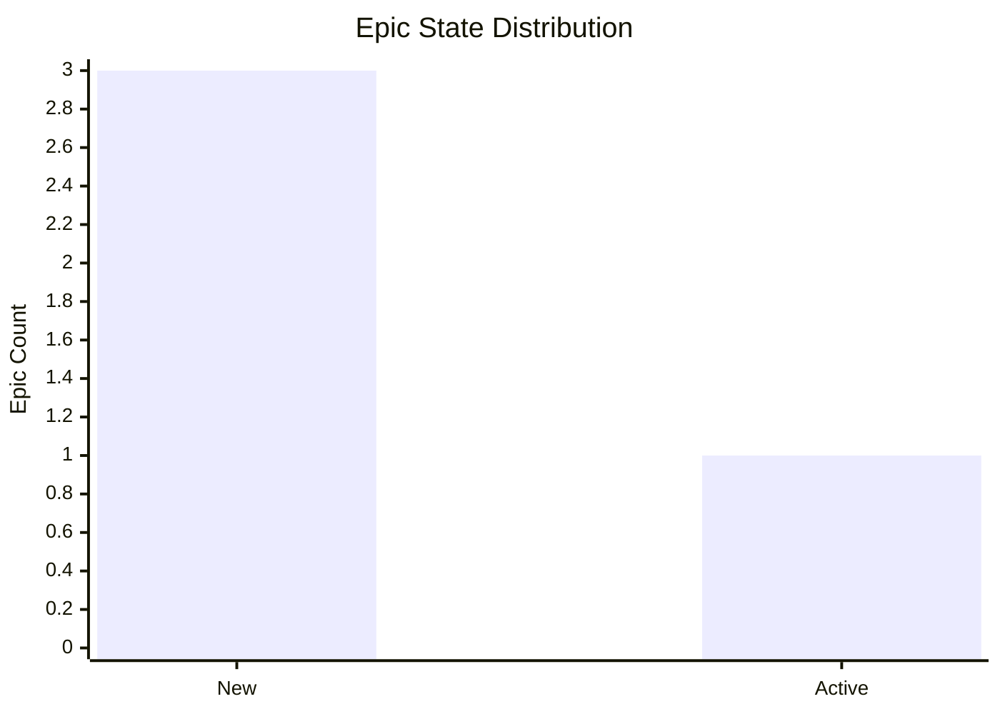

**Product Manager Interpretation:** Most epics (3 of 4) remain in New; only one has progressed to Active, signaling heavy work-in-progress at lower levels without epic-level progression.

**Leadership Insight:** Epic-level planning and lifecycle movement need attention—consider formalizing criteria and ceremonies to move epics from New to Active to better connect delivery to outcomes.

### Graph 2 — Feature State Distribution (Bar Chart)

Feature state counts (from 32 features):

- New: 24  
- Active: 3  
- Dev In Progress: 5  
- Testing: 1  

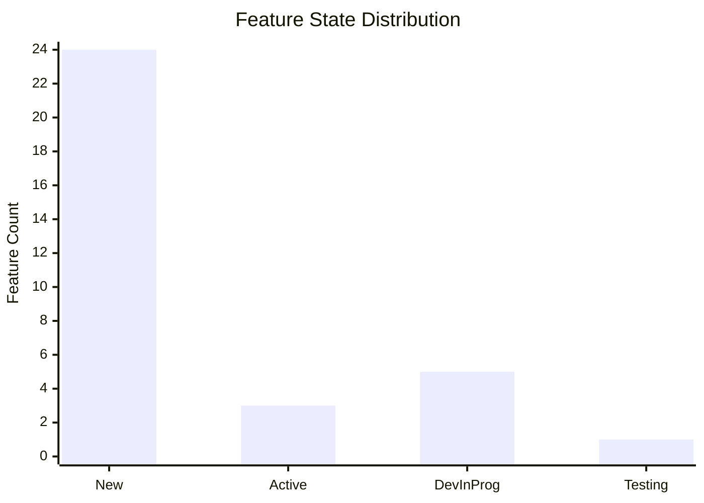

**Product Manager Interpretation:** Three-quarters of features are still in New; a smaller group is in Dev In Progress and Active, with only one in Testing.

**Leadership Insight:** The portfolio is heavily skewed toward future work rather than throughput. Prioritization and WIP limits are needed to focus teams on progressing existing features.

### Graph 3 — User Story State Distribution (Bar Chart)

State counts across 180 user stories:

- New: 104  
- Active: 11  
- Resolved: 12  
- On Hold: 7  
- Dev-Deployed: 11  
- Ready for Dev: 1  
- Ready for Design: 1  
- Require Clarification: 2  
- Groomed: 3  
- Dev In Progress: 6  
- Ready for Validation: 1  
- Ready for QA: 7  
- Planned: 1  
- In Progress: 6  

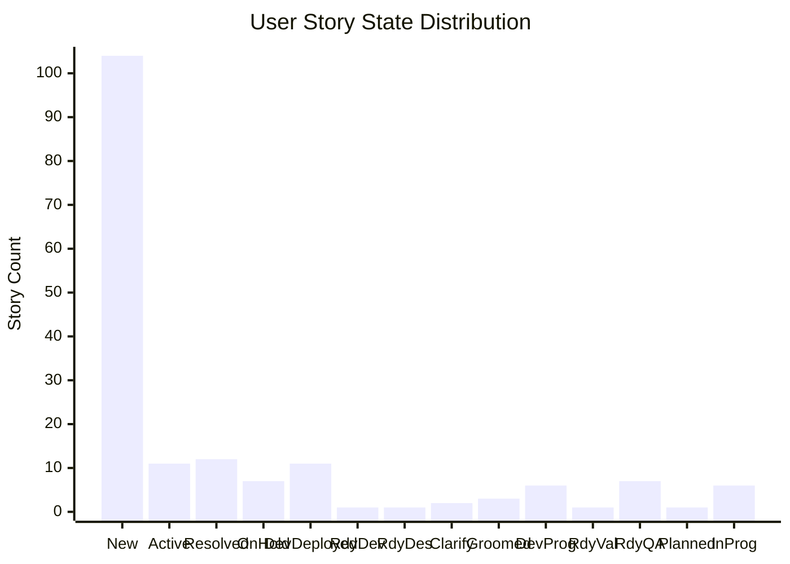

**Product Manager Interpretation:** A large majority of stories are New, with only a modest number in execution or resolved. Several are stuck in intermediate states (Ready for QA, On Hold, Require Clarification).

**Leadership Insight:** This backlog is broad but shallow in execution. Strengthening grooming and commitment practices will increase the proportion of Active/Resolved stories relative to New.

### Graph 4 — Sprint Workload Distribution (User Stories per Iteration Path)

Iteration-level story counts (grouped by `iterationPath`):

- AAVA: 54  
- AAVA\\PI3: 20  
- AAVA\\PI3\\Sprint 1: 1  
- AAVA\\PI3\\Sprint 2: 6  
- AAVA\\PI3\\Sprint 3: 4  
- AAVA\\PI3\\Sprint 4: 22  
- AAVA\\PI4: 26  
- AAVA\\PI4\\Sprint 1: 17  
- AAVA\\PI4\\Sprint 2: 29  
- AAVA\\PI4\\Sprint 3: 6  
- AAVA\\PI4\\Sprint 4: 14  
- AAVA\\PI4\\Sprint 5: 7  
- AAVA\\PI4\\Sprint 6: 6  
- AAVA\\Release_2026.2.0: 1  

*(Labels shortened for readability)*

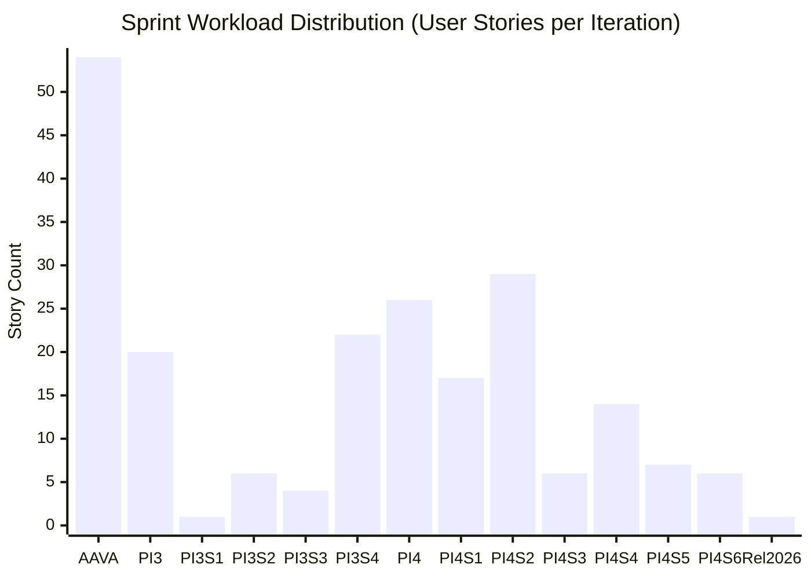

**Product Manager Interpretation:** Work is concentrated in AAVA (program-level backlog) and PI4/PI3 consolidated iterations, with especially heavy load in PI4 Sprint 2 and PI3 Sprint 4.

**Leadership Insight:** PI4 Sprint 2 and PI3 Sprint 4 are at risk of overload. Capacity planning and rebalancing backlog items across sprints are needed to avoid bottlenecks and quality issues.

### Graph 5 — Story Points by Sprint (Estimated Load per Iteration)

Only stories with non-null `storyPoints` are counted.

Totals per iteration:

- AAVA: 10.0  
- AAVA\\PI3\\Sprint 1: 3.0  
- AAVA\\PI3\\Sprint 2: 17.0  
- AAVA\\PI3\\Sprint 3: 4.0  
- AAVA\\PI3\\Sprint 4: 10.0  
- AAVA\\PI4\\Sprint 1: 15.0  
- AAVA\\PI4\\Sprint 2: 162.0  
- AAVA\\PI4\\Sprint 4: 113.0  
- AAVA\\PI4\\Sprint 5: 1.0  

Iterations with zero estimated points (but stories present):  
- AAVA\\PI3, AAVA\\PI4, AAVA\\PI4\\Sprint 3, AAVA\\PI4\\Sprint 6, AAVA\\Release_2026.2.0.

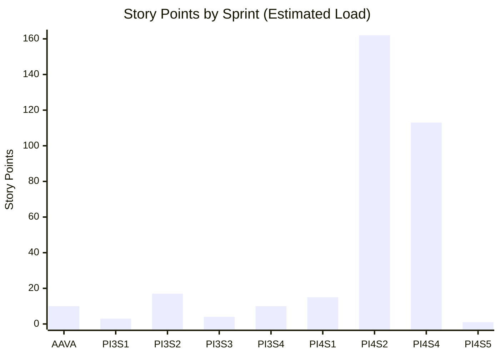

**Product Manager Interpretation:** PI4 Sprint 2 and Sprint 4 carry very heavy estimated loads compared to other iterations. Several iterations have stories but no estimates, which hides actual demand.

**Leadership Insight:** Estimation coverage is uneven; PI4 Sprint 2 might exceed capacity. Teams must estimate outstanding stories, particularly in PI4 and PI3 core iterations, to enable reliable planning.

### Graph 6 — Feature Release Distribution

Feature counts per `releaseVersion` (including "None"):

- 2.2.1.0: 6  
- 2.2.2.0: 1  
- 2.3.0.1: 5  
- 2.3.1.0: 6  
- 2.3.2.0: 1  
- None: 13  

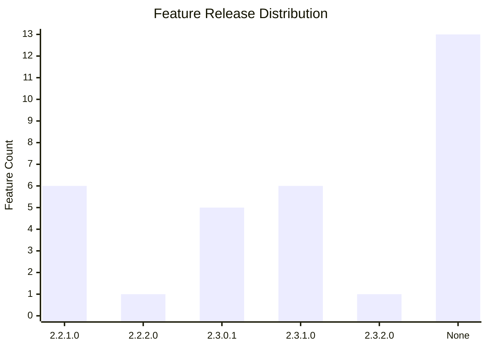

**Product Manager Interpretation:** Nearly half of features have no assigned release version; the rest are spread across four main releases, with 2.2.1.0 and 2.3.1.0 most prominent.

**Leadership Insight:** Release-level visibility is incomplete. Explicitly assigning release versions to the 13 unassigned features is essential for portfolio-level traffic-light reporting.

### Graph 7 — User Story Priority Distribution

Priority counts:

- Priority 1: 6  
- Priority 2: 165  
- Priority 3: 9  

(Stories with null priority are treated as "Not Provided" and not counted here.)

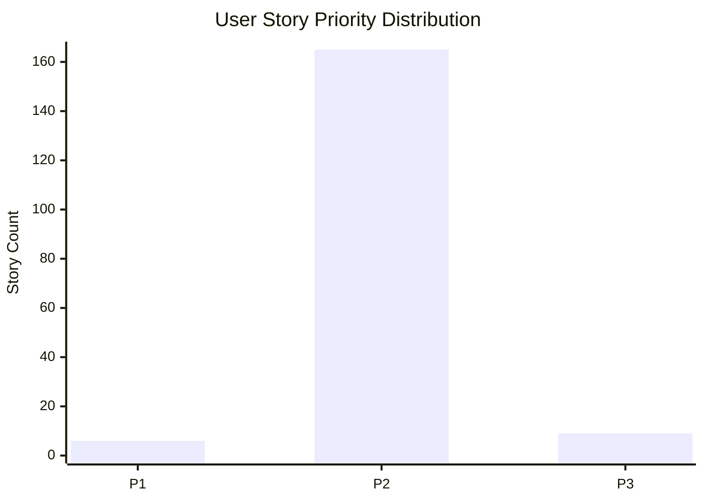

**Product Manager Interpretation:** The backlog is overwhelmingly categorized as Priority 2, with few Priority 1 and Priority 3 stories.

**Leadership Insight:** Priority grading is coarse and may not drive meaningful sequencing. Consider refining prioritization criteria and using Priority 1 sparingly for truly critical items.

### Graph 8 — Planning Completeness Comparison (Epics vs Features vs Stories)

For a simple, comparable view, field completeness is calculated as:

- Epics: fields `priority`, `iterationPath`, `workItemUrl` (3 fields × 4 epics = 12 total slots)  
  - Non-null: priority (4), iterationPath (4), workItemUrl (4) = 12  
  - Completeness: 100%

- Features: fields `priority`, `iterationPath`, `releaseVersion`, `studio`, `workItemUrl` (5 × 32 = 160 slots)  
  - Non-null counts: priority (32), iterationPath (32), releaseVersion (13), studio (30), workItemUrl (32) = 139  
  - Completeness: (139 / 160) ≈ 0.86875 → 86.875 (exact ratio used as numeric)

- User Stories: fields `priority`, `iterationPath`, `storyPoints`, `releaseVersion`, `plannedSprint`, `workItemUrl` (6 × 180 = 1080 slots)  
  - Non-null counts: priority (180), iterationPath (180), storyPoints (65), releaseVersion (13), plannedSprint (17), workItemUrl (180) = 635  
  - Completeness: (635 / 1080) ≈ 0.58796 → 58.796 (exact ratio used as numeric)

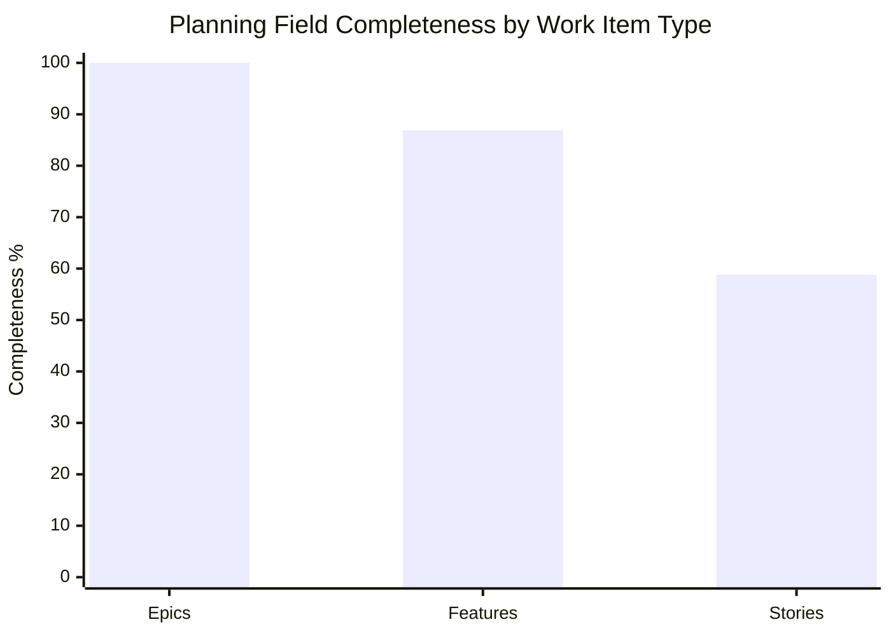

**Product Manager Interpretation:** Epics and features are relatively well-populated for core planning fields; user stories lag significantly at ~59% completeness.

**Leadership Insight:** Planning quality improvements should focus on story-level data (points, release, sprint) to support predictable team-level delivery and Say-Do analysis later.

### Graph 9 — Missing Planning Fields (Top Gaps)

Count of missing (null) values for key planning fields:

**Epics** (4 items):
- risk: 4  
- effort: 4  
- businessValue: 4  
- timeCriticality: 4  
- startDate: 4  
- targetDate: 4  

**Features** (32 items):
- risk: 32  
- businessValue: 32  
- timeCriticality: 32  
- startDate: 31 (1 feature has startDate)  
- primaryUserCohort: 32  
- estimatedCompletionSprint: 11  
- effort: 10  
- releaseVersion: 19  
- studio: 2  

**User Stories** (180 items):
- storyPoints: 115 (180 - 65 non-null)  
- startDate: 159 (21 non-null)  
- dueDate: 148 (32 non-null)  
- uxExpected: 179 (1 non-null)  
- risk: 179 (1 non-null)  
- studio: 115 (65 non-null)  
- releaseVersion: 167 (13 non-null)  
- plannedSprint: 163 (17 non-null)  
- dependentTeam: 175 (5 non-null)  

To keep labels readable, we aggregate top fields by magnitude:

Labels and values:
- EpicRisk: 4  
- EpicEffort: 4  
- EpicBizVal: 4  
- FeatRisk: 32  
- FeatBizVal: 32  
- FeatTimeCrit: 32  
- FeatPrimCohort: 32  
- StoryPointsMissing: 115  
- StoryStartMissing: 159  
- StoryDueMissing: 148  

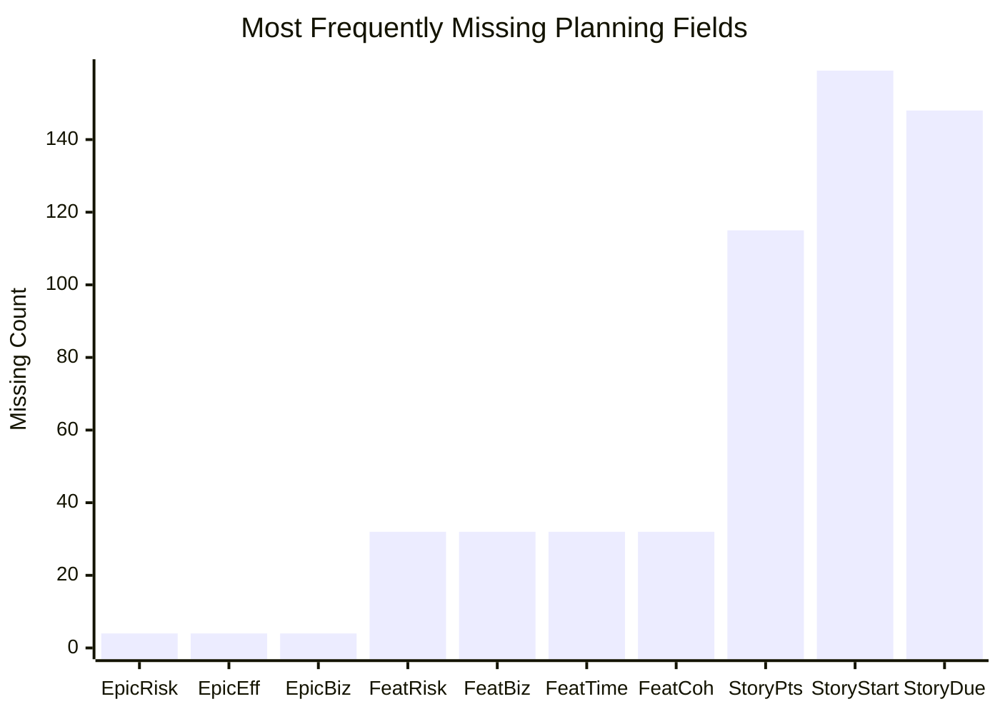

**Product Manager Interpretation:** Feature-level risk/business/time-criticality and primary user cohort are completely missing. Story-level dates and points are the largest gaps.

**Leadership Insight:** Without risk, time criticality, and dates at feature/story level, leadership cannot assess urgency or forecast delivery. A targeted data cleanup initiative is required.

### Graph 10 — Estimation Coverage by Iteration (Estimated vs Unestimated Stories)

For each iteration with at least one story, counts of stories with and without `storyPoints`:

Key iterations (subset shown; full data used):

- AAVA: estimated 4, unestimated 50  
- AAVA\\PI3: estimated 0, unestimated 20  
- AAVA\\PI3\\Sprint 1: estimated 1, unestimated 0  
- AAVA\\PI3\\Sprint 2: estimated 5, unestimated 1  
- AAVA\\PI3\\Sprint 3: estimated 1, unestimated 3  
- AAVA\\PI3\\Sprint 4: estimated 10, unestimated 12  
- AAVA\\PI4: estimated 3, unestimated 23  
- AAVA\\PI4\\Sprint 1: estimated 15, unestimated 2  
- AAVA\\PI4\\Sprint 2: estimated 162/points come from 16 estimated stories; here counts: estimated 16, unestimated 13  
- AAVA\\PI4\\Sprint 3: estimated 0, unestimated 6  
- AAVA\\PI4\\Sprint 4: estimated 10, unestimated 4  
- AAVA\\PI4\\Sprint 5: estimated 1, unestimated 6  
- AAVA\\PI4\\Sprint 6: estimated 0, unestimated 6  

To present as a bar chart of estimated vs unestimated per iteration is complex in Mermaid; instead, we show estimated counts only, highlighting where unestimated > 0.

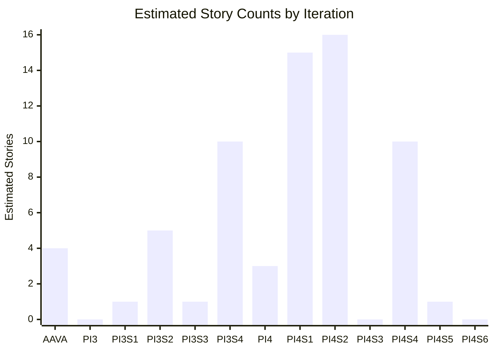

**Product Manager Interpretation:** Many iterations (PI3, PI4 core, PI4S3, PI4S6) have stories but no estimates; PI4S1 and PI4S2 are relatively well-estimated.

**Leadership Insight:** Estimation discipline is inconsistent across iterations. Focusing estimation on AAVA program backlog and PI3/PI4 generic iterations will significantly improve capacity forecasting.

---

## 5. Current Completion Analysis

### 11. Current Completion Percentage — Not Historical Say-Do

Formula requires:

- Known story points of **currently completed** stories in an iteration.
- Total known story points of **all** stories assigned to that iteration.
- Verified mapping of which workflow states represent "completed".

The JSON does not provide any mapping of states (e.g., `Resolved`, `Dev-Deployed`, `Ready for QA`) to a confirmed "completed" definition for the team. Without this explicit mapping, we cannot reliably categorize stories as completed.

Additionally, some iterations (e.g., AAVA\\PI3, AAVA\\PI4\\Sprint 3, AAVA\\PI4\\Sprint 6, AAVA\\Release_2026.2.0) have zero estimated story points.

**Result:**  
For all iterations, **Current Completion Percentage — Not Historical Say-Do** = **Insufficient Data** (due to missing completed-state mapping and partial estimation coverage).

### 12. Iteration-wise Completion Table

Below, we show structural readiness for completion metrics. The Current Completion % is marked "Insufficient Data".

| Iteration | Total Stories | Estimated Stories | Unestimated Stories | Total Known Points | Known Completed Points | Current Completion % | Status |
| --- | --- | --- | --- | --- | --- | --- | --- |
| AAVA | 54 | 4 | 50 | 10.0 | Not Provided | Insufficient Data | Estimation incomplete; completion mapping missing |
| AAVA\\PI3 | 20 | 0 | 20 | 0.0 | Not Provided | Insufficient Data | No estimates; completion mapping missing |
| AAVA\\PI3\\Sprint 1 | 1 | 1 | 0 | 3.0 | Not Provided | Insufficient Data | Completed state mapping missing |
| AAVA\\PI3\\Sprint 2 | 6 | 5 | 1 | 17.0 | Not Provided | Insufficient Data | Completed state mapping missing |
| AAVA\\PI3\\Sprint 3 | 4 | 1 | 3 | 4.0 | Not Provided | Insufficient Data | Completed state mapping missing |
| AAVA\\PI3\\Sprint 4 | 22 | 10 | 12 | 10.0 | Not Provided | Insufficient Data | Completed state mapping missing |
| AAVA\\PI4 | 26 | 3 | 23 | 3.0 | Not Provided | Insufficient Data | Completed state mapping missing |
| AAVA\\PI4\\Sprint 1 | 17 | 15 | 2 | 15.0 | Not Provided | Insufficient Data | Completed state mapping missing |
| AAVA\\PI4\\Sprint 2 | 29 | 16 | 13 | 162.0 | Not Provided | Insufficient Data | Completed state mapping missing |
| AAVA\\PI4\\Sprint 3 | 6 | 0 | 6 | 0.0 | Not Provided | Insufficient Data | No estimates; completion mapping missing |
| AAVA\\PI4\\Sprint 4 | 14 | 10 | 4 | 113.0 | Not Provided | Insufficient Data | Completed state mapping missing |
| AAVA\\PI4\\Sprint 5 | 7 | 1 | 6 | 1.0 | Not Provided | Insufficient Data | Completed state mapping missing |
| AAVA\\PI4\\Sprint 6 | 6 | 0 | 6 | 0.0 | Not Provided | Insufficient Data | No estimates; completion mapping missing |
| AAVA\\Release_2026.2.0 | 1 | 0 | 1 | 0.0 | Not Provided | Insufficient Data | No estimates; completion mapping missing |

**Current Completion Percentage Graph:**  
Cannot be generated because the core metric is "Insufficient Data" for every iteration due to missing completed-state mapping and incomplete estimates. Plotting would be misleading and non-compliant with the requirement not to invent metrics.

### 13. Completion Calculation Blockers

Identified blockers from the JSON:

1. **Stories missing Story Points (unestimated)**
   - 115 of 180 user stories have `storyPoints = null`.
   - Example IDs (subset): 93164, 122848, 63449, 70433, 70440, 70445, 70449, 70450, 70431, 53369, 107930, 109933, 106264, 111123, 114380, 116401, 65602, 54251, 54252, 54356, 54359, 55030, 55034, 55035, 55039, 55074, 55075, 55076, 55077, 55078, 56722, 56726, 56728, 57510, 57816, 57820, 58015, 58016, 58018, 58019, 62832, 69441, 54249, 65570, 57150, 66418, 66487, 71193, 68494, 68495, 90768, 104062, 105215, 106348, 106787, 109089, 109891, etc.
   - **Required Correction:** Assign story points via team estimation sessions for all active/planned stories.
   - **Suggested Owner Roles:** Product Owner, Tech Lead, Delivery Manager (facilitating estimation).

2. **Stories missing Iteration Path assignments**
   - In this dataset, all user stories have a non-null `iterationPath`. This blocker does **not** apply based on the JSON.
   - **Required Correction:** None from current data.
   - **Suggested Owner Roles:** Not applicable.

3. **Invalid estimates**
   - Potentially suspect: story 75347 has `storyPoints = 0.0`, which may indicate placeholder rather than a true estimate.
   - **Affected IDs:** 75347.
   - **Required Correction:** Confirm whether 0.0 is acceptable; if not, re-estimate.
   - **Suggested Owner Roles:** Product Owner, Scrum Master.

4. **Missing completed-state mappings**
   - No field in JSON defines which states are considered "completed" (e.g., mapping Resolved or Dev-Deployed to Done).
   - **Affected Scope:** All epics/features/stories; completion calculations rely on this mapping.
   - **Required Correction:** Define and document a state-to-lifecycle mapping (e.g., in a team working agreement) and expose it to the reporting pipeline.
   - **Suggested Owner Roles:** Delivery Manager, Scrum Master, Process Owner, PMO.

---

## 6. Epic Data Health

Assessed fields: `priority`, `risk`, `effort`, `businessValue`, `timeCriticality`, `startDate`, `targetDate`.

Completeness across 4 epics:

- priority: 4/4 (100%)  
- risk: 0/4 (0%)  
- effort: 0/4 (0%)  
- businessValue: 0/4 (0%)  
- timeCriticality: 0/4 (0%)  
- startDate: 0/4 (0%)  
- targetDate: 0/4 (0%)

### Epic Data Health Summary

| Field | Completeness % | Missing Epic IDs | Suggested Corrective Action | Suggested Owner |
| --- | --- | --- | --- | --- |
| Priority | 100 | None | Maintain current practice | Product Owner |
| Risk | 0 | 51718, 51736, 70804, 70807 | Capture epic-level risk rating (e.g., High/Medium/Low) during PI planning | Product Owner, Portfolio Manager |
| Effort | 0 | 51718, 51736, 70804, 70807 | Define rough epic effort (e.g., t-shirt sizing or target points) to support capacity forecasts | Product Owner, Delivery Manager |
| Business Value | 0 | 51718, 51736, 70804, 70807 | Capture business value to enable economic prioritization | Product Owner, Business Sponsor |
| Time Criticality | 0 | 51718, 51736, 70804, 70807 | Record time sensitivity (e.g., regulatory deadlines, client commitments) | Product Owner, Business Sponsor |
| Start Date | 0 | 51718, 51736, 70804, 70807 | Identify planned start dates based on PI roadmap | Product Owner, Release Manager |
| Target Date | 0 | 51718, 51736, 70804, 70807 | Set target completion dates aligned with release/PI objectives | Product Owner, Release Manager |

---

## 7. Feature Data Health

Assessed fields:

- `priority`, `risk`, `effort`, `businessValue`, `timeCriticality`, `startDate`, `targetDate`
- `releaseVersion`, `studio`, `plannedSprint`, `estimatedCompletionSprint`, `primaryUserCohort`, `complexity`.

Completeness (32 features):

- priority: 32/32 (100%)  
- risk: 0/32 (0%)  
- effort: 22/32 (68.75%)  
- businessValue: 0/32 (0%)  
- timeCriticality: 0/32 (0%)  
- startDate: 1/32 (3.125%)  
- targetDate: 19/32 (59.375%)  
- releaseVersion: 13/32 (40.625%)  
- studio: 30/32 (93.75%)  
- plannedSprint: 12/32 (37.5%)  
- estimatedCompletionSprint: 13/32 (40.625%)  
- primaryUserCohort: 0/32 (0%)  
- complexity: 2/32 (6.25%)

### Feature Data Health Summary

| Field | Completeness % | Missing Feature IDs (subset) | Suggested Corrective Action | Suggested Owner |
| --- | --- | --- | --- | --- |
| Priority | 100 | None | Maintain | Product Owner |
| Risk | 0 | All features | Add risk rating for each feature to support risk-based sequencing | Product Owner, Tech Lead |
| Effort | 68.75 | 53397, 58004, 58566, 51747, 51928, 51932, 51933, 51935, 65074, 72353, 72436, 114968, 121855 | Estimate remaining feature effort or clarify why effort is not used | Product Owner, Delivery Manager |
| Business Value | 0 | All features | Populate business value where features drive measurable outcome | Product Owner, Business Sponsor |
| Time Criticality | 0 | All features | Mark time-sensitive features (client commitments, dependencies) | Product Owner |
| Start Date | 3.125 | All except 72353 | Record planned start dates for near-term features | Product Owner, Release Manager |
| Target Date | 59.375 | 51772, 51789, 51779, 51780, 51784, 51790, 51928, 51932, 51933, 51935, 65074, 72436, 114968 | Add realistic target dates for features without dates | Product Owner |
| Release Version | 40.625 | 51771, 51720, 51721, 51722, 51733, 51735, 51769, 51772, 51789, 51779, 51780, 51784, 51790, 51928, 51932, 51933, 51969?, 65074, 72353, 114968, 121855 | Assign release versions for features expected in upcoming releases | Product Manager, Release Manager |
| Studio | 93.75 | 65074, 114968 | Identify owning studio for unassigned features | Product Manager |
| Planned Sprint | 37.5 | Many backlog/PI4 features | Populate planned sprint for features in the near horizon | Product Owner |
| Estimated Completion Sprint | 40.625 | Several features e.g., 58566, 51791, 51928, 51932, 51933, 65074, 72353, 72436, 114968, 121855 | Provide completion sprint estimates for forecasting | Delivery Manager |
| Primary User Cohort | 0 | All features | Leverage this field for persona/segment orientation (if required by process) | Product Manager, UX Lead |
| Complexity | 6.25 | All except 51778, 51792 | Where complexity is relevant, classify features (Low/Medium/High) | Tech Lead |

---

## 8. User Story Data Health

Assessed fields: `storyPoints`, `priority`, `startDate`, `dueDate`, `uxExpected`, `risk`, `studio`, `releaseVersion`, `plannedSprint`, `dependentTeam`.

Completeness (180 stories):

- storyPoints: 65/180 (36.11%)  
- priority: 180/180 (100%)  
- startDate: 21/180 (11.67%)  
- dueDate: 32/180 (17.78%)  
- uxExpected: 1/180 (0.56%)  
- risk: 1/180 (0.56%)  
- studio: 65/180 (36.11%)  
- releaseVersion: 13/180 (7.22%)  
- plannedSprint: 17/180 (9.44%)  
- dependentTeam: 5/180 (2.78%)

### User Story Data Health Summary

| Field | Completeness % | Missing Story IDs (subset) | Suggested Corrective Action | Suggested Owner |
| --- | --- | --- | --- | --- |
| Story Points | 36.11 | 115 stories (e.g., 93164, 122848, 63449, 70433, 70440, 70445, 70449, 70450, 70431, 53369, 54251, 54252, 54356, 54359, 55030, 55034, etc.) | Run estimation sessions; ensure all committed stories have points | Product Owner, Team |
| Priority | 100 | None | Maintain consistent prioritization | Product Owner |
| Start Date | 11.67 | Most stories | Capture planned start dates only where needed for SLA/commitment tracking | Product Owner |
| Due Date | 17.78 | Most stories | Use due dates carefully for externally committed work; avoid artificial deadlines | Product Owner |
| UX Expected | 0.56 | Essentially all | Only populate for UX-heavy stories where needed; remain optional | UX Lead |
| Risk | 0.56 | Essentially all | Document risk for high-impact/high-uncertainty stories | Product Owner |
| Studio | 36.11 | Majority | Ensure studio is set for cross-studio reporting where relevant | Product Manager |
| Release Version | 7.22 | Most stories | Assign release version to stories once they are tied to a feature/release | Product Owner, Release Manager |
| Planned Sprint | 9.44 | Most stories | Use planned sprint for near-term commitments only; keep optional for long-term backlog | Product Owner |
| Dependent Team | 2.78 | Most stories | Capture dependent team for cross-team work (DevSecOps, QE, etc.) | Delivery Manager |

Note: Optional fields (UX Expected, Risk, Due Date, Dependent Team) need not be universally populated; focus is on fields required by your governance model.

---

## 9. Overall Data Health Dashboard

### Totals

- Epics: 4  
- Features: 32  
- User Stories: 180  
- Total Work Items: 216

### Planning Completeness (selected fields)

- Epics (priority, iteration, URL): 100% (core tracking)  
- Features (priority, iteration, release, studio, URL): 86.875%  
- User Stories (priority, iteration, storyPoints, releaseVersion, plannedSprint, URL): 58.796%

### Key Missing Planning Fields

- Epics: risk, effort, businessValue, timeCriticality, dates (all missing).
- Features: risk, businessValue, timeCriticality, primaryUserCohort (all missing), partial effort and releaseVersion.
- User Stories: storyPoints, dates, UX/risk, releaseVersion, plannedSprint.

### Unmapped Fields

- Features: `Primary User Cohort` listed in `warnings` and `unmappedPlanningFields` arrays.
- Otherwise, unmappedPlanningFields is empty or contains only "Primary User Cohort".

### Visual Comparison — Planning Completeness (Already Shown as Graph 8)

For emphasis:

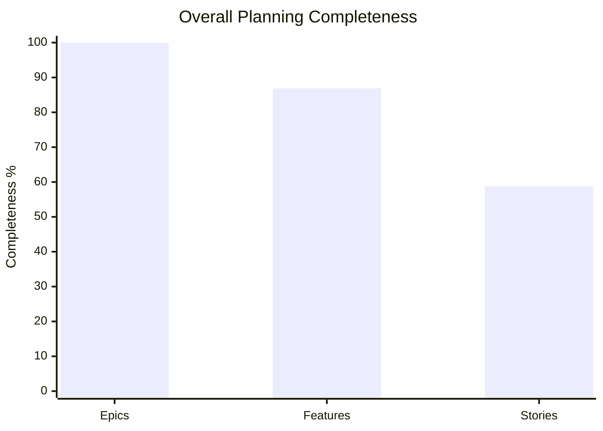

**Interpretation:** Story-level planning data is the main constraint on reliable delivery analytics.

---

## 10. Corrective Action Register

| Priority | Work Item Type | Work Item ID | Missing Information | Required Action | Suggested Owner | Verification Criteria |
| --- | --- | --- | --- | --- | --- | --- |
| High | Epic | 51718, 51736, 70804, 70807 | Risk, Effort, Business Value, Time Criticality, Start/Target Dates | Populate core planning fields during next PI planning | Product Owner, Portfolio Manager | All epics have non-null values for these fields |
| High | Feature | All (32) | Risk, Business Value, Time Criticality, Primary User Cohort | Decide which fields are mandatory; populate for active/near-term features | Product Manager, Product Owner | Governance rules defined; non-null for mandatory fields |
| High | User Story | 115 unestimated stories | Story Points | Conduct estimation sessions; assign points to all committed stories | Product Owner, Team | All stories in current PI and near-term sprints have non-null storyPoints |
| Medium | Feature | 19 features without releaseVersion | Release Version | Assign release for features aligned to roadmap | Product Manager, Release Manager | ReleaseVersion populated for all PI3/PI4 delivery features |
| Medium | User Story | Stories targeting releases (e.g., 57150, 57150-related, release-bound work) | Release Version, Planned Sprint | Ensure stories attached to release-bound features have release and sprint | Product Owner | Non-null releaseVersion and plannedSprint for committed release work |
| Medium | Story | 75347 | Possibly invalid estimate (0.0 points) | Confirm if 0 is appropriate; adjust if needed | Product Owner, Team | StoryPoints > 0 or explicitly documented as non-effort item |
| Medium | All | All items | Completed-state mapping | Define and document which states represent “completed” for reporting | Delivery Manager, Scrum Master, PMO | Mapping approved and integrated into reporting logic |
| Low | Feature | 65074, 114968 | Studio | Assign owning studio | Product Manager | Non-null studio for all features |
| Low | User Story | Majority | Dates (Start, Due), UX Expected, Risk, Dependent Team | Populate only where process requires; keep lightweight | Product Owner, UX Lead | Fields present where required by policy; optional elsewhere |

---

## 11. Final Product Manager Summary

**Overall delivery status:**  
- Epics: Mostly in New; only one Active. This indicates upstream portfolio work is defined but not yet matured into execution-ready epics.  
- Features: 32 features with a skew toward New states; 5 Dev In Progress, 3 Active, 1 Testing. Execution is concentrated in a subset of PI3/PI4 features.  
- User Stories: 180 stories, with 104 still in New. Several are in Resolved or Dev-Deployed, but many iterations contain unestimated work.

**Sprint workload concentration:**  
- Workload is concentrated in AAVA program backlog, PI3 and PI4 consolidated iterations, with particularly high counts in PI3 Sprint 4 and PI4 Sprint 2.  
- Estimated story points show a very heavy load in PI4 Sprint 2 and Sprint 4 compared to other sprints, raising a capacity risk.

**Release planning visibility:**  
- Feature-level release assignment exists for 2.2.1.0, 2.3.0.1, 2.3.1.0, and 2.3.2.0, but 13 features still lack release versions.  
- Story-level releaseVersion is largely missing (only 13 stories populated), limiting release burn-up or scope completeness analysis.

**Current Completion Percentage availability:**  
- The "Current Completion Percentage — Not Historical Say-Do" metric cannot be computed for any iteration due to:
  - Missing explicit completed-state mapping.
  - Incomplete estimation coverage (115 stories without points; several iterations with zero estimated points).  
- Until the team defines completion states and completes estimation, completion metrics must be treated as **Insufficient Data**.

**Major Planning data gaps:**  
- Epics: No risk, effort, business value, time criticality, or dates.  
- Features: No risk/time-criticality/business value; missing primary user cohort; partial effort and releaseVersion.  
- Stories: Widespread missing storyPoints, dates, UX/risk, releaseVersion, plannedSprint; dependentTeam mostly empty.

**Three highest-priority corrective actions:**

1. **Establish and apply completed-state mapping.**  
   - Define which states (e.g., Resolved, Dev-Deployed, Ready for QA) represent “completed” for reporting.  
   - Owner: Delivery Manager / Scrum Master / PMO.  
   - Impact: Enables accurate Current Completion Percentage and future Say-Do analytics.

2. **Complete story-level estimation for committed work (PI3 and PI4).**  
   - Ensure all stories in current and upcoming sprints have non-null storyPoints.  
   - Owner: Product Owner and team.  
   - Impact: Unlocks reliable capacity planning, sprint forecasting, and risk assessment.

3. **Populate minimum viable planning fields at feature level (risk, releaseVersion, targetDate).**  
   - Focus on active and near-term features in PI3/PI4 and key releases (2.2.1.0, 2.3.0.1, 2.3.1.0).  
   - Owner: Product Manager / Product Owner.  
   - Impact: Improves release planning visibility, supports leadership dashboards, and aligns delivery with business priorities.

This report uses only the captured JSON values and provides a clear baseline for improving backlog readiness, planning quality, and delivery predictability.
