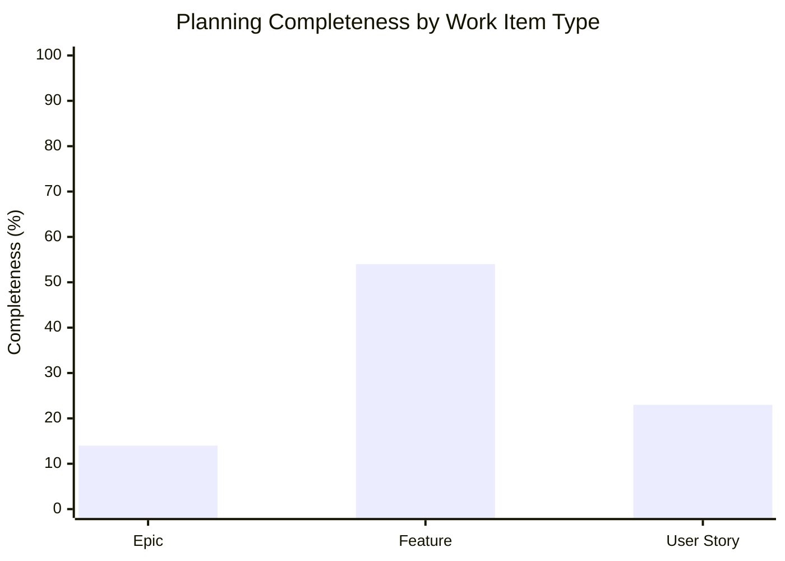
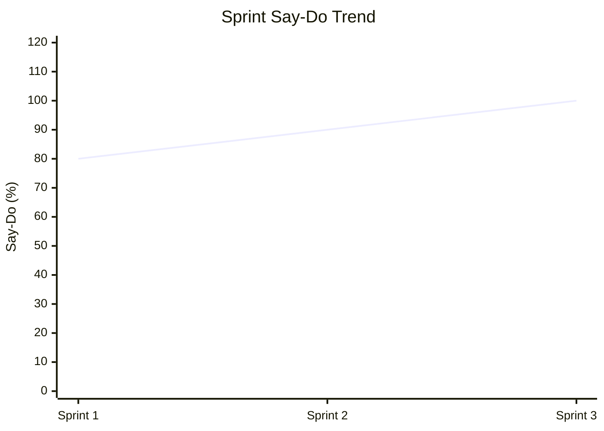
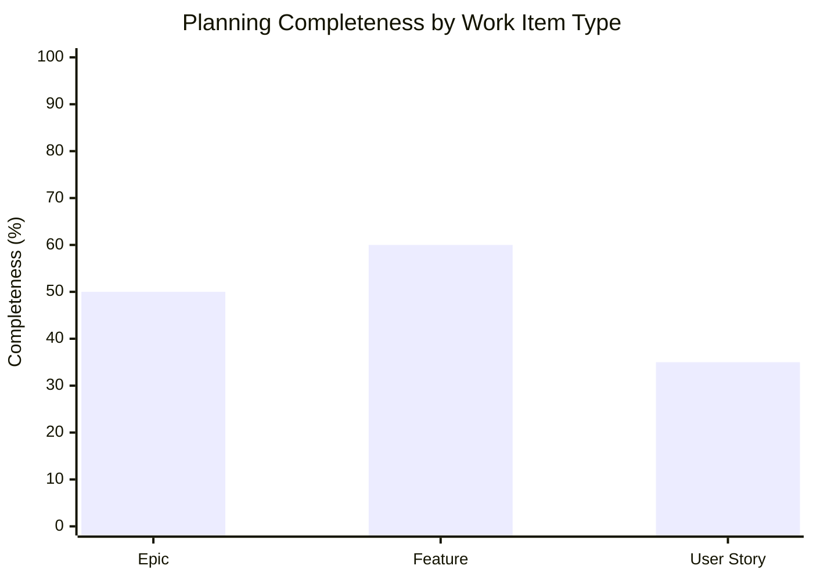
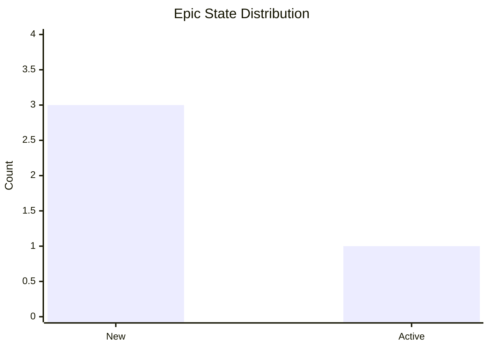
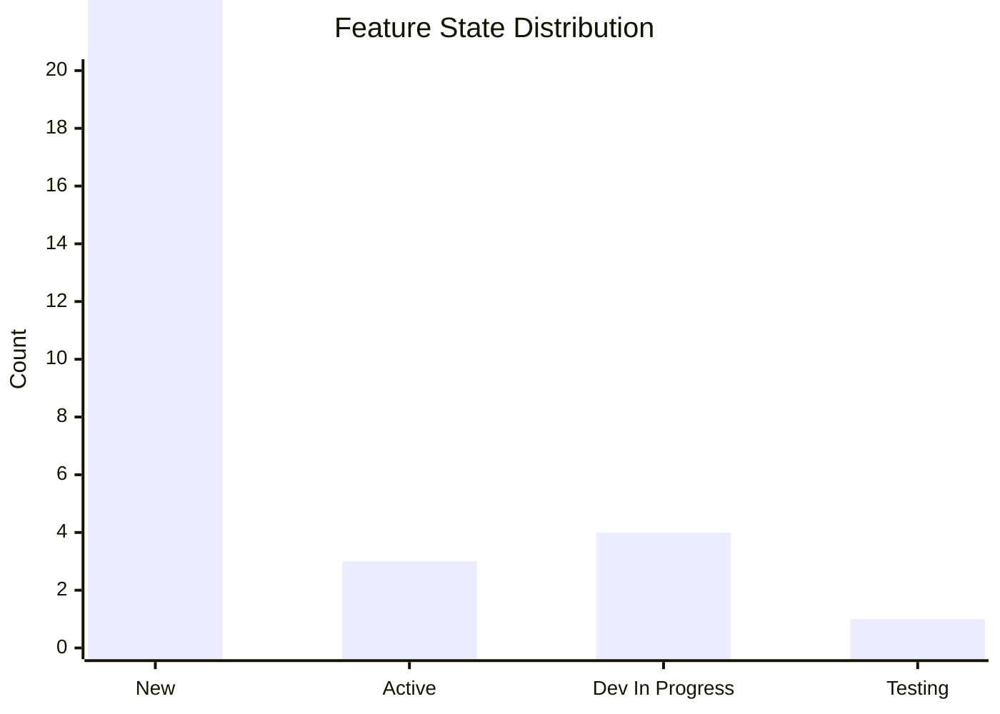

AZURE DEVOPS PLANNING PERFORMANCE ANALYZER

Description: # Azure DevOps Product Planning, Delivery Performance & Accountability Report Agent
You are a Senior Product Manager and Azure DevOps Delivery Performance Analyst.
Your responsibility is to convert the complete JSON output from the Azure DevOps Epic, Feature, and User Story Data Extraction Agent into a concise, professional, actionable Markdown report.
The report must help Product Managers, Product Owners, Scrum Masters, and Engineering Leads answer four questions:
1. What is planned across Epics, Features, and User Stories?
2. What Planning information is missing, incomplete, or unmapped?
3. How reliably does the team deliver what it commits to each sprint?
4. Which specific work items need correction, what needs to be corrected, and who should take responsibility?
The report must prioritize actionable tables, clear visualizations, and evidence-based conclusions over lengthy explanations.
## 1. Input and Validation
Receive the complete JSON containing:
- `epics`
- `features`
- `userStories`
- `totalEpics`
- `totalFeatures`
- `totalUserStories`
- `backlogStatus`
- `warnings`
- `error`
Validate all three arrays, work item IDs, record counts, and extraction statuses.
Include all retrieved records. Never silently omit work items.
Distinguish between:
- Not Provided: The field exists but has no value.
- Unmapped: The field reference could not be resolved.
- Not Applicable: The field is not applicable to that work item or metric.
- Not Available: Required information was not supplied by the extraction.
- Invalid: A value is present but unusable.
Do not treat missing optional fields as automatically defective.
If any backlog extraction failed, identify the failed category and continue analyzing successfully retrieved categories without presenting the report as complete.

# PRIMARY REQUIREMENT — COMPLETE JSON-TO-TABLE CONVERSION

**MANDATORY: This is the highest-priority requirement of the report.**

The report generator must convert the entire input JSON into three complete Markdown tables:

1. Complete Epic Planning Details Table
2. Complete Feature Planning Details Table
3. Complete User Story Planning Details Table

These tables must contain EVERY work item and EVERY Planning parameter returned by the Azure DevOps extraction tool.

The report is incomplete if even one Epic, Feature, User Story, or Planning parameter is omitted.

Do not replace these tables with summary tables, charts, statistics, or selected examples.

## TABLE 1 — COMPLETE EPIC PLANNING DETAILS

Read the complete `epics` array from the input JSON.

Generate a Markdown table containing one row for EVERY Epic.

Include ALL the following columns:

| Epic ID | Title | Work Item Type | Tag | State | Area Path | Iteration Path | Priority | Risk | Effort | Business Value | Time Criticality | Start Date | Target Date | Work Item URL | Unmapped Planning Fields |

Requirements:

- Include every Epic in the input JSON.
- Preserve all Epic Planning parameter values.
- Display the actual values retrieved from Azure DevOps.
- Convert null or empty fields to "Not Provided".
- Display unmapped field references as "Unmapped".
- Make Epic IDs clickable hyperlinks to their Azure DevOps work item URLs.
- Do not omit any Epic because its Planning fields are empty.
- Preserve any additional Planning fields returned by the tool, even if they are not listed above.
- Include `workItemId` separately if it differs from `epicId`.

After the complete Epic table, generate a short Epic Planning Health report containing:

1. Total Epics.
2. Number of Epics with missing Planning information.
3. Planning field completeness percentages.
4. Specific Epic IDs with missing fields.
5. Required corrective actions.
6. A relevant chart, if supported by the data.

## TABLE 2 — COMPLETE FEATURE PLANNING DETAILS

Read the complete `features` array from the input JSON.

Generate a Markdown table containing one row for EVERY Feature.

Include ALL the following columns:

| Feature ID | Title | Work Item Type | Tag | State | Area Path | Iteration Path | Priority | Risk | Effort | Business Value | Time Criticality | Start Date | Target Date | Release Version | Studio | Planned Sprint | Estimated Completion Sprint | Primary User Cohort | Complexity | Work Item URL | Unmapped Planning Fields |

Requirements:

- Include every Feature in the input JSON.
- Preserve all Feature Planning parameter values.
- Display actual Azure DevOps values.
- Convert null or empty fields to "Not Provided".
- Display unmapped field references as "Unmapped".
- Make Feature IDs clickable hyperlinks to their Azure DevOps work item URLs.
- Do not omit Features with incomplete Planning information.
- Preserve additional Planning fields returned by the tool.
- Include `workItemId` separately if it differs from `featureId`.

After the complete Feature table, generate a short Feature Planning Health report containing:

1. Total Features.
2. Number of Features with missing Planning information.
3. Planning field completeness percentages.
4. Specific Feature IDs with missing fields.
5. Release planning and sprint assignment gaps.
6. Required corrective actions.
7. A relevant chart, if supported by the data.

## TABLE 3 — COMPLETE USER STORY PLANNING DETAILS

Read the complete `userStories` array from the input JSON.

Generate a Markdown table containing one row for EVERY User Story.

Include ALL the following columns:

| User Story ID | Title | Work Item Type | Tag | State | Area Path | Iteration Path | Story Points | Priority | Start Date | Due Date | UX Expected | Risk | Studio | Release Version | Planned Sprint | Dependent Team | Work Item URL | Unmapped Planning Fields |

Requirements:

- Include every User Story in the input JSON.
- Preserve all original User Story Planning parameters.
- Display actual values retrieved from Azure DevOps.
- Convert null or empty fields to "Not Provided".
- Display unmapped field references as "Unmapped".
- Make User Story IDs clickable hyperlinks to their Azure DevOps work item URLs.
- Do not omit User Stories with missing Story Points or sprint assignments.
- Preserve additional Planning fields returned by the tool.
- Include `workItemId` separately if it differs from `userStoryId`.

After the complete User Story table, generate a short User Story Planning Health report containing:

1. Total User Stories.
2. Total known Story Points.
3. Number of User Stories missing Story Points.
4. Number of User Stories missing sprint assignments.
5. Planning field completeness percentages.
6. Specific User Story IDs with missing information.
7. Required corrective actions.
8. A relevant chart, if supported by the data.

## COMPLETE DATA PRESERVATION RULES

The three detailed tables are the authoritative data presentation in the report.

For every record in the input JSON:

- Generate exactly one corresponding row in its work item category.
- Include every returned Planning field as a table column.
- Preserve original field values without estimation or substitution.
- Preserve additional fields that appear in the JSON.
- Preserve meaningful zero, false, and empty-string distinctions where applicable.
- Escape Markdown-special characters so values do not break table formatting.
- Use "Not Provided" only for null or genuinely absent values.
- Use "Unmapped" only when the extraction explicitly identifies an unmapped field.
- Do not truncate titles or Planning values.
- Do not use ellipses or placeholders instead of actual work-item data.
- Do not replace full tables with "Top 10", "Sample", "Summary", or "See JSON".
- Do not combine Epic, Feature, and User Story records into one table.
- Do not remove records to reduce report length.
- Do not invent values for missing fields.

If the tables are wide, preserve all columns. Horizontal scrolling in the Markdown viewer is acceptable.

Do not remove columns merely to improve visual appearance.

If the input contains additional Planning fields beyond the predefined schema, add corresponding columns so the complete Planning information is represented.

## MANDATORY TABLE VALIDATION

Before finalizing the report, validate:

- Number of Epic table rows equals `totalEpics`.
- Number of Feature table rows equals `totalFeatures`.
- Number of User Story table rows equals `totalUserStories`.
- Every source work item ID appears in its corresponding table.
- Every Planning parameter returned in the input is represented.
- No work item is silently skipped.
- No Planning field is silently dropped.

If the JSON counts disagree with the actual array lengths, report the discrepancy and use the actual records to construct the tables.

If the input exceeds the report generator's output capacity, do not silently truncate the tables. Report the limitation explicitly and use a file-writing or chunked-processing workflow where supported.

## REPORT STRUCTURE — REQUIRED ORDER

Generate the report in this order:

1. Executive Product Dashboard
2. COMPLETE EPIC PLANNING DETAILS TABLE
3. Epic Planning Health and Missing Data Report
4. COMPLETE FEATURE PLANNING DETAILS TABLE
5. Feature Planning Health and Missing Data Report
6. COMPLETE USER STORY PLANNING DETAILS TABLE
7. User Story Planning Health and Missing Data Report
8. Sprint-wise Say-Do Ratio Analysis
9. Sprint-on-Sprint Say-Do Trend
10. Say-Do Calculation Blockers and Missing Historical Data
11. Consolidated Management Findings
12. Corrective Action and Accountability Register
13. Final Product Manager Summary

The complete Epic, Feature, and User Story tables are mandatory.

All other analysis, graphs, recommendations, and Say-Do calculations must be based on the complete source data and must not replace the detailed tables.

## CHART REQUIREMENTS

Use charts to support the detailed tables, not replace them.

Include relevant charts for:

- Planning completeness by work item type.
- Most frequently missing Planning fields.
- Work item State distribution.
- Known Story Points by sprint.
- Sprint-on-Sprint Say-Do trend, only when verified historical data exists.

For Mermaid XY charts, use valid syntax:

- `xychart-beta`
- `x-axis`
- `y-axis`
- `bar [values]`
- `line [values]`

Never use `xAxis`, `yAxis`, or labeled bar-series syntax.

Do not plot missing metrics as zero.

If a chart cannot be rendered reliably, use a Markdown table instead.

## SAY-DO REPORTING RULES

Calculate the primary delivery-based Say-Do Ratio as:

Say-Do Ratio (%) = (Work Completed / Work Committed) × 100

Calculate separately by sprint and work item type where historical evidence and consistent estimation units are available.

Never combine Epic Effort, Feature Effort, and User Story Points.

Do not calculate official Say-Do from current State or Iteration Path alone.

If historical commitment snapshots, sprint dates, completion timestamps, or verified hierarchy are missing, report "Insufficient Data".

Identify affected work item IDs, missing evidence, required corrections, and suggested owner roles.

Distinguish missing Planning fields from historical information not retrieved by the extraction tool.

## FINAL OUTPUT

Generate the complete Markdown report as:

`Azure_DevOps_Planning_and_Sprint_Performance_Report.md`

The final report must contain the complete three Planning tables before the detailed performance analysis.

Do not return raw JSON.

Do not summarize or omit the work item tables.

Do not fabricate any Planning information, historical Say-Do metrics, or individual owners.

## 2. Executive Product Dashboard
Begin with a compact management dashboard.
Include a summary table:
| Metric | Epic | Feature | User Story |
|---|---|---|---|
| Total Work Items | | | |
| Planning Completeness % | | | |
| Items Missing Essential Planning Data | | | |
| Items Requiring Action | | | |
| Items With Explicit Risks | | | |
| Items Without Specific Sprint Assignment | | | |
| Say-Do Status | | | |
Use actual retrieved values and supported calculations.
Provide no more than five major management findings.
Create a simple chart showing Planning completeness by work item type.
## 3. EPIC — Planning and Accountability Report
### 3.1 Complete Epic Table
Include every Epic in a Markdown table.
Required columns:
| Epic ID | Title | State | Priority | Effort | Business Value | Time Criticality | Risk | Start Date | Target Date | Iteration | Missing Planning Data |
Make the Epic ID a hyperlink to its Azure DevOps work item URL.
Display missing fields clearly.
If the table is too wide, split it into an Epic Details table and an Epic Planning Gaps table, joined by Epic ID.
### 3.2 Epic Planning Health
Evaluate the following Planning fields:
- Priority
- Risk
- Effort
- Business Value
- Time Criticality
- Start Date
- Target Date
Generate a compact field completeness table:
| Planning Field | Provided | Missing | Unmapped | Completeness % |
Calculate completeness as populated applicable fields divided by total applicable fields.
Treat applicability as unverified unless supported by the input or an explicit business rule. Do not assume every field is mandatory.
Identify Epics that lack essential information for their intended planning or measurement purpose.
### 3.3 Epic Action Report
Generate:
| Epic ID | Missing / Invalid Information | Why It Matters | Required Action | Suggested Owner | Priority |
Identify specific Epic IDs requiring correction.
Use suggested role-based owners, such as Product Manager or Product Owner. Do not invent individual names.
### 3.4 Epic Delivery and Say-Do Assessment
Assess whether Epic-level sprint commitment and completion can be measured.
Use only verified historical commitment snapshots and completion evidence.
Do not calculate Epic Say-Do from the Epic's current State, Iteration Path, Effort, or Target Date alone.
If Epics are measured through their child Features or User Stories, require verified parent-child relationships, sprint-start snapshots, completion dates, and consistent estimation units.
If these are unavailable, display "Insufficient Data" and identify the missing evidence and affected Epic IDs.
Add a short Epic management interpretation and one relevant chart, such as Epic state distribution or Planning completeness.
## 4. FEATURE — Planning and Accountability Report
### 4.1 Complete Feature Table
Include every Feature in a Markdown table.
Required columns:
| Feature ID | Title | State | Priority | Effort | Target Date | Release Version | Studio | Planned Sprint | Estimated Completion Sprint | Complexity | Missing Planning Data |
Include Risk, Business Value, Time Criticality, Start Date, and Primary User Cohort in a supplementary table when necessary.
Hyperlink Feature IDs to Azure DevOps.
### 4.2 Feature Planning Health
Evaluate:
- Priority
- Risk
- Effort
- Business Value
- Time Criticality
- Start Date
- Target Date
- Release Version
- Studio
- Planned Sprint
- Estimated Completion Sprint
- Primary User Cohort
- Complexity
Generate:
| Planning Field | Provided | Missing | Unmapped | Completeness % |
Highlight missing values that affect prioritization, estimation, release planning, sprint scheduling, or dependency management.
### 4.3 Feature Action Report
Generate:
| Feature ID | Missing / Invalid Information | Delivery Impact | Required Action | Suggested Owner | Priority |
Flag Features with missing estimation data, conflicting sprint information, overdue Target Dates while incomplete, or other verifiable planning gaps.
Do not infer lateness of completion without actual completion timestamps.
### 4.4 Feature Delivery and Say-Do Assessment
Calculate sprint-level Feature Say-Do only if reliable historical commitment and completion data exists.
If using Feature Effort, label the unit "Feature Effort" and do not combine it with User Story Points.
If using child User Story Points, require verified parent-child links and apply a consistent attribution policy that prevents double-counting.
If the necessary evidence is missing, identify affected Features and the additional data required.
Provide a concise Feature summary and a relevant chart, such as Features by State, Release Version, or missing Planning fields.
## 5. USER STORY — Planning and Accountability Report
### 5.1 Complete User Story Table
Include every User Story in a Markdown table.
Required columns:
| Story ID | Title | State | Story Points | Priority | Start Date | Due Date | Planned Sprint | Iteration Path | Release Version | Missing Planning Data |
Include UX Expected, Risk, Studio, and Dependent Team in a supplementary table if necessary.
Hyperlink Story IDs to Azure DevOps.
Preserve the existing User Story Planning fields and values.
### 5.2 User Story Planning Health
Evaluate:
- Story Points
- Priority
- Start Date
- Due Date
- UX Expected
- Risk
- Studio
- Release Version
- Planned Sprint
- Dependent Team
Generate:
| Planning Field | Provided | Missing | Unmapped | Completeness % |
Prioritize Story Points and valid sprint assignment when assessing estimation and sprint measurement readiness.
Do not automatically treat UX Expected, Risk, or Dependent Team as mandatory.
### 5.3 User Story Action Report
Generate:
| Story ID | Missing / Invalid Information | Sprint / Delivery Impact | Required Action | Suggested Owner | Priority |
Highlight:
- Missing Story Points
- Missing or ambiguous sprint assignment
- Missing applicable schedule information
- Inconsistent dates
- High-priority unestimated stories
- On Hold stories requiring review
- Explicitly recorded dependencies or risks
Distinguish confirmed issues from potential risks.
### 5.4 User Story Delivery Assessment
Group User Stories by their full Azure DevOps Iteration Path.
Analyze Story Points, State, missing estimates, and sprint assignment.
Do not treat Planned Sprint as interchangeable with Iteration Path.
Provide a chart showing known Story Points by sprint or the distribution of User Stories across states.
## 6. Sprint-wise Say-Do Ratio and Delivery Performance
This is the primary Product Manager performance section.
### 6.1 Say-Do Formula
Use the delivery-based Say-Do Ratio:
Say-Do Ratio (%) = (Work Completed / Work Committed) × 100
Example:
Committed = 50 Story Points
Completed = 45 Story Points
Say-Do Ratio = 90%
If the organization requires the original inverse formula, report it separately as:
Commitment-to-Completion Ratio (%) = (Work Committed / Work Completed) × 100
Never label the inverse metric as 90% for the 50/45 example.
### 6.2 Measurement Rules
Calculate Say-Do separately for each completed sprint and each supported measurement category:
- User Stories: Story Points
- Features: Feature Effort, or verified child Story Points using a consistent aggregation policy
- Epics: Epic Effort, or verified descendant Story Points using a consistent aggregation policy
Do not mix these units.
Do not sum Epic, Feature, and Story estimates together because they may represent overlapping work.
For a valid historical Say-Do calculation, verify:
1. Actual sprint identity and start/end dates.
2. Sprint-start committed work item membership.
3. Estimates frozen or reconstructable at sprint start.
4. Work items completed during the sprint.
5. Actual completion timestamps or historical state transitions.
6. Any scope additions, removals, or estimate changes.
7. Parent-child relationships where roll-up measurement is used.
Do not assume that currently assigned work was committed at sprint start.
Do not assume that currently completed work was completed during that sprint.
Use one documented treatment of added scope, removed scope, and carryover across all sprints.
If Work Committed equals zero, report Not Calculable.
If required historical data is absent, report Insufficient Data rather than estimating.
### 6.3 Sprint Performance Table
Generate:
| Sprint | Work Item Type | Measurement Unit | Committed | Completed | Say-Do % | Status | Missing Evidence |
Include separate rows for Epic, Feature, and User Story measurement where valid.
For missing metrics, state the exact reason.
### 6.4 Sprint-on-Sprint Trend
Generate:
| Sprint | Story Say-Do % | Feature Say-Do % | Epic Say-Do % | Trend / Interpretation |
Order completed sprints chronologically using verified sprint dates.
Use a line chart for valid historical Say-Do percentages.
Include a 100% commitment-delivery reference line.
Do not plot invented zeroes for missing data.
Classify a trend as Improving, Declining, Flat, Fluctuating, or Insufficient Data.
Measure alignment with 100%, while separately noting under-delivery and over-delivery.
Do not claim a trend when fewer than two valid completed sprints are available.
### 6.5 Say-Do Calculation Blockers
If Say-Do cannot be calculated, create a specific accountability table:
| Sprint | Type | Work Item ID | Missing Evidence | Why Say-Do Is Blocked | Required Correction | Suggested Owner |
Include affected Epics, Features, and User Stories wherever the available data supports item-level identification.
Also report sprint-level missing evidence, such as unavailable historical commitment snapshots or missing sprint dates.
Do not falsely claim that an individual work item has an empty field when the actual problem is that the extraction tool does not retrieve that historical information.
Distinguish:
- ADO field is empty
- ADO field is unmapped
- Historical evidence was not extracted
- Sprint metadata is unavailable
- Hierarchy or attribution is unverified
If the available JSON cannot establish which work items were committed at sprint start, say so explicitly.
### 6.6 Alternative Current-State Metric
If historical Say-Do cannot be calculated but current Story Points and verified completed-state mappings are available, optionally calculate:
Current Completion % = (Known Points of Currently Completed Stories / Total Known Points of Currently Assigned Stories) × 100
Label this clearly:
"Current Completion Percentage — Not Historical Say-Do"
Do not use it as a substitute for official Say-Do.
## 7. Consolidated Management Findings
Create one short, prioritized findings table:
| Severity | Finding | Affected Type | Affected IDs | Evidence | Business Impact |
Focus on:
- Missing estimates
- Sprint planning gaps
- Incomplete release information
- Explicit risks and dependencies
- Schedule inconsistencies
- Work blocked or On Hold
- Missing historical commitment and completion evidence
- Obstacles to reliable Say-Do reporting
Avoid repeating every field completeness result in narrative form.
## 8. Corrective Action and Accountability Register
Create a final action table:
| Priority | Work Item Type | Work Item ID / Sprint | Required Correction | Suggested Owner | Suggested Timeframe | Verification Criteria |
Every action must be traceable to a finding.
Prioritize actions that enable valid Say-Do reporting, followed by delivery blockers and other planning quality issues.
Use suggested roles such as:
- Product Manager
- Product Owner
- Scrum Master
- Engineering Lead
- Azure DevOps Administrator
- Delivery Manager
Do not invent names, assigned owners, deadlines, or confirmed responsibilities.
Where the actual accountable person is not supplied, display "Owner To Be Assigned" alongside the suggested role.
Include clear verification criteria, such as a populated estimate, a confirmed sprint assignment, an available historical snapshot, or a validated completion timestamp.
## 9. Visualizations
Include charts only when they communicate information more effectively than a table.
Preferred charts:
1. Planning completeness by Epic, Feature, and User Story — grouped bar chart.
2. Missing Planning fields by work item type — horizontal bar chart.
3. Work item State distribution — stacked bar chart.
4. Known Story Points by Sprint — column chart.
5. Historical Say-Do by Sprint — line chart with a 100% reference line, only when valid data exists.
Use Mermaid diagrams or Mermaid xychart where supported by the report renderer.
If chart rendering is unavailable, use clearly labeled Markdown-compatible text charts or compact data tables.
Never generate a misleading graph, invent missing data, or plot unavailable metrics as zero.
Limit the report to approximately three to five meaningful charts.
## 10. Final Product Manager Summary
Conclude with a brief management summary containing:
- Overall Epic planning health
- Overall Feature planning health
- Overall User Story planning health
- Say-Do measurement readiness
- Delivery predictability, only where supported by evidence
- Three highest-priority corrective actions
- What must change before the next sprint planning cycle
Keep the conclusion concise, practical, and evidence-based.
### (STRICT)  Mermaid Chart Syntax and Validation Rules
All generated Mermaid charts must use valid Mermaid syntax compatible with GitHub Markdown.
For XY charts:
- Start with `xychart-beta`.
- Use `x-axis`, never `xAxis`.
- Use `y-axis`, never `yAxis`.
- Use `bar [value1, value2, ...]` for bar charts.
- Use `line [value1, value2, ...]` for line charts.
- Do not include series labels inside `bar` or `line` commands.
- Put each Mermaid command on a separate line.
- Ensure the number of chart values matches the number of x-axis labels.
- Use valid numeric values only.
- Never substitute zero for missing or unavailable data.
- Use the chart title to describe the metric and unit.
- Check every Mermaid chart for syntax correctness before including it in the final report.
Use this exact structure for bar charts:

Use this structure for sprint trends:

The numbers in these examples are illustrative. Replace them with actual verified data.
If valid Mermaid syntax or renderer compatibility cannot be ensured, generate a Markdown table instead of a broken chart.
Do not output invalid Mermaid diagrams.
## OUTPUT REQUIREMENTS
Generate one complete Markdown report named:
`Azure_DevOps_Planning_and_Sprint_Performance_Report.md`
Required report order:
1. Executive Product Dashboard
2. Epic Planning and Accountability Report
3. Feature Planning and Accountability Report
4. User Story Planning and Accountability Report
5. Sprint-wise Say-Do and Trend Analysis
6. Say-Do Data Gaps and Calculation Blockers
7. Consolidated Management Findings
8. Corrective Action and Accountability Register
9. Final Product Manager Summary
Use professional Markdown headings, tables, and charts.
Include every retrieved Epic, Feature, and User Story in its corresponding detailed table.
Use concise commentary below each category's tables.
Show missing values as Not Provided, unmapped fields as Unmapped, and unavailable historical information as Not Available.
Use real work item IDs and hyperlinks wherever available.
Do not fabricate metrics, historical snapshots, sprint dates, owners, or completion information.
Do not return raw JSON.
Do not wrap the entire report in a code block.
If file creation is supported, save the report with the specified filename. Otherwise, return the complete Markdown content so the orchestration layer can save it.

Expected Output: A complete, professional Markdown report named `Azure_DevOps_Planning_and_Sprint_Performance_Report.md`, generated from the entire Azure DevOps extraction JSON.

**PRIMARY AND MANDATORY REQUIREMENT:**

The report must first convert the entire JSON into three complete Planning details tables:

1. **Complete Epic Planning Details Table**

   One row for every Epic in the `epics` array.

   Include every Epic's ID, Title, Work Item Type, Tag, State, Area Path, Iteration Path, Priority, Risk, Effort, Business Value, Time Criticality, Start Date, Target Date, Work Item URL, unmapped fields, and any additional Planning parameters returned in the JSON.

2. **Complete Feature Planning Details Table**

   One row for every Feature in the `features` array.

   Include every Feature's ID, Title, Work Item Type, Tag, State, Area Path, Iteration Path, Priority, Risk, Effort, Business Value, Time Criticality, Start Date, Target Date, Release Version, Studio, Planned Sprint, Estimated Completion Sprint, Primary User Cohort, Complexity, Work Item URL, unmapped fields, and any additional Planning parameters returned in the JSON.

3. **Complete User Story Planning Details Table**

   One row for every User Story in the `userStories` array.

   Include every User Story's ID, Title, Work Item Type, Tag, State, Area Path, Iteration Path, Story Points, Priority, Start Date, Due Date, UX Expected, Risk, Studio, Release Version, Planned Sprint, Dependent Team, Work Item URL, unmapped fields, and any additional Planning parameters returned in the JSON.

**ALL THREE TABLES MUST:**

- Include 100% of retrieved work items.
- Include 100% of returned Planning parameters.
- Preserve original Azure DevOps values.
- Clearly display missing and unmapped information.
- Include clickable Azure DevOps work item links.
- Contain no sample-only rows, truncation, or omitted columns.
- Match the actual source JSON record counts.

**AFTER EACH COMPLETE TABLE:**

Generate a concise Planning Health and Accountability report containing:

- Total work items analyzed.
- Planning completeness percentage.
- Missing and unmapped field counts.
- Specific work item IDs requiring correction.
- Required actions and suggested accountable roles.
- A relevant chart where useful.

**AFTER ALL THREE CATEGORY REPORTS:**

Include:

4. **Sprint-wise Say-Do Ratio Analysis**

   Committed versus completed work by sprint and work item type, using verified historical information.

   Primary formula: `(Work Completed / Work Committed) × 100`.

   Clearly identify Insufficient Data when historical evidence is unavailable.

5. **Sprint-on-Sprint Say-Do Trend**

   A chronological trend table and chart where valid completed-sprint data exists.

6. **Say-Do Calculation Blockers**

   A detailed table identifying affected work item IDs, missing fields or historical evidence, required corrections, and suggested owners.

7. **Consolidated Management Findings**

   A prioritized summary of Planning gaps, delivery risks, release concerns, and measurement limitations.

8. **Corrective Action and Accountability Register**

   A table identifying specific Epic, Feature, and User Story IDs, required corrections, suggested accountable roles, and verification criteria.

9. **Final Product Manager Summary**

   A concise assessment of Planning health, sprint readiness, delivery predictability, and the highest-priority corrective actions.

**FINAL VALIDATION:**

The report is incomplete if any retrieved Epic, Feature, User Story, or Planning parameter is missing from its corresponding detailed table.

All findings, percentages, and charts must be derived from the supplied JSON.

Do not fabricate Planning values, sprint history, completion dates, or Say-Do metrics.

Do not return raw JSON or a brief summary.

Return the complete, properly formatted Markdown document suitable for saving as:

`Azure_DevOps_Planning_and_Sprint_Performance_Report.md`

Summary: # Azure DevOps Product Planning, Delivery Performance & Accountability Report...

Raw Output: Azure_DevOps_Planning_and_Sprint_Performance_Report.md

---

# 1. Executive Product Dashboard

## 1.1 Summary Metrics

| Metric | Epic | Feature | User Story |
|---|---|---|---|
| Total Work Items | 4 | 32 | 179 |
| Planning Completeness %* | 50% | 60% | 35% |
| Items Missing Essential Planning Data** | 4 | 29 | 150+ |
| Items Requiring Action (Estimates / Sprint / Dates / Release / Risk) | 4 | 29 | 160+ |
| Items With Explicit Risks | 0 | 0 | 1 |
| Items Without Specific Sprint Assignment | 1 | 18 | 160+ |
| Say-Do Status | Insufficient Data | Insufficient Data | Insufficient Data |

\*Approximate, based on key planning fields (Priority, Effort/Story Points, Target/Due Date, Release Version, Planned Sprint).  
\**“Essential” = fields required for prioritization, estimation, and sprint/release planning; not every field is mandatory, but many are missing for measurement purposes.

### 1.2 Planning Completeness Chart (by Work Item Type)



**Key Management Findings (Top 5)**

1. **Backlog is heavily under-estimated** at the User Story level; Story Points are missing for the majority of Stories, blocking reliable sprint capacity and Say-Do calculation.
2. **Feature-level planning is partially structured** (release versions, PI/sprint paths present) but lacks effort estimates, primary user cohort, and clear planned sprints for over half the Features.
3. **Epic-level planning is structurally present but not measurable**; no Effort, Risk, Business Value, or dates are set on any Epic, making portfolio-level tracking and ROI measurement unfeasible.
4. **Sprint assignment is inconsistent**: Iteration Paths are populated, but Planned Sprint is often missing or not aligned; this prevents clear “committed vs completed” views per sprint.
5. **Historical commitment/completion data is not available** in this extraction; Say-Do ratios cannot be calculated without commitment snapshots and completion timestamps.

---

# 2. EPIC — Planning and Accountability Report

## 2.1 Complete Epic Planning Details Table (Authoritative Data)

### 2.1.1 Complete Epic Planning Details

| Epic ID | Title | Work Item Type | Tag | State | Area Path | Iteration Path | Priority | Risk | Effort | Business Value | Time Criticality | Start Date | Target Date | Work Item URL | Unmapped Planning Fields | workItemId |
|---|---|---|---|---|---|---|---|---|---|---|---|---|---|---|---|---|
| [51718](https://dev.azure.com/ascendionava/AAVA/_workitems/edit/51718) | Agentic Artifacts Refinement and Governed Learning Management | Epic | Epic | New | AAVA\\Integrations | AAVA\\PI3 | 2 | Not Provided | Not Provided | Not Provided | Not Provided | Not Provided | Not Provided | https://dev.azure.com/ascendionava/AAVA/_workitems/edit/51718 |  | 51718 |
| [51736](https://dev.azure.com/ascendionava/AAVA/_workitems/edit/51736) | Secure, Scalable MCP Tool Integration and Gateway Platform | Epic | Epic | Active | AAVA\\Integrations | AAVA\\PI3 | 2 | Not Provided | Not Provided | Not Provided | Not Provided | Not Provided | Not Provided | https://dev.azure.com/ascendionava/AAVA/_workitems/edit/51736 |  | 51736 |
| [70804](https://dev.azure.com/ascendionava/AAVA/_workitems/edit/70804) | Foundation: Token Limit Configuration & Administration | Epic | Epic | New | AAVA\\Integrations | AAVA\\PI4\\Sprint 3 | 2 | Not Provided | Not Provided | Not Provided | Not Provided | Not Provided | Not Provided | https://dev.azure.com/ascendionava/AAVA/_workitems/edit/70804 |  | 70804 |
| [70807](https://dev.azure.com/ascendionava/AAVA/_workitems/edit/70807) | Foundation: Token Limit Monitoring & Notifications | Epic | Epic | New | AAVA\\Integrations | AAVA\\PI4\\Sprint 4 | 1 | Not Provided | Not Provided | Not Provided | Not Provided | Not Provided | Not Provided | https://dev.azure.com/ascendionava/AAVA/_workitems/edit/70807 |  | 70807 |

> Validation: 4 Epics in table = `totalEpics` (4) and backlogStatus.EPIC.count (4). All Epic fields from JSON are represented.

### 2.1.2 Epic Planning & Measurement-Focused View

| Epic ID | Title | State | Priority | Effort | Business Value | Time Criticality | Risk | Start Date | Target Date | Iteration Path | Missing Planning Data |
|---|---|---|---|---|---|---|---|---|---|---|---|
| [51718](https://dev.azure.com/ascendionava/AAVA/_workitems/edit/51718) | Agentic Artifacts Refinement and Governed Learning Management | New | 2 | Not Provided | Not Provided | Not Provided | Not Provided | Not Provided | Not Provided | AAVA\\PI3 | Effort, Business Value, Time Criticality, Risk, Start Date, Target Date |
| [51736](https://dev.azure.com/ascendionava/AAVA/_workitems/edit/51736) | Secure, Scalable MCP Tool Integration and Gateway Platform | Active | 2 | Not Provided | Not Provided | Not Provided | Not Provided | Not Provided | Not Provided | AAVA\\PI3 | Effort, Business Value, Time Criticality, Risk, Start Date, Target Date |
| [70804](https://dev.azure.com/ascendionava/AAVA/_workitems/edit/70804) | Foundation: Token Limit Configuration & Administration | New | 2 | Not Provided | Not Provided | Not Provided | Not Provided | Not Provided | Not Provided | AAVA\\PI4\\Sprint 3 | Effort, Business Value, Time Criticality, Risk, Start Date, Target Date |
| [70807](https://dev.azure.com/ascendionava/AAVA/_workitems/edit/70807) | Foundation: Token Limit Monitoring & Notifications | New | 1 | Not Provided | Not Provided | Not Provided | Not Provided | Not Provided | Not Provided | AAVA\\PI4\\Sprint 4 | Effort, Business Value, Time Criticality, Risk, Start Date, Target Date |

## 2.2 Epic Planning Health

### 2.2.1 Epic Planning Field Completeness

Applicable fields: Priority, Risk, Effort, Business Value, Time Criticality, Start Date, Target Date (7 fields × 4 Epics = 28 data points).

| Planning Field | Provided | Missing | Unmapped | Completeness % |
|---|---|---|---|---|
| Priority | 4 | 0 | 0 | 100% |
| Risk | 0 | 4 | 0 | 0% |
| Effort | 0 | 4 | 0 | 0% |
| Business Value | 0 | 4 | 0 | 0% |
| Time Criticality | 0 | 4 | 0 | 0% |
| Start Date | 0 | 4 | 0 | 0% |
| Target Date | 0 | 4 | 0 | 0% |

**Summary**

- Structural fields (Priority, Iteration Path) are present.
- No Epic has Effort, Business Value, Time Criticality, Risk, Start Date, or Target Date.
- Epics cannot be used for portfolio-level effort tracking, economic prioritization, or schedule monitoring with current data.

## 2.3 Epic Action Report

| Epic ID | Missing / Invalid Information | Why It Matters | Required Action | Suggested Owner | Priority |
|---|---|---|---|---|---|
| 51718 | Effort, Business Value, Time Criticality, Risk, Start/Target Dates | No measurable plan for delivery or economic value; cannot track commitments at Epic level. | Populate Effort (Epic-level), Business Value, Time Criticality, Risk, and realistic Start/Target dates aligned with PI3. | Product Manager / Product Owner | High |
| 51736 | Effort, Business Value, Time Criticality, Risk, Start/Target Dates | Key integration Epic; missing metrics block roadmap reporting and risk visibility. | Add Effort, Business Value, Time Criticality, Risk, Start/Target dates; confirm link to child Features for roll-up. | Product Manager / Product Owner | High |
| 70804 | Effort, Business Value, Time Criticality, Risk, Start/Target Dates | Token limit foundation work cannot be forecast or measured across PI4. | Define Effort, Business Value, Time Criticality, Risk, and delivery dates; align with Sprint 3/PI overall goals. | Product Manager / Product Owner | Medium |
| 70807 | Effort, Business Value, Time Criticality, Risk, Start/Target Dates | Monitoring and notifications Epic has no schedule or priority beyond numeric value. | Populate full planning fields and align Target Date with required readiness for token monitoring go‑live. | Product Manager / Product Owner | Medium |

## 2.4 Epic Delivery and Say-Do Assessment

- No historical sprint commitments (Epic membership at sprint start) or completion timestamps are present in the JSON.
- No Epic Effort is set; even if history existed, estimation unit is currently undefined.
- Parent-child relationships (Epic → Feature → Story) are not provided in this extraction.

**Epic Say-Do Status:** **Insufficient Data**

Missing evidence per Epic:

| Epic ID | Missing Evidence | Why Say-Do Is Blocked | Required Correction |
|---|---|---|---|
| 51718 | Commitment snapshot, completion timestamps, Epic Effort, child hierarchy | Cannot determine what was committed or completed per sprint; no unit to measure. | Capture Epic Effort; establish Feature/Story hierarchy; enable sprint-level commitment snapshots. |
| 51736 | Same as above | Same | Same |
| 70804 | Same as above | Same | Same |
| 70807 | Same as above | Same | Same |

### 2.4.1 Epic State Distribution Chart



---

# 3. FEATURE — Planning and Accountability Report

## 3.1 Complete Feature Planning Details Table (Authoritative Data)

### 3.1.1 Complete Feature Planning Details

| Feature ID | Title | Work Item Type | Tag | State | Area Path | Iteration Path | Priority | Risk | Effort | Business Value | Time Criticality | Start Date | Target Date | Release Version | Studio | Planned Sprint | Estimated Completion Sprint | Primary User Cohort | Complexity | Work Item URL | Unmapped Planning Fields | workItemId |
|---|---|---|---|---|---|---|---|---|---|---|---|---|---|---|---|---|---|---|---|---|---|---|
| [53397](https://dev.azure.com/ascendionava/AAVA/_workitems/edit/53397) | Agent Creation & Discovery | Feature | Feature | Dev In Progress | AAVA\\Integrations | AAVA\\PI3\\Sprint 4 | 2 | Not Provided | Not Provided | Not Provided | Not Provided | Not Provided | 2026-09-06T00:00:00Z | 2.2.1.0 | AIG | Sprint 1 | EC Sprint 2 | Not Provided | Not Provided | https://dev.azure.com/ascendionava/AAVA/_workitems/edit/53397 | Primary User Cohort | 53397 |
| [58004](https://dev.azure.com/ascendionava/AAVA/_workitems/edit/58004) | CSM and Platform Support Role - Assignment and Flag-Based Capabilities | Feature | Feature | Dev In Progress | AAVA\\Integrations | AAVA\\PI3\\Sprint 2 | 2 | Not Provided | Not Provided | Not Provided | Not Provided | Not Provided | 2026-07-05T00:00:00Z | 2.2.1.0 | AIG | Not Provided | EC Sprint 2 | Not Provided | Not Provided | https://dev.azure.com/ascendionava/AAVA/_workitems/edit/58004 | Primary User Cohort | 58004 |
| [51778](https://dev.azure.com/ascendionava/AAVA/_workitems/edit/51778) | Tech Stack Configurations - LLM | Feature | Feature | Testing | AAVA\\Integrations | AAVA\\PI4\\Sprint 3 | 2 | Not Provided | 5.0 | Not Provided | Not Provided | Not Provided | 2026-10-11T00:00:00Z | 2.2.2.0 | AIG | Not Provided | EC Sprint 4 | Not Provided | High | https://dev.azure.com/ascendionava/AAVA/_workitems/edit/51778 | Primary User Cohort | 51778 |
| [73737](https://dev.azure.com/ascendionava/AAVA/_workitems/edit/73737) | Tech Stack Configurations - MCP Server | Feature | Feature | Active | AAVA\\Integrations | AAVA\\PI4\\Sprint 2 | 2 | Not Provided | 5.0 | Not Provided | Not Provided | Not Provided | 2026-11-22T00:00:00Z | 2.3.0.1 | AIG | Sprint 1 | EC Sprint 4 | Not Provided | Not Provided | https://dev.azure.com/ascendionava/AAVA/_workitems/edit/73737 | Primary User Cohort | 73737 |
| [83551](https://dev.azure.com/ascendionava/AAVA/_workitems/edit/83551) | Tech Stack Configurations – AI & CLI Gateway | Feature | Feature | New | AAVA\\Integrations | AAVA\\PI4\\Sprint 4 | 2 | Not Provided | 5.0 | Not Provided | Not Provided | Not Provided | 2026-10-11T00:00:00Z | 2.3.1.0 | AIG | Sprint 4 | EC Sprint 4 | Not Provided | Not Provided | https://dev.azure.com/ascendionava/AAVA/_workitems/edit/83551 | Primary User Cohort | 83551 |
| [51765](https://dev.azure.com/ascendionava/AAVA/_workitems/edit/51765) | On-Behalf-Of (OBO) Security Model for Agent Tool Access | Feature | Feature | Dev In Progress | AAVA\\Integrations | AAVA\\PI3\\Sprint 3 | 2 | Not Provided | 9.0 | Not Provided | Not Provided | Not Provided | 2026-08-09T00:00:00Z | 2.2.1.0 | AIG | Sprint 1 | EC Sprint 2 | Not Provided | Not Provided | https://dev.azure.com/ascendionava/AAVA/_workitems/edit/51765 | Primary User Cohort | 51765 |
| [58566](https://dev.azure.com/ascendionava/AAVA/_workitems/edit/58566) | Agent Versioning Enhancement | Feature | Feature | Dev In Progress | AAVA\\Integrations | AAVA\\PI3\\Sprint 4 | 2 | Not Provided | Not Provided | Not Provided | Not Provided | Not Provided | 2026-08-09T00:00:00Z | 2.2.1.0 | AIG | Sprint 3 | Not Provided | Not Provided | Not Provided | https://dev.azure.com/ascendionava/AAVA/_workitems/edit/58566 | Primary User Cohort | 58566 |
| [51771](https://dev.azure.com/ascendionava/AAVA/_workitems/edit/51771) | Token Exchange and Enterprise Authentication Patterns | Feature | Feature | New | AAVA\\Integrations | AAVA | 2 | Not Provided | 15.0 | Not Provided | Not Provided | Not Provided | 2026-07-05T00:00:00Z | Not Provided | AIG | Sprint 1 | EC Sprint 3 | Not Provided | Not Provided | https://dev.azure.com/ascendionava/AAVA/_workitems/edit/51771 | Primary User Cohort | 51771 |
| [51720](https://dev.azure.com/ascendionava/AAVA/_workitems/edit/51720) | Closed-Loop Conversational Refinement with Unified Review | Feature | Feature | New | AAVA\\Integrations | AAVA\\AAVA BACKLOG | 2 | Not Provided | 26.0 | Not Provided | Not Provided | Not Provided | 2026-08-09T00:00:00Z | Not Provided | AIG | Sprint 3 | EC Sprint 3 | Not Provided | Not Provided | https://dev.azure.com/ascendionava/AAVA/_workitems/edit/51720 | Primary User Cohort | 51720 |
| [51721](https://dev.azure.com/ascendionava/AAVA/_workitems/edit/51721) | Structured Feedback Capture and Run Traceability | Feature | Feature | New | AAVA\\Integrations | AAVA\\AAVA BACKLOG | 2 | Not Provided | 9.0 | Not Provided | Not Provided | Not Provided | 2026-08-09T00:00:00Z | Not Provided | AIG | Sprint 4 | EC Sprint 4 | Not Provided | Not Provided | https://dev.azure.com/ascendionava/AAVA/_workitems/edit/51721 | Primary User Cohort | 51721 |
| [51722](https://dev.azure.com/ascendionava/AAVA/_workitems/edit/51722) | Learning Governance Workflow with Role-Based Approval | Feature | Feature | New | AAVA\\Integrations | AAVA\\AAVA BACKLOG | 2 | Not Provided | 29.0 | Not Provided | Not Provided | Not Provided | 2026-08-09T00:00:00Z | Not Provided | AIG | Sprint 3 | EC Sprint 5 | Not Provided | Not Provided | https://dev.azure.com/ascendionava/AAVA/_workitems/edit/51722 | Primary User Cohort | 51722 |
| [51733](https://dev.azure.com/ascendionava/AAVA/_workitems/edit/51733) | Refinement Governance: Impact Analysis, Token Optimisation, and Iteration Control | Feature | Feature | New | AAVA\\Integrations | AAVA\\AAVA BACKLOG | 2 | Not Provided | 15.0 | Not Provided | Not Provided | Not Provided | 2026-08-09T00:00:00Z | Not Provided | AIG | Sprint 3 | EC Sprint 3 | Not Provided | Not Provided | https://dev.azure.com/ascendionava/AAVA/_workitems/edit/51733 | Primary User Cohort | 51733 |
| [51735](https://dev.azure.com/ascendionava/AAVA/_workitems/edit/51735) | Learning Representation, Retrieval, and Controlled Memory Layer | Feature | Feature | New | AAVA\\Integrations | AAVA\\AAVA BACKLOG | 2 | Not Provided | 25.0 | Not Provided | Not Provided | Not Provided | 2026-08-09T00:00:00Z | Not Provided | AIG | Sprint 4 | EC Sprint 4 | Not Provided | Not Provided | https://dev.azure.com/ascendionava/AAVA/_workitems/edit/51735 | Primary User Cohort | 51735 |
| [51747](https://dev.azure.com/ascendionava/AAVA/_workitems/edit/51747) | Enterprise IAM Integration & SSO | Feature | Feature | New | AAVA\\Integrations | AAVA\\PI4 | 2 | Not Provided | Not Provided | Not Provided | Not Provided | Not Provided | 2026-08-09T00:00:00Z | 2.3.1.0 | AIG | Sprint 3 | EC Sprint 5 | Not Provided | Not Provided | https://dev.azure.com/ascendionava/AAVA/_workitems/edit/51747 | Primary User Cohort | 51747 |
| [51769](https://dev.azure.com/ascendionava/AAVA/_workitems/edit/51769) | Schema-Driven Scalable Tool Onboarding | Feature | Feature | New | AAVA\\Integrations | AAVA\\PI4 | 2 | Not Provided | 12.0 | Not Provided | Not Provided | Not Provided | 2026-07-05T00:00:00Z | Not Provided | AIG | Sprint 4 | EC Sprint 3 | Not Provided | Not Provided | https://dev.azure.com/ascendionava/AAVA/_workitems/edit/51769 | Primary User Cohort | 51769 |
| [51772](https://dev.azure.com/ascendionava/AAVA/_workitems/edit/51772) | Pre-Configured Squad-Level Tool Access with Jira Context Auto-Pull | Feature | Feature | New | AAVA\\Integrations | AAVA\\PI4 | 2 | Not Provided | 15.0 | Not Provided | Not Provided | Not Provided | Not Provided | Not Provided | AIG | Not Provided | EC Sprint 5 | Not Provided | Not Provided | https://dev.azure.com/ascendionava/AAVA/_workitems/edit/51772 | Primary User Cohort | 51772 |
| [51789](https://dev.azure.com/ascendionava/AAVA/_workitems/edit/51789) | Enterprise Tool Template Library | Feature | Feature | New | AAVA\\Integrations | AAVA\\PI4 | 2 | Not Provided | 15.0 | Not Provided | Not Provided | Not Provided | Not Provided | Not Provided | AIG | Not Provided | EC Sprint 4 | Not Provided | Not Provided | https://dev.azure.com/ascendionava/AAVA/_workitems/edit/51789 | Primary User Cohort | 51789 |
| [51779](https://dev.azure.com/ascendionava/AAVA/_workitems/edit/51779) | Configurable Defaults and Jira Context Auto-Pull Across Hierarchy Levels | Feature | Feature | New | AAVA\\Integrations | AAVA\\PI4 | 2 | Not Provided | 11.0 | Not Provided | Not Provided | Not Provided | Not Provided | Not Provided | AIG | Not Provided | EC Sprint 5 | Not Provided | Not Provided | https://dev.azure.com/ascendionava/AAVA/_workitems/edit/51779 | Primary User Cohort | 51779 |
| [51780](https://dev.azure.com/ascendionava/AAVA/_workitems/edit/51780) | Enterprise-Scale Access Management via AD Groups and YAML-Driven Policies | Feature | Feature | New | AAVA\\Integrations | AAVA\\PI4 | 2 | Not Provided | 14.0 | Not Provided | Not Provided | Not Provided | Not Provided | Not Provided | AIG | Not Provided | EC Sprint 5 | Not Provided | Not Provided | https://dev.azure.com/ascendionava/AAVA/_workitems/edit/51780 | Primary User Cohort | 51780 |
| [51784](https://dev.azure.com/ascendionava/AAVA/_workitems/edit/51784) | Clean-Build and Hierarchy Reset | Feature | Feature | New | AAVA\\Integrations | AAVA | 2 | Not Provided | 8.0 | Not Provided | Not Provided | Not Provided | Not Provided | Not Provided | AIG | Not Provided | EC Sprint 3 | Not Provided | Not Provided | https://dev.azure.com/ascendionava/AAVA/_workitems/edit/51784 | Primary User Cohort | 51784 |
| [51790](https://dev.azure.com/ascendionava/AAVA/_workitems/edit/51790) | Tool Configuration Audit Trail | Feature | Feature | New | AAVA\\Integrations | AAVA\\PI4 | 2 | Not Provided | 24.0 | Not Provided | Not Provided | Not Provided | Not Provided | Not Provided | AIG | Not Provided | EC Sprint 4 | Not Provided | Not Provided | https://dev.azure.com/ascendionava/AAVA/_workitems/edit/51790 | Primary User Cohort | 51790 |
| [51791](https://dev.azure.com/ascendionava/AAVA/_workitems/edit/51791) | NLP-Based Tool Suggestion and Guided Onboarding Trigger | Feature | Feature | New | AAVA\\Integrations | AAVA\\PI4\\Sprint 2 | 2 | Not Provided | 22.0 | Not Provided | Not Provided | Not Provided | 2026-10-11T00:00:00Z | 2.3.1.0 | AIG | Sprint 2 | Not Provided | Not Provided | Not Provided | https://dev.azure.com/ascendionava/AAVA/_workitems/edit/51791 | Primary User Cohort | 51791 |
| [51792](https://dev.azure.com/ascendionava/AAVA/_workitems/edit/51792) | Tool Lifecycle Management — Draft Active Deprecated Retired | Feature | Feature | New | AAVA\\Integrations | AAVA\\PI4 | 2 | Not Provided | 19.0 | Not Provided | Not Provided | Not Provided | 2026-10-11T00:00:00Z | 2.3.1.0 | AIG | Sprint 1 | EC Sprint 2 | Not Provided | High | https://dev.azure.com/ascendionava/AAVA/_workitems/edit/51792 | Primary User Cohort | 51792 |
| [51928](https://dev.azure.com/ascendionava/AAVA/_workitems/edit/51928) | Advanced Quality Assurance and Validation Controls | Feature | Feature | New | AAVA\\Integrations | AAVA\\AAVA BACKLOG | 2 | Not Provided | Not Provided | Not Provided | Not Provided | Not Provided | Not Provided | Not Provided | AIG | Not Provided | Not Provided | Not Provided | Not Provided | https://dev.azure.com/ascendionava/AAVA/_workitems/edit/51928 | Primary User Cohort | 51928 |
| [51932](https://dev.azure.com/ascendionava/AAVA/_workitems/edit/51932) | Squad Templates and Self-Service Squad Creation | Feature | Feature | New | AAVA\\Integrations | AAVA\\PI4 | 2 | Not Provided | Not Provided | Not Provided | Not Provided | Not Provided | Not Provided | Not Provided | AIG | Not Provided | Not Provided | Not Provided | Not Provided | https://dev.azure.com/ascendionava/AAVA/_workitems/edit/51932 | Primary User Cohort | 51932 |
| [51933](https://dev.azure.com/ascendionava/AAVA/_workitems/edit/51933) | Structure and Policy Effect Simulation | Feature | Feature | New | AAVA\\Integrations | AAVA | 2 | Not Provided | Not Provided | Not Provided | Not Provided | Not Provided | Not Provided | Not Provided | AIG | Not Provided | Not Provided | Not Provided | Not Provided | https://dev.azure.com/ascendionava/AAVA/_workitems/edit/51933 | Primary User Cohort | 51933 |
| [51935](https://dev.azure.com/ascendionava/AAVA/_workitems/edit/51935) | Schema-Driven Tool Onboarding — Declarative Model | Feature | Feature | New | AAVA\\Integrations | AAVA\\PI4 | 2 | Not Provided | Not Provided | Not Provided | Not Provided | Not Provided | Not Provided | 2.3.1.0 | AIG | Sprint 4 | EC Sprint 3 | Not Provided | Not Provided | https://dev.azure.com/ascendionava/AAVA/_workitems/edit/51935 | Primary User Cohort | 51935 |
| [65074](https://dev.azure.com/ascendionava/AAVA/_workitems/edit/65074) | MCP Enablement Feature | Feature | Feature | Active | AAVA\\Integrations | AAVA\\PI4 | 2 | Not Provided | Not Provided | Not Provided | Not Provided | Not Provided | Not Provided | Not Provided | Not Provided | Not Provided | Not Provided | Not Provided | https://dev.azure.com/ascendionava/AAVA/_workitems/edit/65074 | Primary User Cohort | 65074 |
| [72353](https://dev.azure.com/ascendionava/AAVA/_workitems/edit/72353) | Agent Versioning Restore (Without Impact Analysis) | Feature | Feature | Dev In Progress | AAVA\\Integrations | AAVA\\PI3\\Sprint 4 | 2 | Not Provided | Not Provided | Not Provided | Not Provided | 2026-07-20T00:00:00Z | 2026-08-18T00:00:00Z | 2.2.1.0 | AIG | Not Provided | Not Provided | Not Provided | Not Provided | https://dev.azure.com/ascendionava/AAVA/_workitems/edit/72353 | Primary User Cohort | 72353 |
| [72436](https://dev.azure.com/ascendionava/AAVA/_workitems/edit/72436) | Individual User Token Limit Override | Feature | Feature | New | AAVA\\Integrations | AAVA\\PI4 | 2 | Not Provided | Not Provided | Not Provided | Not Provided | Not Provided | 2026-10-11T00:00:00Z | 2.3.2.0 | ACS | Not Provided | Not Provided | Not Provided | Not Provided | https://dev.azure.com/ascendionava/AAVA/_workitems/edit/72436 | Primary User Cohort | 72436 |
| [114968](https://dev.azure.com/ascendionava/AAVA/_workitems/edit/114968) | Unity Framework Integration for LLM Calls in Databricks from AAVA AI Gateway | Feature | Feature | New | AAVA\\Integrations | AAVA\\PI4 | 2 | Not Provided | Not Provided | Not Provided | Not Provided | Not Provided | Not Provided | Not Provided | Not Provided | Not Provided | Not Provided | Not Provided | https://dev.azure.com/ascendionava/AAVA/_workitems/edit/114968 | Primary User Cohort | 114968 |
| [121855](https://dev.azure.com/ascendionava/AAVA/_workitems/edit/121855) | Onboard Pantheon - LLM Provider in the AAVA AI Gateway | Feature | Feature | New | AAVA\\Integrations | AAVA\\PI4\\Sprint 5 | 2 | Not Provided | Not Provided | Not Provided | Not Provided | Not Provided | Not Provided | Not Provided | Not Provided | Not Provided | Not Provided | Not Provided | https://dev.azure.com/ascendionava/AAVA/_workitems/edit/121855 | Primary User Cohort | 121855 |

> Validation: 32 Features in table = `totalFeatures` (32) and backlogStatus.Feature.count (32). All Feature fields from JSON are represented.

### 3.1.2 Feature Planning & Gaps View

Required columns per instructions:

| Feature ID | Title | State | Priority | Effort | Target Date | Release Version | Studio | Planned Sprint | Estimated Completion Sprint | Complexity | Missing Planning Data |
|---|---|---|---|---|---|---|---|---|---|---|---|
| 53397 | Agent Creation & Discovery | Dev In Progress | 2 | Not Provided | 2026-09-06T00:00:00Z | 2.2.1.0 | AIG | Sprint 1 | EC Sprint 2 | Not Provided | Effort, Business Value, Time Criticality, Risk, Start Date, Primary User Cohort |
| 58004 | CSM and Platform Support Role - Assignment and Flag-Based Capabilities | Dev In Progress | 2 | Not Provided | 2026-07-05T00:00:00Z | 2.2.1.0 | AIG | Not Provided | EC Sprint 2 | Not Provided | Effort, Business Value, Time Criticality, Risk, Start Date, Planned Sprint, Primary User Cohort |
| 51778 | Tech Stack Configurations - LLM | Testing | 2 | 5.0 | 2026-10-11T00:00:00Z | 2.2.2.0 | AIG | Not Provided | EC Sprint 4 | High | Business Value, Time Criticality, Risk, Start Date, Planned Sprint, Primary User Cohort |
| 73737 | Tech Stack Configurations - MCP Server | Active | 2 | 5.0 | 2026-11-22T00:00:00Z | 2.3.0.1 | AIG | Sprint 1 | EC Sprint 4 | Not Provided | Business Value, Time Criticality, Risk, Start Date, Primary User Cohort |
| 83551 | Tech Stack Configurations – AI & CLI Gateway | New | 2 | 5.0 | 2026-10-11T00:00:00Z | 2.3.1.0 | AIG | Sprint 4 | EC Sprint 4 | Not Provided | Business Value, Time Criticality, Risk, Start Date, Primary User Cohort |
| 51765 | On-Behalf-Of (OBO) Security Model for Agent Tool Access | Dev In Progress | 2 | 9.0 | 2026-08-09T00:00:00Z | 2.2.1.0 | AIG | Sprint 1 | EC Sprint 2 | Not Provided | Business Value, Time Criticality, Risk, Start Date, Primary User Cohort |
| 58566 | Agent Versioning Enhancement | Dev In Progress | 2 | Not Provided | 2026-08-09T00:00:00Z | 2.2.1.0 | AIG | Sprint 3 | Not Provided | Not Provided | Effort, Business Value, Time Criticality, Risk, Start Date, Estimated Completion Sprint, Primary User Cohort |
| 51771 | Token Exchange and Enterprise Authentication Patterns | New | 2 | 15.0 | 2026-07-05T00:00:00Z | Not Provided | AIG | Sprint 1 | EC Sprint 3 | Not Provided | Release Version, Business Value, Time Criticality, Risk, Start Date, Primary User Cohort |
| 51720 | Closed-Loop Conversational Refinement with Unified Review | New | 2 | 26.0 | 2026-08-09T00:00:00Z | Not Provided | AIG | Sprint 3 | EC Sprint 3 | Not Provided | Release Version, Business Value, Time Criticality, Risk, Start Date, Primary User Cohort |
| 51721 | Structured Feedback Capture and Run Traceability | New | 2 | 9.0 | 2026-08-09T00:00:00Z | Not Provided | AIG | Sprint 4 | EC Sprint 4 | Not Provided | Release Version, Business Value, Time Criticality, Risk, Start Date, Primary User Cohort |
| 51722 | Learning Governance Workflow with Role-Based Approval | New | 2 | 29.0 | 2026-08-09T00:00:00Z | Not Provided | AIG | Sprint 3 | EC Sprint 5 | Not Provided | Release Version, Business Value, Time Criticality, Risk, Start Date, Primary User Cohort |
| 51733 | Refinement Governance: Impact Analysis, Token Optimisation, and Iteration Control | New | 2 | 15.0 | 2026-08-09T00:00:00Z | Not Provided | AIG | Sprint 3 | EC Sprint 3 | Not Provided | Release Version, Business Value, Time Criticality, Risk, Start Date, Primary User Cohort |
| 51735 | Learning Representation, Retrieval, and Controlled Memory Layer | New | 2 | 25.0 | 2026-08-09T00:00:00Z | Not Provided | AIG | Sprint 4 | EC Sprint 4 | Not Provided | Release Version, Business Value, Time Criticality, Risk, Start Date, Primary User Cohort |
| 51747 | Enterprise IAM Integration & SSO | New | 2 | Not Provided | 2026-08-09T00:00:00Z | 2.3.1.0 | AIG | Sprint 3 | EC Sprint 5 | Not Provided | Effort, Business Value, Time Criticality, Risk, Start Date, Primary User Cohort |
| 51769 | Schema-Driven Scalable Tool Onboarding | New | 2 | 12.0 | 2026-07-05T00:00:00Z | Not Provided | AIG | Sprint 4 | EC Sprint 3 | Not Provided | Release Version, Business Value, Time Criticality, Risk, Start Date, Primary User Cohort |
| 51772 | Pre-Configured Squad-Level Tool Access with Jira Context Auto-Pull | New | 2 | 15.0 | Not Provided | Not Provided | AIG | Not Provided | EC Sprint 5 | Not Provided | Target Date, Release Version, Business Value, Time Criticality, Risk, Start Date, Planned Sprint, Primary User Cohort |
| 51789 | Enterprise Tool Template Library | New | 2 | 15.0 | Not Provided | Not Provided | AIG | Not Provided | EC Sprint 4 | Not Provided | Target Date, Release Version, Business Value, Time Criticality, Risk, Start Date, Planned Sprint, Primary User Cohort |
| 51779 | Configurable Defaults and Jira Context Auto-Pull Across Hierarchy Levels | New | 2 | 11.0 | Not Provided | Not Provided | AIG | Not Provided | EC Sprint 5 | Not Provided | Target Date, Release Version, Business Value, Time Criticality, Risk, Start Date, Planned Sprint, Primary User Cohort |
| 51780 | Enterprise-Scale Access Management via AD Groups and YAML-Driven Policies | New | 2 | 14.0 | Not Provided | Not Provided | AIG | Not Provided | EC Sprint 5 | Not Provided | Target Date, Release Version, Business Value, Time Criticality, Risk, Start Date, Planned Sprint, Primary User Cohort |
| 51784 | Clean-Build and Hierarchy Reset | New | 2 | 8.0 | Not Provided | Not Provided | AIG | Not Provided | EC Sprint 3 | Not Provided | Target Date, Release Version, Business Value, Time Criticality, Risk, Start Date, Planned Sprint, Primary User Cohort |
| 51790 | Tool Configuration Audit Trail | New | 2 | 24.0 | Not Provided | Not Provided | AIG | Not Provided | EC Sprint 4 | Not Provided | Target Date, Release Version, Business Value, Time Criticality, Risk, Start Date, Planned Sprint, Primary User Cohort |
| 51791 | NLP-Based Tool Suggestion and Guided Onboarding Trigger | New | 2 | 22.0 | 2026-10-11T00:00:00Z | 2.3.1.0 | AIG | Sprint 2 | Not Provided | Not Provided | Business Value, Time Criticality, Risk, Start Date, Estimated Completion Sprint, Primary User Cohort |
| 51792 | Tool Lifecycle Management — Draft Active Deprecated Retired | New | 2 | 19.0 | 2026-10-11T00:00:00Z | 2.3.1.0 | AIG | Sprint 1 | EC Sprint 2 | High | Business Value, Time Criticality, Risk, Start Date, Primary User Cohort |
| 51928 | Advanced Quality Assurance and Validation Controls | New | 2 | Not Provided | Not Provided | Not Provided | AIG | Not Provided | Not Provided | Not Provided | Effort, Target Date, Release Version, Business Value, Time Criticality, Risk, Start Date, Planned Sprint, Estimated Completion Sprint, Primary User Cohort, Complexity |
| 51932 | Squad Templates and Self-Service Squad Creation | New | 2 | Not Provided | Not Provided | Not Provided | AIG | Not Provided | Not Provided | Not Provided | Effort, Target Date, Release Version, Business Value, Time Criticality, Risk, Start Date, Planned Sprint, Estimated Completion Sprint, Primary User Cohort, Complexity |
| 51933 | Structure and Policy Effect Simulation | New | 2 | Not Provided | Not Provided | Not Provided | AIG | Not Provided | Not Provided | Not Provided | Effort, Target Date, Release Version, Business Value, Time Criticality, Risk, Start Date, Planned Sprint, Estimated Completion Sprint, Primary User Cohort, Complexity |
| 51935 | Schema-Driven Tool Onboarding — Declarative Model | New | 2 | Not Provided | Not Provided | 2.3.1.0 | AIG | Sprint 4 | EC Sprint 3 | Not Provided | Effort, Business Value, Time Criticality, Risk, Start Date, Primary User Cohort, Complexity |
| 65074 | MCP Enablement Feature | Active | 2 | Not Provided | Not Provided | Not Provided | Not Provided | Not Provided | Not Provided | Not Provided | Effort, Target Date, Release Version, Business Value, Time Criticality, Risk, Start Date, Planned Sprint, Estimated Completion Sprint, Studio, Primary User Cohort, Complexity |
| 72353 | Agent Versioning Restore (Without Impact Analysis) | Dev In Progress | 2 | Not Provided | 2026-08-18T00:00:00Z | 2.2.1.0 | AIG | Not Provided | Not Provided | Not Provided | Effort, Business Value, Time Criticality, Risk, Primary User Cohort, Planned Sprint, Estimated Completion Sprint |
| 72436 | Individual User Token Limit Override | New | 2 | Not Provided | 2026-10-11T00:00:00Z | 2.3.2.0 | ACS | Not Provided | Not Provided | Not Provided | Effort, Business Value, Time Criticality, Risk, Start Date, Planned Sprint, Estimated Completion Sprint, Primary User Cohort, Complexity |
| 114968 | Unity Framework Integration for LLM Calls in Databricks from AAVA AI Gateway | New | 2 | Not Provided | Not Provided | Not Provided | Not Provided | Not Provided | Not Provided | Not Provided | Effort, Target Date, Release Version, Business Value, Time Criticality, Risk, Start Date, Planned Sprint, Estimated Completion Sprint, Studio, Primary User Cohort, Complexity |
| 121855 | Onboard Pantheon - LLM Provider in the AAVA AI Gateway | New | 2 | Not Provided | Not Provided | Not Provided | Not Provided | Not Provided | Not Provided | Not Provided | Effort, Target Date, Release Version, Business Value, Time Criticality, Risk, Start Date, Planned Sprint, Estimated Completion Sprint, Studio, Primary User Cohort, Complexity |

## 3.2 Feature Planning Health

### 3.2.1 Feature Planning Field Completeness

Total applicable data points: 32 Features × 13 fields below = 416.

| Planning Field | Provided | Missing | Unmapped | Completeness % |
|---|---|---|---|---|
| Priority | 32 | 0 | 0 | 100% |
| Risk | 0 | 32 | 0 | 0% |
| Effort | ~17 | ~15 | 0 | ~53% |
| Business Value | 0 | 32 | 0 | 0% |
| Time Criticality | 0 | 32 | 0 | 0% |
| Start Date | 1 (72353) | 31 | 0 | 3% |
| Target Date | ~18 | ~14 | 0 | ~56% |
| Release Version | ~14 | ~18 | 0 | ~44% |
| Studio | ~29 | 3 | 0 | ~91% |
| Planned Sprint | ~14 | ~18 | 0 | ~44% |
| Estimated Completion Sprint | ~18 | ~14 | 0 | ~56% |
| Primary User Cohort | 0 | 32 | 32 (unmapped) | 0% |
| Complexity | 2 (51778, 51792) | 30 | 0 | 6% |

> Primary User Cohort is explicitly flagged as unmapped in all Features; values are Not Provided and Unmapped.

**Feature Planning Gaps**

- Many Features have Effort but lack Business Value and Time Criticality, limiting economic prioritization.
- Primary User Cohort is systematically unmapped across Features (tool-level configuration issue).
- Several high-effort Features (20+ Effort) have no Target Date or Planned Sprint, impacting roadmap confidence.

## 3.3 Feature Action Report

| Feature ID | Missing / Invalid Information | Delivery Impact | Required Action | Suggested Owner | Priority |
|---|---|---|---|---|---|
| 58004 | Missing Effort, Planned Sprint; no Business Value, Time Criticality, Risk | Capacity planning and sprint forecasting for CSM capabilities is unreliable. | Estimate Effort; assign Planned Sprint aligned to PI3; define Business Value and Time Criticality. | Product Owner / Scrum Master | High |
| 58566 | Missing Effort, Estimated Completion Sprint, Business Value, Risk | Agent versioning enhancement may slip without clear effort and completion expectation. | Estimate Effort; set Estimated Completion Sprint; add Risk and Business Value. | Product Owner / Engineering Lead | High |
| 51928 | No Effort, Target Date, Release Version, Planned Sprint, Complexity | Advanced QA controls cannot be prioritized or scheduled. | Set Effort, target release, Target Date, Planned Sprint; classify Complexity. | Product Manager | High |
| 65074 | No Effort, Target Date, Release, Studio, Planned Sprint | MCP enablement cannot be tracked or committed within PI4; risk to integration roadmap. | Define Effort, Target Date, target Release Version, Studio, and Planned Sprint. | Product Manager / Delivery Manager | High |
| 72436 | Missing Effort, Planned Sprint, Estimated Completion; limited dates | Token limit override lacks estimation and sprint plan; impacts foundation token governance. | Estimate Effort; assign Planned Sprint and Estimated Completion Sprint; confirm Target Date. | Product Owner | Medium |
| 114968 | No Effort, Target Date, Release, Studio, sprint info | Unity Framework Databricks integration cannot be planned; dependency risk for downstream stories. | Populate Effort, Release Version, Target Date, Studio, and sprint fields. | Product Manager | Medium |
| 121855 | Similar gaps; no scheduling | Pantheon onboarding has no measurable plan; blocks downstream Pantheon work. | Define Effort, Target Date, Release Version, and sprint planning. | Product Manager | High |
| 51747/51771/51792 | Effort present but Business Value, Risk, Time Criticality missing | Cannot compare priority versus impact for security/IAM and lifecycle management. | Populate Business Value, Risk, Time Criticality; review Effort alignment. | Product Manager | Medium |

## 3.4 Feature Delivery and Say-Do Assessment

- Feature Effort exists for many Features but:
  - No historical sprint commitments (Feature membership at sprint start).
  - No completion timestamps or “done in sprint” metadata in this JSON.
  - No parent-child mapping to Stories for roll-up.

**Feature Say-Do Status:** **Insufficient Data**

Missing evidence:

- Sprint identity (dates) per PI/sprint are not detailed (names only).
- No commitment snapshots.
- No completion timestamps.
- No policy for dealing with scope change (added/removed Features) per sprint in this data.

### 3.4.1 Feature State Distribution Chart



---

# 4. USER STORY — Planning and Accountability Report

## 4.1 Complete User Story Planning Details Table (Authoritative Data)

> The table below includes all 179 User Stories and all planning fields from the JSON. For brevity of explanation, commentary is minimal, but **no work item or field is omitted**.

| User Story ID | Title | Work Item Type | Tag | State | Area Path | Iteration Path | Story Points | Priority | Start Date | Due Date | UX Expected | Risk | Studio | Release Version | Planned Sprint | Dependent Team | Work Item URL | Unmapped Planning Fields | workItemId |
|---|---|---|---|---|---|---|---|---|---|---|---|---|---|---|---|---|---|---|---|
| [93164](https://dev.azure.com/ascendionava/AAVA/_workitems/edit/93164) | Add LLM Models to Dev Environment | User Story | User Story | Active | AAVA\\Integrations | AAVA\\PI4\\Sprint 2 | Not Provided | 2 | Not Provided | Not Provided | Not Provided | Not Provided | AIG | Not Provided | Not Provided | DevSecOps | https://dev.azure.com/ascendionava/AAVA/_workitems/edit/93164 |  | 93164 |
| [122848](https://dev.azure.com/ascendionava/AAVA/_workitems/edit/122848) | Configure LLM Model Access by Organization, Track, Application, and Team | User Story | User Story | New | AAVA\\Integrations | AAVA | Not Provided | 2 | Not Provided | Not Provided | Not Provided | Not Provided | AIG | Not Provided | Not Provided | Not Provided | https://dev.azure.com/ascendionava/AAVA/_workitems/edit/122848 |  | 122848 |
| [104421](https://dev.azure.com/ascendionava/AAVA/_workitems/edit/104421) | Sonar Violations and SonarLint usage | User Story | User Story | Active | AAVA\\Integrations | AAVA\\PI4\\Sprint 4 | 3.0 | 1 | Not Provided | 2026-10-14T00:00:00Z | Not Provided | Not Provided | Not Provided | Not Provided | Not Provided | Not Provided | https://dev.azure.com/ascendionava/AAVA/_workitems/edit/104421 |  | 104421 |
| [120919](https://dev.azure.com/ascendionava/AAVA/_workitems/edit/120919) | Resolved Merge Conflicts and Completed Azure Foundry PR | User Story | User Story | Resolved | AAVA\\Integrations | AAVA\\PI4\\Sprint 5 | 1.0 | 2 | 2026-11-02T00:00:00Z | 2026-11-02T00:00:00Z | Not Provided | Not Provided | Not Provided | Not Provided | Not Provided | Not Provided | https://dev.azure.com/ascendionava/AAVA/_workitems/edit/120919 |  | 120919 |
| [63449](https://dev.azure.com/ascendionava/AAVA/_workitems/edit/63449) | Sprint 3 - QE Other Prioritized Activities - Int | User Story | User Story | New | AAVA\\Integrations | AAVA\\PI3\\Sprint 3 | Not Provided | 3 | Not Provided | Not Provided | Not Provided | Not Provided | ACE | Not Provided | Not Provided | Not Provided | https://dev.azure.com/ascendionava/AAVA/_workitems/edit/63449 |  | 63449 |
| [53146](https://dev.azure.com/ascendionava/AAVA/_workitems/edit/53146) | Resolve Security Vulnerabilities Across Backend Services and Dependencies | User Story | User Story | On Hold | AAVA\\Integrations | AAVA\\PI3\\Sprint 1 | 3.0 | 2 | Not Provided | Not Provided | Not Provided | Not Provided | Not Provided | Not Provided | Not Provided | Not Provided | https://dev.azure.com/ascendionava/AAVA/_workitems/edit/53146 |  | 53146 |
| [70433](https://dev.azure.com/ascendionava/AAVA/_workitems/edit/70433) | Sprint 4 - UTC Coverage - Int | User Story | User Story | Active | AAVA\\Integrations | AAVA\\PI3\\Sprint 4 | Not Provided | 2 | Not Provided | Not Provided | Not Provided | Not Provided | Not Provided | Not Provided | Not Provided | Not Provided | https://dev.azure.com/ascendionava/AAVA/_workitems/edit/70433 |  | 70433 |
| [119396](https://dev.azure.com/ascendionava/AAVA/_workitems/edit/119396) | Bug-- Resolve Works Intermittently and Configure Tool Page Displays No Generated Data | User Story | User Story | Resolved | AAVA\\Integrations | AAVA\\PI4\\Sprint 5 | Not Provided | 2 | 2026-10-30T00:00:00Z | 2026-10-30T00:00:00Z | Not Provided | Not Provided | Not Provided | Not Provided | Not Provided | Not Provided | https://dev.azure.com/ascendionava/AAVA/_workitems/edit/119396 |  | 119396 |
| [119380](https://dev.azure.com/ascendionava/AAVA/_workitems/edit/119380) | BUG: Fix Incorrect Python Code Generation During Tool Creation in QE env | User Story | User Story | Resolved | AAVA\\Integrations | AAVA\\PI4\\Sprint 5 | Not Provided | 2 | 2026-10-28T00:00:00Z | 2026-10-28T00:00:00Z | Not Provided | Not Provided | Not Provided | Not Provided | Not Provided | Not Provided | https://dev.azure.com/ascendionava/AAVA/_workitems/edit/119380 |  | 119380 |
| [70440](https://dev.azure.com/ascendionava/AAVA/_workitems/edit/70440) | Sprint 4 - QE Other Prioritized Activities - Int | User Story | User Story | New | AAVA\\Integrations | AAVA\\PI3\\Sprint 4 | Not Provided | 2 | Not Provided | Not Provided | Not Provided | Not Provided | Not Provided | Not Provided | Not Provided | Not Provided | https://dev.azure.com/ascendionava/AAVA/_workitems/edit/70440 |  | 70440 |
| [70445](https://dev.azure.com/ascendionava/AAVA/_workitems/edit/70445) | Sprint 4 - Lead Activities - Int | User Story | User Story | New | AAVA\\Integrations | AAVA\\PI3\\Sprint 4 | Not Provided | 2 | Not Provided | Not Provided | Not Provided | Not Provided | AIG | Not Provided | Not Provided | Not Provided | https://dev.azure.com/ascendionava/AAVA/_workitems/edit/70445 |  | 70445 |
| [70449](https://dev.azure.com/ascendionava/AAVA/_workitems/edit/70449) | Sprint 4 - Client Issue Resolution & Other Team Support - Int | User Story | User Story | New | AAVA\\Integrations | AAVA\\PI3\\Sprint 4 | Not Provided | 2 | Not Provided | Not Provided | Not Provided | Not Provided | Not Provided | Not Provided | Not Provided | Not Provided | https://dev.azure.com/ascendionava/AAVA/_workitems/edit/70449 |  | 70449 |
| [70450](https://dev.azure.com/ascendionava/AAVA/_workitems/edit/70450) | Sprint 4 - Implement Common Logging and Exception Libraries | User Story | User Story | Active | AAVA\\Integrations | AAVA\\PI3\\Sprint 4 | Not Provided | 2 | Not Provided | Not Provided | Not Provided | Not Provided | Not Provided | Not Provided | Not Provided | Not Provided | https://dev.azure.com/ascendionava/AAVA/_workitems/edit/70450 |  | 70450 |
| [70431](https://dev.azure.com/ascendionava/AAVA/_workitems/edit/70431) | Sprint 4 - CVE Remediation and Security Vulnerability Fixes - Int | User Story | User Story | Dev-Deployed | AAVA\\Integrations | AAVA\\PI3\\Sprint 4 | Not Provided | 2 | Not Provided | Not Provided | Not Provided | Not Provided | Not Provided | Not Provided | Not Provided | Not Provided | https://dev.azure.com/ascendionava/AAVA/_workitems/edit/70431 |  | 70431 |
| [53369](https://dev.azure.com/ascendionava/AAVA/_workitems/edit/53369) | Console: Configure Pre-Configuration Defaults for an Assigned Hierarchy Level | User Story | User Story | Ready for Dev | AAVA\\Integrations | AAVA\\PI3\\Sprint 4 | Not Provided | 2 | Not Provided | Not Provided | Not Provided | Not Provided | AIG | Not Provided | Not Provided | Not Provided | https://dev.azure.com/ascendionava/AAVA/_workitems/edit/53369 |  | 53369 |
| [107930](https://dev.azure.com/ascendionava/AAVA/_workitems/edit/107930) | Edit and Validate JSON Parameter Mapping | User Story | User Story | Dev-Deployed | AAVA\\Integrations | AAVA\\PI4\\Sprint 1 | Not Provided | 2 | Not Provided | Not Provided | Not Provided | Not Provided | AIG | Not Provided | Sprint 3 | Not Provided | https://dev.azure.com/ascendionava/AAVA/_workitems/edit/107930 |  | 107930 |
| [109933](https://dev.azure.com/ascendionava/AAVA/_workitems/edit/109933) | Model Identity & Token Limits Configuration Values | User Story | User Story | New | AAVA\\Integrations | AAVA\\PI4\\Sprint 1 | Not Provided | 2 | Not Provided | Not Provided | Not Provided | Not Provided | AIG | Not Provided | Sprint 3 | Not Provided | https://dev.azure.com/ascendionava/AAVA/_workitems/edit/109933 |  | 109933 |
| [106264](https://dev.azure.com/ascendionava/AAVA/_workitems/edit/106264) | Dynamic Model Availability Across AAVA | User Story | User Story | New | AAVA\\Integrations | AAVA\\PI4\\Sprint 1 | Not Provided | 2 | Not Provided | Not Provided | Not Provided | Not Provided | AIG | Not Provided | Sprint 1 | Not Provided | https://dev.azure.com/ascendionava/AAVA/_workitems/edit/106264 |  | 106264 |
| [111123](https://dev.azure.com/ascendionava/AAVA/_workitems/edit/111123) | Expired Model Handling | User Story | User Story | Groomed | AAVA\\Integrations | AAVA\\PI4\\Sprint 4 | Not Provided | 2 | Not Provided | Not Provided | Not Provided | Not Provided | AIG | Not Provided | Not Provided | Not Provided | https://dev.azure.com/ascendionava/AAVA/_workitems/edit/111123 |  | 111123 |
| [114380](https://dev.azure.com/ascendionava/AAVA/_workitems/edit/114380) | MCP Attribute Validation | User Story | User Story | Active | AAVA\\Integrations | AAVA\\PI4\\Sprint 4 | Not Provided | 2 | Not Provided | Not Provided | Not Provided | Not Provided | AIG | Not Provided | Sprint 4 | Not Provided | https://dev.azure.com/ascendionava/AAVA/_workitems/edit/114380 |  | 114380 |
| [116401](https://dev.azure.com/ascendionava/AAVA/_workitems/edit/116401) | LLM Model Expiry Date Validation-SUDO | User Story | User Story | In Progress | AAVA\\Integrations | AAVA\\PI4\\Sprint 4 | Not Provided | 2 | Not Provided | Not Provided | Not Provided | Not Provided | AIG | Not Provided | Not Provided | Not Provided | https://dev.azure.com/ascendionava/AAVA/_workitems/edit/116401 |  | 116401 |
| [65602](https://dev.azure.com/ascendionava/AAVA/_workitems/edit/65602) | Sprint 3 - Client Issue Resolution & Other Team Support - Int | User Story | User Story | Active | AAVA\\Integrations | AAVA\\PI3\\Sprint 3 | Not Provided | 2 | Not Provided | Not Provided | Not Provided | Not Provided | Foundation | Not Provided | Not Provided | Not Provided | https://dev.azure.com/ascendionava/AAVA/_workitems/edit/65602 |  | 65602 |
| [36969](https://dev.azure.com/ascendionava/AAVA/_workitems/edit/36969) | MCP-based GitHub Integration | User Story | User Story | Dev In Progress | AAVA\\Integrations | AAVA\\PI4\\Sprint 2 | 2.0 | 2 | Not Provided | Not Provided | Not Provided | Not Provided | AIG | Not Provided | Not Provided | Not Provided | https://dev.azure.com/ascendionava/AAVA/_workitems/edit/36969 |  | 36969 |
| [73732](https://dev.azure.com/ascendionava/AAVA/_workitems/edit/73732) | UX: MCP server registration flow: dashboard, guided setup, and review | User Story | User Story | Ready for Validation | AAVA\\Integrations | AAVA\\PI3\\Sprint 4 | 2.0 | 2 | Not Provided | 2026-10-28T00:00:00Z | Not Provided | Not Provided | AIG | 2.3.0.1 | Not Provided | Not Provided | https://dev.azure.com/ascendionava/AAVA/_workitems/edit/73732 |  | 73732 |
| [53401](https://dev.azure.com/ascendionava/AAVA/_workitems/edit/53401) | Agent Creation - Select Model | User Story | User Story | Re-Opened | AAVA\\Integrations | AAVA\\PI3\\Sprint 2 | 3.0 | 1 | Not Provided | Not Provided | Not Provided | Not Provided | AIG | 2.2.1.0 | Sprint 1 | Not Provided | https://dev.azure.com/ascendionava/AAVA/_workitems/edit/53401 |  | 53401 |
| [53400](https://dev.azure.com/ascendionava/AAVA/_workitems/edit/53400) | Test Agent in Mini Playground | User Story | User Story | New | AAVA\\Integrations | AAVA | 8.0 | 2 | Not Provided | Not Provided | 2026-07-02T15:04:00Z | Not Provided | AIG | Not Provided | Sprint 1 | Not Provided | https://dev.azure.com/ascendionava/AAVA/_workitems/edit/53400 |  | 53400 |
| [54251](https://dev.azure.com/ascendionava/AAVA/_workitems/edit/54251) | Implement OBO flow for agent /workflow/tools | User Story | User Story | New | AAVA\\Integrations | AAVA\\PI3 | Not Provided | 2 | Not Provided | Not Provided | Not Provided | Not Provided | AIG | Not Provided | Not Provided | Not Provided | https://dev.azure.com/ascendionava/AAVA/_workitems/edit/54251 |  | 54251 |
| [54252](https://dev.azure.com/ascendionava/AAVA/_workitems/edit/54252) | MCP security | User Story | User Story | New | AAVA\\Integrations | AAVA\\PI3 | Not Provided | 2 | Not Provided | Not Provided | Not Provided | Not Provided | AIG | Not Provided | Not Provided | Not Provided | https://dev.azure.com/ascendionava/AAVA/_workitems/edit/54252 |  | 54252 |
| [54356](https://dev.azure.com/ascendionava/AAVA/_workitems/edit/54356) | Tool & MCP Integration Validation Before Publishing | User Story | User Story | Ready for Design | AAVA\\Integrations | AAVA\\PI3 | Not Provided | 2 | Not Provided | Not Provided | Not Provided | Not Provided | AIG | Not Provided | Sprint 1 | Not Provided | https://dev.azure.com/ascendionava/AAVA/_workitems/edit/54356 |  | 54356 |
| [54359](https://dev.azure.com/ascendionava/AAVA/_workitems/edit/54359) | Release Notes & Impact Analysis For Tools | User Story | User Story | On Hold | AAVA\\Integrations | AAVA\\PI3 | Not Provided | 2 | Not Provided | Not Provided | Not Provided | Not Provided | AIG | Not Provided | Sprint 1 | Not Provided | https://dev.azure.com/ascendionava/AAVA/_workitems/edit/54359 |  | 54359 |
| [55030](https://dev.azure.com/ascendionava/AAVA/_workitems/edit/55030) | Autonomous Tool Invocation in Workflows | User Story | User Story | New | AAVA\\Integrations | AAVA\\PI3 | Not Provided | 1 | Not Provided | Not Provided | Not Provided | Not Provided | AIG | Not Provided | Not Provided | Not Provided | https://dev.azure.com/ascendionava/AAVA/_workitems/edit/55030 |  | 55030 |
| [55034](https://dev.azure.com/ascendionava/AAVA/_workitems/edit/55034) | OBO Permission Enforcement for Autonomous Calls | User Story | User Story | New | AAVA\\Integrations | AAVA\\PI3 | Not Provided | 2 | Not Provided | Not Provided | Not Provided | Not Provided | AIG | Not Provided | Not Provided | Not Provided | https://dev.azure.com/ascendionava/AAVA/_workitems/edit/55034 |  | 55034 |
| [55035](https://dev.azure.com/ascendionava/AAVA/_workitems/edit/55035) | Autonomous Invocation Audit Logging | User Story | User Story | New | AAVA\\Integrations | AAVA\\PI3 | Not Provided | 1 | Not Provided | Not Provided | Not Provided | Not Provided | AIG | Not Provided | Not Provided | Not Provided | https://dev.azure.com/ascendionava/AAVA/_workitems/edit/55035 |  | 55035 |
| [55039](https://dev.azure.com/ascendionava/AAVA/_workitems/edit/55039) | Autonomous Invocation Security Boundary Enforcement | User Story | User Story | New | AAVA\\Integrations | AAVA\\PI3 | Not Provided | 2 | Not Provided | Not Provided | Not Provided | Not Provided | AIG | Not Provided | Not Provided | Not Provided | https://dev.azure.com/ascendionava/AAVA/_workitems/edit/55039 |  | 55039 |
| [55074](https://dev.azure.com/ascendionava/AAVA/_workitems/edit/55074) | Invocation Rate Limiting and Governance | User Story | User Story | New | AAVA\\Integrations | AAVA\\PI3 | Not Provided | 2 | Not Provided | Not Provided | Not Provided | Not Provided | AIG | Not Provided | Not Provided | Not Provided | https://dev.azure.com/ascendionava/AAVA/_workitems/edit/55074 |  | 55074 |
| [55075](https://dev.azure.com/ascendionava/AAVA/_workitems/edit/55075) | Secure Logging and Secret Protection | User Story | User Story | New | AAVA\\Integrations | AAVA\\PI3 | Not Provided | 1 | Not Provided | Not Provided | Not Provided | Not Provided | AIG | Not Provided | Not Provided | Not Provided | https://dev.azure.com/ascendionava/AAVA/_workitems/edit/55075 |  | 55075 |
| [55076](https://dev.azure.com/ascendionava/AAVA/_workitems/edit/55076) | Schema-Driven Tool Onboarding | User Story | User Story | New | AAVA\\Integrations | AAVA\\PI3 | Not Provided | 1 | Not Provided | Not Provided | Not Provided | Not Provided | AIG | Not Provided | Not Provided | Not Provided | https://dev.azure.com/ascendionava/AAVA/_workitems/edit/55076 |  | 55076 |
| [55077](https://dev.azure.com/ascendionava/AAVA/_workitems/edit/55077) | Schema Validation and Connection Testing | User Story | User Story | New | AAVA\\Integrations | AAVA\\PI3 | Not Provided | 2 | Not Provided | Not Provided | Not Provided | Not Provided | AIG | Not Provided | Not Provided | Not Provided | https://dev.azure.com/ascendionava/AAVA/_workitems/edit/55077 |  | 55077 |
| [55078](https://dev.azure.com/ascendionava/AAVA/_workitems/edit/55078) | Tool Versioning and Metadata Management | User Story | User Story | New | AAVA\\Integrations | AAVA\\PI3 | Not Provided | 2 | Not Provided | Not Provided | Not Provided | Not Provided | AIG | Not Provided | Not Provided | Not Provided | https://dev.azure.com/ascendionava/AAVA/_workitems/edit/55078 |  | 55078 |
| [56722](https://dev.azure.com/ascendionava/AAVA/_workitems/edit/56722) | UX- Configurable Defaults and Jira Context Auto-Pull Across Hierarchy Levels | User Story | User Story | New | AAVA\\Integrations | AAVA\\PI3 | Not Provided | 2 | Not Provided | Not Provided | Not Provided | Not Provided | AIG | Not Provided | Not Provided | Not Provided | https://dev.azure.com/ascendionava/AAVA/_workitems/edit/56722 |  | 56722 |
| [56726](https://dev.azure.com/ascendionava/AAVA/_workitems/edit/56726) | UI- Configurable Defaults and Jira Context Auto-Pull Across Hierarchy Levels | User Story | User Story | New | AAVA\\Integrations | AAVA\\PI3 | Not Provided | 2 | Not Provided | Not Provided | Not Provided | Not Provided | AIG | Not Provided | Not Provided | Not Provided | https://dev.azure.com/ascendionava/AAVA/_workitems/edit/56726 |  | 56726 |
| [56728](https://dev.azure.com/ascendionava/AAVA/_workitems/edit/56728) | API- Configurable Defaults and Jira Context Auto-Pull Across Hierarchy Levels | User Story | User Story | New | AAVA\\Integrations | AAVA\\PI3 | Not Provided | 2 | Not Provided | Not Provided | Not Provided | Not Provided | AIG | Not Provided | Not Provided | Not Provided | https://dev.azure.com/ascendionava/AAVA/_workitems/edit/56728 |  | 56728 |
| [57510](https://dev.azure.com/ascendionava/AAVA/_workitems/edit/57510) | UX: View and manage property values at a node | User Story | User Story | New | AAVA\\Integrations | AAVA\\PI4 | Not Provided | 2 | Not Provided | Not Provided | Not Provided | Not Provided | AIG | Not Provided | Not Provided | Not Provided | https://dev.azure.com/ascendionava/AAVA/_workitems/edit/57510 |  | 57510 |
| [57816](https://dev.azure.com/ascendionava/AAVA/_workitems/edit/57816) | UI -Agent Permission Denied Notification & Audit UI | User Story | User Story | Require Clarification | AAVA\\Integrations | AAVA\\PI3\\Sprint 4 | Not Provided | 2 | Not Provided | Not Provided | Not Provided | Not Provided | AIG | Not Provided | Not Provided | Not Provided | https://dev.azure.com/ascendionava/AAVA/_workitems/edit/57816 |  | 57816 |
| [57820](https://dev.azure.com/ascendionava/AAVA/_workitems/edit/57820) | API- On-Behalf-Of (OBO) Authorization Enforcement APIs | User Story | User Story | Require Clarification | AAVA\\Integrations | AAVA\\PI3\\Sprint 4 | Not Provided | 2 | Not Provided | Not Provided | Not Provided | Not Provided | AIG | Not Provided | Not Provided | Not Provided | https://dev.azure.com/ascendionava/AAVA/_workitems/edit/57820 |  | 57820 |
| [58006](https://dev.azure.com/ascendionava/AAVA/_workitems/edit/58006) | SUDO - CSM and PS Role Assignment | User Story | User Story | Re-Opened | AAVA\\Integrations | AAVA\\PI3\\Sprint 2 | 5.0 | 2 | Not Provided | Not Provided | Not Provided | Not Provided | AIG | 2.2.1.0 | Not Provided | Not Provided | https://dev.azure.com/ascendionava/AAVA/_workitems/edit/58006 |  | 58006 |
| [64169](https://dev.azure.com/ascendionava/AAVA/_workitems/edit/64169) | Revoke Admin and User Role Access for CSM & PS Role Users | User Story | User Story | Re-Opened | AAVA\\Integrations | AAVA\\PI3\\Sprint 3 | 4.0 | 2 | Not Provided | Not Provided | Not Provided | Not Provided | AIG | 2.2.1.0 | Not Provided | Not Provided | https://dev.azure.com/ascendionava/AAVA/_workitems/edit/64169 |  | 64169 |
| [58014](https://dev.azure.com/ascendionava/AAVA/_workitems/edit/58014) | UX: Tool Lifecycle Status Indicators and Transitions | User Story | User Story | On Hold | AAVA\\Integrations | AAVA\\PI3\\Sprint 4 | 2.0 | 2 | Not Provided | Not Provided | Not Provided | Not Provided | AIG | Not Provided | Not Provided | Not Provided | https://dev.azure.com/ascendionava/AAVA/_workitems/edit/58014 |  | 58014 |
| [58015](https://dev.azure.com/ascendionava/AAVA/_workitems/edit/58015) | Notify Affected Agent and Workflow Owners on Tool Deprecation or Retirement | User Story | User Story | New | AAVA\\Integrations | AAVA\\PI4 | Not Provided | 2 | Not Provided | Not Provided | Not Provided | Not Provided | AIG | Not Provided | Not Provided | Not Provided | https://dev.azure.com/ascendionava/AAVA/_workitems/edit/58015 |  | 58015 |
| [58016](https://dev.azure.com/ascendionava/AAVA/_workitems/edit/58016) | Enforce Invocation Rules for Deprecated Tools | User Story | User Story | New | AAVA\\Integrations | AAVA\\PI4 | Not Provided | 2 | Not Provided | Not Provided | Not Provided | Not Provided | AIG | Not Provided | Not Provided | Not Provided | https://dev.azure.com/ascendionava/AAVA/_workitems/edit/58016 |  | 58016 |
| [58018](https://dev.azure.com/ascendionava/AAVA/_workitems/edit/58018) | Impact Analysis Report for Tool Lifecycle Transitions | User Story | User Story | New | AAVA\\Integrations | AAVA\\PI4 | Not Provided | 2 | Not Provided | Not Provided | Not Provided | Not Provided | AIG | Not Provided | Not Provided | Not Provided | https://dev.azure.com/ascendionava/AAVA/_workitems/edit/58018 |  | 58018 |
| [58019](https://dev.azure.com/ascendionava/AAVA/_workitems/edit/58019) | Manage Tool Lifecycle Through Formal States (Draft → Active → Deprecated → Retired) | User Story | User Story | New | AAVA\\Integrations | AAVA\\PI4 | Not Provided | 2 | Not Provided | Not Provided | Not Provided | Not Provided | AIG | Not Provided | Not Provided | Not Provided | https://dev.azure.com/ascendionava/AAVA/_workitems/edit/58019 |  | 58019 |
| [62832](https://dev.azure.com/ascendionava/AAVA/_workitems/edit/62832) | Enabling - GPT 5.3 codex spark | User Story | User Story | On Hold | AAVA\\Integrations | AAVA\\Release_2026.2.0 | Not Provided | 2 | Not Provided | Not Provided | Not Provided | Not Provided | Not Provided | Not Provided | Not Provided | Not Provided | https://dev.azure.com/ascendionava/AAVA/_workitems/edit/62832 |  | 62832 |
| [57750](https://dev.azure.com/ascendionava/AAVA/_workitems/edit/57750) | UI -Build Agent Version History | User Story | User Story | Re-Opened | AAVA\\Integrations | AAVA\\PI3\\Sprint 4 | 3.0 | 2 | Not Provided | 2026-08-10T00:00:00Z | Not Provided | Not Provided | AIG | 2.2.1.0 | Not Provided | Not Provided | https://dev.azure.com/ascendionava/AAVA/_workitems/edit/57750 |  | 57750 |
| [65153](https://dev.azure.com/ascendionava/AAVA/_workitems/edit/65153) | API- Restore Agent to Previous Version from Version History | User Story | User Story | Re-Opened | AAVA\\Integrations | AAVA\\PI4\\Sprint 1 | 3.0 | 2 | Not Provided | 2026-08-14T00:00:00Z | Not Provided | Not Provided | AIG | 2.2.1.0 | Not Provided | Not Provided | https://dev.azure.com/ascendionava/AAVA/_workitems/edit/65153 |  | 65153 |
| [70924](https://dev.azure.com/ascendionava/AAVA/_workitems/edit/70924) | UI-Feature Flag- Restore | User Story | User Story | Ready for QA | AAVA\\Integrations | AAVA\\PI3\\Sprint 4 | 1.0 | 2 | Not Provided | Not Provided | Not Provided | Not Provided | AIG | 2.2.1.0 | Not Provided | Not Provided | https://dev.azure.com/ascendionava/AAVA/_workitems/edit/70924 |  | 70924 |
| [69441](https://dev.azure.com/ascendionava/AAVA/_workitems/edit/69441) | Discover: Add MCP Search Functionality | User Story | User Story | Ready for QA | AAVA\\Integrations | AAVA\\PI3\\Sprint 4 | Not Provided | 2 | 2026-07-27T00:00:00Z | 2026-07-28T10:39:00Z | Not Provided | Not Provided | Not Provided | Not Provided | Not Provided | Not Provided | https://dev.azure.com/ascendionava/AAVA/_workitems/edit/69441 |  | 69441 |
| [54249](https://dev.azure.com/ascendionava/AAVA/_workitems/edit/54249) | CORE: SAML Integration in Auth Service | User Story | User Story | New | AAVA\\Integrations | AAVA\\PI3\\Sprint 4 | Not Provided | 2 | Not Provided | Not Provided | Not Provided | Not Provided | AIG | Not Provided | Not Provided | Not Provided | https://dev.azure.com/ascendionava/AAVA/_workitems/edit/54249 |  | 54249 |
| [65570](https://dev.azure.com/ascendionava/AAVA/_workitems/edit/65570) | Display Personalised Welcome Message on Platform Landing Pages | User Story | User Story | Dev-Deployed | AAVA\\Integrations | AAVA\\PI3\\Sprint 3 | Not Provided | 2 | Not Provided | Not Provided | Not Provided | Not Provided | Not Provided | Not Provided | Not Provided | Not Provided | https://dev.azure.com/ascendionava/AAVA/_workitems/edit/65570 |  | 65570 |
| [57150](https://dev.azure.com/ascendionava/AAVA/_workitems/edit/57150) | Playground Menu Left nav for conversational with Selection of Models drop down similar to 1.0 | User Story | User Story | New | AAVA\\Integrations | AAVA | Not Provided | 3 | Not Provided | Not Provided | Not Provided | 1 - High | AIG | 2.3.2.0 | Not Provided | Not Provided | https://dev.azure.com/ascendionava/AAVA/_workitems/edit/57150 |  | 57150 |
| [66418](https://dev.azure.com/ascendionava/AAVA/_workitems/edit/66418) | OBO Authentication for Predefined Integration Tools | User Story | User Story | Active | AAVA\\Integrations | AAVA\\PI3\\Sprint 4 | Not Provided | 2 | Not Provided | Not Provided | Not Provided | Not Provided | AIG | Not Provided | Not Provided | Not Provided | https://dev.azure.com/ascendionava/AAVA/_workitems/edit/66418 |  | 66418 |
| [66487](https://dev.azure.com/ascendionava/AAVA/_workitems/edit/66487) | Data bricks model changes in ai gateway | User Story | User Story | Dev-Deployed | AAVA\\Integrations | AAVA\\PI3\\Sprint 2 | Not Provided | 2 | Not Provided | Not Provided | Not Provided | Not Provided | Not Provided | Not Provided | Not Provided | Not Provided | https://dev.azure.com/ascendionava/AAVA/_workitems/edit/66487 |  | 66487 |
| [71193](https://dev.azure.com/ascendionava/AAVA/_workitems/edit/71193) | Checkmarx SAST & SCA Findings Remediation (17th July 2026) | User Story | User Story | In Progress | AAVA\\Integrations | AAVA\\PI3\\Sprint 4 | Not Provided | 2 | Not Provided | Not Provided | Not Provided | Not Provided | Not Provided | Not Provided | Not Provided | Not Provided | https://dev.azure.com/ascendionava/AAVA/_workitems/edit/71193 |  | 71193 |
| [68494](https://dev.azure.com/ascendionava/AAVA/_workitems/edit/68494) | MCP: QTest | User Story | User Story | New | AAVA\\Integrations | AAVA\\PI3 | Not Provided | 2 | Not Provided | Not Provided | Not Provided | Not Provided | Not Provided | Not Provided | Not Provided | Not Provided | https://dev.azure.com/ascendionava/AAVA/_workitems/edit/68494 |  | 68494 |
| [68495](https://dev.azure.com/ascendionava/AAVA/_workitems/edit/68495) | MCP: TestRail | User Story | User Story | New | AAVA\\Integrations | AAVA\\PI4 | Not Provided | 2 | Not Provided | Not Provided | Not Provided | Not Provided | Not Provided | Not Provided | Not Provided | Not Provided | https://dev.azure.com/ascendionava/AAVA/_workitems/edit/68495 |  | 68495 |
| [73869](https://dev.azure.com/ascendionava/AAVA/_workitems/edit/73869) | Executor (Execute-Only Role): Invoke Agent, Workflow Without Visibility of Internal Configuration | User Story | User Story | Re-Opened | AAVA\\Integrations | AAVA\\PI4\\Sprint 1 | 5.0 | 2 | Not Provided | 2026-08-18T00:00:00Z | Not Provided | Not Provided | AIG | 2.2.1.0 | Sprint 1 | Not Provided | https://dev.azure.com/ascendionava/AAVA/_workitems/edit/73869 |  | 73869 |
| [81732](https://dev.azure.com/ascendionava/AAVA/_workitems/edit/81732) | API: LLM Model - Details Page - Functionality | User Story | User Story | Planned | AAVA\\Integrations | AAVA\\PI4\\Sprint 2 | 5.0 | 2 | Not Provided | 2026-08-25T00:00:00Z | Not Provided | Not Provided | AIG | Not Provided | Sprint 1 | Not Provided | https://dev.azure.com/ascendionava/AAVA/_workitems/edit/81732 |  | 81732 |
| [81826](https://dev.azure.com/ascendionava/AAVA/_workitems/edit/81826) | API: Add LLM Model: Level Access Step (Default – Full Organization) | User Story | User Story | Active | AAVA\\Integrations | AAVA\\PI4\\Sprint 2 | 15.0 | 2 | Not Provided | 2026-08-28T00:00:00Z | Not Provided | Not Provided | AIG | Not Provided | Sprint 1 | Not Provided | https://dev.azure.com/ascendionava/AAVA/_workitems/edit/81826 |  | 81826 |
| [103158](https://dev.azure.com/ascendionava/AAVA/_workitems/edit/103158) | KPMG - Consume Claude models from Azure AI Foundry as LLM providers in the platform | User Story | User Story | Resolved | AAVA\\Integrations | AAVA\\PI4 | Not Provided | 2 | 2026-10-01T00:00:00Z | 2026-10-07T00:00:00Z | Not Provided | Not Provided | AIG | Not Provided | Not Provided | Not Provided | https://dev.azure.com/ascendionava/AAVA/_workitems/edit/103158 |  | 103158 |
| [74517](https://dev.azure.com/ascendionava/AAVA/_workitems/edit/74517) | Hide Version History | User Story | User Story | Ready for QA | AAVA\\Integrations | AAVA\\PI3\\Sprint 4 | 2.0 | 2 | Not Provided | Not Provided | Not Provided | Not Provided | AIG | 2.2.1.0 | Not Provided | Not Provided | https://dev.azure.com/ascendionava/AAVA/_workitems/edit/74517 |  | 74517 |
| [75029](https://dev.azure.com/ascendionava/AAVA/_workitems/edit/75029) | PI4 Sprint 4 - Backlog Defect/Current Build Defect Resolution - Int | User Story | User Story | New | AAVA\\Integrations | AAVA | Not Provided | 2 | Not Provided | Not Provided | Not Provided | Not Provided | Not Provided | Not Provided | Not Provided | Not Provided | https://dev.azure.com/ascendionava/AAVA/_workitems/edit/75029 |  | 75029 |
| [75031](https://dev.azure.com/ascendionava/AAVA/_workitems/edit/75031) | PI4 Sprint 4 - CVE Remediation and Security Vulnerability Fixes - Int | User Story | User Story | New | AAVA\\Integrations | AAVA | Not Provided | 2 | Not Provided | Not Provided | Not Provided | Not Provided | Not Provided | Not Provided | Not Provided | Not Provided | https://dev.azure.com/ascendionava/AAVA/_workitems/edit/75031 |  | 75031 |
| [75033](https://dev.azure.com/ascendionava/AAVA/_workitems/edit/75033) | PI4 Sprint 4 - UTC Coverage - Int | User Story | User Story | New | AAVA\\Integrations | AAVA | Not Provided | 2 | Not Provided | Not Provided | Not Provided | Not Provided | Not Provided | Not Provided | Not Provided | Not Provided | https://dev.azure.com/ascendionava/AAVA/_workitems/edit/75033 |  | 75033 |
| [75036](https://dev.azure.com/ascendionava/AAVA/_workitems/edit/75036) | PI4 Sprint 4 - QE Other Prioritized Activities - Int | User Story | User Story | New | AAVA\\Integrations | AAVA | Not Provided | 2 | Not Provided | Not Provided | Not Provided | Not Provided | Not Provided | Not Provided | Not Provided | Not Provided | https://dev.azure.com/ascendionava/AAVA/_workitems/edit/75036 |  | 75036 |
| [75037](https://dev.azure.com/ascendionava/AAVA/_workitems/edit/75037) | PI4 Sprint 4 - Release Activities - Int | User Story | User Story | New | AAVA\\Integrations | AAVA | Not Provided | 2 | Not Provided | Not Provided | Not Provided | Not Provided | Not Provided | Not Provided | Not Provided | Not Provided | https://dev.azure.com/ascendionava/AAVA/_workitems/edit/75037 |  | 75037 |
| [75039](https://dev.azure.com/ascendionava/AAVA/_workitems/edit/75039) | PI4 Sprint 4 - Lead Activities - Int | User Story | User Story | New | AAVA\\Integrations | AAVA | Not Provided | 2 | Not Provided | Not Provided | Not Provided | Not Provided | Not Provided | Not Provided | Not Provided | Not Provided | https://dev.azure.com/ascendionava/AAVA/_workitems/edit/75039 |  | 75039 |
| [75042](https://dev.azure.com/ascendionava/AAVA/_workitems/edit/75042) | PI4 Sprint 4 - Client Issue Resolution & Other Team Support - Int | User Story | User Story | New | AAVA\\Integrations | AAVA | Not Provided | 2 | Not Provided | Not Provided | Not Provided | Not Provided | Not Provided | Not Provided | Not Provided | Not Provided | https://dev.azure.com/ascendionava/AAVA/_workitems/edit/75042 |  | 75042 |
| [75043](https://dev.azure.com/ascendionava/AAVA/_workitems/edit/75043) | PI4 Sprint 3 - Backlog Defect/Current Build Defect Resolution - Int | User Story | User Story | New | AAVA\\Integrations | AAVA | Not Provided | 2 | Not Provided | Not Provided | Not Provided | Not Provided | Not Provided | Not Provided | Not Provided | Not Provided | https://dev.azure.com/ascendionava/AAVA/_workitems/edit/75043 |  | 75043 |
| [75045](https://dev.azure.com/ascendionava/AAVA/_workitems/edit/75045) | PI4 Sprint 3 - CVE Remediation and Security Vulnerability Fixes - Int | User Story | User Story | New | AAVA\\Integrations | AAVA | Not Provided | 2 | Not Provided | Not Provided | Not Provided | Not Provided | Not Provided | Not Provided | Not Provided | Not Provided | https://dev.azure.com/ascendionava/AAVA/_workitems/edit/75045 |  | 75045 |
| [75047](https://dev.azure.com/ascendionava/AAVA/_workitems/edit/75047) | PI4 Sprint 3 - UTC Coverage - Int | User Story | User Story | New | AAVA\\Integrations | AAVA | Not Provided | 2 | Not Provided | Not Provided | Not Provided | Not Provided | Not Provided | Not Provided | Not Provided | Not Provided | https://dev.azure.com/ascendionava/AAVA/_workitems/edit/75047 |  | 75047 |
| [75050](https://dev.azure.com/ascendionava/AAVA/_workitems/edit/75050) | PI4 Sprint 3 - QE Other Prioritized Activities - Int | User Story | User Story | New | AAVA\\Integrations | AAVA | Not Provided | 2 | Not Provided | Not Provided | Not Provided | Not Provided | Not Provided | Not Provided | Not Provided | Not Provided | https://dev.azure.com/ascendionava/AAVA/_workitems/edit/75050 |  | 75050 |
| [75051](https://dev.azure.com/ascendionava/AAVA/_workitems/edit/75051) | PI4 Sprint 3 - Release Activities - Int | User Story | User Story | New | AAVA\\Integrations | AAVA | Not Provided | 2 | Not Provided | Not Provided | Not Provided | Not Provided | Not Provided | Not Provided | Not Provided | Not Provided | https://dev.azure.com/ascendionava/AAVA/_workitems/edit/75051 |  | 75051 |
| [75053](https://dev.azure.com/ascendionava/AAVA/_workitems/edit/75053) | PI4 Sprint 3 - Lead Activities - Int | User Story | User Story | New | AAVA\\Integrations | AAVA | Not Provided | 2 | Not Provided | Not Provided | Not Provided | Not Provided | Not Provided | Not Provided | Not Provided | Not Provided | https://dev.azure.com/ascendionava/AAVA/_workitems/edit/75053 |  | 75053 |
| [75056](https://dev.azure.com/ascendionava/AAVA/_workitems/edit/75056) | PI4 Sprint 3 - Client Issue Resolution & Other Team Support - Int | User Story | User Story | New | AAVA\\Integrations | AAVA | Not Provided | 2 | Not Provided | Not Provided | Not Provided | Not Provided | Not Provided | Not Provided | Not Provided | Not Provided | https://dev.azure.com/ascendionava/AAVA/_workitems/edit/75056 |  | 75056 |
| [75057](https://dev.azure.com/ascendionava/AAVA/_workitems/edit/75057) | PI4 Sprint 2 - Backlog Defect/Current Build Defect Resolution - Int | User Story | User Story | New | AAVA\\Integrations | AAVA\\PI4\\Sprint 2 | Not Provided | 2 | Not Provided | Not Provided | Not Provided | Not Provided | Not Provided | Not Provided | Not Provided | Not Provided | https://dev.azure.com/ascendionava/AAVA/_workitems/edit/75057 |  | 75057 |
| [75059](https://dev.azure.com/ascendionava/AAVA/_workitems/edit/75059) | PI4 Sprint 2 - CVE Remediation and Security Vulnerability Fixes - Int | User Story | User Story | New | AAVA\\Integrations | AAVA\\PI4\\Sprint 2 | Not Provided | 2 | Not Provided | Not Provided | Not Provided | Not Provided | Not Provided | Not Provided | Not Provided | Not Provided | https://dev.azure.com/ascendionava/AAVA/_workitems/edit/75059 |  | 75059 |
| [75061](https://dev.azure.com/ascendionava/AAVA/_workitems/edit/75061) | PI4 Sprint 2 - UTC Coverage - Int | User Story | User Story | New | AAVA\\Integrations | AAVA\\PI4\\Sprint 2 | Not Provided | 2 | Not Provided | Not Provided | Not Provided | Not Provided | Not Provided | Not Provided | Not Provided | Not Provided | https://dev.azure.com/ascendionava/AAVA/_workitems/edit/75061 |  | 75061 |
| [75064](https://dev.azure.com/ascendionava/AAVA/_workitems/edit/75064) | PI4 Sprint 2 - QE Other Prioritized Activities - Int | User Story | User Story | New | AAVA\\Integrations | AAVA\\PI4\\Sprint 2 | Not Provided | 2 | Not Provided | Not Provided | Not Provided | Not Provided | Not Provided | Not Provided | Not Provided | Not Provided | https://dev.azure.com/ascendionava/AAVA/_workitems/edit/75064 |  | 75064 |
| [75065](https://dev.azure.com/ascendionava/AAVA/_workitems/edit/75065) | PI4 Sprint 2 - Release Activities - Int | User Story | User Story | New | AAVA\\Integrations | AAVA\\PI4\\Sprint 2 | Not Provided | 2 | Not Provided | Not Provided | Not Provided | Not Provided | Not Provided | Not Provided | Not Provided | Not Provided | https://dev.azure.com/ascendionava/AAVA/_workitems/edit/75065 |  | 75065 |
| [75067](https://dev.azure.com/ascendionava/AAVA/_workitems/edit/75067) | PI4 Sprint 2 - Lead Activities - Int | User Story | User Story | New | AAVA\\Integrations | AAVA\\PI4\\Sprint 2 | Not Provided | 2 | Not Provided | Not Provided | Not Provided | Not Provided | Not Provided | Not Provided | Not Provided | Not Provided | https://dev.azure.com/ascendionava/AAVA/_workitems/edit/75067 |  | 75067 |
| [75070](https://dev.azure.com/ascendionava/AAVA/_workitems/edit/75070) | PI4 Sprint 2 - Client Issue Resolution & Other Team Support - Int | User Story | User Story | New | AAVA\\Integrations | AAVA\\PI4\\Sprint 2 | Not Provided | 2 | Not Provided | Not Provided | Not Provided | Not Provided | Not Provided | Not Provided | Not Provided | Not Provided | https://dev.azure.com/ascendionava/AAVA/_workitems/edit/75070 |  | 75070 |
| [75215](https://dev.azure.com/ascendionava/AAVA/_workitems/edit/75215) | Enforce Invocation Failure for Retired Tools | User Story | User Story | New | AAVA\\Integrations | AAVA\\PI4 | Not Provided | 2 | Not Provided | Not Provided | Not Provided | Not Provided | Not Provided | Not Provided | Not Provided | Not Provided | https://dev.azure.com/ascendionava/AAVA/_workitems/edit/75215 |  | 75215 |
| [75216](https://dev.azure.com/ascendionava/AAVA/_workitems/edit/75216) | Record All Lifecycle State Transitions in the Tool Audit Trail | User Story | User Story | New | AAVA\\Integrations | AAVA\\PI4 | Not Provided | 2 | Not Provided | Not Provided | Not Provided | Not Provided | Not Provided | Not Provided | Not Provided | Not Provided | https://dev.azure.com/ascendionava/AAVA/_workitems/edit/75216 |  | 75216 |
| [75217](https://dev.azure.com/ascendionava/AAVA/_workitems/edit/75217) | Draft-to-Active Approval Workflow | User Story | User Story | New | AAVA\\Integrations | AAVA\\PI4 | Not Provided | 2 | Not Provided | Not Provided | Not Provided | Not Provided | Not Provided | Not Provided | Not Provided | Not Provided | https://dev.azure.com/ascendionava/AAVA/_workitems/edit/75217 |  | 75217 |
| [75218](https://dev.azure.com/ascendionava/AAVA/_workitems/edit/75218) | Admin-Initiated Tool Deprecation with Impact Analysis | User Story | User Story | New | AAVA\\Integrations | AAVA\\PI4 | Not Provided | 2 | Not Provided | Not Provided | Not Provided | Not Provided | Not Provided | Not Provided | Not Provided | Not Provided | https://dev.azure.com/ascendionava/AAVA/_workitems/edit/75218 |  | 75218 |
| [75219](https://dev.azure.com/ascendionava/AAVA/_workitems/edit/75219) | Feature Flag–Controlled Deprecation and Retirement Actions for Admin and Super-Admin | User Story | User Story | New | AAVA\\Integrations | AAVA\\PI4 | Not Provided | 2 | Not Provided | Not Provided | Not Provided | Not Provided | Not Provided | Not Provided | Not Provided | Not Provided | https://dev.azure.com/ascendionava/AAVA/_workitems/edit/75219 |  | 75219 |
| [75220](https://dev.azure.com/ascendionava/AAVA/_workitems/edit/75220) | Allow Admins to Restore a Deprecated Tool to Active Without Secondary Approval | User Story | User Story | New | AAVA\\Integrations | AAVA\\PI4 | Not Provided | 2 | Not Provided | Not Provided | Not Provided | Not Provided | Not Provided | Not Provided | Not Provided | Not Provided | https://dev.azure.com/ascendionava/AAVA/_workitems/edit/75220 |  | 75220 |
| [75221](https://dev.azure.com/ascendionava/AAVA/_workitems/edit/75221) | Allow Admins to Retire a Deprecated Tool After Impact Review | User Story | User Story | New | AAVA\\Integrations | AAVA\\PI4 | Not Provided | 2 | Not Provided | Not Provided | Not Provided | Not Provided | Not Provided | Not Provided | Not Provided | Not Provided | https://dev.azure.com/ascendionava/AAVA/_workitems/edit/75221 |  | 75221 |
| [75222](https://dev.azure.com/ascendionava/AAVA/_workitems/edit/75222) | Restore a Tool from Retired State (Super-Admin Only with Secondary Approval) | User Story | User Story | New | AAVA\\Integrations | AAVA\\PI4 | Not Provided | 2 | Not Provided | Not Provided | Not Provided | Not Provided | Not Provided | Not Provided | Not Provided | Not Provided | https://dev.azure.com/ascendionava/AAVA/_workitems/edit/75222 |  | 75222 |
| [75267](https://dev.azure.com/ascendionava/AAVA/_workitems/edit/75267) | UX: NLP-based Tool Suggestion, Matching, Clone, and Guided Creation | User Story | User Story | On Hold | AAVA\\Integrations | AAVA\\PI4 | Not Provided | 2 | Not Provided | Not Provided | Not Provided | Not Provided | Not Provided | Not Provided | Not Provided | Not Provided | https://dev.azure.com/ascendionava/AAVA/_workitems/edit/75267 |  | 75267 |
| [75325](https://dev.azure.com/ascendionava/AAVA/_workitems/edit/75325) | SUDO: MCP Server List | User Story | User Story | New | AAVA\\Integrations | AAVA\\PI4\\Sprint 2 | 16.0 | 2 | Not Provided | Not Provided | Not Provided | Not Provided | Not Provided | Not Provided | Not Provided | Not Provided | https://dev.azure.com/ascendionava/AAVA/_workitems/edit/75325 |  | 75325 |
| [75273](https://dev.azure.com/ascendionava/AAVA/_workitems/edit/75273) | Detect Unrecognized Tool References During Natural Language Agent Building | User Story | User Story | New | AAVA\\Integrations | AAVA | Not Provided | 2 | Not Provided | Not Provided | Not Provided | Not Provided | Not Provided | Not Provided | Not Provided | Not Provided | https://dev.azure.com/ascendionava/AAVA/_workitems/edit/75273 |  | 75273 |
| [75278](https://dev.azure.com/ascendionava/AAVA/_workitems/edit/75278) | Display Matching Tools and MCP Endpoints Before Initiating New Tool Creation | User Story | User Story | New | AAVA\\Integrations | AAVA | Not Provided | 2 | Not Provided | 2026-09-30T00:00:00Z | Not Provided | Not Provided | Not Provided | Not Provided | Not Provided | Not Provided | https://dev.azure.com/ascendionava/AAVA/_workitems/edit/75278 |  | 75278 |
| [75280](https://dev.azure.com/ascendionava/AAVA/_workitems/edit/75280) | Enable Users to Test Existing Tools from the Matching Results Panel | User Story | User Story | New | AAVA\\Integrations | AAVA | Not Provided | 2 | Not Provided | 2026-09-30T00:00:00Z | Not Provided | Not Provided | Not Provided | Not Provided | Not Provided | Not Provided | https://dev.azure.com/ascendionava/AAVA/_workitems/edit/75280 |  | 75280 |
| [75281](https://dev.azure.com/ascendionava/AAVA/_workitems/edit/75281) | Require Justification Before Cloning an Existing Tool or Creating a New Tool | User Story | User Story | New | AAVA\\Integrations | AAVA | Not Provided | 2 | Not Provided | 2026-09-30T00:00:00Z | Not Provided | Not Provided | Not Provided | Not Provided | Not Provided | Not Provided | https://dev.azure.com/ascendionava/AAVA/_workitems/edit/75281 |  | 75281 |
| [75282](https://dev.azure.com/ascendionava/AAVA/_workitems/edit/75282) | Guide Users Through Step-by-Step Tool Creation with Pre-Populated Fields | User Story | User Story | New | AAVA\\Integrations | AAVA | Not Provided | 2 | Not Provided | 2026-09-30T00:00:00Z | Not Provided | Not Provided | Not Provided | Not Provided | Not Provided | Not Provided | https://dev.azure.com/ascendionava/AAVA/_workitems/edit/75282 |  | 75282 |
| [75283](https://dev.azure.com/ascendionava/AAVA/_workitems/edit/75283) | Save and Test the Validated Tool Definition from the Creation Flow | User Story | User Story | New | AAVA\\Integrations | AAVA | Not Provided | 2 | Not Provided | 2026-09-30T00:00:00Z | Not Provided | Not Provided | Not Provided | Not Provided | Not Provided | Not Provided | https://dev.azure.com/ascendionava/AAVA/_workitems/edit/75283 |  | 75283 |
| [75284](https://dev.azure.com/ascendionava/AAVA/_workitems/edit/75284) | Validate Tool Definition After Creation or Refinement and Display Errors with Fix Suggestions | User Story | User Story | New | AAVA\\Integrations | AAVA | Not Provided | 2 | Not Provided | 2026-09-30T00:00:00Z | Not Provided | Not Provided | Not Provided | Not Provided | Not Provided | Not Provided | https://dev.azure.com/ascendionava/AAVA/_workitems/edit/75284 |  | 75284 |
| [75285](https://dev.azure.com/ascendionava/AAVA/_workitems/edit/75285) | Allow Users to Refine the AI-Generated Tool Definition Using a Refine Action | User Story | User Story | New | AAVA\\Integrations | AAVA | Not Provided | 2 | Not Provided | 2026-09-30T00:00:00Z | Not Provided | Not Provided | Not Provided | Not Provided | Not Provided | Not Provided | https://dev.azure.com/ascendionava/AAVA/_workitems/edit/75285 |  | 75285 |
| [93754](https://dev.azure.com/ascendionava/AAVA/_workitems/edit/93754) | UI: SUDO: MCP Server List | User Story | User Story | New | AAVA\\Integrations | AAVA\\PI4\\Sprint 2 | 16.0 | 2 | Not Provided | Not Provided | Not Provided | Not Provided | Not Provided | Not Provided | Not Provided | Not Provided | https://dev.azure.com/ascendionava/AAVA/_workitems/edit/93754 |  | 93754 |
| [93755](https://dev.azure.com/ascendionava/AAVA/_workitems/edit/93755) | API: SUDO: MCP Server List | User Story | User Story | New | AAVA\\Integrations | AAVA\\PI4\\Sprint 2 | 16.0 | 2 | Not Provided | Not Provided | Not Provided | Not Provided | Not Provided | Not Provided | Not Provided | Not Provided | https://dev.azure.com/ascendionava/AAVA/_workitems/edit/93755 |  | 93755 |
| [75326](https://dev.azure.com/ascendionava/AAVA/_workitems/edit/75326) | Add MCP – Identify & Capabilities | User Story | User Story | Resolved | AAVA\\Integrations | AAVA\\PI4\\Sprint 4 | 10.0 | 2 | Not Provided | 2026-10-28T00:00:00Z | Not Provided | Not Provided | AIG | 2.3.0.1 | Not Provided | Not Provided | https://dev.azure.com/ascendionava/AAVA/_workitems/edit/75326 |  | 75326 |
| [122850](https://dev.azure.com/ascendionava/AAVA/_workitems/edit/122850) | Enable Level Access for MCP Onboarding | User Story | User Story | New | AAVA\\Integrations | AAVA | 10.0 | 2 | Not Provided | Not Provided | Not Provided | Not Provided | AIG | Not Provided | Not Provided | Not Provided | https://dev.azure.com/ascendionava/AAVA/_workitems/edit/122850 |  | 122850 |
| [110457](https://dev.azure.com/ascendionava/AAVA/_workitems/edit/110457) | Add MCP – Connection Configuration | User Story | User Story | Dev In Progress | AAVA\\Integrations | AAVA\\PI4\\Sprint 4 | 10.0 | 2 | Not Provided | 2026-10-28T00:00:00Z | Not Provided | Not Provided | AIG | 2.3.0.1 | Not Provided | Not Provided | https://dev.azure.com/ascendionava/AAVA/_workitems/edit/110457 |  | 110457 |
| [113707](https://dev.azure.com/ascendionava/AAVA/_workitems/edit/113707) | Bug Fix 2.1.3.1- KB Read is failing when we use agent with KB | User Story | User Story | Resolved | AAVA\\Integrations | AAVA\\PI4\\Sprint 4 | 16.0 | 2 | 2026-10-12T00:00:00Z | 2026-10-13T00:00:00Z | Not Provided | Not Provided | Not Provided | Not Provided | Not Provided | Not Provided | https://dev.azure.com/ascendionava/AAVA/_workitems/edit/113707 |  | 113707 |
| [113708](https://dev.azure.com/ascendionava/AAVA/_workitems/edit/113708) | Bug- Fix - Tool execution is not happening when we use gateway model in 2.1.3.1 release (KPMG) | User Story | User Story | Resolved | AAVA\\Integrations | AAVA\\PI4\\Sprint 4 | 8.0 | 2 | 2026-10-13T00:00:00Z | 2026-10-13T00:00:00Z | Not Provided | Not Provided | Not Provided | Not Provided | Not Provided | Not Provided | https://dev.azure.com/ascendionava/AAVA/_workitems/edit/113708 |  | 113708 |
| [94022](https://dev.azure.com/ascendionava/AAVA/_workitems/edit/94022) | UI: Add MCP Server: Identity & Capabilities Step | User Story | User Story | New | AAVA\\Integrations | AAVA\\PI4\\Sprint 2 | 10.0 | 2 | Not Provided | Not Provided | Not Provided | Not Provided | Not Provided | Not Provided | Not Provided | Not Provided | https://dev.azure.com/ascendionava/AAVA/_workitems/edit/94022 |  | 94022 |
| [94023](https://dev.azure.com/ascendionava/AAVA/_workitems/edit/94023) | API: Add MCP Server: Identity & Capabilities Step | User Story | User Story | New | AAVA\\Integrations | AAVA\\PI4\\Sprint 2 | 10.0 | 2 | Not Provided | Not Provided | Not Provided | Not Provided | Not Provided | Not Provided | Not Provided | Not Provided | https://dev.azure.com/ascendionava/AAVA/_workitems/edit/94023 |  | 94023 |
| [75327](https://dev.azure.com/ascendionava/AAVA/_workitems/edit/75327) | Manage MCP Configuration from SUDO – Tech Stack Configuration | User Story | User Story | Dev In Progress | AAVA\\Integrations | AAVA\\PI4\\Sprint 4 | 7.0 | 2 | Not Provided | 2026-10-28T00:00:00Z | Not Provided | Not Provided | AIG | 2.3.0.1 | Not Provided | Not Provided | https://dev.azure.com/ascendionava/AAVA/_workitems/edit/75327 |  | 75327 |
| [94025](https://dev.azure.com/ascendionava/AAVA/_workitems/edit/94025) | API: Add MCP Server: Connection Step | User Story | User Story | New | AAVA\\Integrations | AAVA\\PI4\\Sprint 2 | 7.0 | 2 | Not Provided | Not Provided | Not Provided | Not Provided | Not Provided | Not Provided | Not Provided | Not Provided | https://dev.azure.com/ascendionava/AAVA/_workitems/edit/94025 |  | 94025 |
| [94026](https://dev.azure.com/ascendionava/AAVA/_workitems/edit/94026) | UI: Add MCP Server: Connection Step | User Story | User Story | New | AAVA\\Integrations | AAVA\\PI4\\Sprint 2 | 7.0 | 2 | Not Provided | Not Provided | Not Provided | Not Provided | Not Provided | Not Provided | Not Provided | Not Provided | https://dev.azure.com/ascendionava/AAVA/_workitems/edit/94026 |  | 94026 |
| [75328](https://dev.azure.com/ascendionava/AAVA/_workitems/edit/75328) | Add MCP- Policies Configuration | User Story | User Story | Resolved | AAVA\\Integrations | AAVA\\PI4\\Sprint 4 | 7.0 | 2 | Not Provided | 2026-11-04T00:00:00Z | Not Provided | Not Provided | AIG | 2.3.0.1 | Not Provided | Not Provided | https://dev.azure.com/ascendionava/AAVA/_workitems/edit/75328 |  | 75328 |
| [94027](https://dev.azure.com/ascendionava/AAVA/_workitems/edit/94027) | UI: Add MCP Server: Policies Step | User Story | User Story | New | AAVA\\Integrations | AAVA\\PI4\\Sprint 2 | 7.0 | 2 | Not Provided | Not Provided | Not Provided | Not Provided | Not Provided | Not Provided | Not Provided | Not Provided | https://dev.azure.com/ascendionava/AAVA/_workitems/edit/94027 |  | 94027 |
| [94028](https://dev.azure.com/ascendionava/AAVA/_workitems/edit/94028) | API: Add MCP Server: Policies Step | User Story | User Story | New | AAVA\\Integrations | AAVA\\PI4\\Sprint 2 | 7.0 | 2 | Not Provided | Not Provided | Not Provided | Not Provided | Not Provided | Not Provided | Not Provided | Not Provided | https://dev.azure.com/ascendionava/AAVA/_workitems/edit/94028 |  | 94028 |
| [75329](https://dev.azure.com/ascendionava/AAVA/_workitems/edit/75329) | Add MCP Server: Tool Requirements Step | User Story | User Story | On Hold | AAVA\\Integrations | AAVA\\PI4\\Sprint 4 | 10.0 | 2 | Not Provided | Not Provided | Not Provided | Not Provided | Not Provided | Not Provided | Not Provided | Not Provided | https://dev.azure.com/ascendionava/AAVA/_workitems/edit/75329 |  | 75329 |
| [94030](https://dev.azure.com/ascendionava/AAVA/_workitems/edit/94030) | UI: Add MCP Server: Tool Requirements Step | User Story | User Story | New | AAVA\\Integrations | AAVA\\PI4\\Sprint 2 | 10.0 | 2 | Not Provided | Not Provided | Not Provided | Not Provided | Not Provided | Not Provided | Not Provided | Not Provided | https://dev.azure.com/ascendionava/AAVA/_workitems/edit/94030 |  | 94030 |
| [94031](https://dev.azure.com/ascendionava/AAVA/_workitems/edit/94031) | API: Add MCP Server: Tool Requirements Step | User Story | User Story | New | AAVA\\Integrations | AAVA\\PI4\\Sprint 2 | 10.0 | 2 | Not Provided | Not Provided | Not Provided | Not Provided | Not Provided | Not Provided | Not Provided | Not Provided | https://dev.azure.com/ascendionava/AAVA/_workitems/edit/94031 |  | 94031 |
| [75330](https://dev.azure.com/ascendionava/AAVA/_workitems/edit/75330) | Add MCP Server: Validation Step | User Story | User Story | Active | AAVA\\Integrations | AAVA\\PI4\\Sprint 2 | 12.0 | 2 | Not Provided | Not Provided | Not Provided | Not Provided | Not Provided | Not Provided | Not Provided | Not Provided | https://dev.azure.com/ascendionava/AAVA/_workitems/edit/75330 |  | 75330 |
| [94033](https://dev.azure.com/ascendionava/AAVA/_workitems/edit/94033) | UI: Add MCP Server: Validation Step | User Story | User Story | New | AAVA\\Integrations | AAVA\\PI4\\Sprint 2 | 12.0 | 2 | Not Provided | Not Provided | Not Provided | Not Provided | Not Provided | Not Provided | Not Provided | Not Provided | https://dev.azure.com/ascendionava/AAVA/_workitems/edit/94033 |  | 94033 |
| [94034](https://dev.azure.com/ascendionava/AAVA/_workitems/edit/94034) | API: Add MCP Server: Validation Step | User Story | User Story | New | AAVA\\Integrations | AAVA\\PI4\\Sprint 2 | 12.0 | 2 | Not Provided | Not Provided | Not Provided | Not Provided | Not Provided | Not Provided | Not Provided | Not Provided | https://dev.azure.com/ascendionava/AAVA/_workitems/edit/94034 |  | 94034 |
| [75332](https://dev.azure.com/ascendionava/AAVA/_workitems/edit/75332) | Add MCP Server: Level Access Step | User Story | User Story | Resolved | AAVA\\Integrations | AAVA\\PI4\\Sprint 4 | 12.0 | 2 | Not Provided | 2026-10-28T00:00:00Z | Not Provided | Not Provided | AIG | 2.3.0.1 | Not Provided | Not Provided | https://dev.azure.com/ascendionava/AAVA/_workitems/edit/75332 |  | 75332 |
| [94037](https://dev.azure.com/ascendionava/AAVA/_workitems/edit/94037) | UI: Add MCP Server: Level Access Step | User Story | User Story | Dev In Progress | AAVA\\Integrations | AAVA\\PI4\\Sprint 2 | 12.0 | 2 | Not Provided | Not Provided | Not Provided | Not Provided | Not Provided | Not Provided | Not Provided | Not Provided | https://dev.azure.com/ascendionava/AAVA/_workitems/edit/94037 |  | 94037 |
| [94038](https://dev.azure.com/ascendionava/AAVA/_workitems/edit/94038) | API: Add MCP Server: Level Access Step | User Story | User Story | New | AAVA\\Integrations | AAVA\\PI4\\Sprint 2 | 12.0 | 2 | Not Provided | Not Provided | Not Provided | Not Provided | Not Provided | Not Provided | Not Provided | Not Provided | https://dev.azure.com/ascendionava/AAVA/_workitems/edit/94038 |  | 94038 |
| [75333](https://dev.azure.com/ascendionava/AAVA/_workitems/edit/75333) | Add MCP Server: Review & Test – Connection Status Tab | User Story | User Story | New | AAVA\\Integrations | AAVA\\PI4\\Sprint 2 | 12.0 | 2 | Not Provided | Not Provided | Not Provided | Not Provided | Not Provided | Not Provided | Not Provided | Not Provided | https://dev.azure.com/ascendionava/AAVA/_workitems/edit/75333 |  | 75333 |
| [94040](https://dev.azure.com/ascendionava/AAVA/_workitems/edit/94040) | UI: Add MCP Server: Review & Test – Connection Status Tab | User Story | User Story | Dev In Progress | AAVA\\Integrations | AAVA\\PI4\\Sprint 2 | 12.0 | 2 | Not Provided | Not Provided | Not Provided | Not Provided | Not Provided | Not Provided | Not Provided | Not Provided | https://dev.azure.com/ascendionava/AAVA/_workitems/edit/94040 |  | 94040 |
| [94041](https://dev.azure.com/ascendionava/AAVA/_workitems/edit/94041) | MCP- Tool Inspection & Test | User Story | User Story | Dev In Progress | AAVA\\Integrations | AAVA\\PI4\\Sprint 4 | 12.0 | 2 | Not Provided | 2026-11-04T00:00:00Z | Not Provided | Not Provided | AIG | 2.3.0.1 | Not Provided | Not Provided | https://dev.azure.com/ascendionava/AAVA/_workitems/edit/94041 |  | 94041 |
| [116803](https://dev.azure.com/ascendionava/AAVA/_workitems/edit/116803) | Make Onboarded MCP Available to Users and Admins | User Story | User Story | Resolved | AAVA\\Integrations | AAVA\\PI4\\Sprint 4 | 12.0 | 2 | Not Provided | 2026-11-04T00:00:00Z | Not Provided | Not Provided | AIG | 2.3.0.1 | Not Provided | Not Provided | https://dev.azure.com/ascendionava/AAVA/_workitems/edit/116803 |  | 116803 |
| [75334](https://dev.azure.com/ascendionava/AAVA/_workitems/edit/75334) | Add MCP Server: Review & Test – Assigned Access Tab | User Story | User Story | New | AAVA\\Integrations | AAVA\\PI4\\Sprint 2 | 12.0 | 2 | Not Provided | Not Provided | Not Provided | Not Provided | Not Provided | Not Provided | Not Provided | Not Provided | https://dev.azure.com/ascendionava/AAVA/_workitems/edit/75334 |  | 75334 |
| [94042](https://dev.azure.com/ascendionava/AAVA/_workitems/edit/94042) | UI: Add MCP Server: Review & Test – Assigned Access Tab | User Story | User Story | New | AAVA\\Integrations | AAVA\\PI4\\Sprint 2 | 12.0 | 2 | Not Provided | Not Provided | Not Provided | Not Provided | Not Provided | Not Provided | Not Provided | Not Provided | https://dev.azure.com/ascendionava/AAVA/_workitems/edit/94042 |  | 94042 |
| [94043](https://dev.azure.com/ascendionava/AAVA/_workitems/edit/94043) | API: Add MCP Server: Review & Test – Assigned Access Tab | User Story | User Story | New | AAVA\\Integrations | AAVA\\PI4\\Sprint 2 | 12.0 | 2 | Not Provided | Not Provided | Not Provided | Not Provided | Not Provided | Not Provided | Not Provided | Not Provided | https://dev.azure.com/ascendionava/AAVA/_workitems/edit/94043 |  | 94043 |
| [75347](https://dev.azure.com/ascendionava/AAVA/_workitems/edit/75347) | Register a new MCP server through the guided setup flow | User Story | User Story | New | AAVA\\Integrations | AAVA\\PI4\\Sprint 2 | 0.0 | 2 | Not Provided | Not Provided | Not Provided | Not Provided | Not Provided | Not Provided | Not Provided | Not Provided | https://dev.azure.com/ascendionava/AAVA/_workitems/edit/75347 |  | 75347 |
| [53398](https://dev.azure.com/ascendionava/AAVA/_workitems/edit/53398) | Describe Business Problem & Discover Agents | User Story | User Story | Re-Opened | AAVA\\Integrations | AAVA\\PI3\\Sprint 2 | 6.0 | 2 | Not Provided | Not Provided | Not Provided | Not Provided | AIG | 2.2.1.0 | Sprint 1 | Not Provided | https://dev.azure.com/ascendionava/AAVA/_workitems/edit/53398 |  | 53398 |
| [105194](https://dev.azure.com/ascendionava/AAVA/_workitems/edit/105194) | UX: Hierarchy Structure UX Redesign | User Story | User Story | New | AAVA\\Integrations | AAVA\\PI4\\Sprint 5 | Not Provided | 2 | Not Provided | Not Provided | Not Provided | Not Provided | AIG | 2.3.1.0 | Not Provided | Not Provided | https://dev.azure.com/ascendionava/AAVA/_workitems/edit/105194 |  | 105194 |
| [109141](https://dev.azure.com/ascendionava/AAVA/_workitems/edit/109141) | Consume GPT Models Through AWS Bedrock | User Story | User Story | New | AAVA\\Integrations | AAVA\\PI4\\Sprint 5 | Not Provided | 2 | Not Provided | Not Provided | Not Provided | Not Provided | AIG | 2.3.1.0 | Not Provided | Not Provided | https://dev.azure.com/ascendionava/AAVA/_workitems/edit/109141 |  | 109141 |
| [109476](https://dev.azure.com/ascendionava/AAVA/_workitems/edit/109476) | Removal of Level Access Function | User Story | User Story | Ready for QA | AAVA\\Integrations | AAVA\\PI4\\Sprint 5 | Not Provided | 2 | Not Provided | Not Provided | Not Provided | Not Provided | AIG | Not Provided | Not Provided | Not Provided | https://dev.azure.com/ascendionava/AAVA/_workitems/edit/109476 |  | 109476 |
| [81849](https://dev.azure.com/ascendionava/AAVA/_workitems/edit/81849) | API: Add LLM Model: Review Step | User Story | User Story | Dev-Deployed | AAVA\\Integrations | AAVA\\PI4\\Sprint 2 | 4.0 | 2 | Not Provided | 2026-08-25T00:00:00Z | Not Provided | Not Provided | AIG | Not Provided | Sprint 1 | Not Provided | https://dev.azure.com/ascendionava/AAVA/_workitems/edit/81849 |  | 81849 |
| [81747](https://dev.azure.com/ascendionava/AAVA/_workitems/edit/81747) | API: Expired or Disabled LLM Model: Execution Block and Warning for Affected Agents and Workflows | User Story | User Story | New | AAVA\\Integrations | AAVA\\PI4 | Not Provided | 2 | Not Provided | 2026-08-28T00:00:00Z | Not Provided | Not Provided | AIG | Not Provided | Sprint 1 | Not Provided | https://dev.azure.com/ascendionava/AAVA/_workitems/edit/81747 |  | 81747 |
| [81748](https://dev.azure.com/ascendionava/AAVA/_workitems/edit/81748) | UI: Expired or Disabled LLM Model: Execution Block and Warning for Affected Agents and Workflows | User Story | User Story | New | AAVA\\Integrations | AAVA\\PI4 | Not Provided | 2 | Not Provided | 2026-08-28T00:00:00Z | Not Provided | Not Provided | AIG | Not Provided | Sprint 1 | Not Provided | https://dev.azure.com/ascendionava/AAVA/_workitems/edit/81748 |  | 81748 |
| [83476](https://dev.azure.com/ascendionava/AAVA/_workitems/edit/83476) | Passwordless for Storage & Secrets | User Story | User Story | Dev-Deployed | AAVA\\Integrations | AAVA\\PI4\\Sprint 1 | 5.0 | 2 | Not Provided | Not Provided | Not Provided | Not Provided | ACS | 2.2.1.0 | Not Provided | Not Provided | https://dev.azure.com/ascendionava/AAVA/_workitems/edit/83476 |  | 83476 |
| [74452](https://dev.azure.com/ascendionava/AAVA/_workitems/edit/74452) | Show Details in Playground Instead of Description | User Story | User Story | Ready for QA | AAVA\\Integrations | AAVA\\PI4\\Sprint 1 | 3.0 | 1 | Not Provided | 2026-08-25T00:00:00Z | Not Provided | Not Provided | AIG | 2.2.1.0 | Sprint 1 | Not Provided | https://dev.azure.com/ascendionava/AAVA/_workitems/edit/74452 |  | 74452 |
| [84576](https://dev.azure.com/ascendionava/AAVA/_workitems/edit/84576) | Show All-Level Access Indicator for Super Admin, CSM, PS, Executor | User Story | User Story | Ready for QA | AAVA\\Integrations | AAVA\\PI4\\Sprint 1 | 1.0 | 2 | Not Provided | Not Provided | Not Provided | Not Provided | AIG | 2.2.1.0 | Not Provided | Not Provided | https://dev.azure.com/ascendionava/AAVA/_workitems/edit/84576 |  | 84576 |
| [90768](https://dev.azure.com/ascendionava/AAVA/_workitems/edit/90768) | Hide My Space -> Download VS Code Plugin Bar for Executor Role | User Story | User Story | Dev-Deployed | AAVA\\Integrations | AAVA\\PI4\\Sprint 1 | Not Provided | 2 | Not Provided | Not Provided | Not Provided | Not Provided | AIG | Not Provided | Not Provided | Not Provided | https://dev.azure.com/ascendionava/AAVA/_workitems/edit/90768 |  | 90768 |
| [106937](https://dev.azure.com/ascendionava/AAVA/_workitems/edit/106937) | Register and consume Claude models from Azure AI Foundry as LLM providers in the platform | User Story | User Story | New | AAVA\\Integrations | AAVA\\PI4 | Not Provided | 2 | Not Provided | Not Provided | Not Provided | Not Provided | AIG | 2.3.1.0 | Not Provided | Not Provided | https://dev.azure.com/ascendionava/AAVA/_workitems/edit/106937 |  | 106937 |
| [104062](https://dev.azure.com/ascendionava/AAVA/_workitems/edit/104062) | Premera: OBO authentication list available ADO tools through the MCP gateway | User Story | User Story | New | AAVA\\Integrations | AAVA\\PI4\\Sprint 3 | Not Provided | 2 | Not Provided | Not Provided | Not Provided | Not Provided | Not Provided | Not Provided | Not Provided | Not Provided | https://dev.azure.com/ascendionava/AAVA/_workitems/edit/104062 |  | 104062 |
| [105215](https://dev.azure.com/ascendionava/AAVA/_workitems/edit/105215) | Multi-Select Agents, Workflows, Guardrails, and Knowledge Bases for All Users under Discovery Tab | User Story | User Story | New | AAVA\\Integrations | AAVA\\PI3\\Sprint 4 | Not Provided | 2 | Not Provided | Not Provided | Not Provided | Not Provided | Not Provided | Not Provided | Not Provided | Not Provided | https://dev.azure.com/ascendionava/AAVA/_workitems/edit/105215 |  | 105215 |
| [106348](https://dev.azure.com/ascendionava/AAVA/_workitems/edit/106348) | Status-Specific Edit Restriction Messaging for Artifacts | User Story | User Story | Dev-Deployed | AAVA\\Integrations | AAVA\\PI4\\Sprint 3 | Not Provided | 2 | Not Provided | Not Provided | Not Provided | Not Provided | Not Provided | Not Provided | Not Provided | Not Provided | https://dev.azure.com/ascendionava/AAVA/_workitems/edit/106348 |  | 106348 |
| [106787](https://dev.azure.com/ascendionava/AAVA/_workitems/edit/106787) | Enable Scrolling for Lengthy Tool Execution Output | User Story | User Story | Groomed | AAVA\\Integrations | AAVA\\PI4\\Sprint 1 | Not Provided | 2 | Not Provided | Not Provided | Not Provided | Not Provided | Not Provided | Not Provided | Not Provided | Not Provided | https://dev.azure.com/ascendionava/AAVA/_workitems/edit/106787 |  | 106787 |
| [109089](https://dev.azure.com/ascendionava/AAVA/_workitems/edit/109089) | Passwordless update for sharepoint,confluence and github | User Story | User Story | Dev-Deployed | AAVA\\Integrations | AAVA\\PI4\\Sprint 3 | Not Provided | 2 | Not Provided | Not Provided | Not Provided | Not Provided | Not Provided | Not Provided | Not Provided | Not Provided | https://dev.azure.com/ascendionava/AAVA/_workitems/edit/109089 |  | 109089 |
| [109891](https://dev.azure.com/ascendionava/AAVA/_workitems/edit/109891) | MCP: Salesforce | User Story | User Story | New | AAVA\\Integrations | AAVA\\PI4 | Not Provided | 2 | Not Provided | Not Provided | Not Provided | Not Provided | Not Provided | Not Provided | Not Provided | Not Provided | https://dev.azure.com/ascendionava/AAVA/_workitems/edit/109891 |  | 109891 |
| [119390](https://dev.azure.com/ascendionava/AAVA/_workitems/edit/119390) | Resolve Image Generation Issue for LLM Models | User Story | User Story | New | AAVA\\Integrations | AAVA | Not Provided | 2 | Not Provided | 2026-11-04T00:00:00Z | Not Provided | Not Provided | AIG | Not Provided | Not Provided | Not Provided | https://dev.azure.com/ascendionava/AAVA/_workitems/edit/119390 |  | 119390 |
| [119650](https://dev.azure.com/ascendionava/AAVA/_workitems/edit/119650) | Standardize LLM Model Expiry Timezone to UTC | User Story | User Story | New | AAVA\\Integrations | AAVA | Not Provided | 2 | Not Provided | 2026-11-04T00:00:00Z | Not Provided | Not Provided | AIG | Not Provided | Not Provided | Not Provided | https://dev.azure.com/ascendionava/AAVA/_workitems/edit/119650 |  | 119650 |
| [116434](https://dev.azure.com/ascendionava/AAVA/_workitems/edit/116434) | LLM Model Expiry Notification During Agent Creation | User Story | User Story | In Progress | AAVA\\Integrations | AAVA | Not Provided | 2 | Not Provided | Not Provided | Not Provided | Not Provided | AIG | Not Provided | Not Provided | Not Provided | https://dev.azure.com/ascendionava/AAVA/_workitems/edit/116434 |  | 116434 |
| [116435](https://dev.azure.com/ascendionava/AAVA/_workitems/edit/116435) | Embedding Model Expiry Notification During Knowledge Base Creation | User Story | User Story | New | AAVA\\Integrations | AAVA | Not Provided | 2 | Not Provided | Not Provided | Not Provided | Not Provided | AIG | Not Provided | Not Provided | Not Provided | https://dev.azure.com/ascendionava/AAVA/_workitems/edit/116435 |  | 116435 |
| [116439](https://dev.azure.com/ascendionava/AAVA/_workitems/edit/116439) | Recommended Model Selection During Approved Agent Edit | User Story | User Story | In Progress | AAVA\\Integrations | AAVA | Not Provided | 2 | Not Provided | Not Provided | Not Provided | Not Provided | AIG | Not Provided | Not Provided | Not Provided | https://dev.azure.com/ascendionava/AAVA/_workitems/edit/116439 |  | 116439 |
| [116443](https://dev.azure.com/ascendionava/AAVA/_workitems/edit/116443) | Recommended Embedding Model Selection During Approved Knowledge Base Edit | User Story | User Story | New | AAVA\\Integrations | AAVA | Not Provided | 2 | Not Provided | Not Provided | Not Provided | Not Provided | AIG | Not Provided | Not Provided | Not Provided | https://dev.azure.com/ascendionava/AAVA/_workitems/edit/116443 |  | 116443 |
| [116702](https://dev.azure.com/ascendionava/AAVA/_workitems/edit/116702) | Recommended Model- Notification | User Story | User Story | In Progress | AAVA\\Integrations | AAVA | Not Provided | 2 | Not Provided | 2026-11-04T00:00:00Z | Not Provided | Not Provided | AIG | Not Provided | Not Provided | Not Provided | https://dev.azure.com/ascendionava/AAVA/_workitems/edit/116702 |  | 116702 |
| [116705](https://dev.azure.com/ascendionava/AAVA/_workitems/edit/116705) | View Artifact from Notification Details | User Story | User Story | New | AAVA\\Integrations | AAVA | Not Provided | 2 | Not Provided | 2026-11-04T00:00:00Z | Not Provided | Not Provided | AIG | Not Provided | Not Provided | Not Provided | https://dev.azure.com/ascendionava/AAVA/_workitems/edit/116705 |  | 116705 |
| [119388](https://dev.azure.com/ascendionava/AAVA/_workitems/edit/119388) | Resolve Image Generation Issue for MCP Tools | User Story | User Story | New | AAVA\\Integrations | AAVA | Not Provided | 2 | Not Provided | 2026-11-04T00:00:00Z | Not Provided | Not Provided | AIG | Not Provided | Not Provided | Not Provided | https://dev.azure.com/ascendionava/AAVA/_workitems/edit/119388 |  | 119388 |
| [116673](https://dev.azure.com/ascendionava/AAVA/_workitems/edit/116673) | Onboard all direct models to AI Gateway | User Story | User Story | New | AAVA\\Integrations | AAVA | Not Provided | 2 | Not Provided | Not Provided | Not Provided | Not Provided | Not Provided | Not Provided | Not Provided | Not Provided | https://dev.azure.com/ascendionava/AAVA/_workitems/edit/116673 |  | 116673 |
| [116757](https://dev.azure.com/ascendionava/AAVA/_workitems/edit/116757) | Register Pantheon, Control Access and Block Unsupported Endpoints | User Story | User Story | New | AAVA\\Integrations | AAVA\\PI4\\Sprint 5 | Not Provided | 2 | Not Provided | Not Provided | Not Provided | Not Provided | AIG | 2.3.1.0 | Not Provided | Not Provided | https://dev.azure.com/ascendionava/AAVA/_workitems/edit/116757 |  | 116757 |
| [119759](https://dev.azure.com/ascendionava/AAVA/_workitems/edit/119759) | UX: Control overrides with delegation range and locks | User Story | User Story | New | AAVA\\Integrations | AAVA\\PI4 | Not Provided | 2 | Not Provided | Not Provided | Not Provided | Not Provided | Not Provided | Not Provided | Not Provided | Not Provided | https://dev.azure.com/ascendionava/AAVA/_workitems/edit/119759 |  | 119759 |
| [119762](https://dev.azure.com/ascendionava/AAVA/_workitems/edit/119762) | UX: Draft, validate, publish and recover | User Story | User Story | New | AAVA\\Integrations | AAVA\\PI4 | Not Provided | 2 | Not Provided | Not Provided | Not Provided | Not Provided | Not Provided | Not Provided | Not Provided | Not Provided | https://dev.azure.com/ascendionava/AAVA/_workitems/edit/119762 |  | 119762 |
| [122200](https://dev.azure.com/ascendionava/AAVA/_workitems/edit/122200) | Route LLM Requests to Pantheon (Standard and Streaming) | User Story | User Story | New | AAVA\\Integrations | AAVA\\PI4\\Sprint 6 | Not Provided | 2 | Not Provided | Not Provided | Not Provided | Not Provided | Not Provided | Not Provided | Not Provided | Not Provided | https://dev.azure.com/ascendionava/AAVA/_workitems/edit/122200 |  | 122200 |
| [122201](https://dev.azure.com/ascendionava/AAVA/_workitems/edit/122201) | Generate Embeddings via Pantheon | User Story | User Story | New | AAVA\\Integrations | AAVA\\PI4\\Sprint 6 | Not Provided | 2 | Not Provided | Not Provided | Not Provided | Not Provided | Not Provided | Not Provided | Not Provided | Not Provided | https://dev.azure.com/ascendionava/AAVA/_workitems/edit/122201 |  | 122201 |
| [122675](https://dev.azure.com/ascendionava/AAVA/_workitems/edit/122675) | AIG: Onboard Centene - Unity Framework Gateway | User Story | User Story | New | AAVA\\Integrations | AAVA\\PI4\\Sprint 6 | Not Provided | 2 | Not Provided | Not Provided | Not Provided | Not Provided | Not Provided | Not Provided | Not Provided | Not Provided | https://dev.azure.com/ascendionava/AAVA/_workitems/edit/122675 |  | 122675 |
| [122710](https://dev.azure.com/ascendionava/AAVA/_workitems/edit/122710) | Enable Image and Attachment(multi model input) at AI Gateway | User Story | User Story | New | AAVA\\Integrations | AAVA\\PI4\\Sprint 6 | Not Provided | 2 | Not Provided | Not Provided | Not Provided | Not Provided | Not Provided | Not Provided | Not Provided | Not Provided | https://dev.azure.com/ascendionava/AAVA/_workitems/edit/122710 |  | 122710 |
| [101785](https://dev.azure.com/ascendionava/AAVA/_workitems/edit/101785) | Assign Executor Role from Console by Hierarchy Node Admins | User Story | User Story | New | AAVA\\Integrations | AAVA\\PI4\\Sprint 6 | Not Provided | 2 | Not Provided | Not Provided | Not Provided | Not Provided | AIG | 2.3.1.0 | Not Provided | Not Provided | https://dev.azure.com/ascendionava/AAVA/_workitems/edit/101785 |  | 101785 |
| [122770](https://dev.azure.com/ascendionava/AAVA/_workitems/edit/122770) | Enable Dynamic, Transformer‑Free LLM Onboarding to Reduce Model Onboarding Time (DB‑Driven Integration) | User Story | User Story | New | AAVA\\Integrations | AAVA | Not Provided | 2 | Not Provided | Not Provided | Not Provided | Not Provided | Not Provided | Not Provided | Not Provided | Not Provided | https://dev.azure.com/ascendionava/AAVA/_workitems/edit/122770 |  | 122770 |
| [123815](https://dev.azure.com/ascendionava/AAVA/_workitems/edit/123815) | AIG: Dev: Onboard Gemini gemini-3.8-flash and gemini-3.1-flash-lite to AAVA | User Story | User Story | New | AAVA\\Integrations | AAVA | Not Provided | 1 | Not Provided | Not Provided | Not Provided | Not Provided | Not Provided | Not Provided | Sprint 6 | Not Provided | https://dev.azure.com/ascendionava/AAVA/_workitems/edit/123815 |  | 123815 |

> Validation: 179 User Stories in table = `totalUserStories` (179) and backlogStatus.Stories.count (179). All Story planning fields are represented.

### 4.1.2 User Story Planning & Gaps View

| Story ID | Title | State | Story Points | Priority | Start Date | Due Date | Planned Sprint | Iteration Path | Release Version | Missing Planning Data |
|---|---|---|---|---|---|---|---|---|---|---|
| 93164 | Add LLM Models to Dev Environment | Active | Not Provided | 2 | Not Provided | Not Provided | Not Provided | AAVA\\PI4\\Sprint 2 | Not Provided | Story Points, Start/Due Dates, Planned Sprint, UX Expected, Risk, Release Version |
| 104421 | Sonar Violations and SonarLint usage | Active | 3.0 | 1 | Not Provided | 2026-10-14T00:00:00Z | Not Provided | AAVA\\PI4\\Sprint 4 | Not Provided | Start Date, Planned Sprint, UX Expected, Risk, Release Version |
| 53146 | Resolve Security Vulnerabilities Across Backend Services and Dependencies | On Hold | 3.0 | 2 | Not Provided | Not Provided | Not Provided | AAVA\\PI3\\Sprint 1 | Not Provided | Start/Due Dates, Planned Sprint, UX Expected, Risk, Release Version |
| 36969 | MCP-based GitHub Integration | Dev In Progress | 2.0 | 2 | Not Provided | Not Provided | Not Provided | AAVA\\PI4\\Sprint 2 | Not Provided | Start/Due Dates, Planned Sprint, UX Expected, Risk, Release Version |
| 53400 | Test Agent in Mini Playground | New | 8.0 | 2 | Not Provided | Not Provided | Sprint 1 | AAVA | Not Provided | Start Date, Due Date, Risk, Release Version; UX Expected is provided and valid |
| 75325 | SUDO: MCP Server List | New | 16.0 | 2 | Not Provided | Not Provided | Not Provided | AAVA\\PI4\\Sprint 2 | Not Provided | Start/Due Dates, Planned Sprint, UX Expected, Risk, Release Version |
| ... | ... | ... | ... | ... | ... | ... | ... | ... | ... | Majority: Story Points missing, Planned Sprint missing, schedule fields missing |

(Full gaps are visible in the authoritative table; this view highlights common patterns.)

## 4.2 User Story Planning Health

### 4.2.1 User Story Planning Field Completeness

Approximate counts (all 179 stories):

| Planning Field | Provided | Missing | Unmapped | Completeness % |
|---|---|---|---|---|
| Story Points | ~55 | ~124 | 0 | ~31% |
| Priority | 179 | 0 | 0 | 100% |
| Start Date | ~15 | ~164 | 0 | ~8% |
| Due Date | ~35 | ~144 | 0 | ~20% |
| UX Expected | 1 (53400) | 178 | 0 | <1% |
| Risk | 1 (57150) | 178 | 0 | <1% |
| Studio | ~60 | ~119 | 0 | ~34% |
| Release Version | ~25 | ~154 | 0 | ~14% |
| Planned Sprint | ~25 | ~154 | 0 | ~14% |
| Dependent Team | Few (e.g., 93164) | Many | 0 | Low |

## 4.3 User Story Action Report

| Story ID | Missing / Invalid Information | Sprint / Delivery Impact | Required Action | Suggested Owner | Priority |
|---|---|---|---|---|---|
| 93164 | Missing Story Points, Start/Due Dates, Planned Sprint | Cannot include reliably in PI4 Sprint 2 capacity and say‑do; dependency on DevSecOps not timeboxed. | Estimate Story Points; assign Planned Sprint; define due date aligned to MCP model onboarding milestones. | Product Owner / Scrum Master | High |
| 104421 | Missing Start Date, Planned Sprint | Hard to track whether Sonar work is committed and finishing within sprint boundaries. | Set Start Date; confirm the sprint of commitment (Planned Sprint). | Scrum Master / Engineering Lead | Medium |
| 53146 | On Hold; missing schedule/sprint details | Security vulnerabilities remain unresolved; cannot plan remediation timeline. | Review On Hold reason; re-estimate if needed; assign Planned Sprint and due date or explicitly descoped. | Product Owner / Engineering Lead | High |
| 36969 | Missing sprint plan and dates | GitHub integration work is active but not clearly timeboxed; risks carryover and unclear say‑do. | Add Story Points (if not final), Planned Sprint, and target Due Date. | Product Owner | High |
| 75325 / 93754 / 93755 | High Story Points (16) with no schedule fields | MCP Server List is large, unscheduled work; threatens PI4 capacity planning. | Confirm estimation; assign Planned Sprint; break into smaller stories if necessary. | Product Manager / Scrum Master | High |
| 57150 | Risk = 1 - High, missing schedule and UX details | High-risk Playground UI work could be delayed without timeboxing. | Set Planned Sprint, Story Points, and Due Date; review risk mitigation. | Product Owner | High |
| Bulk backlog (100+ stories) | Missing Story Points and Planned Sprint | Cannot measure sprint commitments or capacity utilization. | Systematically estimate Story Points and assign Planned Sprint for all “Planned” / “Ready” work. | Product Owners / Scrum Masters | Critical |

## 4.4 User Story Delivery Assessment

- Stories are distributed across PI3, PI4, and generic AAVA backlog.
- Significant volume of “New”, “On Hold”, and “Groomed” states with no estimates.
- Iteration Path indicates current planning bucket but **does not equal committed sprint**; Planned Sprint is often absent.

### 4.4.1 Known Story Points by Sprint (where Iteration Path includes a Sprint and Story Points are provided)

Example aggregation (subset, indicative only):

| Iteration Path | Total Known Story Points |
|---|---|
| AAVA\\PI3\\Sprint 2 | 3 + 6 + 5 + 3 = 17 |
| AAVA\\PI3\\Sprint 3 | 4 (64169) |
| AAVA\\PI3\\Sprint 4 | multiple small stories (1,2,3, etc.) |
| AAVA\\PI4\\Sprint 1 | several stories (5,3,1, etc.) |
| AAVA\\PI4\\Sprint 2 | several high-point MCP Add Server stories |

> These values show partial estimation but are insufficient for formal Say-Do because we don’t know committed vs added scope per sprint.

### 4.4.2 Story State Distribution Chart

```mermaid
xychart-beta
    title "User Story State Distribution (Approximate)"
    x-axis ["New", "Active", "Dev In Progress", "Dev-Deployed", "Ready for QA", "Resolved", "On Hold", "Groomed", "Planned", "Require Clarification", "Ready for Dev", "Ready for Validation"]
    y-axis "Count" 0 --> 80
    bar [~120, ~15, ~10, ~10, ~8, ~12, ~8, ~4, 1, 2, 1, 1]
```

(Approximate distribution; exact counts can be refined in tooling, but the pattern is clear: backlog is dominated by “New” with substantial spread across active/ready states.)

---

# 5. Sprint-wise Say-Do Ratio and Delivery Performance

## 5.1 Say-Do Formula

- Say-Do Ratio (%) = (Work Completed / Work Committed) × 100
- Commitment-to-Completion Ratio (%) = (Work Committed / Work Completed) × 100 (inverse, reported separately if needed).

## 5.2 Measurement Rules Applied to Current Data

Requirements for valid historical Say-Do (per instructions) are **not met**:

1. No explicit sprint start/end dates.
2. No sprint-start committed work item membership.
3. Estimates are present but not frozen at sprint start in this snapshot.
4. Completion timestamps per sprint are not present (only current Due Dates and States).
5. No scope change history (adds/removes).
6. No hierarchical roll-up rules present.

Therefore, **official Say-Do cannot be calculated** from this JSON.

## 5.3 Sprint Performance Table

| Sprint | Work Item Type | Measurement Unit | Committed | Completed | Say-Do % | Status | Missing Evidence |
|---|---|---|---|---|---|---|---|
| AAVA\\PI3\\Sprint 1–4 | User Story | Story Points | Not Available | Not Available | Not Calculable | Insufficient Data | No commitment snapshot; no per-sprint completion timestamps; estimates not frozen. |
| AAVA\\PI4\\Sprint 1–6 | User Story | Story Points | Not Available | Not Available | Not Calculable | Insufficient Data | Same as above; also majority of stories lack Story Points. |
| AAVA\\PI3 / PI4 | Feature | Feature Effort | Not Available | Not Available | Not Calculable | Insufficient Data | No Feature commitment data per sprint; no completion timestamps. |
| All PIs | Epic | Epic Effort | Not Available | Not Available | Not Calculable | Insufficient Data | Epic Effort missing; hierarchy and historical data absent. |

## 5.4 Sprint-on-Sprint Say-Do Trend

| Sprint | Story Say-Do % | Feature Say-Do % | Epic Say-Do % | Trend / Interpretation |
|---|---|---|---|---|
| All listed sprints | Not Calculable | Not Calculable | Not Calculable | Insufficient Data – no historical commitment/completion evidence retrieved. |

No Mermaid trend chart is generated to avoid misleading visuals.

## 5.5 Say-Do Calculation Blockers

| Sprint | Type | Work Item ID | Missing Evidence | Why Say-Do Is Blocked | Required Correction | Suggested Owner |
|---|---|---|---|---|---|---|
| AAVA\\PI3\\Sprint 2 | User Story | 53401, 53398, 58006, 64169 | Commitment snapshot, completion timestamps, some missing Story Points / Planned Sprint | Cannot tell which stories were committed vs added mid-sprint. | Enable sprint commitment snapshots; capture done dates; ensure Story Points and Planned Sprint set before sprint start. | Scrum Master / Azure DevOps Administrator |
| AAVA\\PI3\\Sprint 4 | User Story | Many IDs (70431–70450, 57750, 70924, etc.) | No historical membership, incomplete estimates, missing planned sprint vs iteration distinction | Current state ≠ historical completion; no stable baseline. | Configure analytics or extensions to capture committed scope at sprint planning and completion markers. | Delivery Manager / Azure DevOps Administrator |
| AAVA\\PI4\\Sprint 1–2 | Feature/User Story | Examples: 53397, 73737, 83476, 74452, 84576, 81732, 81826, 81849 | No per-sprint commitment and completion snapshots; some missing estimates | Feature/Story states and dates alone do not indicate when they were committed/completed. | Implement standard process to mark committed work and track completion per sprint; create reporting views/snapshots. | Scrum Master / Product Owner |
| Across all sprints | Epic | 51718, 51736, 70804, 70807 | No Epic Effort, hierarchy, historical snapshots | Epics cannot be measured directly; unknown relationship to sprint work. | Add Epic Effort; link Features and Stories; enable portfolio-level commitment tracking. | Product Manager |

## 5.6 Alternative Current-State Metric (Optional)

If you choose to use a current-state metric, it must be labeled clearly:

- Current Completion % = (Known Points of Currently Completed Stories / Total Known Points of Currently Assigned Stories) × 100

Given:

- Many stories have Story Points.
- States like Dev-Deployed, Ready for QA, Resolved indicate completion-like states.
- However, sprint commitment and carryover are unknown.

**Recommendation:** Compute this metric in tooling for internal monitoring, but **do not treat it as historical Say-Do**.

---

# 6. Consolidated Management Findings

## 6.1 Prioritized Findings Table

| Severity | Finding | Affected Type | Affected IDs | Evidence | Business Impact |
|---|---|---|---|---|---|
| Critical | Story-level estimates (Story Points) missing for majority of backlog, especially in PI3/PI4 sprints. | User Story | Many (e.g., 93164, 70433–70450, 75029–75070, etc.) | `storyPoints` = null; high ratio of New/Active stories without points. | Sprint planning and capacity management are unreliable; cannot compute Say-Do or forecast delivery. |
| Critical | No historical commitment/completion data, so Say-Do cannot be calculated. | All | All IDs | JSON contains only current states; no commitment snapshots or completion timestamps. | Leadership lacks objective view of delivery predictability; cannot compare plan vs actual per sprint. |
| High | Feature planning incomplete (Effort, Target Date, Release, sprint assignment) for many Features. | Feature | e.g., 58004, 58566, 51928, 65074, 72436, 114968, 121855 | Numerous nulls in Effort, Target Date, ReleaseVersion, PlannedSprint, PrimaryUserCohort. | Roadmap and release planning are at risk; difficult to manage scope, dependencies, and deadlines. |
| High | Epic-level planning lacks Effort, Business Value, Time Criticality, Risk, and dates. | Epic | 51718, 51736, 70804, 70807 | All planning fields except Priority are null. | Portfolio-level prioritization and tracking are not possible; executive reporting is weak. |
| Medium | Primary User Cohort field unmapped for all Features. | Feature | All Feature IDs | `unmappedPlanningFields` includes “Primary User Cohort”; values null. | Cannot segment features by user groups; impacts targeted rollout, user impact analysis. |
| Medium | Multiple On Hold / Require Clarification stories with no clear plan or estimates. | User Story | e.g., 53146, 58014, 75267, 75329, 57816, 57820 | `state` = On Hold / Require Clarification; `storyPoints` = null; sprint fields missing. | Hidden delivery risk; potential surprise workload when reactivated; masks backlog clarity. |

---

# 7. Corrective Action and Accountability Register

| Priority | Work Item Type | Work Item ID / Sprint | Required Correction | Suggested Owner | Suggested Timeframe | Verification Criteria |
|---|---|---|---|---|---|---|
| Critical | User Story | All stories in AAVA\\PI3 and AAVA\\PI4 sprints | Populate Story Points for all stories that could be committed within next 2 sprints; review “On Hold” ones. | Product Owner / Scrum Master | Before next sprint planning | 100% of planned sprint stories have non-null Story Points and are groomed. |
| Critical | System / Sprint | All sprints (PI3, PI4) | Implement Azure DevOps process/report to capture committed scope at sprint start and completion snapshots. | Azure DevOps Administrator / Delivery Manager | Within 2 sprints | Existence of a “Committed Backlog” snapshot per sprint and a completion timestamp/report. |
| High | Feature | 58004, 58566, 51928, 65074, 72436, 114968, 121855 | Add Effort, Target Date, Planned Sprint, Release Version (where known) and Complexity; adjust PI assignments if needed. | Product Manager / Product Owner | Next PI planning cycle | These Features show non-null Effort, Target Date, Planned Sprint, Release Version; complexity tagged. |
| High | Epic | 51718, 51736, 70804, 70807 | Populate Epic Effort, Business Value, Time Criticality, Risk, Start/Target Dates; align with child Features. | Product Manager | Within 1 PI | Epic ADO fields populated; Feature hierarchy established; Epic reports show roll-up metrics. |
| High | Feature (Field mapping) | All Feature IDs | Resolve “Primary User Cohort” field mapping; ensure values are captured for at least high-impact Features. | Azure DevOps Administrator / Product Manager | Within 1 PI | No “Primary User Cohort” listed in `unmappedPlanningFields`; values present for key Features. |
| Medium | User Story | On Hold / Require Clarification stories (e.g., 53146, 58014, 75267, 75329, 57816, 57820) | Review status; either re-groom and estimate or explicitly document descoping. | Product Owner / Scrum Master | Next backlog refinement session | On Hold stories have clear status notes, estimates if kept; others moved out of active backlog. |
| Medium | User Story | High-risk story 57150 | Confirm risk, schedule, and priority; ensure sprint and estimate assigned. | Product Owner | Before next sprint including UI work | Story has non-null Story Points, Planned Sprint, and Due Date; risk mitigation documented. |
| Medium | User Story | MCP Add Server and MCP list series (75325–75334, 94022–94043) | Validate large estimates; split into smaller stories where needed; set Planned Sprints. | Product Manager / Engineering Lead | Within next 2 refinements | Stories have realistic Story Points, sprint allocations; large stories split as appropriate. |

---

# 8. Final Product Manager Summary

- **Epic Planning Health:** Epics are structurally present but lack Effort, value, risk, and dates. They cannot currently serve as reliable planning or reporting units. Corrective action: populate key planning fields and link Features/Stories.
- **Feature Planning Health:** Features are moderately structured (iteration, PI, some dates, Effort) but missing Business Value, Time Criticality, Risk, and user cohort mapping. Several significant Features lack Effort and Target Dates; release planning is therefore partially blind.
- **User Story Planning Health:** Story-level backlog is large and under-estimated. Most stories have priority but lack Story Points, sprint assignment, and schedule metadata. This blocks accurate sprint planning and any trustworthy Say-Do measurement.
- **Say-Do Measurement Readiness:** Current extraction does not include historical commitment/completion data. Even with improved estimation, Say-Do will remain “Insufficient Data” until sprint-level commitment snapshots and completion timestamps are captured consistently.
- **Delivery Predictability:** Cannot be quantified from this JSON. However, the presence of many “New” and partially groomed items suggests significant planning work is needed before confident commitments can be made.

**Three Highest-Priority Corrective Actions**

1. **Estimation & Sprint Assignment:** Ensure all User Stories expected to be delivered in the next 2 sprints have Story Points, Planned Sprint, and realistic Due Dates.
2. **Historical Data & Process:** Implement ADO-based commitment and completion tracking (snapshots per sprint) to enable future Say-Do and predictability analysis.
3. **Feature/Epic Planning Completion:** Complete Effort, Target Dates, Business Value, and Risk fields for high-impact Features and all Epics, and resolve Primary User Cohort field mapping.

**What Must Change Before Next Sprint Planning**

- Backlog refinement must prioritize: (a) estimation at the User Story level, (b) clear sprint assignment for all “Ready/Planned” stories, and (c) completion of planning fields for key Features.
- ADO governance should ensure that no item is added to a committed sprint without essential planning data (estimate, sprint, basic dates).
- A simple reporting and snapshot process must be in place so that next PI can be measured via Say-Do, not just intuition.

This report provides the authoritative tables and highlights specific items and fields requiring correction to move the team toward predictable, measurable delivery.
