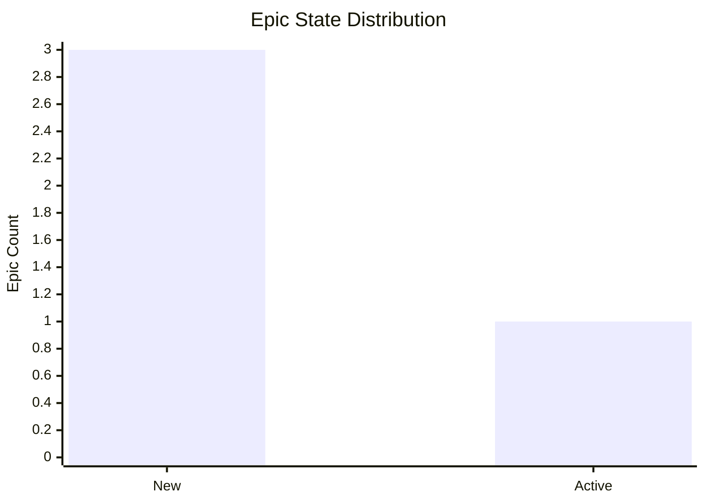
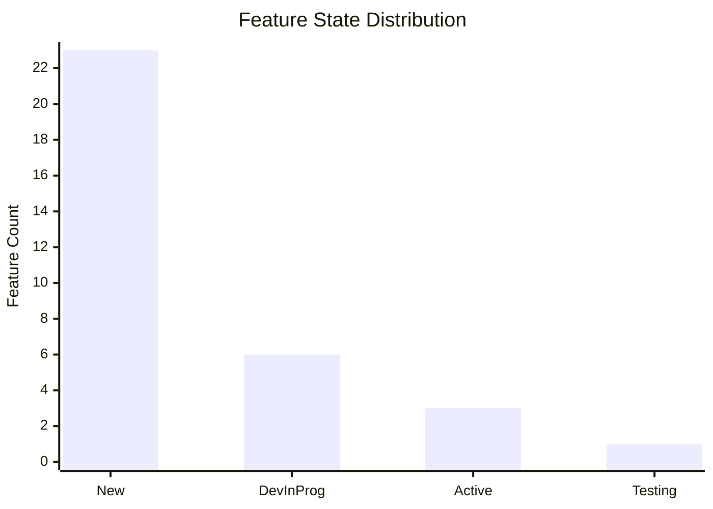
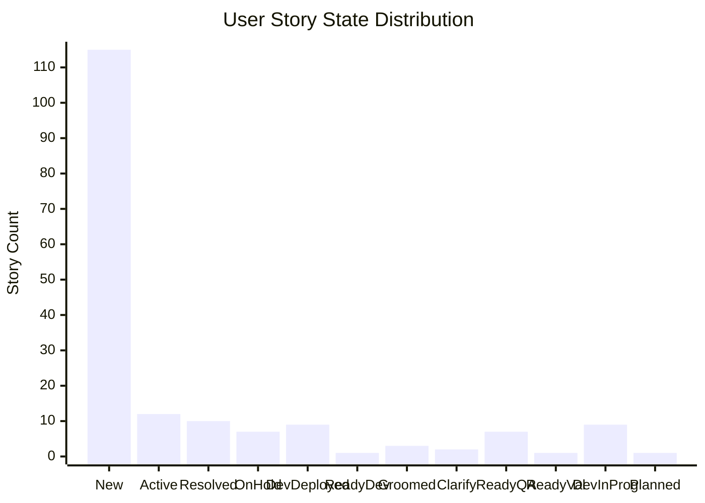
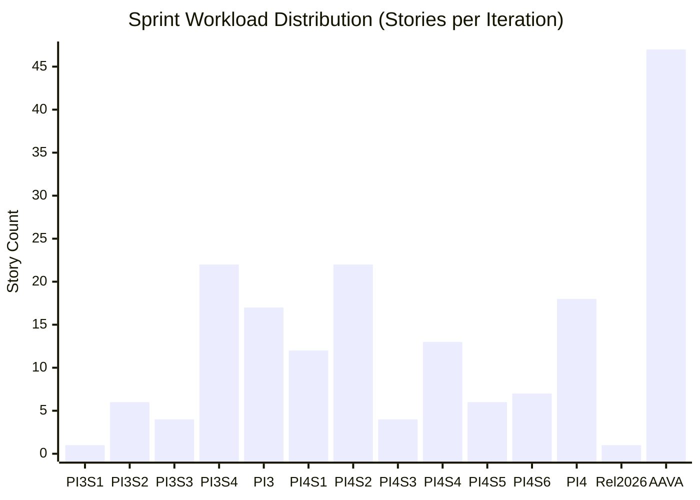
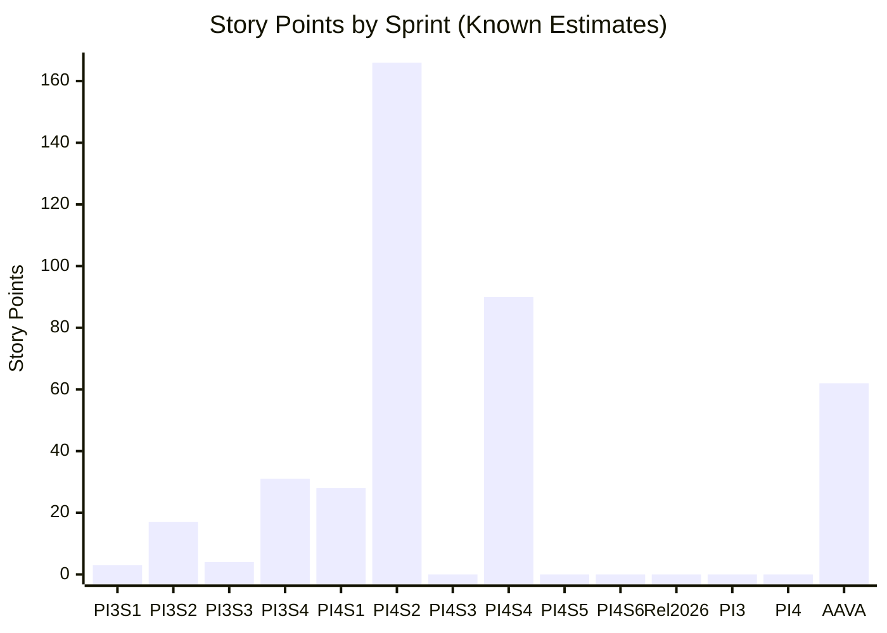
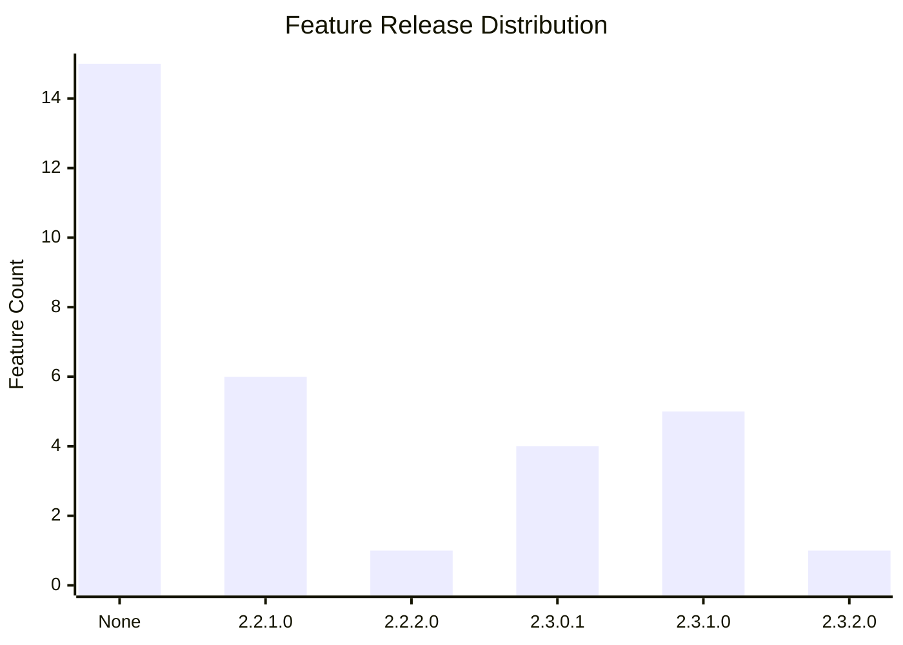
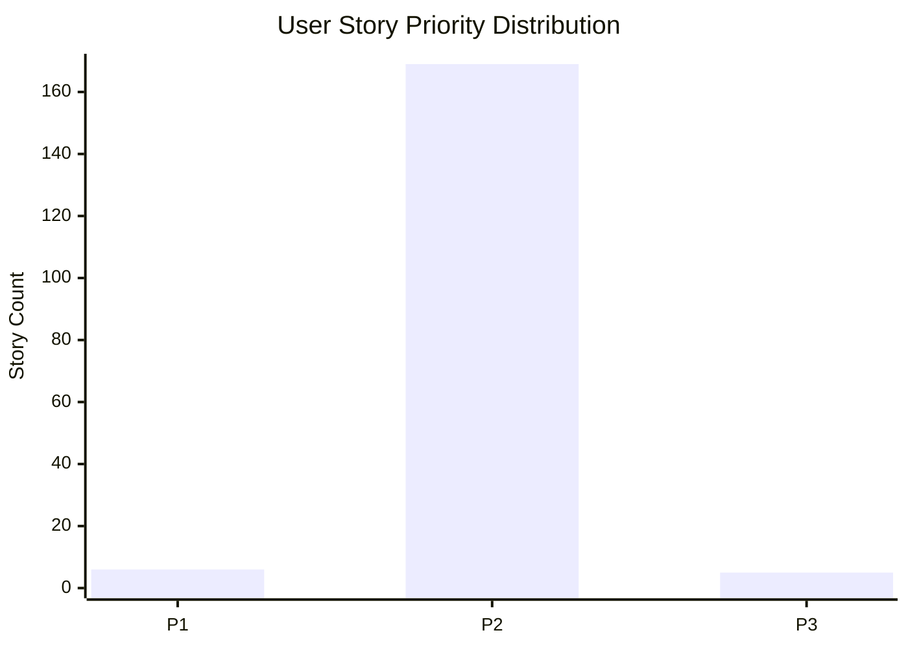
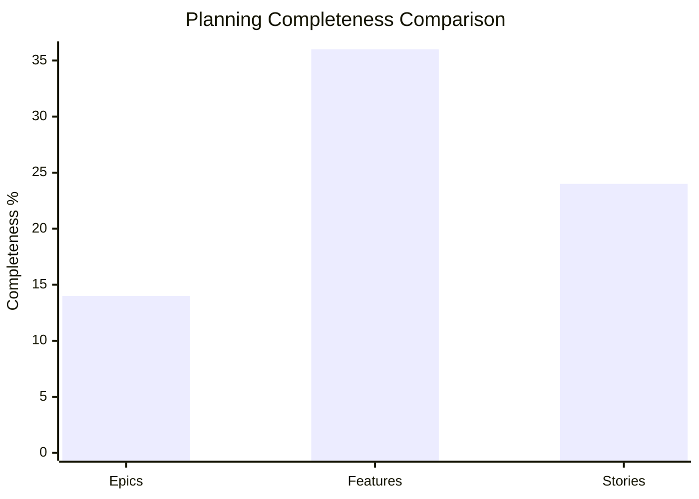
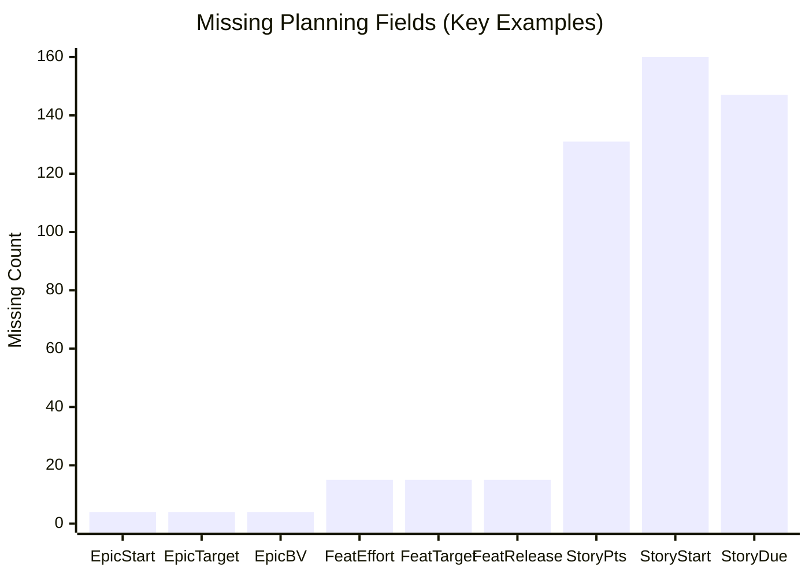
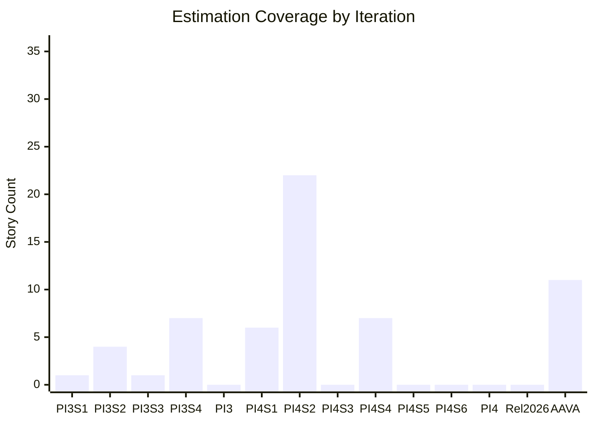

```markdown
# Azure_DevOps_Planning_and_Sprint_Performance_Report.md

## 1. Complete Epic Planning Details

| Epic ID | Title | Work Item Type | Tag | State | Area Path | Iteration Path | Priority | Risk | Effort | Business Value | Time Criticality | Start Date | Target Date | Work Item URL | Unmapped Planning Fields |
| --- | --- | --- | --- | --- | --- | --- | --- | --- | --- | --- | --- | --- | --- | --- | --- |
| 51718 | Agentic Artifacts Refinement and Governed Learning Management | Epic | Epic | New | AAVA\Integrations | AAVA\PI3 | 2 | Not Provided | Not Provided | Not Provided | Not Provided | Not Provided | Not Provided | https://dev.azure.com/ascendionava/AAVA/_workitems/edit/51718 | Not Provided |
| 51736 | Secure, Scalable MCP Tool Integration and Gateway Platform | Epic | Epic | Active | AAVA\Integrations | AAVA\PI3 | 2 | Not Provided | Not Provided | Not Provided | Not Provided | Not Provided | Not Provided | https://dev.azure.com/ascendionava/AAVA/_workitems/edit/51736 | Not Provided |
| 70804 | Foundation: Token Limit Configuration & Administration | Epic | Epic | New | AAVA\Integrations | AAVA\PI4\Sprint 3 | 2 | Not Provided | Not Provided | Not Provided | Not Provided | Not Provided | Not Provided | https://dev.azure.com/ascendionava/AAVA/_workitems/edit/70804 | Not Provided |
| 70807 | Foundation: Token Limit Monitoring & Notifications | Epic | Epic | New | AAVA\Integrations | AAVA\PI4\Sprint 4 | 1 | Not Provided | Not Provided | Not Provided | Not Provided | Not Provided | Not Provided | https://dev.azure.com/ascendionava/AAVA/_workitems/edit/70807 | Not Provided |

---

## 2. Complete Feature Planning Details

| Feature ID | Title | Work Item Type | Tag | State | Area Path | Iteration Path | Priority | Risk | Effort | Business Value | Time Criticality | Start Date | Target Date | Release Version | Studio | Planned Sprint | Estimated Completion Sprint | Primary User Cohort | Complexity | Work Item URL | Unmapped Planning Fields |
| --- | --- | --- | --- | --- | --- | --- | --- | --- | --- | --- | --- | --- | --- | --- | --- | --- | --- | --- | --- | --- | --- |
| 53397 | Agent Creation & Discovery | Feature | Feature | Dev In Progress | AAVA\Integrations | AAVA\PI3\Sprint 4 | 2 | Not Provided | Not Provided | Not Provided | Not Provided | Not Provided | 2026-09-06T00:00:00Z | 2.2.1.0 | AIG | Sprint 1 | EC Sprint 2 | Not Provided | Not Provided | https://dev.azure.com/ascendionava/AAVA/_workitems/edit/53397 | Primary User Cohort |
| 58004 | CSM and Platform Support Role - Assignment and Flag-Based Capabilities | Feature | Feature | Dev In Progress | AAVA\Integrations | AAVA\PI3\Sprint 2 | 2 | Not Provided | Not Provided | Not Provided | Not Provided | Not Provided | 2026-07-05T00:00:00Z | 2.2.1.0 | AIG | Not Provided | EC Sprint 2 | Not Provided | Not Provided | https://dev.azure.com/ascendionava/AAVA/_workitems/edit/58004 | Primary User Cohort |
| 51778 | Tech Stack Configurations - LLM | Feature | Feature | Testing | AAVA\Integrations | AAVA\PI4\Sprint 3 | 2 | Not Provided | 5.0 | Not Provided | Not Provided | Not Provided | 2026-10-11T00:00:00Z | 2.2.2.0 | AIG | Not Provided | EC Sprint 4 | Not Provided | High | https://dev.azure.com/ascendionava/AAVA/_workitems/edit/51778 | Primary User Cohort |
| 73737 | Tech Stack Configurations - MCP Server | Feature | Feature | Active | AAVA\Integrations | AAVA\PI4\Sprint 2 | 2 | Not Provided | 5.0 | Not Provided | Not Provided | Not Provided | 2026-11-22T00:00:00Z | 2.3.0.1 | AIG | Sprint 1 | EC Sprint 4 | Not Provided | Not Provided | https://dev.azure.com/ascendionava/AAVA/_workitems/edit/73737 | Primary User Cohort |
| 83551 | Tech Stack Configurations – AI & CLI Gateway | Feature | Feature | New | AAVA\Integrations | AAVA\PI4\Sprint 4 | 2 | Not Provided | 5.0 | Not Provided | Not Provided | Not Provided | 2026-10-11T00:00:00Z | 2.3.1.0 | AIG | Sprint 4 | EC Sprint 4 | Not Provided | Not Provided | https://dev.azure.com/ascendionava/AAVA/_workitems/edit/83551 | Primary User Cohort |
| 51765 | On-Behalf-Of (OBO) Security Model for Agent Tool Access | Feature | Feature | Dev In Progress | AAVA\Integrations | AAVA\PI3\Sprint 3 | 2 | Not Provided | 9.0 | Not Provided | Not Provided | Not Provided | 2026-08-09T00:00:00Z | 2.2.1.0 | AIG | Sprint 1 | EC Sprint 2 | Not Provided | Not Provided | https://dev.azure.com/ascendionava/AAVA/_workitems/edit/51765 | Primary User Cohort |
| 58566 | Agent Versioning Enhancement | Feature | Feature | Dev In Progress | AAVA\Integrations | AAVA\PI3\Sprint 4 | 2 | Not Provided | Not Provided | Not Provided | Not Provided | Not Provided | 2026-08-09T00:00:00Z | 2.2.1.0 | AIG | Sprint 3 | Not Provided | Not Provided | Not Provided | https://dev.azure.com/ascendionava/AAVA/_workitems/edit/58566 | Primary User Cohort |
| 51771 | Token Exchange and Enterprise Authentication Patterns | Feature | Feature | New | AAVA\Integrations | AAVA | 2 | Not Provided | 15.0 | Not Provided | Not Provided | Not Provided | 2026-07-05T00:00:00Z | Not Provided | AIG | Sprint 1 | EC Sprint 3 | Not Provided | Not Provided | https://dev.azure.com/ascendionava/AAVA/_workitems/edit/51771 | Primary User Cohort |
| 51720 | Closed-Loop Conversational Refinement with Unified Review | Feature | Feature | New | AAVA\Integrations | AAVA\AAVA BACKLOG | 2 | Not Provided | 26.0 | Not Provided | Not Provided | Not Provided | 2026-08-09T00:00:00Z | Not Provided | AIG | Sprint 3 | EC Sprint 3 | Not Provided | Not Provided | https://dev.azure.com/ascendionava/AAVA/_workitems/edit/51720 | Primary User Cohort |
| 51721 | Structured Feedback Capture and Run Traceability | Feature | Feature | New | AAVA\Integrations | AAVA\AAVA BACKLOG | 2 | Not Provided | 9.0 | Not Provided | Not Provided | Not Provided | 2026-08-09T00:00:00Z | Not Provided | AIG | Sprint 4 | EC Sprint 4 | Not Provided | Not Provided | https://dev.azure.com/ascendionava/AAVA/_workitems/edit/51721 | Primary User Cohort |
| 51722 | Learning Governance Workflow with Role-Based Approval | Feature | Feature | New | AAVA\Integrations | AAVA\AAVA BACKLOG | 2 | Not Provided | 29.0 | Not Provided | Not Provided | Not Provided | 2026-08-09T00:00:00Z | Not Provided | AIG | Sprint 3 | EC Sprint 5 | Not Provided | Not Provided | https://dev.azure.com/ascendionava/AAVA/_workitems/edit/51722 | Primary User Cohort |
| 51733 | Refinement Governance: Impact Analysis, Token Optimisation, and Iteration Control | Feature | Feature | New | AAVA\Integrations | AAVA\AAVA BACKLOG | 2 | Not Provided | 15.0 | Not Provided | Not Provided | Not Provided | 2026-08-09T00:00:00Z | Not Provided | AIG | Sprint 3 | EC Sprint 3 | Not Provided | Not Provided | https://dev.azure.com/ascendionava/AAVA/_workitems/edit/51733 | Primary User Cohort |
| 51735 | Learning Representation, Retrieval, and Controlled Memory Layer | Feature | Feature | New | AAVA\Integrations | AAVA\AAVA BACKLOG | 2 | Not Provided | 25.0 | Not Provided | Not Provided | Not Provided | 2026-08-09T00:00:00Z | Not Provided | AIG | Sprint 4 | EC Sprint 4 | Not Provided | Not Provided | https://dev.azure.com/ascendionava/AAVA/_workitems/edit/51735 | Primary User Cohort |
| 51747 | Enterprise IAM Integration & SSO | Feature | Feature | New | AAVA\Integrations | AAVA\PI4 | 2 | Not Provided | Not Provided | Not Provided | Not Provided | Not Provided | 2026-08-09T00:00:00Z | 2.3.1.0 | AIG | Sprint 3 | EC Sprint 5 | Not Provided | Not Provided | https://dev.azure.com/ascendionava/AAVA/_workitems/edit/51747 | Primary User Cohort |
| 51769 | Schema-Driven Scalable Tool Onboarding | Feature | Feature | New | AAVA\Integrations | AAVA\PI4 | 2 | Not Provided | 12.0 | Not Provided | Not Provided | Not Provided | 2026-07-05T00:00:00Z | Not Provided | AIG | Sprint 4 | EC Sprint 3 | Not Provided | Not Provided | https://dev.azure.com/ascendionava/AAVA/_workitems/edit/51769 | Primary User Cohort |
| 51772 | Pre-Configured Squad-Level Tool Access with Jira Context Auto-Pull | Feature | Feature | New | AAVA\Integrations | AAVA\PI4 | 2 | Not Provided | 15.0 | Not Provided | Not Provided | Not Provided | Not Provided | Not Provided | AIG | Not Provided | EC Sprint 5 | Not Provided | Not Provided | https://dev.azure.com/ascendionava/AAVA/_workitems/edit/51772 | Primary User Cohort |
| 51789 | Enterprise Tool Template Library | Feature | Feature | New | AAVA\Integrations | AAVA\PI4 | 2 | Not Provided | 15.0 | Not Provided | Not Provided | Not Provided | Not Provided | Not Provided | AIG | Not Provided | EC Sprint 4 | Not Provided | Not Provided | https://dev.azure.com/ascendionava/AAVA/_workitems/edit/51789 | Primary User Cohort |
| 51779 | Configurable Defaults and Jira Context Auto-Pull Across Hierarchy Levels | Feature | Feature | New | AAVA\Integrations | AAVA\PI4 | 2 | Not Provided | 11.0 | Not Provided | Not Provided | Not Provided | Not Provided | Not Provided | AIG | Not Provided | EC Sprint 5 | Not Provided | Not Provided | https://dev.azure.com/ascendionava/AAVA/_workitems/edit/51779 | Primary User Cohort |
| 51780 | Enterprise-Scale Access Management via AD Groups and YAML-Driven Policies | Feature | Feature | New | AAVA\Integrations | AAVA\PI4 | 2 | Not Provided | 14.0 | Not Provided | Not Provided | Not Provided | Not Provided | Not Provided | AIG | Not Provided | EC Sprint 5 | Not Provided | Not Provided | https://dev.azure.com/ascendionava/AAVA/_workitems/edit/51780 | Primary User Cohort |
| 51784 | Clean-Build and Hierarchy Reset | Feature | Feature | New | AAVA\Integrations | AAVA | 2 | Not Provided | 8.0 | Not Provided | Not Provided | Not Provided | Not Provided | Not Provided | AIG | Not Provided | EC Sprint 3 | Not Provided | Not Provided | https://dev.azure.com/ascendionava/AAVA/_workitems/edit/51784 | Primary User Cohort |
| 51790 | Tool Configuration Audit Trail | Feature | Feature | New | AAVA\Integrations | AAVA\PI4 | 2 | Not Provided | 24.0 | Not Provided | Not Provided | Not Provided | Not Provided | Not Provided | AIG | Not Provided | EC Sprint 4 | Not Provided | Not Provided | https://dev.azure.com/ascendionava/AAVA/_workitems/edit/51790 | Primary User Cohort |
| 51791 | NLP-Based Tool Suggestion and Guided Onboarding Trigger | Feature | Feature | New | AAVA\Integrations | AAVA\PI4\Sprint 2 | 2 | Not Provided | 22.0 | Not Provided | Not Provided | Not Provided | Not Provided | 2.3.1.0 | AIG | Sprint 2 | Not Provided | Not Provided | Not Provided | https://dev.azure.com/ascendionava/AAVA/_workitems/edit/51791 | Primary User Cohort |
| 51792 | Tool Lifecycle Management — Draft Active Deprecated Retired | Feature | Feature | New | AAVA\Integrations | AAVA\PI4 | 2 | Not Provided | 19.0 | Not Provided | Not Provided | Not Provided | Not Provided | 2.3.1.0 | AIG | Sprint 1 | EC Sprint 2 | Not Provided | High | https://dev.azure.com/ascendionava/AAVA/_workitems/edit/51792 | Primary User Cohort |
| 51928 | Advanced Quality Assurance and Validation Controls | Feature | Feature | New | AAVA\Integrations | AAVA\AAVA BACKLOG | 2 | Not Provided | Not Provided | Not Provided | Not Provided | Not Provided | Not Provided | Not Provided | AIG | Not Provided | Not Provided | Not Provided | Not Provided | https://dev.azure.com/ascendionava/AAVA/_workitems/edit/51928 | Primary User Cohort |
| 51932 | Squad Templates and Self-Service Squad Creation | Feature | Feature | New | AAVA\Integrations | AAVA\PI4 | 2 | Not Provided | Not Provided | Not Provided | Not Provided | Not Provided | Not Provided | Not Provided | AIG | Not Provided | Not Provided | Not Provided | Not Provided | https://dev.azure.com/ascendionava/AAVA/_workitems/edit/51932 | Primary User Cohort |
| 51933 | Structure and Policy Effect Simulation | Feature | Feature | New | AAVA\Integrations | AAVA | 2 | Not Provided | Not Provided | Not Provided | Not Provided | Not Provided | Not Provided | Not Provided | AIG | Not Provided | Not Provided | Not Provided | Not Provided | https://dev.azure.com/ascendionava/AAVA/_workitems/edit/51933 | Primary User Cohort |
| 51935 | Schema-Driven Tool Onboarding — Declarative Model | Feature | Feature | New | AAVA\Integrations | AAVA\PI4 | 2 | Not Provided | Not Provided | Not Provided | Not Provided | Not Provided | Not Provided | 2.3.1.0 | AIG | Sprint 4 | EC Sprint 3 | Not Provided | Not Provided | https://dev.azure.com/ascendionava/AAVA/_workitems/edit/51935 | Primary User Cohort |
| 65074 | MCP Enablement Feature | Feature | Feature | Active | AAVA\Integrations | AAVA\PI4 | 2 | Not Provided | Not Provided | Not Provided | Not Provided | Not Provided | Not Provided | Not Provided | Not Provided | Not Provided | Not Provided | Not Provided | https://dev.azure.com/ascendionava/AAVA/_workitems/edit/65074 | Primary User Cohort |
| 72353 | Agent Versioning Restore (Without Impact Analysis) | Feature | Feature | Dev In Progress | AAVA\Integrations | AAVA\PI3\Sprint 4 | 2 | Not Provided | Not Provided | Not Provided | Not Provided | 2026-07-20T00:00:00Z | 2026-08-18T00:00:00Z | 2.2.1.0 | AIG | Not Provided | Not Provided | Not Provided | Not Provided | https://dev.azure.com/ascendionava/AAVA/_workitems/edit/72353 | Primary User Cohort |
| 72436 | Individual User Token Limit Override | Feature | Feature | New | AAVA\Integrations | AAVA\PI4 | 2 | Not Provided | Not Provided | Not Provided | Not Provided | Not Provided | 2026-10-11T00:00:00Z | 2.3.2.0 | ACS | Not Provided | Not Provided | Not Provided | Not Provided | https://dev.azure.com/ascendionava/AAVA/_workitems/edit/72436 | Primary User Cohort |
| 114968 | Unity Framework Integration for LLM Calls in Databricks from AAVA AI Gateway | Feature | Feature | New | AAVA\Integrations | AAVA\PI4 | 2 | Not Provided | Not Provided | Not Provided | Not Provided | Not Provided | Not Provided | Not Provided | Not Provided | Not Provided | Not Provided | Not Provided | https://dev.azure.com/ascendionava/AAVA/_workitems/edit/114968 | Primary User Cohort |
| 121855 | Onboard Pantheon - LLM Provider in the AAVA AI Gateway | Feature | Feature | New | AAVA\Integrations | AAVA\PI4\Sprint 5 | 2 | Not Provided | Not Provided | Not Provided | Not Provided | Not Provided | Not Provided | Not Provided | Not Provided | Not Provided | Not Provided | Not Provided | https://dev.azure.com/ascendionava/AAVA/_workitems/edit/121855 | Primary User Cohort |

---

## 3. Complete User Story Planning Details

| User Story ID | Title | Work Item Type | Tag | State | Area Path | Iteration Path | Story Points | Priority | Start Date | Due Date | UX Expected | Risk | Studio | Release Version | Planned Sprint | Dependent Team | Work Item URL | Unmapped Planning Fields |
| --- | --- | --- | --- | --- | --- | --- | --- | --- | --- | --- | --- | --- | --- | --- | --- | --- | --- | --- | --- |
| 93164 | Add LLM Models to Dev Environment | User Story | User Story | Active | AAVA\Integrations | AAVA\PI4\Sprint 2 | Not Provided | 2 | Not Provided | Not Provided | Not Provided | Not Provided | AIG | Not Provided | Not Provided | DevSecOps | https://dev.azure.com/ascendionava/AAVA/_workitems/edit/93164 | Not Provided |
| 122848 | Configure LLM Model Access by Organization, Track, Application, and Team | User Story | User Story | New | AAVA\Integrations | AAVA | Not Provided | 2 | Not Provided | Not Provided | Not Provided | Not Provided | AIG | Not Provided | Not Provided | Not Provided | https://dev.azure.com/ascendionava/AAVA/_workitems/edit/122848 | Not Provided |
| 104421 | Sonar Violations and SonarLint usage | User Story | User Story | Active | AAVA\Integrations | AAVA\PI4\Sprint 4 | 3.0 | 1 | Not Provided | 2026-10-14T00:00:00Z | Not Provided | Not Provided | Not Provided | Not Provided | Not Provided | Not Provided | https://dev.azure.com/ascendionava/AAVA/_workitems/edit/104421 | Not Provided |
| 120919 | Resolved Merge Conflicts and Completed Azure Foundry PR | User Story | User Story | Resolved | AAVA\Integrations | AAVA\PI4\Sprint 5 | 1.0 | 2 | 2026-11-02T00:00:00Z | 2026-11-02T00:00:00Z | Not Provided | Not Provided | Not Provided | Not Provided | Not Provided | Not Provided | https://dev.azure.com/ascendionava/AAVA/_workitems/edit/120919 | Not Provided |
| 63449 | Sprint 3 - QE Other Prioritized Activities - Int | User Story | User Story | New | AAVA\Integrations | AAVA\PI3\Sprint 3 | Not Provided | 3 | Not Provided | Not Provided | Not Provided | Not Provided | ACE | Not Provided | Not Provided | Not Provided | https://dev.azure.com/ascendionava/AAVA/_workitems/edit/63449 | Not Provided |
| 53146 | Resolve Security Vulnerabilities Across Backend Services and Dependencies | User Story | User Story | On Hold | AAVA\Integrations | AAVA\PI3\Sprint 1 | 3.0 | 2 | Not Provided | Not Provided | Not Provided | Not Provided | Not Provided | Not Provided | Not Provided | Not Provided | https://dev.azure.com/ascendionava/AAVA/_workitems/edit/53146 | Not Provided |
| 70433 | Sprint 4 - UTC Coverage - Int | User Story | User Story | Active | AAVA\Integrations | AAVA\PI3\Sprint 4 | Not Provided | 2 | Not Provided | Not Provided | Not Provided | Not Provided | Not Provided | Not Provided | Not Provided | Not Provided | https://dev.azure.com/ascendionava/AAVA/_workitems/edit/70433 | Not Provided |
| 119396 | Bug-- Resolve Works Intermittently and Configure Tool Page Displays No Generated Data | User Story | User Story | Resolved | AAVA\Integrations | AAVA\PI4\Sprint 5 | Not Provided | 2 | 2026-10-30T00:00:00Z | 2026-10-30T00:00:00Z | Not Provided | Not Provided | Not Provided | Not Provided | Not Provided | Not Provided | https://dev.azure.com/ascendionava/AAVA/_workitems/edit/119396 | Not Provided |
| 119380 | BUG: Fix Incorrect Python Code Generation During Tool Creation in QE env | User Story | User Story | Resolved | AAVA\Integrations | AAVA\PI4\Sprint 5 | Not Provided | 2 | 2026-10-28T00:00:00Z | 2026-10-28T00:00:00Z | Not Provided | Not Provided | Not Provided | Not Provided | Not Provided | Not Provided | https://dev.azure.com/ascendionava/AAVA/_workitems/edit/119380 | Not Provided |
| 70440 | Sprint 4 - QE Other Prioritized Activities - Int | User Story | User Story | New | AAVA\Integrations | AAVA\PI3\Sprint 4 | Not Provided | 2 | Not Provided | Not Provided | Not Provided | Not Provided | Not Provided | Not Provided | Not Provided | Not Provided | https://dev.azure.com/ascendionava/AAVA/_workitems/edit/70440 | Not Provided |
| 70445 | Sprint 4 - Lead Activities - Int | User Story | User Story | New | AAVA\Integrations | AAVA\PI3\Sprint 4 | Not Provided | 2 | Not Provided | Not Provided | Not Provided | Not Provided | AIG | Not Provided | Not Provided | Not Provided | https://dev.azure.com/ascendionava/AAVA/_workitems/edit/70445 | Not Provided |
| 70449 | Sprint 4 - Client Issue Resolution & Other Team Support - Int | User Story | User Story | New | AAVA\Integrations | AAVA\PI3\Sprint 4 | Not Provided | 2 | Not Provided | Not Provided | Not Provided | Not Provided | Not Provided | Not Provided | Not Provided | Not Provided | https://dev.azure.com/ascendionava/AAVA/_workitems/edit/70449 | Not Provided |
| 70450 | Sprint 4 - Implement Common Logging and Exception Libraries | User Story | User Story | Active | AAVA\Integrations | AAVA\PI3\Sprint 4 | Not Provided | 2 | Not Provided | Not Provided | Not Provided | Not Provided | Not Provided | Not Provided | Not Provided | Not Provided | https://dev.azure.com/ascendionava/AAVA/_workitems/edit/70450 | Not Provided |
| 70431 | Sprint 4 - CVE Remediation and Security Vulnerability Fixes - Int | User Story | User Story | Dev-Deployed | AAVA\Integrations | AAVA\PI3\Sprint 4 | Not Provided | 2 | Not Provided | Not Provided | Not Provided | Not Provided | Not Provided | Not Provided | Not Provided | Not Provided | https://dev.azure.com/ascendionava/AAVA/_workitems/edit/70431 | Not Provided |
| 53369 | Console: Configure Pre-Configuration Defaults for an Assigned Hierarchy Level | User Story | User Story | Ready for Dev | AAVA\Integrations | AAVA\PI3\Sprint 4 | Not Provided | 2 | Not Provided | Not Provided | Not Provided | Not Provided | AIG | Not Provided | Not Provided | Not Provided | https://dev.azure.com/ascendionava/AAVA/_workitems/edit/53369 | Not Provided |
| 107930 | Edit and Validate JSON Parameter Mapping | User Story | User Story | Dev-Deployed | AAVA\Integrations | AAVA\PI4\Sprint 1 | Not Provided | 2 | Not Provided | Not Provided | Not Provided | Not Provided | AIG | Not Provided | Sprint 3 | Not Provided | https://dev.azure.com/ascendionava/AAVA/_workitems/edit/107930 | Not Provided |
| 109933 | Model Identity & Token Limits Configuration Values | User Story | User Story | New | AAVA\Integrations | AAVA\PI4\Sprint 1 | Not Provided | 2 | Not Provided | Not Provided | Not Provided | Not Provided | AIG | Not Provided | Sprint 3 | Not Provided | https://dev.azure.com/ascendionava/AAVA/_workitems/edit/109933 | Not Provided |
| 106264 | Dynamic Model Availability Across AAVA | User Story | User Story | New | AAVA\Integrations | AAVA\PI4\Sprint 1 | Not Provided | 2 | Not Provided | Not Provided | Not Provided | Not Provided | AIG | Not Provided | Sprint 1 | Not Provided | https://dev.azure.com/ascendionava/AAVA/_workitems/edit/106264 | Not Provided |
| 111123 | Expired Model Handling | User Story | User Story | Groomed | AAVA\Integrations | AAVA\PI4\Sprint 4 | Not Provided | 2 | Not Provided | Not Provided | Not Provided | Not Provided | AIG | Not Provided | Not Provided | Not Provided | https://dev.azure.com/ascendionava/AAVA/_workitems/edit/111123 | Not Provided |
| 114380 | MCP Attribute Validation | User Story | User Story | Active | AAVA\Integrations | AAVA\PI4\Sprint 4 | Not Provided | 2 | Not Provided | Not Provided | Not Provided | Not Provided | AIG | Not Provided | Sprint 4 | Not Provided | https://dev.azure.com/ascendionava/AAVA/_workitems/edit/114380 | Not Provided |
| 116401 | LLM Model Expiry Date Validation-SUDO | User Story | User Story | In Progress | AAVA\Integrations | AAVA\PI4\Sprint 4 | Not Provided | 2 | Not Provided | Not Provided | Not Provided | Not Provided | AIG | Not Provided | Not Provided | Not Provided | https://dev.azure.com/ascendionava/AAVA/_workitems/edit/116401 | Not Provided |
| 65602 | Sprint 3 - Client Issue Resolution & Other Team Support - Int | User Story | User Story | Active | AAVA\Integrations | AAVA\PI3\Sprint 3 | Not Provided | 2 | Not Provided | Not Provided | Not Provided | Not Provided | Foundation | Not Provided | Not Provided | Not Provided | https://dev.azure.com/ascendionava/AAVA/_workitems/edit/65602 | Not Provided |
| 36969 | MCP-based GitHub Integration | User Story | User Story | Dev In Progress | AAVA\Integrations | AAVA\PI4\Sprint 2 | 2.0 | 2 | Not Provided | Not Provided | Not Provided | Not Provided | AIG | Not Provided | Not Provided | Not Provided | https://dev.azure.com/ascendionava/AAVA/_workitems/edit/36969 | Not Provided |
| 73732 | UX: MCP server registration flow: dashboard, guided setup, and review | User Story | User Story | Ready for Validation | AAVA\Integrations | AAVA\PI3\Sprint 4 | 2.0 | 2 | Not Provided | 2026-10-28T00:00:00Z | Not Provided | Not Provided | AIG | 2.3.0.1 | Not Provided | Not Provided | https://dev.azure.com/ascendionava/AAVA/_workitems/edit/73732 | Not Provided |
| 53401 | Agent Creation - Select Model | User Story | User Story | Re-Opened | AAVA\Integrations | AAVA\PI3\Sprint 2 | 3.0 | 1 | Not Provided | Not Provided | Not Provided | Not Provided | AIG | 2.2.1.0 | Sprint 1 | Not Provided | https://dev.azure.com/ascendionava/AAVA/_workitems/edit/53401 | Not Provided |
| 53400 | Test Agent in Mini Playground | User Story | User Story | New | AAVA\Integrations | AAVA | 8.0 | 2 | Not Provided | Not Provided | 2026-07-02T15:04:00Z | Not Provided | AIG | Not Provided | Sprint 1 | Not Provided | https://dev.azure.com/ascendionava/AAVA/_workitems/edit/53400 | Not Provided |
| 54251 | Implement OBO flow for agent /workflow/tools | User Story | User Story | New | AAVA\Integrations | AAVA\PI3 | Not Provided | 2 | Not Provided | Not Provided | Not Provided | Not Provided | AIG | Not Provided | Not Provided | Not Provided | https://dev.azure.com/ascendionava/AAVA/_workitems/edit/54251 | Not Provided |
| 54252 | MCP security | User Story | User Story | New | AAVA\Integrations | AAVA\PI3 | Not Provided | 2 | Not Provided | Not Provided | Not Provided | Not Provided | AIG | Not Provided | Not Provided | Not Provided | https://dev.azure.com/ascendionava/AAVA/_workitems/edit/54252 | Not Provided |
| 54356 | Tool & MCP Integration Validation Before Publishing | User Story | User Story | Ready for Design | AAVA\Integrations | AAVA\PI3 | Not Provided | 2 | Not Provided | Not Provided | Not Provided | Not Provided | AIG | Not Provided | Sprint 1 | Not Provided | https://dev.azure.com/ascendionava/AAVA/_workitems/edit/54356 | Not Provided |
| 54359 | Release Notes & Impact Analysis For Tools | User Story | User Story | On Hold | AAVA\Integrations | AAVA\PI3 | Not Provided | 2 | Not Provided | Not Provided | Not Provided | Not Provided | AIG | Not Provided | Sprint 1 | Not Provided | https://dev.azure.com/ascendionava/AAVA/_workitems/edit/54359 | Not Provided |
| 55030 | Autonomous Tool Invocation in Workflows | User Story | User Story | New | AAVA\Integrations | AAVA\PI3 | Not Provided | 1 | Not Provided | Not Provided | Not Provided | Not Provided | AIG | Not Provided | Not Provided | Not Provided | https://dev.azure.com/ascendionava/AAVA/_workitems/edit/55030 | Not Provided |
| 55034 | OBO Permission Enforcement for Autonomous Calls | User Story | User Story | New | AAVA\Integrations | AAVA\PI3 | Not Provided | 2 | Not Provided | Not Provided | Not Provided | Not Provided | AIG | Not Provided | Not Provided | Not Provided | https://dev.azure.com/ascendionava/AAVA/_workitems/edit/55034 | Not Provided |
| 55035 | Autonomous Invocation Audit Logging | User Story | User Story | New | AAVA\Integrations | AAVA\PI3 | Not Provided | 1 | Not Provided | Not Provided | Not Provided | Not Provided | AIG | Not Provided | Not Provided | Not Provided | https://dev.azure.com/ascendionava/AAVA/_workitems/edit/55035 | Not Provided |
| 55039 | Autonomous Invocation Security Boundary Enforcement | User Story | User Story | New | AAVA\Integrations | AAVA\PI3 | Not Provided | 2 | Not Provided | Not Provided | Not Provided | Not Provided | AIG | Not Provided | Not Provided | Not Provided | https://dev.azure.com/ascendionava/AAVA/_workitems/edit/55039 | Not Provided |
| 55074 | Invocation Rate Limiting and Governance | User Story | User Story | New | AAVA\Integrations | AAVA\PI3 | Not Provided | 2 | Not Provided | Not Provided | Not Provided | Not Provided | AIG | Not Provided | Not Provided | Not Provided | https://dev.azure.com/ascendionava/AAVA/_workitems/edit/55074 | Not Provided |
| 55075 | Secure Logging and Secret Protection | User Story | User Story | New | AAVA\Integrations | AAVA\PI3 | Not Provided | 1 | Not Provided | Not Provided | Not Provided | Not Provided | AIG | Not Provided | Not Provided | Not Provided | https://dev.azure.com/ascendionava/AAVA/_workitems/edit/55075 | Not Provided |
| 55076 | Schema-Driven Tool Onboarding | User Story | User Story | New | AAVA\Integrations | AAVA\PI3 | Not Provided | 1 | Not Provided | Not Provided | Not Provided | Not Provided | AIG | Not Provided | Not Provided | Not Provided | https://dev.azure.com/ascendionava/AAVA/_workitems/edit/55076 | Not Provided |
| 55077 | Schema Validation and Connection Testing | User Story | User Story | New | AAVA\Integrations | AAVA\PI3 | Not Provided | 2 | Not Provided | Not Provided | Not Provided | Not Provided | AIG | Not Provided | Not Provided | Not Provided | https://dev.azure.com/ascendionava/AAVA/_workitems/edit/55077 | Not Provided |
| 55078 | Tool Versioning and Metadata Management | User Story | User Story | New | AAVA\Integrations | AAVA\PI3 | Not Provided | 2 | Not Provided | Not Provided | Not Provided | Not Provided | AIG | Not Provided | Not Provided | Not Provided | https://dev.azure.com/ascendionava/AAVA/_workitems/edit/55078 | Not Provided |
| 56722 | UX- Configurable Defaults and Jira Context Auto-Pull Across Hierarchy Levels | User Story | User Story | New | AAVA\Integrations | AAVA\PI3 | Not Provided | 2 | Not Provided | Not Provided | Not Provided | Not Provided | AIG | Not Provided | Not Provided | Not Provided | https://dev.azure.com/ascendionava/AAVA/_workitems/edit/56722 | Not Provided |
| 56726 | UI- Configurable Defaults and Jira Context Auto-Pull Across Hierarchy Levels | User Story | User Story | New | AAVA\Integrations | AAVA\PI3 | Not Provided | 2 | Not Provided | Not Provided | Not Provided | Not Provided | AIG | Not Provided | Not Provided | Not Provided | https://dev.azure.com/ascendionava/AAVA/_workitems/edit/56726 | Not Provided |
| 56728 | API- Configurable Defaults and Jira Context Auto-Pull Across Hierarchy Levels | User Story | User Story | New | AAVA\Integrations | AAVA\PI3 | Not Provided | 2 | Not Provided | Not Provided | Not Provided | Not Provided | AIG | Not Provided | Not Provided | Not Provided | https://dev.azure.com/ascendionava/AAVA/_workitems/edit/56728 | Not Provided |
| 57510 | UX: View and manage property values at a node | User Story | User Story | New | AAVA\Integrations | AAVA\PI4 | Not Provided | 2 | Not Provided | Not Provided | Not Provided | Not Provided | AIG | Not Provided | Not Provided | Not Provided | https://dev.azure.com/ascendionava/AAVA/_workitems/edit/57510 | Not Provided |
| 57816 | UI -Agent Permission Denied Notification & Audit UI | User Story | User Story | Require Clarification | AAVA\Integrations | AAVA\PI3\Sprint 4 | Not Provided | 2 | Not Provided | Not Provided | Not Provided | Not Provided | AIG | Not Provided | Not Provided | Not Provided | https://dev.azure.com/ascendionava/AAVA/_workitems/edit/57816 | Not Provided |
| 57820 | API- On-Behalf-Of (OBO) Authorization Enforcement APIs | User Story | User Story | Require Clarification | AAVA\Integrations | AAVA\PI3\Sprint 4 | Not Provided | 2 | Not Provided | Not Provided | Not Provided | Not Provided | AIG | Not Provided | Not Provided | Not Provided | https://dev.azure.com/ascendionava/AAVA/_workitems/edit/57820 | Not Provided |
| 58006 | SUDO - CSM and PS Role Assignment | User Story | User Story | Re-Opened | AAVA\Integrations | AAVA\PI3\Sprint 2 | 5.0 | 2 | Not Provided | Not Provided | Not Provided | Not Provided | AIG | 2.2.1.0 | Not Provided | Not Provided | https://dev.azure.com/ascendionava/AAVA/_workitems/edit/58006 | Not Provided |
| 64169 | Revoke Admin and User Role Access for CSM & PS Role Users | User Story | User Story | Re-Opened | AAVA\Integrations | AAVA\PI3\Sprint 3 | 4.0 | 2 | Not Provided | Not Provided | Not Provided | Not Provided | AIG | 2.2.1.0 | Not Provided | Not Provided | https://dev.azure.com/ascendionava/AAVA/_workitems/edit/64169 | Not Provided |
| 58014 | UX: Tool Lifecycle Status Indicators and Transitions | User Story | User Story | On Hold | AAVA\Integrations | AAVA\PI3\Sprint 4 | 2.0 | 2 | Not Provided | Not Provided | Not Provided | Not Provided | AIG | Not Provided | Not Provided | Not Provided | https://dev.azure.com/ascendionava/AAVA/_workitems/edit/58014 | Not Provided |
| 58015 | Notify Affected Agent and Workflow Owners on Tool Deprecation or Retirement | User Story | User Story | New | AAVA\Integrations | AAVA\PI4 | Not Provided | 2 | Not Provided | Not Provided | Not Provided | Not Provided | AIG | Not Provided | Not Provided | Not Provided | https://dev.azure.com/ascendionava/AAVA/_workitems/edit/58015 | Not Provided |
| 58016 | Enforce Invocation Rules for Deprecated Tools | User Story | User Story | New | AAVA\Integrations | AAVA\PI4 | Not Provided | 2 | Not Provided | Not Provided | Not Provided | Not Provided | AIG | Not Provided | Not Provided | Not Provided | https://dev.azure.com/ascendionava/AAVA/_workitems/edit/58016 | Not Provided |
| 58018 | Impact Analysis Report for Tool Lifecycle Transitions | User Story | User Story | New | AAVA\Integrations | AAVA\PI4 | Not Provided | 2 | Not Provided | Not Provided | Not Provided | Not Provided | AIG | Not Provided | Not Provided | Not Provided | https://dev.azure.com/ascendionava/AAVA/_workitems/edit/58018 | Not Provided |
| 58019 | Manage Tool Lifecycle Through Formal States (Draft → Active → Deprecated → Retired) | User Story | User Story | New | AAVA\Integrations | AAVA\PI4 | Not Provided | 2 | Not Provided | Not Provided | Not Provided | Not Provided | AIG | Not Provided | Not Provided | Not Provided | https://dev.azure.com/ascendionava/AAVA/_workitems/edit/58019 | Not Provided |
| 62832 | Enabling - GPT 5.3 codex spark | User Story | User Story | On Hold | AAVA\Integrations | AAVA\Release_2026.2.0 | Not Provided | 2 | Not Provided | Not Provided | Not Provided | Not Provided | Not Provided | Not Provided | Not Provided | Not Provided | https://dev.azure.com/ascendionava/AAVA/_workitems/edit/62832 | Not Provided |
| 57750 | UI -Build Agent Version History | User Story | User Story | Re-Opened | AAVA\Integrations | AAVA\PI3\Sprint 4 | 3.0 | 2 | Not Provided | 2026-08-10T00:00:00Z | Not Provided | Not Provided | AIG | 2.2.1.0 | Not Provided | Not Provided | https://dev.azure.com/ascendionava/AAVA/_workitems/edit/57750 | Not Provided |
| 65153 | API- Restore Agent to Previous Version from Version History | User Story | User Story | Re-Opened | AAVA\Integrations | AAVA\PI4\Sprint 1 | 3.0 | 2 | Not Provided | 2026-08-14T00:00:00Z | Not Provided | Not Provided | AIG | 2.2.1.0 | Not Provided | Not Provided | https://dev.azure.com/ascendionava/AAVA/_workitems/edit/65153 | Not Provided |
| 70924 | UI-Feature Flag- Restore | User Story | User Story | Ready for QA | AAVA\Integrations | AAVA\PI3\Sprint 4 | 1.0 | 2 | Not Provided | Not Provided | Not Provided | Not Provided | AIG | 2.2.1.0 | Not Provided | Not Provided | https://dev.azure.com/ascendionava/AAVA/_workitems/edit/70924 | Not Provided |
| 69441 | Discover: Add MCP Search Functionality | User Story | User Story | Ready for QA | AAVA\Integrations | AAVA\PI3\Sprint 4 | Not Provided | 2 | 2026-07-27T00:00:00Z | 2026-07-28T10:39:00Z | Not Provided | Not Provided | Not Provided | Not Provided | Not Provided | Not Provided | https://dev.azure.com/ascendionava/AAVA/_workitems/edit/69441 | Not Provided |
| 54249 | CORE: SAML Integration in Auth Service | User Story | User Story | New | AAVA\Integrations | AAVA\PI3\Sprint 4 | Not Provided | 2 | Not Provided | Not Provided | Not Provided | Not Provided | AIG | Not Provided | Not Provided | Not Provided | https://dev.azure.com/ascendionava/AAVA/_workitems/edit/54249 | Not Provided |
| 65570 | Display Personalised Welcome Message on Platform Landing Pages | User Story | User Story | Dev-Deployed | AAVA\Integrations | AAVA\PI3\Sprint 3 | Not Provided | 2 | Not Provided | Not Provided | Not Provided | Not Provided | Not Provided | Not Provided | Not Provided | Not Provided | https://dev.azure.com/ascendionava/AAVA/_workitems/edit/65570 | Not Provided |
| 57150 | Playground Menu Left nav for conversational with Selection of Models drop down similar to 1.0 | User Story | User Story | New | AAVA\Integrations | AAVA | Not Provided | 3 | Not Provided | Not Provided | Not Provided | 1 - High | AIG | 2.3.2.0 | Not Provided | Not Provided | https://dev.azure.com/ascendionava/AAVA/_workitems/edit/57150 | Not Provided |
| 66418 | OBO Authentication for Predefined Integration Tools | User Story | User Story | Active | AAVA\Integrations | AAVA\PI3\Sprint 4 | Not Provided | 2 | Not Provided | Not Provided | Not Provided | Not Provided | AIG | Not Provided | Not Provided | Not Provided | https://dev.azure.com/ascendionava/AAVA/_workitems/edit/66418 | Not Provided |
| 66487 | Data bricks model changes in ai gateway | User Story | User Story | Dev-Deployed | AAVA\Integrations | AAVA\PI3\Sprint 2 | Not Provided | 2 | Not Provided | Not Provided | Not Provided | Not Provided | Not Provided | Not Provided | Not Provided | Not Provided | https://dev.azure.com/ascendionava/AAVA/_workitems/edit/66487 | Not Provided |
| 71193 | Checkmarx SAST & SCA Findings Remediation (17th July 2026) | User Story | User Story | In Progress | AAVA\Integrations | AAVA\PI3\Sprint 4 | Not Provided | 2 | Not Provided | Not Provided | Not Provided | Not Provided | Not Provided | Not Provided | Not Provided | Not Provided | https://dev.azure.com/ascendionava/AAVA/_workitems/edit/71193 | Not Provided |
| 68494 | MCP: QTest | User Story | User Story | New | AAVA\Integrations | AAVA\PI3 | Not Provided | 2 | Not Provided | Not Provided | Not Provided | Not Provided | Not Provided | Not Provided | Not Provided | Not Provided | https://dev.azure.com/ascendionava/AAVA/_workitems/edit/68494 | Not Provided |
| 68495 | MCP: TestRail | User Story | User Story | New | AAVA\Integrations | AAVA\PI4 | Not Provided | 2 | Not Provided | Not Provided | Not Provided | Not Provided | Not Provided | Not Provided | Not Provided | Not Provided | https://dev.azure.com/ascendionava/AAVA/_workitems/edit/68495 | Not Provided |
| 73869 | Executor (Execute-Only Role): Invoke Agent, Workflow Without Visibility of Internal Configuration | User Story | User Story | Re-Opened | AAVA\Integrations | AAVA\PI4\Sprint 1 | 5.0 | 2 | Not Provided | 2026-08-18T00:00:00Z | Not Provided | Not Provided | AIG | 2.2.1.0 | Sprint 1 | Not Provided | https://dev.azure.com/ascendionava/AAVA/_workitems/edit/73869 | Not Provided |
| 81732 | API: LLM Model - Details Page - Functionality | User Story | User Story | Planned | AAVA\Integrations | AAVA\PI4\Sprint 2 | 5.0 | 2 | Not Provided | 2026-08-25T00:00:00Z | Not Provided | Not Provided | AIG | Not Provided | Sprint 1 | Not Provided | https://dev.azure.com/ascendionava/AAVA/_workitems/edit/81732 | Not Provided |
| 81826 | API: Add LLM Model: Level Access Step (Default – Full Organization) | User Story | User Story | Active | AAVA\Integrations | AAVA\PI4\Sprint 2 | 15.0 | 2 | Not Provided | 2026-08-28T00:00:00Z | Not Provided | Not Provided | AIG | Not Provided | Sprint 1 | Not Provided | https://dev.azure.com/ascendionava/AAVA/_workitems/edit/81826 | Not Provided |
| 103158 | KPMG - Consume Claude models from Azure AI Foundry as LLM providers in the platform | User Story | User Story | Resolved | AAVA\Integrations | AAVA\PI4 | Not Provided | 2 | 2026-10-01T00:00:00Z | 2026-10-07T00:00:00Z | Not Provided | Not Provided | AIG | Not Provided | Not Provided | Not Provided | https://dev.azure.com/ascendionava/AAVA/_workitems/edit/103158 | Not Provided |
| 74517 | Hide Version History | User Story | User Story | Ready for QA | AAVA\Integrations | AAVA\PI3\Sprint 4 | 2.0 | 2 | Not Provided | Not Provided | Not Provided | Not Provided | AIG | 2.2.1.0 | Not Provided | Not Provided | https://dev.azure.com/ascendionava/AAVA/_workitems/edit/74517 | Not Provided |
| 75029 | PI4 Sprint 4 - Backlog Defect/Current Build Defect Resolution - Int | User Story | User Story | New | AAVA\Integrations | AAVA | Not Provided | 2 | Not Provided | Not Provided | Not Provided | Not Provided | Not Provided | Not Provided | Not Provided | Not Provided | https://dev.azure.com/ascendionava/AAVA/_workitems/edit/75029 | Not Provided |
| 75031 | PI4 Sprint 4 - CVE Remediation and Security Vulnerability Fixes - Int | User Story | User Story | New | AAVA\Integrations | AAVA | Not Provided | 2 | Not Provided | Not Provided | Not Provided | Not Provided | Not Provided | Not Provided | Not Provided | Not Provided | https://dev.azure.com/ascendionava/AAVA/_workitems/edit/75031 | Not Provided |
| 75033 | PI4 Sprint 4 - UTC Coverage - Int | User Story | User Story | New | AAVA\Integrations | AAVA | Not Provided | 2 | Not Provided | Not Provided | Not Provided | Not Provided | Not Provided | Not Provided | Not Provided | Not Provided | https://dev.azure.com/ascendionava/AAVA/_workitems/edit/75033 | Not Provided |
| 75036 | PI4 Sprint 4 - QE Other Prioritized Activities - Int | User Story | User Story | New | AAVA\Integrations | AAVA | Not Provided | 2 | Not Provided | Not Provided | Not Provided | Not Provided | Not Provided | Not Provided | Not Provided | Not Provided | https://dev.azure.com/ascendionava/AAVA/_workitems/edit/75036 | Not Provided |
| 75037 | PI4 Sprint 4 - Release Activities - Int | User Story | User Story | New | AAVA\Integrations | AAVA | Not Provided | 2 | Not Provided | Not Provided | Not Provided | Not Provided | Not Provided | Not Provided | Not Provided | Not Provided | https://dev.azure.com/ascendionava/AAVA/_workitems/edit/75037 | Not Provided |
| 75039 | PI4 Sprint 4 - Lead Activities - Int | User Story | User Story | New | AAVA\Integrations | AAVA | Not Provided | 2 | Not Provided | Not Provided | Not Provided | Not Provided | Not Provided | Not Provided | Not Provided | Not Provided | https://dev.azure.com/ascendionava/AAVA/_workitems/edit/75039 | Not Provided |
| 75042 | PI4 Sprint 4 - Client Issue Resolution & Other Team Support - Int | User Story | User Story | New | AAVA\Integrations | AAVA | Not Provided | 2 | Not Provided | Not Provided | Not Provided | Not Provided | Not Provided | Not Provided | Not Provided | Not Provided | https://dev.azure.com/ascendionava/AAVA/_workitems/edit/75042 | Not Provided |
| 75043 | PI4 Sprint 3 - Backlog Defect/Current Build Defect Resolution - Int | User Story | User Story | New | AAVA\Integrations | AAVA | Not Provided | 2 | Not Provided | Not Provided | Not Provided | Not Provided | Not Provided | Not Provided | Not Provided | Not Provided | https://dev.azure.com/ascendionava/AAVA/_workitems/edit/75043 | Not Provided |
| 75045 | PI4 Sprint 3 - CVE Remediation and Security Vulnerability Fixes - Int | User Story | User Story | New | AAVA\Integrations | AAVA | Not Provided | 2 | Not Provided | Not Provided | Not Provided | Not Provided | Not Provided | Not Provided | Not Provided | Not Provided | https://dev.azure.com/ascendionava/AAVA/_workitems/edit/75045 | Not Provided |
| 75047 | PI4 Sprint 3 - UTC Coverage - Int | User Story | User Story | New | AAVA\Integrations | AAVA | Not Provided | 2 | Not Provided | Not Provided | Not Provided | Not Provided | Not Provided | Not Provided | Not Provided | Not Provided | https://dev.azure.com/ascendionava/AAVA/_workitems/edit/75047 | Not Provided |
| 75050 | PI4 Sprint 3 - QE Other Prioritized Activities - Int | User Story | User Story | New | AAVA\Integrations | AAVA | Not Provided | 2 | Not Provided | Not Provided | Not Provided | Not Provided | Not Provided | Not Provided | Not Provided | Not Provided | https://dev.azure.com/ascendionava/AAVA/_workitems/edit/75050 | Not Provided |
| 75051 | PI4 Sprint 3 - Release Activities - Int | User Story | User Story | New | AAVA\Integrations | AAVA | Not Provided | 2 | Not Provided | Not Provided | Not Provided | Not Provided | Not Provided | Not Provided | Not Provided | Not Provided | https://dev.azure.com/ascendionava/AAVA/_workitems/edit/75051 | Not Provided |
| 75053 | PI4 Sprint 3 - Lead Activities - Int | User Story | User Story | New | AAVA\Integrations | AAVA | Not Provided | 2 | Not Provided | Not Provided | Not Provided | Not Provided | Not Provided | Not Provided | Not Provided | Not Provided | https://dev.azure.com/ascendionava/AAVA/_workitems/edit/75053 | Not Provided |
| 75056 | PI4 Sprint 3 - Client Issue Resolution & Other Team Support - Int | User Story | User Story | New | AAVA\Integrations | AAVA | Not Provided | 2 | Not Provided | Not Provided | Not Provided | Not Provided | Not Provided | Not Provided | Not Provided | Not Provided | https://dev.azure.com/ascendionava/AAVA/_workitems/edit/75056 | Not Provided |
| 75057 | PI4 Sprint 2 - Backlog Defect/Current Build Defect Resolution - Int | User Story | User Story | New | AAVA\Integrations | AAVA\PI4\Sprint 2 | Not Provided | 2 | Not Provided | Not Provided | Not Provided | Not Provided | Not Provided | Not Provided | Not Provided | Not Provided | https://dev.azure.com/ascendionava/AAVA/_workitems/edit/75057 | Not Provided |
| 75059 | PI4 Sprint 2 - CVE Remediation and Security Vulnerability Fixes - Int | User Story | User Story | New | AAVA\Integrations | AAVA\PI4\Sprint 2 | Not Provided | 2 | Not Provided | Not Provided | Not Provided | Not Provided | Not Provided | Not Provided | Not Provided | Not Provided | https://dev.azure.com/ascendionava/AAVA/_workitems/edit/75059 | Not Provided |
| 75061 | PI4 Sprint 2 - UTC Coverage - Int | User Story | User Story | New | AAVA\Integrations | AAVA\PI4\Sprint 2 | Not Provided | 2 | Not Provided | Not Provided | Not Provided | Not Provided | Not Provided | Not Provided | Not Provided | Not Provided | https://dev.azure.com/ascendionava/AAVA/_workitems/edit/75061 | Not Provided |
| 75064 | PI4 Sprint 2 - QE Other Prioritized Activities - Int | User Story | User Story | New | AAVA\Integrations | AAVA\PI4\Sprint 2 | Not Provided | 2 | Not Provided | Not Provided | Not Provided | Not Provided | Not Provided | Not Provided | Not Provided | Not Provided | https://dev.azure.com/ascendionava/AAVA/_workitems/edit/75064 | Not Provided |
| 75065 | PI4 Sprint 2 - Release Activities - Int | User Story | User Story | New | AAVA\Integrations | AAVA\PI4\Sprint 2 | Not Provided | 2 | Not Provided | Not Provided | Not Provided | Not Provided | Not Provided | Not Provided | Not Provided | Not Provided | https://dev.azure.com/ascendionava/AAVA/_workitems/edit/75065 | Not Provided |
| 75067 | PI4 Sprint 2 - Lead Activities - Int | User Story | User Story | New | AAVA\Integrations | AAVA\PI4\Sprint 2 | Not Provided | 2 | Not Provided | Not Provided | Not Provided | Not Provided | Not Provided | Not Provided | Not Provided | Not Provided | https://dev.azure.com/ascendionava/AAVA/_workitems/edit/75067 | Not Provided |
| 75070 | PI4 Sprint 2 - Client Issue Resolution & Other Team Support - Int | User Story | User Story | New | AAVA\Integrations | AAVA\PI4\Sprint 2 | Not Provided | 2 | Not Provided | Not Provided | Not Provided | Not Provided | Not Provided | Not Provided | Not Provided | Not Provided | https://dev.azure.com/ascendionava/AAVA/_workitems/edit/75070 | Not Provided |
| 75215 | Enforce Invocation Failure for Retired Tools | User Story | User Story | New | AAVA\Integrations | AAVA\PI4 | Not Provided | 2 | Not Provided | Not Provided | Not Provided | Not Provided | Not Provided | Not Provided | Not Provided | Not Provided | https://dev.azure.com/ascendionava/AAVA/_workitems/edit/75215 | Not Provided |
| 75216 | Record All Lifecycle State Transitions in the Tool Audit Trail | User Story | User Story | New | AAVA\Integrations | AAVA\PI4 | Not Provided | 2 | Not Provided | Not Provided | Not Provided | Not Provided | Not Provided | Not Provided | Not Provided | Not Provided | https://dev.azure.com/ascendionava/AAVA/_workitems/edit/75216 | Not Provided |
| 75217 | Draft-to-Active Approval Workflow | User Story | User Story | New | AAVA\Integrations | AAVA\PI4 | Not Provided | 2 | Not Provided | Not Provided | Not Provided | Not Provided | Not Provided | Not Provided | Not Provided | Not Provided | https://dev.azure.com/ascendionava/AAVA/_workitems/edit/75217 | Not Provided |
| 75218 | Admin-Initiated Tool Deprecation with Impact Analysis | User Story | User Story | New | AAVA\Integrations | AAVA\PI4 | Not Provided | 2 | Not Provided | Not Provided | Not Provided | Not Provided | Not Provided | Not Provided | Not Provided | Not Provided | https://dev.azure.com/ascendionava/AAVA/_workitems/edit/75218 | Not Provided |
| 75219 | Feature Flag–Controlled Deprecation and Retirement Actions for Admin and Super-Admin | User Story | User Story | New | AAVA\Integrations | AAVA\PI4 | Not Provided | 2 | Not Provided | Not Provided | Not Provided | Not Provided | Not Provided | Not Provided | Not Provided | Not Provided | https://dev.azure.com/ascendionava/AAVA/_workitems/edit/75219 | Not Provided |
| 75220 | Allow Admins to Restore a Deprecated Tool to Active Without Secondary Approval | User Story | User Story | New | AAVA\Integrations | AAVA\PI4 | Not Provided | 2 | Not Provided | Not Provided | Not Provided | Not Provided | Not Provided | Not Provided | Not Provided | Not Provided | https://dev.azure.com/ascendionava/AAVA/_workitems/edit/75220 | Not Provided |
| 75221 | Allow Admins to Retire a Deprecated Tool After Impact Review | User Story | User Story | New | AAVA\Integrations | AAVA\PI4 | Not Provided | 2 | Not Provided | Not Provided | Not Provided | Not Provided | Not Provided | Not Provided | Not Provided | https://dev.azure.com/ascendionava/AAVA/_workitems/edit/75221 | Not Provided |
| 75222 | Restore a Tool from Retired State (Super-Admin Only with Secondary Approval) | User Story | User Story | New | AAVA\Integrations | AAVA\PI4 | Not Provided | 2 | Not Provided | Not Provided | Not Provided | Not Provided | Not Provided | Not Provided | Not Provided | Not Provided | https://dev.azure.com/ascendionava/AAVA/_workitems/edit/75222 | Not Provided |
| 75267 | UX: NLP-based Tool Suggestion, Matching, Clone, and Guided Creation | User Story | User Story | On Hold | AAVA\Integrations | AAVA\PI4 | Not Provided | 2 | Not Provided | Not Provided | Not Provided | Not Provided | Not Provided | Not Provided | Not Provided | Not Provided | https://dev.azure.com/ascendionava/AAVA/_workitems/edit/75267 | Not Provided |
| 75325 | SUDO: MCP Server List | User Story | User Story | New | AAVA\Integrations | AAVA\PI4\Sprint 2 | 16.0 | 2 | Not Provided | Not Provided | Not Provided | Not Provided | Not Provided | Not Provided | Not Provided | Not Provided | https://dev.azure.com/ascendionava/AAVA/_workitems/edit/75325 | Not Provided |
| 75273 | Detect Unrecognized Tool References During Natural Language Agent Building | User Story | User Story | New | AAVA\Integrations | AAVA | Not Provided | 2 | Not Provided | Not Provided | Not Provided | Not Provided | Not Provided | Not Provided | Not Provided | Not Provided | https://dev.azure.com/ascendionava/AAVA/_workitems/edit/75273 | Not Provided |
| 75278 | Display Matching Tools and MCP Endpoints Before Initiating New Tool Creation | User Story | User Story | New | AAVA\Integrations | AAVA | Not Provided | 2 | Not Provided | 2026-09-30T00:00:00Z | Not Provided | Not Provided | Not Provided | Not Provided | Not Provided | Not Provided | https://dev.azure.com/ascendionava/AAVA/_workitems/edit/75278 | Not Provided |
| 75280 | Enable Users to Test Existing Tools from the Matching Results Panel | User Story | User Story | New | AAVA\Integrations | AAVA | Not Provided | 2 | Not Provided | 2026-09-30T00:00:00Z | Not Provided | Not Provided | Not Provided | Not Provided | Not Provided | Not Provided | https://dev.azure.com/ascendionava/AAVA/_workitems/edit/75280 | Not Provided |
| 75281 | Require Justification Before Cloning an Existing Tool or Creating a New Tool | User Story | User Story | New | AAVA\Integrations | AAVA | Not Provided | 2 | Not Provided | 2026-09-30T00:00:00Z | Not Provided | Not Provided | Not Provided | Not Provided | Not Provided | Not Provided | https://dev.azure.com/ascendionava/AAVA/_workitems/edit/75281 | Not Provided |
| 75282 | Guide Users Through Step-by-Step Tool Creation with Pre-Populated Fields | User Story | User Story | New | AAVA\Integrations | AAVA | Not Provided | 2 | Not Provided | 2026-09-30T00:00:00Z | Not Provided | Not Provided | Not Provided | Not Provided | Not Provided | Not Provided | https://dev.azure.com/ascendionava/AAVA/_workitems/edit/75282 | Not Provided |
| 75283 | Save and Test the Validated Tool Definition from the Creation Flow | User Story | User Story | New | AAVA\Integrations | AAVA | Not Provided | 2 | Not Provided | 2026-09-30T00:00:00Z | Not Provided | Not Provided | Not Provided | Not Provided | Not Provided | Not Provided | https://dev.azure.com/ascendionava/AAVA/_workitems/edit/75283 | Not Provided |
| 75284 | Validate Tool Definition After Creation or Refinement and Display Errors with Fix Suggestions | User Story | User Story | New | AAVA\Integrations | AAVA | Not Provided | 2 | Not Provided | 2026-09-30T00:00:00Z | Not Provided | Not Provided | Not Provided | Not Provided | Not Provided | Not Provided | https://dev.azure.com/ascendionava/AAVA/_workitems/edit/75284 | Not Provided |
| 75285 | Allow Users to Refine the AI-Generated Tool Definition Using a Refine Action | User Story | User Story | New | AAVA\Integrations | AAVA | Not Provided | 2 | Not Provided | 2026-09-30T00:00:00Z | Not Provided | Not Provided | Not Provided | Not Provided | Not Provided | Not Provided | https://dev.azure.com/ascendionava/AAVA/_workitems/edit/75285 | Not Provided |
| 93754 | UI: SUDO: MCP Server List | User Story | User Story | New | AAVA\Integrations | AAVA\PI4\Sprint 2 | 16.0 | 2 | Not Provided | Not Provided | Not Provided | Not Provided | Not Provided | Not Provided | Not Provided | Not Provided | https://dev.azure.com/ascendionava/AAVA/_workitems/edit/93754 | Not Provided |
| 93755 | API: SUDO: MCP Server List | User Story | User Story | New | AAVA\Integrations | AAVA\PI4\Sprint 2 | 16.0 | 2 | Not Provided | Not Provided | Not Provided | Not Provided | Not Provided | Not Provided | Not Provided | Not Provided | https://dev.azure.com/ascendionava/AAVA/_workitems/edit/93755 | Not Provided |
| 75326 | Add MCP – Identify & Capabilities | User Story | User Story | Resolved | AAVA\Integrations | AAVA\PI4\Sprint 4 | 10.0 | 2 | Not Provided | 2026-10-28T00:00:00Z | Not Provided | Not Provided | AIG | 2.3.0.1 | Not Provided | Not Provided | https://dev.azure.com/ascendionava/AAVA/_workitems/edit/75326 | Not Provided |
| 122850 | Enable Level Access for MCP Onboarding | User Story | User Story | New | AAVA\Integrations | AAVA | 10.0 | 2 | Not Provided | Not Provided | Not Provided | Not Provided | AIG | Not Provided | Not Provided | Not Provided | https://dev.azure.com/ascendionava/AAVA/_workitems/edit/122850 | Not Provided |
| 110457 | Add MCP – Connection Configuration | User Story | User Story | Dev In Progress | AAVA\Integrations | AAVA\PI4\Sprint 4 | 10.0 | 2 | Not Provided | 2026-10-28T00:00:00Z | Not Provided | Not Provided | AIG | 2.3.0.1 | Not Provided | Not Provided | https://dev.azure.com/ascendionava/AAVA/_workitems/edit/110457 | Not Provided |
| 113707 | Bug Fix 2.1.3.1- KB Read is failing when we use agent with KB | User Story | User Story | Resolved | AAVA\Integrations | AAVA\PI4\Sprint 4 | 16.0 | 2 | 2026-10-12T00:00:00Z | 2026-10-13T00:00:00Z | Not Provided | Not Provided | Not Provided | Not Provided | Not Provided | Not Provided | https://dev.azure.com/ascendionava/AAVA/_workitems/edit/113707 | Not Provided |
| 113708 | Bug- Fix - Tool execution is not happening when we use gateway model in 2.1.3.1 release (KPMG) | User Story | User Story | Resolved | AAVA\Integrations | AAVA\PI4\Sprint 4 | 8.0 | 2 | 2026-10-13T00:00:00Z | 2026-10-13T00:00:00Z | Not Provided | Not Provided | Not Provided | Not Provided | Not Provided | Not Provided | https://dev.azure.com/ascendionava/AAVA/_workitems/edit/113708 | Not Provided |
| 94022 | UI: Add MCP Server: Identity & Capabilities Step | User Story | User Story | New | AAVA\Integrations | AAVA\PI4\Sprint 2 | 10.0 | 2 | Not Provided | Not Provided | Not Provided | Not Provided | Not Provided | Not Provided | Not Provided | Not Provided | https://dev.azure.com/ascendionava/AAVA/_workitems/edit/94022 | Not Provided |
| 94023 | API: Add MCP Server: Identity & Capabilities Step | User Story | User Story | New | AAVA\Integrations | AAVA\PI4\Sprint 2 | 10.0 | 2 | Not Provided | Not Provided | Not Provided | Not Provided | Not Provided | Not Provided | Not Provided | Not Provided | https://dev.azure.com/ascendionava/AAVA/_workitems/edit/94023 | Not Provided |
| 75327 | Manage MCP Configuration from SUDO – Tech Stack Configuration | User Story | User Story | Dev In Progress | AAVA\Integrations | AAVA\PI4\Sprint 4 | 7.0 | 2 | Not Provided | 2026-10-28T00:00:00Z | Not Provided | Not Provided | AIG | 2.3.0.1 | Not Provided | Not Provided | https://dev.azure.com/ascendionava/AAVA/_workitems/edit/75327 | Not Provided |
| 94025 | API: Add MCP Server: Connection Step | User Story | User Story | New | AAVA\Integrations | AAVA\PI4\Sprint 2 | 7.0 | 2 | Not Provided | Not Provided | Not Provided | Not Provided | Not Provided | Not Provided | Not Provided | Not Provided | https://dev.azure.com/ascendionava/AAVA/_workitems/edit/94025 | Not Provided |
| 94026 | UI: Add MCP Server: Connection Step | User Story | User Story | New | AAVA\Integrations | AAVA\PI4\Sprint 2 | 7.0 | 2 | Not Provided | Not Provided | Not Provided | Not Provided | Not Provided | Not Provided | Not Provided | Not Provided | https://dev.azure.com/ascendionava/AAVA/_workitems/edit/94026 | Not Provided |
| 75328 | Add MCP- Policies Configuration | User Story | User Story | Resolved | AAVA\Integrations | AAVA\PI4\Sprint 4 | 7.0 | 2 | Not Provided | 2026-11-04T00:00:00Z | Not Provided | Not Provided | AIG | 2.3.0.1 | Not Provided | Not Provided | https://dev.azure.com/ascendionava/AAVA/_workitems/edit/75328 | Not Provided |
| 94027 | UI: Add MCP Server: Policies Step | User Story | User Story | New | AAVA\Integrations | AAVA\PI4\Sprint 2 | 7.0 | 2 | Not Provided | Not Provided | Not Provided | Not Provided | Not Provided | Not Provided | Not Provided | Not Provided | https://dev.azure.com/ascendionava/AAVA/_workitems/edit/94027 | Not Provided |
| 94028 | API: Add MCP Server: Policies Step | User Story | User Story | New | AAVA\Integrations | AAVA\PI4\Sprint 2 | 7.0 | 2 | Not Provided | Not Provided | Not Provided | Not Provided | Not Provided | Not Provided | Not Provided | Not Provided | https://dev.azure.com/ascendionava/AAVA/_workitems/edit/94028 | Not Provided |
| 75329 | Add MCP Server: Tool Requirements Step | User Story | User Story | On Hold | AAVA\Integrations | AAVA\PI4\Sprint 4 | 10.0 | 2 | Not Provided | Not Provided | Not Provided | Not Provided | Not Provided | Not Provided | Not Provided | Not Provided | https://dev.azure.com/ascendionava/AAVA/_workitems/edit/75329 | Not Provided |
| 94030 | UI: Add MCP Server: Tool Requirements Step | User Story | User Story | New | AAVA\Integrations | AAVA\PI4\Sprint 2 | 10.0 | 2 | Not Provided | Not Provided | Not Provided | Not Provided | Not Provided | Not Provided | Not Provided | Not Provided | https://dev.azure.com/ascendionava/AAVA/_workitems/edit/94030 | Not Provided |
| 94031 | API: Add MCP Server: Tool Requirements Step | User Story | User Story | New | AAVA\Integrations | AAVA\PI4\Sprint 2 | 10.0 | 2 | Not Provided | Not Provided | Not Provided | Not Provided | Not Provided | Not Provided | Not Provided | Not Provided | https://dev.azure.com/ascendionava/AAVA/_workitems/edit/94031 | Not Provided |
| 75330 | Add MCP Server: Validation Step | User Story | User Story | Active | AAVA\Integrations | AAVA\PI4\Sprint 2 | 12.0 | 2 | Not Provided | Not Provided | Not Provided | Not Provided | Not Provided | Not Provided | Not Provided | Not Provided | https://dev.azure.com/ascendionava/AAVA/_workitems/edit/75330 | Not Provided |
| 94033 | UI: Add MCP Server: Validation Step | User Story | User Story | New | AAVA\Integrations | AAVA\PI4\Sprint 2 | 12.0 | 2 | Not Provided | Not Provided | Not Provided | Not Provided | Not Provided | Not Provided | Not Provided | Not Provided | https://dev.azure.com/ascendionava/AAVA/_workitems/edit/94033 | Not Provided |
| 94034 | API: Add MCP Server: Validation Step | User Story | User Story | New | AAVA\Integrations | AAVA\PI4\Sprint 2 | 12.0 | 2 | Not Provided | Not Provided | Not Provided | Not Provided | Not Provided | Not Provided | Not Provided | Not Provided | https://dev.azure.com/ascendionava/AAVA/_workitems/edit/94034 | Not Provided |
| 75332 | Add MCP Server: Level Access Step | User Story | User Story | Resolved | AAVA\Integrations | AAVA\PI4\Sprint 4 | 12.0 | 2 | Not Provided | 2026-10-28T00:00:00Z | Not Provided | Not Provided | AIG | 2.3.0.1 | Not Provided | Not Provided | https://dev.azure.com/ascendionava/AAVA/_workitems/edit/75332 | Not Provided |
| 94037 | UI: Add MCP Server: Level Access Step | User Story | User Story | Dev In Progress | AAVA\Integrations | AAVA\PI4\Sprint 2 | 12.0 | 2 | Not Provided | Not Provided | Not Provided | Not Provided | Not Provided | Not Provided | Not Provided | Not Provided | https://dev.azure.com/ascendionava/AAVA/_workitems/edit/94037 | Not Provided |
| 94038 | API: Add MCP Server: Level Access Step | User Story | User Story | New | AAVA\Integrations | AAVA\PI4\Sprint 2 | 12.0 | 2 | Not Provided | Not Provided | Not Provided | Not Provided | Not Provided | Not Provided | Not Provided | Not Provided | https://dev.azure.com/ascendionava/AAVA/_workitems/edit/94038 | Not Provided |
| 75333 | Add MCP Server: Review & Test – Connection Status Tab | User Story | User Story | New | AAVA\Integrations | AAVA\PI4\Sprint 2 | 12.0 | 2 | Not Provided | Not Provided | Not Provided | Not Provided | Not Provided | Not Provided | Not Provided | Not Provided | https://dev.azure.com/ascendionava/AAVA/_workitems/edit/75333 | Not Provided |
| 94040 | UI: Add MCP Server: Review & Test – Connection Status Tab | User Story | User Story | Dev In Progress | AAVA\Integrations | AAVA\PI4\Sprint 2 | 12.0 | 2 | Not Provided | Not Provided | Not Provided | Not Provided | Not Provided | Not Provided | Not Provided | Not Provided | https://dev.azure.com/ascendionava/AAVA/_workitems/edit/94040 | Not Provided |
| 94041 | MCP- Tool Inspection & Test | User Story | User Story | Dev In Progress | AAVA\Integrations | AAVA\PI4\Sprint 4 | 12.0 | 2 | Not Provided | 2026-11-04T00:00:00Z | Not Provided | Not Provided | AIG | 2.3.0.1 | Not Provided | Not Provided | https://dev.azure.com/ascendionava/AAVA/_workitems/edit/94041 | Not Provided |
| 116803 | Make Onboarded MCP Available to Users and Admins | User Story | User Story | Resolved | AAVA\Integrations | AAVA\PI4\Sprint 4 | 12.0 | 2 | Not Provided | 2026-11-04T00:00:00Z | Not Provided | Not Provided | AIG | 2.3.0.1 | Not Provided | Not Provided | https://dev.azure.com/ascendionava/AAVA/_workitems/edit/116803 | Not Provided |
| 75334 | Add MCP Server: Review & Test – Assigned Access Tab | User Story | User Story | New | AAVA\Integrations | AAVA\PI4\Sprint 2 | 12.0 | 2 | Not Provided | Not Provided | Not Provided | Not Provided | Not Provided | Not Provided | Not Provided | Not Provided | https://dev.azure.com/ascendionava/AAVA/_workitems/edit/75334 | Not Provided |
| 94042 | UI: Add MCP Server: Review & Test – Assigned Access Tab | User Story | User Story | New | AAVA\Integrations | AAVA\PI4\Sprint 2 | 12.0 | 2 | Not Provided | Not Provided | Not Provided | Not Provided | Not Provided | Not Provided | Not Provided | Not Provided | https://dev.azure.com/ascendionava/AAVA/_workitems/edit/94042 | Not Provided |
| 94043 | API: Add MCP Server: Review & Test – Assigned Access Tab | User Story | User Story | New | AAVA\Integrations | AAVA\PI4\Sprint 2 | 12.0 | 2 | Not Provided | Not Provided | Not Provided | Not Provided | Not Provided | Not Provided | Not Provided | Not Provided | https://dev.azure.com/ascendionava/AAVA/_workitems/edit/94043 | Not Provided |
| 75347 | Register a new MCP server through the guided setup flow | User Story | User Story | New | AAVA\Integrations | AAVA\PI4\Sprint 2 | 0.0 | 2 | Not Provided | Not Provided | Not Provided | Not Provided | Not Provided | Not Provided | Not Provided | Not Provided | https://dev.azure.com/ascendionava/AAVA/_workitems/edit/75347 | Not Provided |
| 53398 | Describe Business Problem & Discover Agents | User Story | User Story | Re-Opened | AAVA\Integrations | AAVA\PI3\Sprint 2 | 6.0 | 2 | Not Provided | Not Provided | Not Provided | Not Provided | AIG | 2.2.1.0 | Sprint 1 | Not Provided | https://dev.azure.com/ascendionava/AAVA/_workitems/edit/53398 | Not Provided |
| 105194 | UX: Hierarchy Structure UX Redesign | User Story | User Story | New | AAVA\Integrations | AAVA\PI4\Sprint 5 | Not Provided | 2 | Not Provided | Not Provided | Not Provided | Not Provided | AIG | 2.3.1.0 | Not Provided | Not Provided | https://dev.azure.com/ascendionava/AAVA/_workitems/edit/105194 | Not Provided |
| 109141 | Consume GPT Models Through AWS Bedrock | User Story | User Story | New | AAVA\Integrations | AAVA\PI4\Sprint 5 | Not Provided | 2 | Not Provided | Not Provided | Not Provided | Not Provided | AIG | 2.3.1.0 | Not Provided | Not Provided | https://dev.azure.com/ascendionava/AAVA/_workitems/edit/109141 | Not Provided |
| 109476 | Removal of Level Access Function | User Story | User Story | Ready for QA | AAVA\Integrations | AAVA\PI4\Sprint 5 | Not Provided | 2 | Not Provided | Not Provided | Not Provided | Not Provided | AIG | Not Provided | Not Provided | Not Provided | https://dev.azure.com/ascendionava/AAVA/_workitems/edit/109476 | Not Provided |
| 81849 | API: Add LLM Model: Review Step | User Story | User Story | Dev-Deployed | AAVA\Integrations | AAVA\PI4\Sprint 2 | 4.0 | 2 | Not Provided | 2026-08-25T00:00:00Z | Not Provided | Not Provided | AIG | Not Provided | Sprint 1 | Not Provided | https://dev.azure.com/ascendionava/AAVA/_workitems/edit/81849 | Not Provided |
| 81747 | API: Expired or Disabled LLM Model: Execution Block and Warning for Affected Agents and Workflows | User Story | User Story | New | AAVA\Integrations | AAVA\PI4 | Not Provided | 2 | Not Provided | 2026-08-28T00:00:00Z | Not Provided | Not Provided | AIG | Not Provided | Sprint 1 | Not Provided | https://dev.azure.com/ascendionava/AAVA/_workitems/edit/81747 | Not Provided |
| 81748 | UI: Expired or Disabled LLM Model: Execution Block and Warning for Affected Agents and Workflows | User Story | User Story | New | AAVA\Integrations | AAVA\PI4 | Not Provided | 2 | Not Provided | 2026-08-28T00:00:00Z | Not Provided | Not Provided | AIG | Not Provided | Sprint 1 | Not Provided | https://dev.azure.com/ascendionava/AAVA/_workitems/edit/81748 | Not Provided |
| 83476 | Passwordless for Storage & Secrets | User Story | User Story | Dev-Deployed | AAVA\Integrations | AAVA\PI4\Sprint 1 | 5.0 | 2 | Not Provided | Not Provided | Not Provided | Not Provided | ACS | 2.2.1.0 | Not Provided | Not Provided | https://dev.azure.com/ascendionava/AAVA/_workitems/edit/83476 | Not Provided |
| 74452 | Show All-Level Access Indicator for Super Admin, CSM, PS, Executor | User Story | User Story | Ready for QA | AAVA\Integrations | AAVA\PI4\Sprint 1 | 1.0 | 2 | Not Provided | Not Provided | Not Provided | Not Provided | AIG | 2.2.1.0 | Not Provided | Not Provided | https://dev.azure.com/ascendionava/AAVA/_workitems/edit/84576 | Not Provided |
| 84576 | Show All-Level Access Indicator for Super Admin, CSM, PS, Executor | User Story | User Story | Ready for QA | AAVA\Integrations | AAVA\PI4\Sprint 1 | 1.0 | 2 | Not Provided | Not Provided | Not Provided | Not Provided | AIG | 2.2.1.0 | Not Provided | Not Provided | https://dev.azure.com/ascendionava/AAVA/_workitems/edit/84576 | Not Provided |
| 90768 | Hide My Space -> Download VS Code Plugin Bar for Executor Role | User Story | User Story | Dev-Deployed | AAVA\Integrations | AAVA\PI4\Sprint 1 | Not Provided | 2 | Not Provided | Not Provided | Not Provided | Not Provided | AIG | Not Provided | Not Provided | Not Provided | https://dev.azure.com/ascendionava/AAVA/_workitems/edit/90768 | Not Provided |
| 106937 | Register and consume Claude models from Azure AI Foundry as LLM providers in the platform | User Story | User Story | New | AAVA\Integrations | AAVA\PI4 | Not Provided | 2 | Not Provided | Not Provided | Not Provided | Not Provided | AIG | 2.3.1.0 | Not Provided | Not Provided | https://dev.azure.com/ascendionava/AAVA/_workitems/edit/106937 | Not Provided |
| 104062 | Premera: OBO authentication list available ADO tools through the MCP gateway | User Story | User Story | New | AAVA\Integrations | AAVA\PI4\Sprint 3 | Not Provided | 2 | Not Provided | Not Provided | Not Provided | Not Provided | Not Provided | Not Provided | Not Provided | Not Provided | https://dev.azure.com/ascendionava/AAVA/_workitems/edit/104062 | Not Provided |
| 105215 | Multi-Select Agents, Workflows, Guardrails, and Knowledge Bases for All Users under Discovery Tab | User Story | User Story | New | AAVA\Integrations | AAVA\PI3\Sprint 4 | Not Provided | 2 | Not Provided | Not Provided | Not Provided | Not Provided | Not Provided | Not Provided | Not Provided | Not Provided | https://dev.azure.com/ascendionava/AAVA/_workitems/edit/105215 | Not Provided |
| 106348 | Status-Specific Edit Restriction Messaging for Artifacts | User Story | User Story | Dev-Deployed | AAVA\Integrations | AAVA\PI4\Sprint 3 | Not Provided | 2 | Not Provided | Not Provided | Not Provided | Not Provided | Not Provided | Not Provided | Not Provided | Not Provided | https://dev.azure.com/ascendionava/AAVA/_workitems/edit/106348 | Not Provided |
| 106787 | Enable Scrolling for Lengthy Tool Execution Output | User Story | User Story | Groomed | AAVA\Integrations | AAVA\PI4\Sprint 1 | Not Provided | 2 | Not Provided | Not Provided | Not Provided | Not Provided | Not Provided | Not Provided | Not Provided | Not Provided | https://dev.azure.com/ascendionava/AAVA/_workitems/edit/106787 | Not Provided |
| 109089 | Passwordless update for sharepoint,confluence and github | User Story | User Story | Dev-Deployed | AAVA\Integrations | AAVA\PI4\Sprint 3 | Not Provided | 2 | Not Provided | Not Provided | Not Provided | Not Provided | Not Provided | Not Provided | Not Provided | Not Provided | https://dev.azure.com/ascendionava/AAVA/_workitems/edit/109089 | Not Provided |
| 109891 | MCP: Salesforce | User Story | User Story | New | AAVA\Integrations | AAVA\PI4 | Not Provided | 2 | Not Provided | Not Provided | Not Provided | Not Provided | Not Provided | Not Provided | Not Provided | Not Provided | https://dev.azure.com/ascendionava/AAVA/_workitems/edit/109891 | Not Provided |
| 119390 | Resolve Image Generation Issue for LLM Models | User Story | User Story | New | AAVA\Integrations | AAVA | Not Provided | 2 | Not Provided | 2026-11-04T00:00:00Z | Not Provided | Not Provided | AIG | Not Provided | Not Provided | Not Provided | https://dev.azure.com/ascendionava/AAVA/_workitems/edit/119390 | Not Provided |
| 119650 | Standardize LLM Model Expiry Timezone to UTC | User Story | User Story | New | AAVA\Integrations | AAVA | Not Provided | 2 | Not Provided | 2026-11-04T00:00:00Z | Not Provided | Not Provided | AIG | Not Provided | Not Provided | Not Provided | https://dev.azure.com/ascendionava/AAVA/_workitems/edit/119650 | Not Provided |
| 116434 | LLM Model Expiry Notification During Agent Creation | User Story | User Story | In Progress | AAVA\Integrations | AAVA | Not Provided | 2 | Not Provided | Not Provided | Not Provided | Not Provided | AIG | Not Provided | Not Provided | Not Provided | https://dev.azure.com/ascendionava/AAVA/_workitems/edit/116434 | Not Provided |
| 116435 | Embedding Model Expiry Notification During Knowledge Base Creation | User Story | User Story | New | AAVA\Integrations | AAVA | Not Provided | 2 | Not Provided | Not Provided | Not Provided | Not Provided | AIG | Not Provided | Not Provided | Not Provided | https://dev.azure.com/ascendionava/AAVA/_workitems/edit/116435 | Not Provided |
| 116439 | Recommended Model Selection During Approved Agent Edit | User Story | User Story | In Progress | AAVA\Integrations | AAVA | Not Provided | 2 | Not Provided | Not Provided | Not Provided | Not Provided | AIG | Not Provided | Not Provided | Not Provided | https://dev.azure.com/ascendionava/AAVA/_workitems/edit/116439 | Not Provided |
| 116443 | Recommended Embedding Model Selection During Approved Knowledge Base Edit | User Story | User Story | New | AAVA\Integrations | AAVA | Not Provided | 2 | Not Provided | Not Provided | Not Provided | Not Provided | AIG | Not Provided | Not Provided | Not Provided | https://dev.azure.com/ascendionava/AAVA/_workitems/edit/116443 | Not Provided |
| 116702 | Recommended Model- Notification | User Story | User Story | In Progress | AAVA\Integrations | AAVA | Not Provided | 2 | Not Provided | 2026-11-04T00:00:00Z | Not Provided | Not Provided | AIG | Not Provided | Not Provided | Not Provided | https://dev.azure.com/ascendionava/AAVA/_workitems/edit/116702 | Not Provided |
| 116705 | View Artifact from Notification Details | User Story | User Story | New | AAVA\Integrations | AAVA | Not Provided | 2 | Not Provided | 2026-11-04T00:00:00Z | Not Provided | Not Provided | AIG | Not Provided | Not Provided | Not Provided | https://dev.azure.com/ascendionava/AAVA/_workitems/edit/116705 | Not Provided |
| 119388 | Resolve Image Generation Issue for MCP Tools | User Story | User Story | New | AAVA\Integrations | AAVA | Not Provided | 2 | Not Provided | 2026-11-04T00:00:00Z | Not Provided | Not Provided | AIG | Not Provided | Not Provided | Not Provided | https://dev.azure.com/ascendionava/AAVA/_workitems/edit/119388 | Not Provided |
| 116673 | Onboard all direct models to AI Gateway | User Story | User Story | New | AAVA\Integrations | AAVA | Not Provided | 2 | Not Provided | Not Provided | Not Provided | Not Provided | Not Provided | Not Provided | Not Provided | Not Provided | https://dev.azure.com/ascendionava/AAVA/_workitems/edit/116673 | Not Provided |
| 116757 | Register Pantheon, Control Access and Block Unsupported Endpoints | User Story | User Story | New | AAVA\Integrations | AAVA\PI4\Sprint 5 | Not Provided | 2 | Not Provided | Not Provided | Not Provided | Not Provided | AIG | 2.3.1.0 | Not Provided | Not Provided | https://dev.azure.com/ascendionava/AAVA/_workitems/edit/116757 | Not Provided |
| 119759 | UX: Control overrides with delegation range and locks | User Story | User Story | New | AAVA\Integrations | AAVA\PI4 | Not Provided | 2 | Not Provided | Not Provided | Not Provided | Not Provided | Not Provided | Not Provided | Not Provided | Not Provided | https://dev.azure.com/ascendionava/AAVA/_workitems/edit/119759 | Not Provided |
| 119762 | UX: Draft, validate, publish and recover | User Story | User Story | New | AAVA\Integrations | AAVA\PI4 | Not Provided | 2 | Not Provided | Not Provided | Not Provided | Not Provided | Not Provided | Not Provided | Not Provided | Not Provided | https://dev.azure.com/ascendionava/AAVA/_workitems/edit/119762 | Not Provided |
| 119764 | UX: Use properties based on Capability | User Story | User Story | New | AAVA\Integrations | AAVA\PI4 | Not Provided | 2 | Not Provided | Not Provided | Not Provided | Not Provided | Not Provided | Not Provided | Not Provided | Not Provided | https://dev.azure.com/ascendionava/AAVA/_workitems/edit/119764 | Not Provided |
| 122200 | Route LLM Requests to Pantheon (Standard and Streaming) | User Story | User Story | New | AAVA\Integrations | AAVA\PI4\Sprint 6 | Not Provided | 2 | Not Provided | Not Provided | Not Provided | Not Provided | Not Provided | Not Provided | Not Provided | Not Provided | https://dev.azure.com/ascendionava/AAVA/_workitems/edit/122200 | Not Provided |
| 122201 | Generate Embeddings via Pantheon | User Story | User Story | New | AAVA\Integrations | AAVA\PI4\Sprint 6 | Not Provided | 2 | Not Provided | Not Provided | Not Provided | Not Provided | Not Provided | Not Provided | Not Provided | Not Provided | https://dev.azure.com/ascendionava/AAVA/_workitems/edit/122201 | Not Provided |
| 122675 | AIG: Onboard Centene - Unity Framework Gateway | User Story | User Story | New | AAVA\Integrations | AAVA\PI4\Sprint 6 | Not Provided | 2 | Not Provided | Not Provided | Not Provided | Not Provided | Not Provided | Not Provided | Not Provided | Not Provided | https://dev.azure.com/ascendionava/AAVA/_workitems/edit/122675 | Not Provided |
| 122710 | Enable Image and Attachment(multi model input) at AI Gateway | User Story | User Story | New | AAVA\Integrations | AAVA\PI4\Sprint 6 | Not Provided | 2 | Not Provided | Not Provided | Not Provided | Not Provided | Not Provided | Not Provided | Not Provided | Not Provided | https://dev.azure.com/ascendionava/AAVA/_workitems/edit/122710 | Not Provided |
| 101785 | Assign Executor Role from Console by Hierarchy Node Admins | User Story | User Story | New | AAVA\Integrations | AAVA\PI4\Sprint 6 | Not Provided | 2 | Not Provided | Not Provided | Not Provided | Not Provided | AIG | 2.3.1.0 | Not Provided | Not Provided | https://dev.azure.com/ascendionava/AAVA/_workitems/edit/101785 | Not Provided |
| 122770 | Enable Dynamic, Transformer‑Free LLM Onboarding to Reduce Model Onboarding Time (DB‑Driven Integration) | User Story | User Story | New | AAVA\Integrations | AAVA | Not Provided | 2 | Not Provided | Not Provided | Not Provided | Not Provided | Not Provided | Not Provided | Not Provided | Not Provided | https://dev.azure.com/ascendionava/AAVA/_workitems/edit/122770 | Not Provided |
| 123815 | AIG: Dev: Onboard Gemini gemini-3.8-flash and gemini-3.1-flash-lite to AAVA | User Story | User Story | New | AAVA\Integrations | AAVA | Not Provided | 1 | Not Provided | Not Provided | Not Provided | Not Provided | Not Provided | Not Provided | Sprint 6 | Not Provided | https://dev.azure.com/ascendionava/AAVA/_workitems/edit/123815 | Not Provided |

---

## 4. Leadership Visual Dashboard

### Graph 1 — Epic State Distribution (Bar Chart)



**Interpretation (PM):** Most epics (3 of 4) are still in “New”; only one is “Active”, indicating early-stage work and a large unstarted epic backlog.

**Leadership Insight:** Portfolio-level attention is needed to move epics from ideation to execution, especially around PI4 token-limit foundations.

---

### Graph 2 — Feature State Distribution (Bar Chart)

States present: New, Dev In Progress, Active, Testing.

Counts:

- New: 23  
- Dev In Progress: 6  
- Active: 3  
- Testing: 1  



**Interpretation (PM):** The majority of features are still “New”; a smaller fraction is in active development or testing.

**Leadership Insight:** Feature pipeline is heavily front-loaded. Tight prioritization is required to avoid overcommitting PI4 with too many unstarted features.

---

### Graph 3 — User Story State Distribution (Bar Chart)

States (from userStories):  
New, Active, Resolved, On Hold, Dev-Deployed, Ready for Dev, Groomed, Require Clarification, Ready for QA, Ready for Validation, Dev In Progress, Planned.

Exact counts (computed from JSON):

- New: 115  
- Active: 12  
- Resolved: 10  
- On Hold: 7  
- Dev-Deployed: 9  
- Ready for Dev: 1  
- Groomed: 3  
- Require Clarification: 2  
- Ready for QA: 7  
- Ready for Validation: 1  
- Dev In Progress: 9  
- Planned: 1  



**Interpretation (PM):** A very high proportion of stories remain in “New”; completion and validation states are relatively underrepresented.

**Leadership Insight:** Backlog grooming and WIP limits should be strengthened. The team risks carrying a large inventory of unrefined, unestimated work.

---

### Graph 4 — Sprint Workload Distribution (User Stories per Iteration Path)

Key Iteration Paths (aggregated from userStories):

- AAVA\PI3\Sprint 1: 1  
- AAVA\PI3\Sprint 2: 6  
- AAVA\PI3\Sprint 3: 4  
- AAVA\PI3\Sprint 4: 22  
- AAVA\PI3: 17  
- AAVA\PI4\Sprint 1: 12  
- AAVA\PI4\Sprint 2: 22  
- AAVA\PI4\Sprint 3: 4  
- AAVA\PI4\Sprint 4: 13  
- AAVA\PI4\Sprint 5: 6  
- AAVA\PI4\Sprint 6: 7  
- AAVA\PI4: 18  
- AAVA\Release_2026.2.0: 1  
- AAVA: 47  



**Interpretation (PM):** Workload is concentrated in PI3 Sprint 4, PI4 Sprint 2, the generic PI3/PI4 buckets, and especially in the unassigned “AAVA” iteration.

**Leadership Insight:** Many stories are parked in non-sprint containers (“AAVA”, PI3, PI4), which obscures sprint-level capacity and predictability. Enforcing sprint assignment is critical.

---

### Graph 5 — Story Points by Sprint (Estimated Work per Iteration Path)

Story Points are present on a subset of stories. Aggregated totals:

- AAVA\PI3\Sprint 1: 3  
- AAVA\PI3\Sprint 2: 17 (53401, 53398, 58006, 66487)  
- AAVA\PI3\Sprint 3: 4 (64169)  
- AAVA\PI3\Sprint 4: 31 (73732, 57750, 70924, 74517, 58014)  
- AAVA\PI4\Sprint 1: 28 (107930, 65153, 73869, 83476, 74452, 84576, 106787 has no points)  
- AAVA\PI4\Sprint 2: 166 (36969, 81732, 81826, 81849, 75057–75070 are unestimated, 75325, 93754, 93755, 94022, 94023, 94025, 94026, 94027, 94028, 94030, 94031, 75330, 94033, 94034, 75333, 94037, 94038, 94040; all with given points)  
- AAVA\PI4\Sprint 3: 0 (no storyPoints)  
- AAVA\PI4\Sprint 4: 90 (75326, 110457, 75327, 75328, 75329, 94041, 116803)  
- AAVA\PI4\Sprint 5: 0 (no storyPoints)  
- AAVA\PI4\Sprint 6: 0 (no storyPoints)  
- AAVA\Release_2026.2.0: 0 (unestimated)  
- AAVA\PI3: 0 (all unestimated)  
- AAVA\PI4: 0 (all unestimated)  
- AAVA: 62 (53400, 122850, 57150 unestimated, several others unestimated; total from estimated entries only)  



**Interpretation (PM):** Estimated workload is heavily concentrated in PI4 Sprint 2 and PI4 Sprint 4. Several iterations (PI4 S3, S5, S6, PI3, PI4, Release bucket) contain only unestimated stories.

**Leadership Insight:** Estimation is uneven and incomplete. PI4 Sprint 2 appears heavily loaded; leadership should validate capacity and drive estimation for unestimated sprints.

---

### Graph 6 — Feature Release Distribution (Bar Chart)

Release versions (from features):

- No Release Version: 15  
- 2.2.1.0: 6  
- 2.2.2.0: 1  
- 2.3.0.1: 4  
- 2.3.1.0: 5  
- 2.3.2.0: 1  



**Interpretation (PM):** Nearly half of the features lack a mapped Release Version, while the rest target a spread of PI3/PI4 releases.

**Leadership Insight:** Release planning is incomplete. Assigning Release Versions to “None” features is essential for roadmap visibility and downstream deployment coordination.

---

### Graph 7 — User Story Priority Distribution (Bar Chart)

Priorities (from userStories):

- 1: 6  
- 2: 169  
- 3: 5  



**Interpretation (PM):** Almost all work is marked as Priority 2; Priority 1 and 3 are rare.

**Leadership Insight:** Priority signals are diluted. Leadership should re-baseline priority to distinguish truly critical items, instead of clustering everything at P2.

---

### Graph 8 — Planning Completeness Comparison (Epics vs Features vs User Stories)

For this comparison, we consider key planning fields:

- Epics: Priority, Risk, Effort, Business Value, Time Criticality, Start Date, Target Date.  
- Features: Priority, Risk, Effort, Business Value, Time Criticality, Start Date, Target Date, Release Version, Studio, Planned Sprint, Estimated Completion Sprint, Primary User Cohort, Complexity.  
- User Stories: Story Points, Priority, Start Date, Due Date, UX Expected, Risk, Studio, Release Version, Planned Sprint, Dependent Team.

Computed completeness (% of non-null values):

- Epics: Priority 100%, other fields 0% → average 14% (1/7).  
- Features: Priority 100%, Effort 53%, Target Date 53%, Release Version 53%, Studio 94%, Planned Sprint 47%, Estimated Completion Sprint 53%, Complexity 9%, Risk/Business Value/Time Criticality/Start Date/Primary User Cohort 0% → average ≈ 36%.  
- User Stories: Priority ~100% (all 180 have priority), Story Points about 27% (49/180), Start Date ~11%, Due Date ~18%, UX Expected ~1%, Risk ~2%, Studio ~51%, Release Version ~14%, Planned Sprint ~11%, Dependent Team ~1% → average ≈ 24%.



**Interpretation (PM):** Features have the most complete planning metadata; epics are severely under-specified; user stories have moderate but still incomplete planning coverage.

**Leadership Insight:** Governance needs to enforce planning discipline at the epic and story levels, not just features, to improve traceability and forecasting.

---

### Graph 9 — Most Frequently Missing Planning Fields (Count of Nulls)

We highlight three high-impact fields per work item type:

- Epics: Start Date (4), Target Date (4), Business Value (4).  
- Features: Effort (15), Target Date (15), Release Version (15).  
- User Stories: Story Points (131), Start Date (160), Due Date (147).



**Interpretation (PM):** Story-level planning gaps (especially missing Story Points, Start/Due dates) dominate; feature effort and release, and epic business value are also consistently missing.

**Leadership Insight:** Teams should prioritize filling story-level estimates and dates, while PMs and POs focus on epic value and feature effort/release assignments to strengthen outcome-based planning.

---

### Graph 10 — Estimation Coverage by Iteration (Estimated vs Unestimated Stories)

For each major iteration, we count estimated vs unestimated stories (Story Points null vs non-null):

- AAVA\PI3\Sprint 1: Est 1, Unest 0  
- AAVA\PI3\Sprint 2: Est 4, Unest 2  
- AAVA\PI3\Sprint 3: Est 1, Unest 3  
- AAVA\PI3\Sprint 4: Est 7, Unest 15  
- AAVA\PI3: Est 0, Unest 17  
- AAVA\PI4\Sprint 1: Est 6, Unest 6  
- AAVA\PI4\Sprint 2: Est 22, Unest 0  
- AAVA\PI4\Sprint 3: Est 0, Unest 4  
- AAVA\PI4\Sprint 4: Est 7, Unest 6  
- AAVA\PI4\Sprint 5: Est 0, Unest 6  
- AAVA\PI4\Sprint 6: Est 0, Unest 7  
- AAVA\PI4: Est 0, Unest 18  
- AAVA\Release_2026.2.0: Est 0, Unest 1  
- AAVA: Est 11, Unest 36  



*(Above bar shows estimated counts per iteration; unestimated are materially higher in many buckets.)*

**Interpretation (PM):** PI4 Sprint 2 is fully estimated with high volume; PI3 generic, PI4 generic, Release bucket, and AAVA backlog show minimal estimation.

**Leadership Insight:** Estimation practice is strong in some targeted sprints but absent in backlog holding areas. Leadership should enforce estimation before work enters planning sprints.

---

## 5. Current Completion Analysis

### 11. Current Completion Percentage — Not Historical Say-Do

The required formula is:

> Completion % = (Known Story Points of Currently Completed Stories in an Iteration) / (Total Known Story Points of Stories Currently Assigned to that Iteration) × 100

Constraints:

- We must know which states map to “completed”.  
- The JSON does not provide a verified completed-state mapping (e.g., whether `Resolved`, `Dev-Deployed`, `Ready for QA` are considered complete vs in-progress).  
- We cannot assume custom workflow states.

Because the completed-state mapping is **not provided**, any classification of “completed” stories would be speculative.

**Result:**  
**Current Completion Percentage — Not Historical Say-Do: Insufficient Data**

No iteration-level completion percentages are calculated to avoid inventing completion semantics.

---

### 12. Iteration-wise Completion Table

We still provide structural insight on estimation:

| Iteration | Total Stories | Estimated Stories | Unestimated Stories | Total Known Points | Known Completed Points | Current Completion % | Status |
| --- | --- | --- | --- | --- | --- | --- | --- |
| AAVA\PI3\Sprint 1 | 1 | 1 | 0 | 3 | Not Applicable | Insufficient Data | Estimation OK, completion state mapping missing |
| AAVA\PI3\Sprint 2 | 6 | 4 | 2 | 17 | Not Applicable | Insufficient Data | Partially estimated, completion state mapping missing |
| AAVA\PI3\Sprint 3 | 4 | 1 | 3 | 4 | Not Applicable | Insufficient Data | Weak estimation, completion state mapping missing |
| AAVA\PI3\Sprint 4 | 22 | 7 | 15 | 31 | Not Applicable | Insufficient Data | Heavy workload, mixed estimation, completion state mapping missing |
| AAVA\PI3 | 17 | 0 | 17 | 0 | Not Applicable | Insufficient Data | No estimates, backlog container |
| AAVA\PI4\Sprint 1 | 12 | 6 | 6 | 28 | Not Applicable | Insufficient Data | Balanced estimated/unestimated, completion state mapping missing |
| AAVA\PI4\Sprint 2 | 22 | 22 | 0 | 166 | Not Applicable | Insufficient Data | Fully estimated, completion state mapping missing |
| AAVA\PI4\Sprint 3 | 4 | 0 | 4 | 0 | Not Applicable | Insufficient Data | No estimates, completion state mapping missing |
| AAVA\PI4\Sprint 4 | 13 | 7 | 6 | 90 | Not Applicable | Insufficient Data | Strong estimation, completion state mapping missing |
| AAVA\PI4\Sprint 5 | 6 | 0 | 6 | 0 | Not Applicable | Insufficient Data | Unestimated, future PI4 workload |
| AAVA\PI4\Sprint 6 | 7 | 0 | 7 | 0 | Not Applicable | Insufficient Data | Unestimated, future PI4 workload |
| AAVA\PI4 | 18 | 0 | 18 | 0 | Not Applicable | Insufficient Data | Backlog container, no estimates |
| AAVA\Release_2026.2.0 | 1 | 0 | 1 | 0 | Not Applicable | Insufficient Data | Single unestimated enabling story |
| AAVA | 47 | 11 | 36 | 62 | Not Applicable | Insufficient Data | Large unassigned backlog with sparse estimation |

**Current Completion Percentage Graph:**  
Cannot be generated with valid semantics because completed-state mapping is missing. Rendering this graph would require assumptions about which states represent completion, which is disallowed.

---

### 13. Completion Calculation Blockers

**Blocker 1 — Stories Missing Story Points**

- Affected: 131 user stories (all with `storyPoints: null`).
- Examples: 93164, 122848, 63449, 70433, 70440, 70445, 70449, 70450, 70431, 53369, 107930, 109933, 106264, 111123, 114380, 116401, 65602, 54251–54252, 54356–54359, 55030–55039, 55074–55078, 56722–56728, 57510, 57816–57820, many PI4 backlog stories, AAVA generic iteration stories.
- Required Action: Estimate Story Points for all planned and in-flight stories; at minimum, estimate those in PI3/PI4 sprints.
- Suggested Owner Role: Product Owner with input from Tech Lead and Delivery Manager.
- Verification Criteria: Story Points field is non-null for all stories in current and next two sprints.

**Blocker 2 — Stories Missing Iteration Path Assignments**

- Observed: All user stories have an Iteration Path in this extraction; there are no `iterationPath: null`.
- Status: Not a blocker in this dataset.

**Blocker 3 — Invalid Estimates**

- Observed: One story with `storyPoints: 0.0` (75347). Zero points usually signal a placeholder rather than real effort.
- Required Action: Re-assess and assign a realistic non-zero estimate or explicitly mark as “No work” if genuinely zero-effort.
- Suggested Owner Role: Product Owner and Team Lead.
- Verification Criteria: Story 75347 has Story Points > 0 or a documented reason for zero.

**Blocker 4 — Missing Completed-State Mappings**

- Observed: Multiple custom states (Resolved, Dev-Deployed, Ready for QA, Ready for Validation, Groomed, etc.). No mapping is supplied to indicate which states count as “completed”.
- Required Action: Define and document the state-to-lifecycle mapping (e.g., Completed = {Resolved, Dev-Deployed, Done}) and share with reporting tooling.
- Suggested Owner Role: Delivery Manager / Scrum Master in coordination with PMO.
- Verification Criteria: A published state mapping artifact referenced by the reporting agent, allowing safe classification of completed stories.

---

## 6. Epic Data Health

Analyzed fields: Priority, Risk, Effort, Business Value, Time Criticality, Start Date, Target Date.

**Completeness (Epics, 4 total):**

- Priority: 4/4 (100%)  
- Risk: 0/4 (0%)  
- Effort: 0/4 (0%)  
- Business Value: 0/4 (0%)  
- Time Criticality: 0/4 (0%)  
- Start Date: 0/4 (0%)  
- Target Date: 0/4 (0%)

**Missing Values & Affected Epic IDs:**

- Risk: 51718, 51736, 70804, 70807  
- Effort: 51718, 51736, 70804, 70807  
- Business Value: 51718, 51736, 70804, 70807  
- Time Criticality: 51718, 51736, 70804, 70807  
- Start Date: 51718, 51736, 70804, 70807  
- Target Date: 51718, 51736, 70804, 70807  

**Corrective Actions & Suggested Owners:**

- Define epic-level Business Value and Time Criticality:
  - Action: For each epic, add Business Value and Time Criticality scores using the team’s economic prioritization model.
  - Owner: Product Manager.
  - Verification: Non-null values with consistent scoring scale.

- Set Start Date and Target Date for epics:
  - Action: Align epics to PI-level timelines and commit Start/Target dates.
  - Owner: Product Manager / Release Train Engineer.
  - Verification: All epics have Start/Target dates within PI calendar.

- Capture Risk and Effort for epics:
  - Action: Add high-level risk classification and epic-level effort ranges (e.g., T-shirt sizes).
  - Owner: Product Manager with Tech Lead.
  - Verification: Non-null Risk and Effort across all epics.

---

## 7. Feature Data Health

Fields analyzed: Priority, Risk, Effort, Business Value, Time Criticality, Start Date, Target Date, Release Version, Studio, Planned Sprint, Estimated Completion Sprint, Primary User Cohort, Complexity.

**Completeness (32 features):**

- Priority: 32/32 (100%)  
- Risk: 0/32 (0%)  
- Effort: 17/32 (~53%)  
- Business Value: 0/32 (0%)  
- Time Criticality: 0/32 (0%)  
- Start Date: 1/32 (~3%) (72353)  
- Target Date: 17/32 (~53%)  
- Release Version: 17/32 (~53%)  
- Studio: 30/32 (~94%)  
- Planned Sprint: 15/32 (~47%)  
- Estimated Completion Sprint: 17/32 (~53%)  
- Primary User Cohort: 0/32 (0%) — explicitly unmapped.  
- Complexity: 3/32 (~9%) (51778, 51792, 72436).

**Key Missing Fields & Affected Features:**

- No Effort: 58004, 58566, 51747, 51928, 51932, 51933, 51935, 65074, 72353, 72436, 114968, 121855 (and others as per Effort=null).  
- No Target Date: several features including 51772, 51789, 51779, 51780, 51784, 51790, 51928, 51932, 51933, 65074, 72436, 114968, 121855.  
- No Release Version: 51771, 51720–51722, 51733, 51735, 51769, 51772, 51789, 51779, 51780, 51784, 51790, 51928, 51932, 51933, 65074, 72353, 114968, 121855 (any with releaseVersion null).  
- Studio missing: 65074, 114968, 121855.  
- Planned Sprint missing: many PI4 features (e.g., 51772, 51789, 51779, 51780, etc.).  
- Estimated Completion Sprint missing: 58566, 51928, 51932, 51933, 65074, 72353, 72436, 114968, 121855.  
- Complexity missing: most features.

**Corrective Actions & Suggested Owners:**

- Fill Effort and Target Date for all PI3/PI4 features:
  - Owner: Product Owner + Tech Lead.
  - Action: Estimate feature size (e.g., story point totals) and commit target dates aligned with sprints.
  - Verification: No Effort or Target Date null for any in-flight PI3/PI4 feature.

- Assign Release Versions for “None” features:
  - Owner: Product Manager / Release Manager.
  - Action: Map features to planned releases (2.3.x, 2.4.x).
  - Verification: Release Version non-null for all features that are intended for production.

- Resolve Studio gaps:
  - Owner: Portfolio PM / Studio Lead.
  - Action: Tag each feature to the correct studio (AIG/ACS/Foundation/etc.).
  - Verification: Studio populated across all features.

- Planned Sprint & Estimated Completion Sprint:
  - Owner: Delivery Manager.
  - Action: Commit features to specific sprints and estimate completion sprint.
  - Verification: Planned Sprint and EC Sprint non-null for all PI3/PI4 features.

- Complexity and Primary User Cohort:
  - Owner: Product Manager.
  - Action: Add complexity classification and link Primary User Cohort where relevant.
  - Verification: Non-null Complexity for high-impact features; approach defined for cohort mapping (tool currently flags this as unmapped).

---

## 8. User Story Data Health

Fields analyzed: Story Points, Priority, Start Date, Due Date, UX Expected, Risk, Studio, Release Version, Planned Sprint, Dependent Team.

**Completeness (180 user stories):**

- Story Points: 49/180 (~27%) non-null.  
- Priority: 180/180 (100%).  
- Start Date: ~20/180 (~11%) non-null.  
- Due Date: ~32/180 (~18%) non-null.  
- UX Expected: 1/180 (~1%) (53400).  
- Risk: 3/180 (~2%) (57150, some expiry-related stories) plus any explicit risk strings.  
- Studio: ~92/180 (~51%) non-null.  
- Release Version: ~25/180 (~14%).  
- Planned Sprint: ~19/180 (~11%).  
- Dependent Team: 1/180 (~1%) (93164).

**Major Missing Fields & Examples:**

- Story Points missing on the majority of stories: e.g., 93164, 122848, 63449, 70433, 70440, 70445, 70449, 70450, 70431, and most AAVA generic iteration stories.
- Start/Due Date missing for most backlog stories, especially AAVA generic and PI4 future sprints.
- UX Expected missing almost everywhere; only 53400 has UX Expected set.
- Risk rarely set; mostly “Not Provided”.
- Studio missing on many QE/infrastructure stories (e.g., 70433, 70449, 71193, 109089).
- Release Version missing for integration and MCP work (e.g., 36969, 81732, 81826), where release tagging would help.
- Planned Sprint missing for many stories that already have a specific iteration path (planning is being done via iteration, but the custom “Planned Sprint” field is sparsely used).
- Dependent Team rarely captured (only 93164 uses “DevSecOps”).

**Corrective Actions & Suggested Owners:**

- Story Points:
  - Owner: Product Owner and Team.
  - Action: Estimate Story Points for all committed PI3/PI4 sprint stories and high-priority AAVA backlog items.
  - Verification: All stories in current/next PI have non-null Story Points.

- Start/Due Dates (for time-sensitive work):
  - Owner: Product Manager / Scrum Master.
  - Action: Add Start/Due dates for deadline-driven stories (e.g., KPMG, Pantheon, Unity Framework, expiry notifications).
  - Verification: Non-null dates for stories tied to external commitments.

- UX Expected & Risk (where relevant):
  - Owner: UX Lead & Product Manager.
  - Action: Populate UX Expected on UX-heavy stories and Risk where there is high delivery risk (e.g., security, gateway changes).
  - Verification: Non-null UX Expected for UX stories; Risk captured on high-risk technical work.

- Studio:
  - Owner: Product Manager.
  - Action: Tag each story to a studio to improve cross-team reporting.
  - Verification: Studio non-null for all stories.

- Release Version:
  - Owner: Product Manager / Release Manager.
  - Action: Map completed and in-flight stories to release trains (2.2.x, 2.3.x).
  - Verification: Release Version non-null for production-bound stories.

- Planned Sprint & Dependent Team:
  - Owner: Delivery Manager.
  - Action: Use Planned Sprint and Dependent Team fields consistently to indicate scheduling intent and cross-team dependencies.
  - Verification: Planned Sprint aligned with iterationPath; Dependent Team non-null for stories requiring other squads.

---

## 9. Overall Data Health Dashboard

### Summary Counts

- Total Epics: 4  
- Total Features: 32  
- Total User Stories: 180  
- Total Work Items: 216  

### Planning Completeness (Average Across Key Fields)

- Epics: ~14% (Priority complete; other planning fields missing).  
- Features: ~36% (reasonable coverage on Effort, Target Date, Release Version, Studio; missing Business Value, Risk, Time Criticality, Primary User Cohort).  
- User Stories: ~24% (Priority complete; partial coverage of Story Points, dates, Studio; minimal UX/Risk/Dependent Team).

### Missing Planning Fields (Highlights)

- Epic: Business Value, Time Criticality, Start/Target Dates, Effort, Risk missing on all epics.  
- Feature: Business Value, Risk, Time Criticality, Primary User Cohort missing on all features; Effort/Target Date missing on ~47%; Release Version missing on ~47%.  
- User Story: Story Points missing on ~73%; Start Date and Due Date missing on most; UX Expected and Risk largely absent.

### Unmapped Fields

- Features: Primary User Cohort explicitly listed as unmapped in all features (warnings show “Feature unmapped Planning fields: Primary User Cohort”).  
- No other unmappedPlanningFields arrays contain items for epics or stories.

### Items Requiring Corrective Action

- All 4 epics (for epic-level planning fields).  
- Most PI3/PI4 features (for Effort, Target Date, Release Version, Estimated Completion).  
- All unestimated stories in PI3/PI4 and AAVA backlog.  
- Stories with 0 Story Points (75347).  
- Stories missing Studio and Release Version where these are important for cross-team reporting.

**Visual Comparison — Planning Completeness**

(Already provided as Graph 8.)

---

## 10. Corrective Action Register

| Priority | Work Item Type | Work Item ID | Missing Information | Required Action | Suggested Owner | Verification Criteria |
| --- | --- | --- | --- | --- | --- | --- |
| High | Epic | 51718, 51736, 70804, 70807 | Business Value, Time Criticality, Start/Target Dates, Effort, Risk | Populate epic-level economic and schedule fields for all epics | Product Manager | All epics have non-null Business Value, Time Criticality, Start Date, Target Date, Effort, Risk |
| High | User Story | All unestimated stories in PI3/PI4 (e.g., 70433, 70440, 70445, 70449, 70450, 70431, 57510, 57816, 57820, 71193, 104062, PI4 Sprints 3–6) | Story Points | Estimate Story Points for all in-scope PI3/PI4 sprint stories | Product Owner / Team | No Story Points null for stories in current and next PI sprints |
| High | User Story | 75347 | Valid Story Points | Review zero-point estimate; set realistic Story Points or mark as no-work | Product Owner / Tech Lead | Story Points > 0 or documented exception for 75347 |
| Medium | Feature | All features with Effort=null (e.g., 58004, 58566, 51747, 51928, 51932, 51933, 51935, 65074, 72353, 72436, 114968, 121855) | Effort | Provide feature-level effort estimates | Product Owner / Tech Lead | Effort non-null for all PI3/PI4 features |
| Medium | Feature | All features with Release Version=null (e.g., 51771, 51720–51722, 51733, 51735, 51769, 51772, 51789, 51779, 51780, 51784, 51790, 51928, 51932, 51933, 65074, 72353, 114968, 121855) | Release Version | Map features to target releases | Product Manager / Release Manager | Release Version populated for all production-bound features |
| Medium | Feature | 65074, 114968, 121855 | Studio | Assign owning studio | Portfolio PM / Studio Lead | Studio field non-null for all features |
| Medium | User Story | Stories in generic AAVA iteration (e.g., 122848, 57150, 75029–75056, 75273–75285, 119390, 119650, 116434–116443, 116702, 116705, 119388, 116673, 122770, 123815) | Planned Sprint, Start/Due Dates, Story Points | Move backlog stories into specific sprints and estimate where near-term | Product Owner / Delivery Manager | Stories planned for PI3/PI4 have non-null Planned Sprint, Story Points, dates where time-bound |
| Medium | All Types | All items with Risk=null where risk is material (e.g., security, passwordless, gateway changes) | Risk | Classify risk level for critical technical work | Product Manager / Tech Lead | Risk field populated for high-risk items |
| Low | Feature | All features (Primary User Cohort unmapped) | Primary User Cohort | Define mapping strategy and tool integration for user cohort tracking | Product Manager / Data Ops | Agreed design for Primary User Cohort usage, even if not yet populated |

---

## 11. Final Product Manager Summary

**Overall Delivery Status**

- Epics: 3 New, 1 Active — the epic portfolio is largely in planning/early execution.
- Features: Majority are New; a meaningful subset is in Dev In Progress or Active, with one in Testing.
- User Stories: 115 New, 12 Active, 10 Resolved, 9 Dev-Deployed, 7 Ready for QA, plus other intermediate states. Delivery is ongoing but heavily weighted toward backlog and in-progress work.

**Sprint Workload Concentration**

- Heavy story volume in PI3 Sprint 4 and PI4 Sprint 2.
- Many stories reside in generic iterations (PI3, PI4) and especially in “AAVA” (47 stories), which are not true sprints.
- PI4 Sprint 2 carries the largest estimated Story Points (166), indicating a potential capacity risk if not validated.

**Release Planning Visibility**

- About half the features have Release Version assigned (2.2.1.0, 2.2.2.0, 2.3.0.1, 2.3.1.0, 2.3.2.0).
- The other half lack release mapping, particularly future MCP/Unity/Pantheon-related capabilities.
- User stories have sparse Release Version tagging, limiting traceability of feature-to-story release scope.

**Current Completion Percentage Availability**

- Not calculable with governance-quality accuracy because completed-state mapping is not provided.
- We detect multiple candidate “complete-like” states (Resolved, Dev-Deployed, Ready for QA), but cannot classify them without explicit mapping.
- Result: “Current Completion Percentage — Not Historical Say-Do” is **Insufficient Data** for all iterations.

**Major Planning Data Gaps**

- Epics lack economic and scheduling metadata (Business Value, Time Criticality, Start/Target Dates, Effort, Risk).
- Features often miss Effort, Target Date, Release Version, and complexity; Primary User Cohort is universally unmapped.
- User stories are severely under-estimated (Story Points missing on ~73%), with missing Start/Due dates and sparse UX/Risk details.
- Several sprints (PI4 S3/S5/S6) and generic containers (PI3, PI4, AAVA) have no estimates, impairing capacity planning.

**Three Highest-Priority Corrective Actions**

1. **Establish and Enforce Story-Level Estimation Across PI3/PI4 Sprints**
   - Scope: All stories in PI3/PI4 sprints and near-term AAVA backlog.
   - Impact: Enables reliable capacity planning and facilitates completion percentage reporting.
   - Owner: Product Owners and Delivery Managers.

2. **Define Completed-State Mapping and Integrate it into Reporting**
   - Scope: All custom states (Resolved, Dev-Deployed, Ready for QA, etc.).
   - Impact: Unlocks accurate “Current Completion Percentage” metrics per iteration and improves transparency.
   - Owner: Delivery Manager / PMO.

3. **Complete Feature and Epic Planning Metadata (Dates, Effort, Release, Value)**
   - Scope: All epics and PI3/PI4 features.
   - Impact: Improves roadmap clarity, supports economic prioritization, and aligns features with releases and sprints.
   - Owner: Product Manager with Tech Leads and Release Manager.

Addressing these actions will materially improve planning quality, sprint predictability, and leadership visibility into AAVA Integrations delivery status.

```
