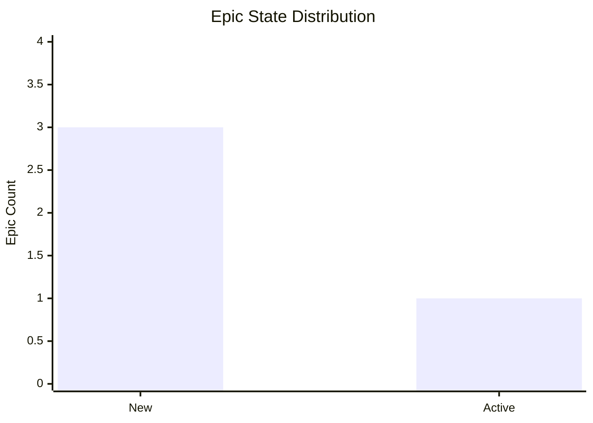
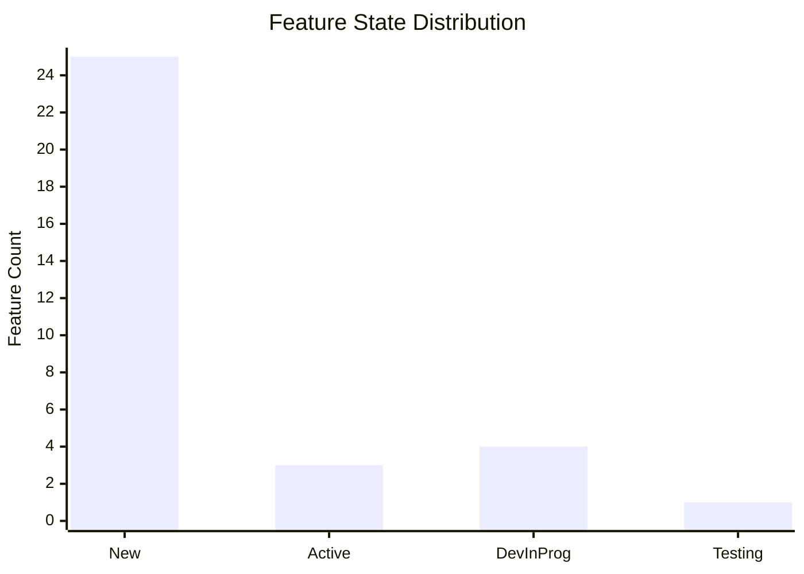
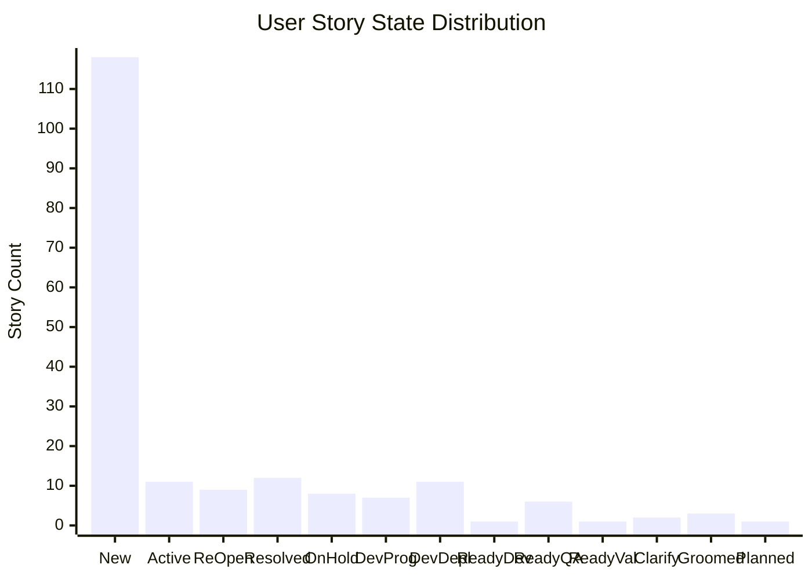
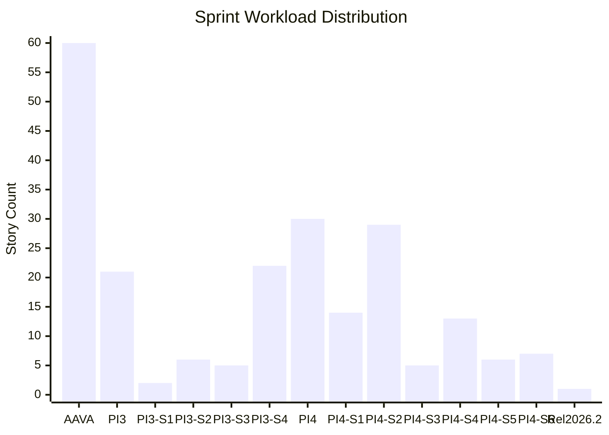
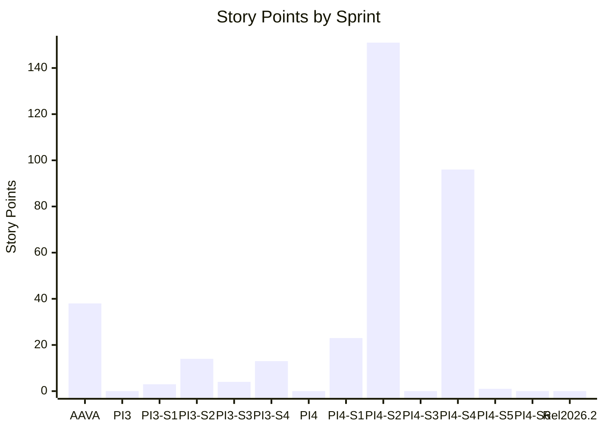
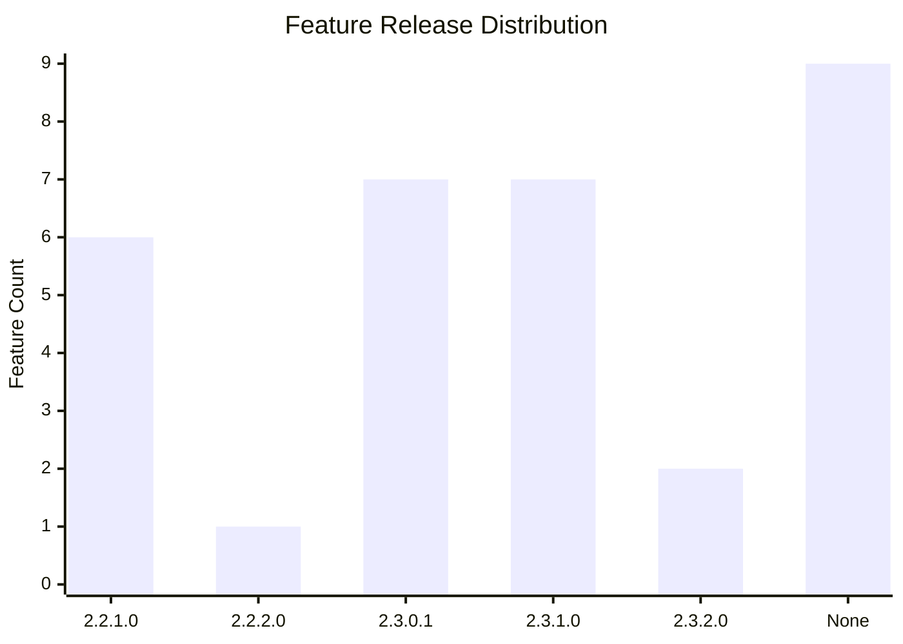
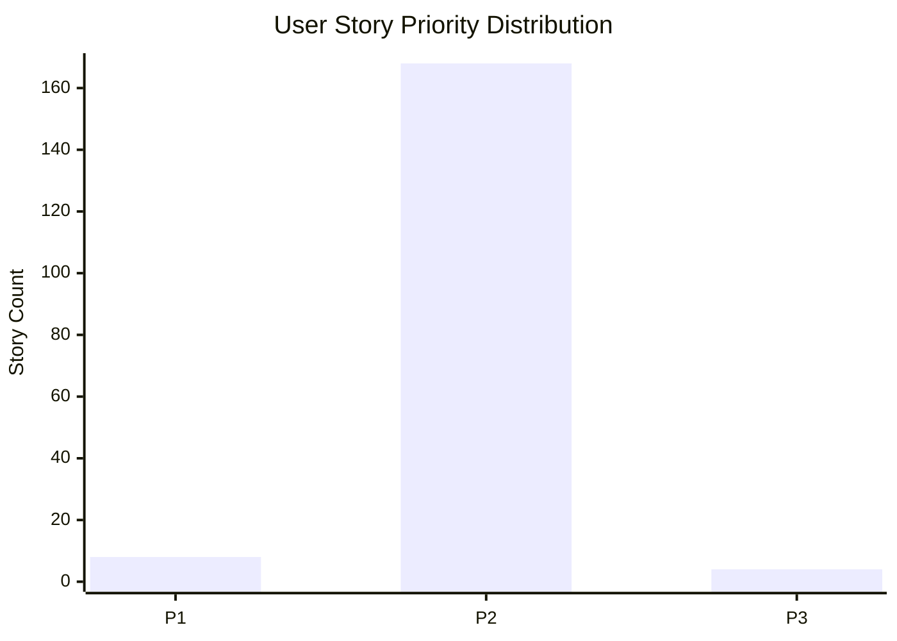
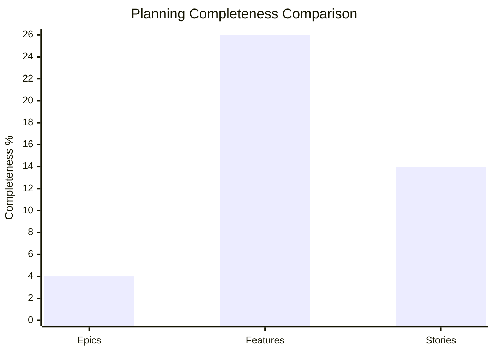
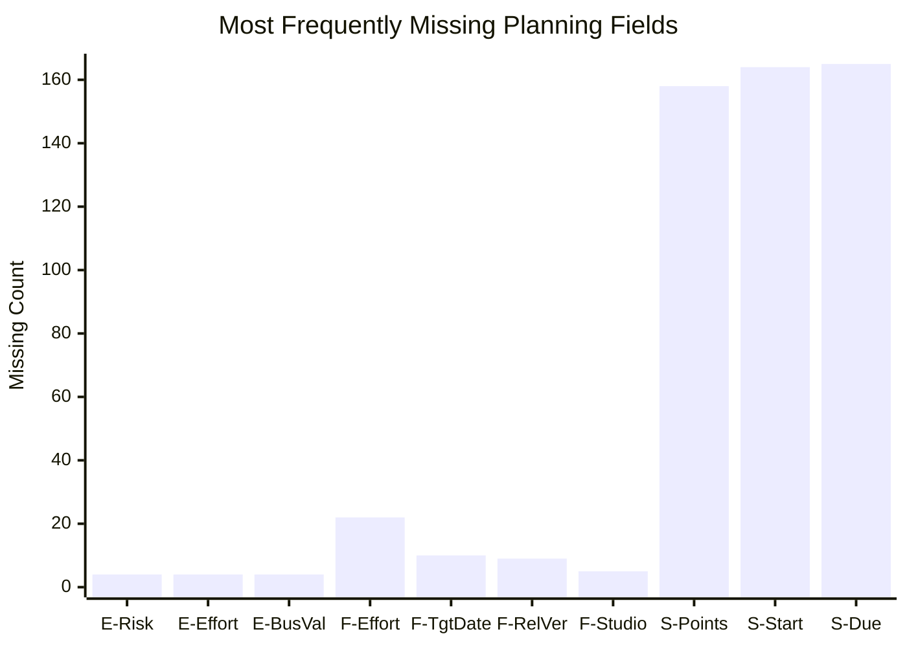
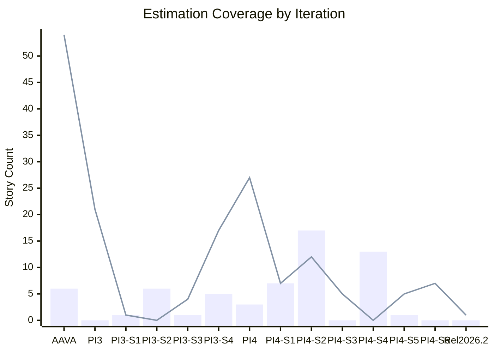

# Azure_DevOps_Planning_and_Sprint_Performance_Report.md

## 1. Complete Epic Planning Table

| Epic ID | Title | Work Item Type | Tag | State | Area Path | Iteration Path | Priority | Risk | Effort | Business Value | Time Criticality | Start Date | Target Date | Work Item URL | Unmapped Planning Fields |
| --- | --- | --- | --- | --- | --- | --- | --- | --- | --- | --- | --- | --- | --- | --- | --- |
| 51718 | Agentic Artifacts Refinement and Governed Learning Management | Epic | Epic | New | AAVA\Integrations | AAVA\PI3 | 2 | Not Provided | Not Provided | Not Provided | Not Provided | Not Provided | Not Provided | https://dev.azure.com/ascendionava/AAVA/_workitems/edit/51718 | Not Provided |
| 51736 | Secure, Scalable MCP Tool Integration and Gateway Platform | Epic | Epic | Active | AAVA\Integrations | AAVA\PI3 | 2 | Not Provided | Not Provided | Not Provided | Not Provided | Not Provided | Not Provided | https://dev.azure.com/ascendionava/AAVA/_workitems/edit/51736 | Not Provided |
| 70804 | Foundation: Token Limit Configuration & Administration | Epic | Epic | New | AAVA\Integrations | AAVA\PI4\Sprint 3 | 2 | Not Provided | Not Provided | Not Provided | Not Provided | Not Provided | Not Provided | https://dev.azure.com/ascendionava/AAVA/_workitems/edit/70804 | Not Provided |
| 70807 | Foundation: Token Limit Monitoring & Notifications | Epic | Epic | New | AAVA\Integrations | AAVA\PI4\Sprint 4 | 1 | Not Provided | Not Provided | Not Provided | Not Provided | Not Provided | Not Provided | https://dev.azure.com/ascendionava/AAVA/_workitems/edit/70807 | Not Provided |

---

## 2. Complete Feature Planning Table

| Feature ID | Title | Work Item Type | Tag | State | Area Path | Iteration Path | Priority | Risk | Effort | Business Value | Time Criticality | Start Date | Target Date | Release Version | Studio | Planned Sprint | Estimated Completion Sprint | Primary User Cohort | Complexity | Work Item URL | Unmapped Planning Fields |
| --- | --- | --- | --- | --- | --- | --- | --- | --- | --- | --- | --- | --- | --- | --- | --- | --- | --- | --- | --- | --- | --- |
| 53397 | Agent Creation & Discovery | Feature | Feature | Dev In Progress | AAVA\Integrations | AAVA\PI3\Sprint 4 | 2 | Not Provided | Not Provided | Not Provided | Not Provided | Not Provided | 2026-09-06T00:00:00Z | 2.2.1.0 | AIG | Sprint 1 | EC Sprint 2 | Not Provided | Not Provided | https://dev.azure.com/ascendionava/AAVA/_workitems/edit/53397 | Primary User Cohort |
| 58004 | CSM and Platform Support Role - Assignment and Flag-Based Capabilities | Feature | Feature | Dev In Progress | AAVA\Integrations | AAVA\PI3\Sprint 2 | 2 | Not Provided | Not Provided | Not Provided | Not Provided | Not Provided | 2026-07-05T00:00:00Z | 2.2.1.0 | AIG | Not Provided | EC Sprint 2 | Not Provided | Not Provided | https://dev.azure.com/ascendionava/AAVA/_workitems/edit/58004 | Primary User Cohort |
| 51778 | Tech Stack Configurations - LLM | Feature | Feature | Testing | AAVA\Integrations | AAVA\PI4\Sprint 3 | 2 | Not Provided | 5.0 | Not Provided | Not Provided | Not Provided | 2026-10-11T00:00:00Z | 2.2.2.0 | AIG | Not Provided | EC Sprint 4 | Not Provided | High | https://dev.azure.com/ascendionava/AAVA/_workitems/edit/51778 | Primary User Cohort |
| 73737 | Tech Stack Configurations - MCP Server | Feature | Feature | Active | AAVA\Integrations | AAVA\PI4\Sprint 2 | 2 | Not Provided | 5.0 | Not Provided | Not Provided | Not Provided | 2026-11-22T00:00:00Z | 2.3.0.1 | AIG | Sprint 1 | EC Sprint 4 | Not Provided | Not Provided | https://dev.azure.com/ascendionava/AAVA/_workitems/edit/73737 | Primary User Cohort |
| 83551 | Tech Stack Configurations – AI & CLI Gateway | Feature | Feature | New | AAVA\Integrations | AAVA\PI4\Sprint 4 | 2 | Not Provided | 5.0 | Not Provided | Not Provided | Not Provided | 2026-10-11T00:00:00Z | 2.3.1.0 | AIG | Sprint 4 | EC Sprint 4 | Not Provided | Not Provided | https://dev.azure.com/ascendionava/AAVA/_workitems/edit/83551 | Primary User Cohort |
| 51765 | On-Behalf-Of (OBO) Security Model for Agent Tool Access | Feature | Feature | Dev In Progress | AAVA\Integrations | AAVA\PI3\Sprint 3 | 2 | Not Provided | 9.0 | Not Provided | Not Provided | Not Provided | 2026-08-09T00:00:00Z | 2.2.1.0 | AIG | Sprint 1 | EC Sprint 2 | Not Provided | Not Provided | https://dev.azure.com/ascendionava/AAVA/_workitems/edit/51765 | Primary User Cohort |
| 58566 | Agent Versioning Enhancement | Feature | Feature | Dev In Progress | AAVA\Integrations | AAVA\PI3\Sprint 4 | 2 | Not Provided | Not Provided | Not Provided | Not Provided | Not Provided | 2026-08-09T00:00:00Z | 2.2.1.0 | AIG | Sprint 3 | Not Provided | Not Provided | Not Provided | https://dev.azure.com/ascendionava/AAVA/_workitems/edit/58566 | Primary User Cohort |
| 51771 | Token Exchange and Enterprise Authentication Patterns | Feature | Feature | New | AAVA\Integrations | AAVA | 2 | Not Provided | 15.0 | Not Provided | Not Provided | Not Provided | 2026-07-05T00:00:00Z | Not Provided | AIG | Sprint 1 | EC Sprint 3 | Not Provided | Not Provided | https://dev.azure.com/ascendionava/AAVA/_workitems/edit/51771 | Primary User Cohort |
| 51720 | Closed-Loop Conversational Refinement with Unified Review | Feature | Feature | New | AAVA\Integrations | AAVA\AAVA BACKLOG | 2 | Not Provided | 26.0 | Not Provided | Not Provided | Not Provided | 2026-08-09T00:00:00Z | Not Provided | AIG | Sprint 3 | EC Sprint 3 | Not Provided | Not Provided | https://dev.azure.com/ascendionava/AAVA/_workitems/edit/51720 | Primary User Cohort |
| 51721 | Structured Feedback Capture and Run Traceability | Feature | Feature | New | AAVA\Integrations | AAVA\AAVA BACKLOG | 2 | Not Provided | 9.0 | Not Provided | Not Provided | Not Provided | 2026-08-09T00:00:00Z | Not Provided | AIG | Sprint 4 | EC Sprint 4 | Not Provided | Not Provided | https://dev.azure.com/ascendionava/AAVA/_workitems/edit/51721 | Primary User Cohort |
| 51722 | Learning Governance Workflow with Role-Based Approval | Feature | Feature | New | AAVA\Integrations | AAVA\AAVA BACKLOG | 2 | Not Provided | 29.0 | Not Provided | Not Provided | Not Provided | 2026-08-09T00:00:00Z | Not Provided | AIG | Sprint 3 | EC Sprint 5 | Not Provided | Not Provided | https://dev.azure.com/ascendionava/AAVA/_workitems/edit/51722 | Primary User Cohort |
| 51733 | Refinement Governance: Impact Analysis, Token Optimisation, and Iteration Control | Feature | Feature | New | AAVA\Integrations | AAVA\AAVA BACKLOG | 2 | Not Provided | 15.0 | Not Provided | Not Provided | Not Provided | 2026-08-09T00:00:00Z | Not Provided | AIG | Sprint 3 | EC Sprint 3 | Not Provided | Not Provided | https://dev.azure.com/ascendionava/AAVA/_workitems/edit/51733 | Primary User Cohort |
| 51735 | Learning Representation, Retrieval, and Controlled Memory Layer | Feature | Feature | New | AAVA\Integrations | AAVA\AAVA BACKLOG | 2 | Not Provided | 25.0 | Not Provided | Not Provided | Not Provided | 2026-08-09T00:00:00Z | Not Provided | AIG | Sprint 4 | EC Sprint 4 | Not Provided | Not Provided | https://dev.azure.com/ascendionava/AAVA/_workitems/edit/51735 | Primary User Cohort |
| 51747 | Enterprise IAM Integration & SSO | Feature | Feature | New | AAVA\Integrations | AAVA\PI4 | 2 | Not Provided | Not Provided | Not Provided | Not Provided | Not Provided | 2026-08-09T00:00:00Z | 2.3.1.0 | AIG | Sprint 3 | EC Sprint 5 | Not Provided | Not Provided | https://dev.azure.com/ascendionava/AAVA/_workitems/edit/51747 | Primary User Cohort |
| 51769 | Schema-Driven Scalable Tool Onboarding | Feature | Feature | New | AAVA\Integrations | AAVA\PI4 | 2 | Not Provided | 12.0 | Not Provided | Not Provided | Not Provided | 2026-07-05T00:00:00Z | Not Provided | AIG | Sprint 4 | EC Sprint 3 | Not Provided | Not Provided | https://dev.azure.com/ascendionava/AAVA/_workitems/edit/51769 | Primary User Cohort |
| 51772 | Pre-Configured Squad-Level Tool Access with Jira Context Auto-Pull | Feature | Feature | New | AAVA\Integrations | AAVA\PI4 | 2 | Not Provided | 15.0 | Not Provided | Not Provided | Not Provided | Not Provided | Not Provided | AIG | Not Provided | EC Sprint 5 | Not Provided | Not Provided | https://dev.azure.com/ascendionava/AAVA/_workitems/edit/51772 | Primary User Cohort |
| 51789 | Enterprise Tool Template Library | Feature | Feature | New | AAVA\Integrations | AAVA\PI4 | 2 | Not Provided | 15.0 | Not Provided | Not Provided | Not Provided | Not Provided | Not Provided | AIG | Not Provided | EC Sprint 4 | Not Provided | Not Provided | https://dev.azure.com/ascendionava/AAVA/_workitems/edit/51789 | Primary User Cohort |
| 51779 | Configurable Defaults and Jira Context Auto-Pull Across Hierarchy Levels | Feature | Feature | New | AAVA\Integrations | AAVA\PI4 | 2 | Not Provided | 11.0 | Not Provided | Not Provided | Not Provided | Not Provided | Not Provided | AIG | Not Provided | EC Sprint 5 | Not Provided | Not Provided | https://dev.azure.com/ascendionava/AAVA/_workitems/edit/51779 | Primary User Cohort |
| 51780 | Enterprise-Scale Access Management via AD Groups and YAML-Driven Policies | Feature | Feature | New | AAVA\Integrations | AAVA\PI4 | 2 | Not Provided | 14.0 | Not Provided | Not Provided | Not Provided | Not Provided | Not Provided | AIG | Not Provided | EC Sprint 5 | Not Provided | Not Provided | https://dev.azure.com/ascendionava/AAVA/_workitems/edit/51780 | Primary User Cohort |
| 51784 | Clean-Build and Hierarchy Reset | Feature | Feature | New | AAVA\Integrations | AAVA | 2 | Not Provided | 8.0 | Not Provided | Not Provided | Not Provided | Not Provided | Not Provided | AIG | Not Provided | EC Sprint 3 | Not Provided | Not Provided | https://dev.azure.com/ascendionava/AAVA/_workitems/edit/51784 | Primary User Cohort |
| 51790 | Tool Configuration Audit Trail | Feature | Feature | New | AAVA\Integrations | AAVA\PI4 | 2 | Not Provided | 24.0 | Not Provided | Not Provided | Not Provided | Not Provided | Not Provided | AIG | Not Provided | EC Sprint 4 | Not Provided | Not Provided | https://dev.azure.com/ascendionava/AAVA/_workitems/edit/51790 | Primary User Cohort |
| 51791 | NLP-Based Tool Suggestion and Guided Onboarding Trigger | Feature | Feature | New | AAVA\Integrations | AAVA\PI4\Sprint 2 | 2 | Not Provided | 22.0 | Not Provided | Not Provided | Not Provided | Not Provided | 2.3.1.0 | AIG | Sprint 2 | Not Provided | Not Provided | Not Provided | https://dev.azure.com/ascendionava/AAVA/_workitems/edit/51791 | Primary User Cohort |
| 51792 | Tool Lifecycle Management — Draft Active Deprecated Retired | Feature | Feature | New | AAVA\Integrations | AAVA\PI4 | 2 | Not Provided | 19.0 | Not Provided | Not Provided | Not Provided | Not Provided | 2.3.1.0 | AIG | Sprint 1 | EC Sprint 2 | Not Provided | High | https://dev.azure.com/ascendionava/AAVA/_workitems/edit/51792 | Primary User Cohort |
| 51928 | Advanced Quality Assurance and Validation Controls | Feature | Feature | New | AAVA\Integrations | AAVA\AAVA BACKLOG | 2 | Not Provided | Not Provided | Not Provided | Not Provided | Not Provided | Not Provided | Not Provided | AIG | Not Provided | Not Provided | Not Provided | Not Provided | https://dev.azure.com/ascendionava/AAVA/_workitems/edit/51928 | Primary User Cohort |
| 51932 | Squad Templates and Self-Service Squad Creation | Feature | Feature | New | AAVA\Integrations | AAVA\PI4 | 2 | Not Provided | Not Provided | Not Provided | Not Provided | Not Provided | Not Provided | Not Provided | AIG | Not Provided | Not Provided | Not Provided | Not Provided | https://dev.azure.com/ascendionava/AAVA/_workitems/edit/51932 | Primary User Cohort |
| 51933 | Structure and Policy Effect Simulation | Feature | Feature | New | AAVA\Integrations | AAVA | 2 | Not Provided | Not Provided | Not Provided | Not Provided | Not Provided | Not Provided | Not Provided | AIG | Not Provided | Not Provided | Not Provided | Not Provided | https://dev.azure.com/ascendionava/AAVA/_workitems/edit/51933 | Primary User Cohort |
| 51935 | Schema-Driven Tool Onboarding — Declarative Model | Feature | Feature | New | AAVA\Integrations | AAVA\PI4 | 2 | Not Provided | Not Provided | Not Provided | Not Provided | Not Provided | Not Provided | 2.3.1.0 | AIG | Sprint 4 | EC Sprint 3 | Not Provided | Not Provided | https://dev.azure.com/ascendionava/AAVA/_workitems/edit/51935 | Primary User Cohort |
| 65074 | MCP Enablement Feature | Feature | Feature | Active | AAVA\Integrations | AAVA\PI4 | 2 | Not Provided | Not Provided | Not Provided | Not Provided | Not Provided | Not Provided | Not Provided | Not Provided | Not Provided | Not Provided | Not Provided | Not Provided | https://dev.azure.com/ascendionava/AAVA/_workitems/edit/65074 | Primary User Cohort |
| 72353 | Agent Versioning Restore (Without Impact Analysis) | Feature | Feature | Dev In Progress | AAVA\Integrations | AAVA\PI3\Sprint 4 | 2 | Not Provided | Not Provided | Not Provided | Not Provided | 2026-07-20T00:00:00Z | 2026-08-18T00:00:00Z | 2.2.1.0 | AIG | Not Provided | Not Provided | Not Provided | Not Provided | https://dev.azure.com/ascendionava/AAVA/_workitems/edit/72353 | Primary User Cohort |
| 72436 | Individual User Token Limit Override | Feature | Feature | New | AAVA\Integrations | AAVA\PI4 | 2 | Not Provided | Not Provided | Not Provided | Not Provided | Not Provided | 2026-10-11T00:00:00Z | 2.3.2.0 | ACS | Not Provided | Not Provided | Not Provided | Not Provided | https://dev.azure.com/ascendionava/AAVA/_workitems/edit/72436 | Primary User Cohort |
| 114968 | Unity Framework Integration for LLM Calls in Databricks from AAVA AI Gateway | Feature | Feature | New | AAVA\Integrations | AAVA\PI4 | 2 | Not Provided | Not Provided | Not Provided | Not Provided | Not Provided | Not Provided | Not Provided | Not Provided | Not Provided | Not Provided | Not Provided | Not Provided | https://dev.azure.com/ascendionava/AAVA/_workitems/edit/114968 | Primary User Cohort |
| 121855 | Onboard Pantheon - LLM Provider in the AAVA AI Gateway | Feature | Feature | New | AAVA\Integrations | AAVA\PI4\Sprint 5 | 2 | Not Provided | Not Provided | Not Provided | Not Provided | Not Provided | Not Provided | Not Provided | Not Provided | Not Provided | Not Provided | Not Provided | Not Provided | https://dev.azure.com/ascendionava/AAVA/_workitems/edit/121855 | Primary User Cohort |

---

## 3. Complete User Story Planning Table

| User Story ID | Title | Work Item Type | Tag | State | Area Path | Iteration Path | Story Points | Priority | Start Date | Due Date | UX Expected | Risk | Studio | Release Version | Planned Sprint | Dependent Team | Work Item URL | Unmapped Planning Fields |
| --- | --- | --- | --- | --- | --- | --- | --- | --- | --- | --- | --- | --- | --- | --- | --- | --- | --- | --- |
| 93164 | Add LLM Models to Dev Environment | User Story | User Story | Active | AAVA\Integrations | AAVA\PI4\Sprint 2 | Not Provided | 2 | Not Provided | Not Provided | Not Provided | Not Provided | AIG | Not Provided | Not Provided | DevSecOps | https://dev.azure.com/ascendionava/AAVA/_workitems/edit/93164 | Not Provided |
| 122848 | Configure LLM Model Access by Organization, Track, Application, and Team | User Story | User Story | New | AAVA\Integrations | AAVA | Not Provided | 2 | Not Provided | Not Provided | Not Provided | Not Provided | AIG | Not Provided | Not Provided | Not Provided | https://dev.azure.com/ascendionava/AAVA/_workitems/edit/122848 | Not Provided |
| 104421 | Sonar Violations and SonarLint usage | User Story | User Story | Active | AAVA\Integrations | AAVA\PI4\Sprint 4 | 3.0 | 1 | Not Provided | 2026-10-14T00:00:00Z | Not Provided | Not Provided | Not Provided | Not Provided | Not Provided | https://dev.azure.com/ascendionava/AAVA/_workitems/edit/104421 | Not Provided |
| 120919 | Resolved Merge Conflicts and Completed Azure Foundry PR | User Story | User Story | Resolved | AAVA\Integrations | AAVA\PI4\Sprint 5 | 1.0 | 2 | 2026-11-02T00:00:00Z | 2026-11-02T00:00:00Z | Not Provided | Not Provided | Not Provided | Not Provided | Not Provided | https://dev.azure.com/ascendionava/AAVA/_workitems/edit/120919 | Not Provided |
| 63449 | Sprint 3 - QE Other Prioritized Activities - Int | User Story | User Story | New | AAVA\Integrations | AAVA\PI3\Sprint 3 | Not Provided | 3 | Not Provided | Not Provided | Not Provided | Not Provided | ACE | Not Provided | Not Provided | Not Provided | https://dev.azure.com/ascendionava/AAVA/_workitems/edit/63449 | Not Provided |
| 53146 | Resolve Security Vulnerabilities Across Backend Services and Dependencies | User Story | User Story | On Hold | AAVA\Integrations | AAVA\PI3\Sprint 1 | 3.0 | 2 | Not Provided | Not Provided | Not Provided | Not Provided | Not Provided | Not Provided | Not Provided | https://dev.azure.com/ascendionava/AAVA/_workitems/edit/53146 | Not Provided |
| 70433 | Sprint 4 - UTC Coverage - Int | User Story | User Story | Active | AAVA\Integrations | AAVA\PI3\Sprint 4 | Not Provided | 2 | Not Provided | Not Provided | Not Provided | Not Provided | Not Provided | Not Provided | Not Provided | https://dev.azure.com/ascendionava/AAVA/_workitems/edit/70433 | Not Provided |
| 119396 | Bug-- Resolve Works Intermittently and Configure Tool Page Displays No Generated Data | User Story | User Story | Resolved | AAVA\Integrations | AAVA\PI4\Sprint 5 | Not Provided | 2 | 2026-10-30T00:00:00Z | 2026-10-30T00:00:00Z | Not Provided | Not Provided | Not Provided | Not Provided | Not Provided | https://dev.azure.com/ascendionava/AAVA/_workitems/edit/119396 | Not Provided |
| 119380 | BUG: Fix Incorrect Python Code Generation During Tool Creation in QE env | User Story | User Story | Resolved | AAVA\Integrations | AAVA\PI4\Sprint 5 | Not Provided | 2 | 2026-10-28T00:00:00Z | 2026-10-28T00:00:00Z | Not Provided | Not Provided | Not Provided | Not Provided | Not Provided | https://dev.azure.com/ascendionava/AAVA/_workitems/edit/119380 | Not Provided |
| 70440 | Sprint 4 - QE Other Prioritized Activities - Int | User Story | User Story | New | AAVA\Integrations | AAVA\PI3\Sprint 4 | Not Provided | 2 | Not Provided | Not Provided | Not Provided | Not Provided | Not Provided | Not Provided | Not Provided | https://dev.azure.com/ascendionava/AAVA/_workitems/edit/70440 | Not Provided |
| 70445 | Sprint 4 - Lead Activities - Int | User Story | User Story | New | AAVA\Integrations | AAVA\PI3\Sprint 4 | Not Provided | 2 | Not Provided | Not Provided | Not Provided | Not Provided | AIG | Not Provided | Not Provided | https://dev.azure.com/ascendionava/AAVA/_workitems/edit/70445 | Not Provided |
| 70449 | Sprint 4 - Client Issue Resolution & Other Team Support - Int | User Story | User Story | New | AAVA\Integrations | AAVA\PI3\Sprint 4 | Not Provided | 2 | Not Provided | Not Provided | Not Provided | Not Provided | Not Provided | Not Provided | Not Provided | https://dev.azure.com/ascendionava/AAVA/_workitems/edit/70449 | Not Provided |
| 70450 | Sprint 4 - Implement Common Logging and Exception Libraries | User Story | User Story | Active | AAVA\Integrations | AAVA\PI3\Sprint 4 | Not Provided | 2 | Not Provided | Not Provided | Not Provided | Not Provided | Not Provided | Not Provided | Not Provided | https://dev.azure.com/ascendionava/AAVA/_workitems/edit/70450 | Not Provided |
| 70431 | Sprint 4 - CVE Remediation and Security Vulnerability Fixes - Int | User Story | User Story | Dev-Deployed | AAVA\Integrations | AAVA\PI3\Sprint 4 | Not Provided | 2 | Not Provided | Not Provided | Not Provided | Not Provided | Not Provided | Not Provided | Not Provided | https://dev.azure.com/ascendionava/AAVA/_workitems/edit/70431 | Not Provided |
| 53369 | Console: Configure Pre-Configuration Defaults for an Assigned Hierarchy Level | User Story | User Story | Ready for Dev | AAVA\Integrations | AAVA\PI3\Sprint 4 | Not Provided | 2 | Not Provided | Not Provided | Not Provided | Not Provided | AIG | Not Provided | Not Provided | https://dev.azure.com/ascendionava/AAVA/_workitems/edit/53369 | Not Provided |
| 107930 | Edit and Validate JSON Parameter Mapping | User Story | User Story | Dev-Deployed | AAVA\Integrations | AAVA\PI4\Sprint 1 | Not Provided | 2 | Not Provided | Not Provided | Not Provided | Not Provided | AIG | Not Provided | Sprint 3 | https://dev.azure.com/ascendionava/AAVA/_workitems/edit/107930 | Not Provided |
| 109933 | Model Identity & Token Limits Configuration Values | User Story | User Story | New | AAVA\Integrations | AAVA\PI4\Sprint 1 | Not Provided | 2 | Not Provided | Not Provided | Not Provided | Not Provided | AIG | Not Provided | Sprint 3 | https://dev.azure.com/ascendionava/AAVA/_workitems/edit/109933 | Not Provided |
| 106264 | Dynamic Model Availability Across AAVA | User Story | User Story | New | AAVA\Integrations | AAVA\PI4\Sprint 1 | Not Provided | 2 | Not Provided | Not Provided | Not Provided | Not Provided | AIG | Not Provided | Sprint 1 | https://dev.azure.com/ascendionava/AAVA/_workitems/edit/106264 | Not Provided |
| 111123 | Expired Model Handling | User Story | User Story | Groomed | AAVA\Integrations | AAVA\PI4\Sprint 4 | Not Provided | 2 | Not Provided | Not Provided | Not Provided | Not Provided | AIG | Not Provided | Not Provided | https://dev.azure.com/ascendionava/AAVA/_workitems/edit/111123 | Not Provided |
| 114380 | MCP Attribute Validation | User Story | User Story | Active | AAVA\Integrations | AAVA\PI4\Sprint 4 | Not Provided | 2 | Not Provided | Not Provided | Not Provided | Not Provided | AIG | Not Provided | Sprint 4 | https://dev.azure.com/ascendionava/AAVA/_workitems/edit/114380 | Not Provided |
| 116401 | LLM Model Expiry Date Validation-SUDO | User Story | User Story | In Progress | AAVA\Integrations | AAVA\PI4\Sprint 4 | Not Provided | 2 | Not Provided | Not Provided | Not Provided | Not Provided | AIG | Not Provided | Not Provided | https://dev.azure.com/ascendionava/AAVA/_workitems/edit/116401 | Not Provided |
| 65602 | Sprint 3 - Client Issue Resolution & Other Team Support - Int | User Story | User Story | Active | AAVA\Integrations | AAVA\PI3\Sprint 3 | Not Provided | 2 | Not Provided | Not Provided | Not Provided | Not Provided | Foundation | Not Provided | Not Provided | https://dev.azure.com/ascendionava/AAVA/_workitems/edit/65602 | Not Provided |
| 36969 | MCP-based GitHub Integration | User Story | User Story | Dev In Progress | AAVA\Integrations | AAVA\PI4\Sprint 2 | 2.0 | 2 | Not Provided | Not Provided | Not Provided | Not Provided | AIG | Not Provided | Not Provided | https://dev.azure.com/ascendionava/AAVA/_workitems/edit/36969 | Not Provided |
| 73732 | UX: MCP server registration flow: dashboard, guided setup, and review | User Story | User Story | Ready for Validation | AAVA\Integrations | AAVA\PI3\Sprint 4 | 2.0 | 2 | Not Provided | 2026-10-28T00:00:00Z | Not Provided | Not Provided | AIG | 2.3.0.1 | Not Provided | https://dev.azure.com/ascendionava/AAVA/_workitems/edit/73732 | Not Provided |
| 53401 | Agent Creation - Select Model | User Story | User Story | Re-Opened | AAVA\Integrations | AAVA\PI3\Sprint 2 | 3.0 | 1 | Not Provided | Not Provided | Not Provided | Not Provided | AIG | 2.2.1.0 | Sprint 1 | https://dev.azure.com/ascendionava/AAVA/_workitems/edit/53401 | Not Provided |
| 53400 | Test Agent in Mini Playground | User Story | User Story | New | AAVA\Integrations | AAVA | 8.0 | 2 | Not Provided | Not Provided | 2026-07-02T15:04:00Z | Not Provided | AIG | Not Provided | Sprint 1 | https://dev.azure.com/ascendionava/AAVA/_workitems/edit/53400 | Not Provided |
| 54251 | Implement OBO flow for agent /workflow/tools | User Story | User Story | New | AAVA\Integrations | AAVA\PI3 | Not Provided | 2 | Not Provided | Not Provided | Not Provided | Not Provided | AIG | Not Provided | Not Provided | https://dev.azure.com/ascendionava/AAVA/_workitems/edit/54251 | Not Provided |
| 54252 | MCP security | User Story | User Story | New | AAVA\Integrations | AAVA\PI3 | Not Provided | 2 | Not Provided | Not Provided | Not Provided | Not Provided | AIG | Not Provided | Not Provided | https://dev.azure.com/ascendionava/AAVA/_workitems/edit/54252 | Not Provided |
| 54356 | Tool & MCP Integration Validation Before Publishing | User Story | User Story | Ready for Design | AAVA\Integrations | AAVA\PI3 | Not Provided | 2 | Not Provided | Not Provided | Not Provided | Not Provided | AIG | Not Provided | Sprint 1 | https://dev.azure.com/ascendionava/AAVA/_workitems/edit/54356 | Not Provided |
| 54359 | Release Notes & Impact Analysis For Tools | User Story | User Story | On Hold | AAVA\Integrations | AAVA\PI3 | Not Provided | 2 | Not Provided | Not Provided | Not Provided | Not Provided | AIG | Not Provided | Sprint 1 | https://dev.azure.com/ascendionava/AAVA/_workitems/edit/54359 | Not Provided |
| 55030 | Autonomous Tool Invocation in Workflows | User Story | User Story | New | AAVA\Integrations | AAVA\PI3 | Not Provided | 1 | Not Provided | Not Provided | Not Provided | Not Provided | AIG | Not Provided | Not Provided | https://dev.azure.com/ascendionava/AAVA/_workitems/edit/55030 | Not Provided |
| 55034 | OBO Permission Enforcement for Autonomous Calls | User Story | User Story | New | AAVA\Integrations | AAVA\PI3 | Not Provided | 2 | Not Provided | Not Provided | Not Provided | Not Provided | AIG | Not Provided | Not Provided | https://dev.azure.com/ascendionava/AAVA/_workitems/edit/55034 | Not Provided |
| 55035 | Autonomous Invocation Audit Logging | User Story | User Story | New | AAVA\Integrations | AAVA\PI3 | Not Provided | 1 | Not Provided | Not Provided | Not Provided | Not Provided | AIG | Not Provided | Not Provided | https://dev.azure.com/ascendionava/AAVA/_workitems/edit/55035 | Not Provided |
| 55039 | Autonomous Invocation Security Boundary Enforcement | User Story | User Story | New | AAVA\Integrations | AAVA\PI3 | Not Provided | 2 | Not Provided | Not Provided | Not Provided | Not Provided | AIG | Not Provided | Not Provided | https://dev.azure.com/ascendionava/AAVA/_workitems/edit/55039 | Not Provided |
| 55074 | Invocation Rate Limiting and Governance | User Story | User Story | New | AAVA\Integrations | AAVA\PI3 | Not Provided | 2 | Not Provided | Not Provided | Not Provided | Not Provided | AIG | Not Provided | Not Provided | https://dev.azure.com/ascendionava/AAVA/_workitems/edit/55074 | Not Provided |
| 55075 | Secure Logging and Secret Protection | User Story | User Story | New | AAVA\Integrations | AAVA\PI3 | Not Provided | 1 | Not Provided | Not Provided | Not Provided | NotProvided | AIG | Not Provided | Not Provided | https://dev.azure.com/ascendionava/AAVA/_workitems/edit/55075 | Not Provided |
| 55076 | Schema-Driven Tool Onboarding | User Story | User Story | New | AAVA\Integrations | AAVA\PI3 | Not Provided | 1 | Not Provided | Not Provided | Not Provided | Not Provided | AIG | Not Provided | Not Provided | https://dev.azure.com/ascendionava/AAVA/_workitems/edit/55076 | Not Provided |
| 55077 | Schema Validation and Connection Testing | User Story | User Story | New | AAVA\Integrations | AAVA\PI3 | Not Provided | 2 | Not Provided | Not Provided | Not Provided | Not Provided | AIG | Not Provided | Not Provided | https://dev.azure.com/ascendionava/AAVA/_workitems/edit/55077 | Not Provided |
| 55078 | Tool Versioning and Metadata Management | User Story | User Story | New | AAVA\Integrations | AAVA\PI3 | Not Provided | 2 | Not Provided | Not Provided | Not Provided | Not Provided | AIG | Not Provided | Not Provided | https://dev.azure.com/ascendionava/AAVA/_workitems/edit/55078 | Not Provided |
| 56722 | UX- Configurable Defaults and Jira Context Auto-Pull Across Hierarchy Levels | User Story | User Story | New | AAVA\Integrations | AAVA\PI3 | Not Provided | 2 | Not Provided | Not Provided | Not Provided | Not Provided | AIG | Not Provided | Not Provided | https://dev.azure.com/ascendionava/AAVA/_workitems/edit/56722 | Not Provided |
| 56726 | UI- Configurable Defaults and Jira Context Auto-Pull Across Hierarchy Levels | User Story | User Story | New | AAVA\Integrations | AAVA\PI3 | Not Provided | 2 | Not Provided | Not Provided | Not Provided | Not Provided | AIG | Not Provided | Not Provided | https://dev.azure.com/ascendionava/AAVA/_workitems/edit/56726 | Not Provided |
| 56728 | API- Configurable Defaults and Jira Context Auto-Pull Across Hierarchy Levels | User Story | User Story | New | AAVA\Integrations | AAVA\PI3 | Not Provided | 2 | Not Provided | Not Provided | Not Provided | Not Provided | AIG | Not Provided | Not Provided | https://dev.azure.com/ascendionava/AAVA/_workitems/edit/56728 | Not Provided |
| 57510 | UX: View and manage property values at a node | User Story | User Story | New | AAVA\Integrations | AAVA\PI4 | Not Provided | 2 | Not Provided | Not Provided | Not Provided | Not Provided | AIG | Not Provided | Not Provided | https://dev.azure.com/ascendionava/AAVA/_workitems/edit/57510 | Not Provided |
| 57816 | UI -Agent Permission Denied Notification & Audit UI | User Story | User Story | Require Clarification | AAVA\Integrations | AAVA\PI3\Sprint 4 | Not Provided | 2 | Not Provided | Not Provided | Not Provided | Not Provided | AIG | Not Provided | Not Provided | https://dev.azure.com/ascendionava/AAVA/_workitems/edit/57816 | Not Provided |
| 57820 | API- On-Behalf-Of (OBO) Authorization Enforcement APIs | User Story | User Story | Require Clarification | AAVA\Integrations | AAVA\PI3\Sprint 4 | Not Provided | 2 | Not Provided | Not Provided | Not Provided | Not Provided | AIG | Not Provided | Not Provided | https://dev.azure.com/ascendionava/AAVA/_workitems/edit/57820 | Not Provided |
| 58006 | SUDO - CSM and PS Role Assignment | User Story | User Story | Re-Opened | AAVA\Integrations | AAVA\PI3\Sprint 2 | 5.0 | 2 | Not Provided | Not Provided | Not Provided | Not Provided | AIG | 2.2.1.0 | Not Provided | https://dev.azure.com/ascendionava/AAVA/_workitems/edit/58006 | Not Provided |
| 64169 | Revoke Admin and User Role Access for CSM & PS Role Users | User Story | User Story | Re-Opened | AAVA\Integrations | AAVA\PI3\Sprint 3 | 4.0 | 2 | Not Provided | Not Provided | Not Provided | Not Provided | AIG | 2.2.1.0 | Not Provided | https://dev.azure.com/ascendionava/AAVA/_workitems/edit/64169 | Not Provided |
| 58014 | UX: Tool Lifecycle Status Indicators and Transitions | User Story | User Story | On Hold | AAVA\Integrations | AAVA\PI3\Sprint 4 | 2.0 | 2 | Not Provided | Not Provided | Not Provided | Not Provided | AIG | Not Provided | Not Provided | https://dev.azure.com/ascendionava/AAVA/_workitems/edit/58014 | Not Provided |
| 58015 | Notify Affected Agent and Workflow Owners on Tool Deprecation or Retirement | User Story | User Story | New | AAVA\Integrations | AAVA\PI4 | Not Provided | 2 | Not Provided | Not Provided | Not Provided | Not Provided | AIG | Not Provided | Not Provided | https://dev.azure.com/ascendionava/AAVA/_workitems/edit/58015 | Not Provided |
| 58016 | Enforce Invocation Rules for Deprecated Tools | User Story | User Story | New | AAVA\Integrations | AAVA\PI4 | Not Provided | 2 | Not Provided | Not Provided | Not Provided | Not Provided | AIG | Not Provided | Not Provided | https://dev.azure.com/ascendionava/AAVA/_workitems/edit/58016 | Not Provided |
| 58018 | Impact Analysis Report for Tool Lifecycle Transitions | User Story | User Story | New | AAVA\Integrations | AAVA\PI4 | Not Provided | 2 | Not Provided | Not Provided | Not Provided | Not Provided | AIG | Not Provided | Not Provided | https://dev.azure.com/ascendionava/AAVA/_workitems/edit/58018 | Not Provided |
| 58019 | Manage Tool Lifecycle Through Formal States (Draft → Active → Deprecated → Retired) | User Story | User Story | New | AAVA\Integrations | AAVA\PI4 | Not Provided | 2 | Not Provided | NotProvided | Not Provided | Not Provided | AIG | Not Provided | Not Provided | https://dev.azure.com/ascendionava/AAVA/_workitems/edit/58019 | Not Provided |
| 62832 | Enabling - GPT 5.3 codex spark | User Story | User Story | On Hold | AAVA\Integrations | AAVA\Release_2026.2.0 | Not Provided | 2 | Not Provided | Not Provided | Not Provided | Not Provided | Not Provided | Not Provided | Not Provided | https://dev.azure.com/ascendionava/AAVA/_workitems/edit/62832 | Not Provided |
| 57750 | UI -Build Agent Version History | User Story | User Story | Re-Opened | AAVA\Integrations | AAVA\PI3\Sprint 4 | 3.0 | 2 | Not Provided | 2026-08-10T00:00:00Z | Not Provided | Not Provided | AIG | 2.2.1.0 | Not Provided | https://dev.azure.com/ascendionava/AAVA/_workitems/edit/57750 | Not Provided |
| 65153 | API- Restore Agent to Previous Version from Version History | User Story | User Story | Re-Opened | AAVA\Integrations | AAVA\PI4\Sprint 1 | 3.0 | 2 | Not Provided | 2026-08-14T00:00:00Z | Not Provided | Not Provided | AIG | 2.2.1.0 | Not Provided | https://dev.azure.com/ascendionava/AAVA/_workitems/edit/65153 | Not Provided |
| 70924 | UI-Feature Flag- Restore | User Story | User Story | Ready for QA | AAVA\Integrations | AAVA\PI3\Sprint 4 | 1.0 | 2 | Not Provided | Not Provided | Not Provided | Not Provided | AIG | 2.2.1.0 | Not Provided | https://dev.azure.com/ascendionava/AAVA/_workitems/edit/70924 | Not Provided |
| 69441 | Discover: Add MCP Search Functionality | User Story | User Story | Ready for QA | AAVA\Integrations | AAVA\PI3\Sprint 4 | Not Provided | 2 | 2026-07-27T00:00:00Z | 2026-07-28T10:39:00Z | Not Provided | Not Provided | Not Provided | Not Provided | Not Provided | https://dev.azure.com/ascendionava/AAVA/_workitems/edit/69441 | Not Provided |
| 54249 | CORE: SAML Integration in Auth Service | User Story | User Story | New | AAVA\Integrations | AAVA\PI3\Sprint 4 | Not Provided | 2 | Not Provided | Not Provided | Not Provided | Not Provided | AIG | Not Provided | Not Provided | https://dev.azure.com/ascendionava/AAVA/_workitems/edit/54249 | Not Provided |
| 65570 | Display Personalised Welcome Message on Platform Landing Pages | User Story | User Story | Dev-Deployed | AAVA\Integrations | AAVA\PI3\Sprint 3 | Not Provided | 2 | Not Provided | Not Provided | Not Provided | Not Provided | Not Provided | Not Provided | Not Provided | https://dev.azure.com/ascendionava/AAVA/_workitems/edit/65570 | Not Provided |
| 57150 | Playground Menu Left nav for conversational with Selection of Models drop down similar to 1.0 | User Story | User Story | New | AAVA\Integrations | AAVA | Not Provided | 3 | Not Provided | Not Provided | Not Provided | 1 - High | AIG | 2.3.2.0 | Not Provided | https://dev.azure.com/ascendionava/AAVA/_workitems/edit/57150 | Not Provided |
| 66418 | OBO Authentication for Predefined Integration Tools | User Story | User Story | Active | AAVA\Integrations | AAVA\PI3\Sprint 4 | Not Provided | 2 | Not Provided | Not Provided | Not Provided | Not Provided | AIG | Not Provided | Not Provided | https://dev.azure.com/ascendionava/AAVA/_workitems/edit/66418 | Not Provided |
| 66487 | Data bricks model changes in ai gateway | User Story | User Story | Dev-Deployed | AAVA\Integrations | AAVA\PI3\Sprint 2 | Not Provided | 2 | Not Provided | Not Provided | Not Provided | Not Provided | Not Provided | Not Provided | Not Provided | https://dev.azure.com/ascendionava/AAVA/_workitems/edit/66487 | Not Provided |
| 71193 | Checkmarx SAST & SCA Findings Remediation (17th July 2026) | User Story | User Story | In Progress | AAVA\Integrations | AAVA\PI3\Sprint 4 | Not Provided | 2 | Not Provided | NotProvided | Not Provided | Not Provided | Not Provided | Not Provided | Not Provided | https://dev.azure.com/ascendionava/AAVA/_workitems/edit/71193 | Not Provided |
| 68494 | MCP: QTest | User Story | User Story | New | AAVA\Integrations | AAVA\PI3 | Not Provided | 2 | Not Provided | NotProvided | Not Provided | Not Provided | Not Provided | Not Provided | Not Provided | https://dev.azure.com/ascendionava/AAVA/_workitems/edit/68494 | Not Provided |
| 68495 | MCP: TestRail | User Story | User Story | New | AAVA\Integrations | AAVA\PI4 | Not Provided | 2 | Not Provided | NotProvided | Not Provided | Not Provided | Not Provided | Not Provided | Not Provided | https://dev.azure.com/ascendionava/AAVA/_workitems/edit/68495 | Not Provided |
| 73869 | Executor (Execute-Only Role): Invoke Agent, Workflow Without Visibility of Internal Configuration | User Story | User Story | Re-Opened | AAVA\Integrations | AAVA\PI4\Sprint 1 | 5.0 | 2 | Not Provided | 2026-08-18T00:00:00Z | Not Provided | Not Provided | AIG | 2.2.1.0 | Sprint 1 | https://dev.azure.com/ascendionava/AAVA/_workitems/edit/73869 | Not Provided |
| 81732 | API: LLM Model - Details Page - Functionality | User Story | User Story | Planned | AAVA\Integrations | AAVA\PI4\Sprint 2 | 5.0 | 2 | Not Provided | 2026-08-25T00:00:00Z | Not Provided | Not Provided | AIG | Not Provided | Sprint 1 | https://dev.azure.com/ascendionava/AAVA/_workitems/edit/81732 | Not Provided |
| 81826 | API: Add LLM Model: Level Access Step (Default – Full Organization) | User Story | User Story | Active | AAVA\Integrations | AAVA\PI4\Sprint 2 | 15.0 | 2 | Not Provided | 2026-08-28T00:00:00Z | NotProvided | Not Provided | AIG | Not Provided | Sprint 1 | https://dev.azure.com/ascendionava/AAVA/_workitems/edit/81826 | Not Provided |
| 103158 | KPMG - Consume Claude models from Azure AI Foundry as LLM providers in the platform | User Story | User Story | Resolved | AAVA\Integrations | AAVA\PI4 | Not Provided | 2 | 2026-10-01T00:00:00Z | 2026-10-07T00:00:00Z | Not Provided | Not Provided | AIG | Not Provided | Not Provided | https://dev.azure.com/ascendionava/AAVA/_workitems/edit/103158 | Not Provided |
| 74517 | Hide Version History | User Story | User Story | Ready for QA | AAVA\Integrations | AAVA\PI3\Sprint 4 | 2.0 | 2 | Not Provided | NotProvided | Not Provided | Not Provided | AIG | 2.2.1.0 | Not Provided | https://dev.azure.com/ascendionava/AAVA/_workitems/edit/74517 | Not Provided |
| 75029 | PI4 Sprint 4 - Backlog Defect/Current Build Defect Resolution - Int | User Story | User Story | New | AAVA\Integrations | AAVA | Not Provided | 2 | Not Provided | NotProvided | Not Provided | Not Provided | Not Provided | Not Provided | Not Provided | https://dev.azure.com/ascendionava/AAVA/_workitems/edit/75029 | Not Provided |
| 75031 | PI4 Sprint 4 - CVE Remediation and Security Vulnerability Fixes - Int | User Story | User Story | New | AAVA\Integrations | AAVA | Not Provided | 2 | NotProvided | NotProvided | Not Provided | Not Provided | Not Provided | Not Provided | Not Provided | https://dev.azure.com/ascendionava/AAVA/_workitems/edit/75031 | Not Provided |
| 75033 | PI4 Sprint 4 - UTC Coverage - Int | User Story | User Story | New | AAVA\Integrations | AAVA | Not Provided | 2 | NotProvided | NotProvided | Not Provided | Not Provided | Not Provided | Not Provided | Not Provided | https://dev.azure.com/ascendionava/AAVA/_workitems/edit/75033 | Not Provided |
| 75036 | PI4 Sprint 4 - QE Other Prioritized Activities - Int | User Story | User Story | New | AAVA\Integrations | AAVA | Not Provided | 2 | NotProvided | NotProvided | Not Provided | Not Provided | Not Provided | Not Provided | Not Provided | https://dev.azure.com/ascendionava/AAVA/_workitems/edit/75036 | Not Provided |
| 75037 | PI4 Sprint 4 - Release Activities - Int | User Story | User Story | New | AAVA\Integrations | AAVA | Not Provided | 2 | NotProvided | NotProvided | Not Provided | Not Provided | Not Provided | Not Provided | Not Provided | https://dev.azure.com/ascendionava/AAVA/_workitems/edit/75037 | Not Provided |
| 75039 | PI4 Sprint 4 - Lead Activities - Int | User Story | User Story | New | AAVA\Integrations | AAVA | Not Provided | 2 | NotProvided | NotProvided | Not Provided | Not Provided | Not Provided | Not Provided | Not Provided | https://dev.azure.com/ascendionava/AAVA/_workitems/edit/75039 | Not Provided |
| 75042 | PI4 Sprint 4 - Client Issue Resolution & Other Team Support - Int | User Story | User Story | New | AAVA\Integrations | AAVA | Not Provided | 2 | NotProvided | NotProvided | Not Provided | Not Provided | Not Provided | Not Provided | Not Provided | https://dev.azure.com/ascendionava/AAVA/_workitems/edit/75042 | Not Provided |
| 75043 | PI4 Sprint 3 - Backlog Defect/Current Build Defect Resolution - Int | User Story | User Story | New | AAVA\Integrations | AAVA | Not Provided | 2 | NotProvided | NotProvided | Not Provided | Not Provided | Not Provided | Not Provided | Not Provided | https://dev.azure.com/ascendionava/AAVA/_workitems/edit/75043 | Not Provided |
| 75045 | PI4 Sprint 3 - CVE Remediation and Security Vulnerability Fixes - Int | User Story | User Story | New | AAVA\Integrations | AAVA | Not Provided | 2 | NotProvided | NotProvided | Not Provided | Not Provided | Not Provided | Not Provided | Not Provided | https://dev.azure.com/ascendionava/AAVA/_workitems/edit/75045 | Not Provided |
| 75047 | PI4 Sprint 3 - UTC Coverage - Int | User Story | User Story | New | AAVA\Integrations | AAVA | Not Provided | 2 | NotProvided | NotProvided | Not Provided | Not Provided | Not Provided | Not Provided | Not Provided | https://dev.azure.com/ascendionava/AAVA/_workitems/edit/75047 | Not Provided |
| 75050 | PI4 Sprint 3 - QE Other Prioritized Activities - Int | User Story | User Story | New | AAVA\Integrations | AAVA | Not Provided | 2 | NotProvided | NotProvided | Not Provided | Not Provided | Not Provided | Not Provided | Not Provided | https://dev.azure.com/ascendionava/AAVA/_workitems/edit/75050 | Not Provided |
| 75051 | PI4 Sprint 3 - Release Activities - Int | User Story | User Story | New | AAVA\Integrations | AAVA | Not Provided | 2 | NotProvided | NotProvided | Not Provided | Not Provided | Not Provided | Not Provided | Not Provided | https://dev.azure.com/ascendionava/AAVA/_workitems/edit/75051 | Not Provided |
| 75053 | PI4 Sprint 3 - Lead Activities - Int | User Story | User Story | New | AAVA\Integrations | AAVA | Not Provided | 2 | NotProvided | NotProvided | Not Provided | Not Provided | Not Provided | Not Provided | NotProvided | https://dev.azure.com/ascendionava/AAVA/_workitems/edit/75053 | Not Provided |
| 75056 | PI4 Sprint 3 - Client Issue Resolution & Other Team Support - Int | User Story | User Story | New | AAVA\Integrations | AAVA | Not Provided | 2 | NotProvided | NotProvided | Not Provided | Not Provided | Not Provided | Not Provided | NotProvided | https://dev.azure.com/ascendionava/AAVA/_workitems/edit/75056 | Not Provided |
| 75057 | PI4 Sprint 2 - Backlog Defect/Current Build Defect Resolution - Int | User Story | User Story | New | AAVA\Integrations | AAVA\PI4\Sprint 2 | Not Provided | 2 | NotProvided | NotProvided | Not Provided | Not Provided | Not Provided | Not Provided | NotProvided | https://dev.azure.com/ascendionava/AAVA/_workitems/edit/75057 | Not Provided |
| 75059 | PI4 Sprint 2 - CVE Remediation and Security Vulnerability Fixes - Int | User Story | User Story | New | AAVA\Integrations | AAVA\PI4\Sprint 2 | Not Provided | 2 | NotProvided | NotProvided | Not Provided | Not Provided | Not Provided | Not Provided | NotProvided | https://dev.azure.com/ascendionava/AAVA/_workitems/edit/75059 | Not Provided |
| 75061 | PI4 Sprint 2 - UTC Coverage - Int | User Story | User Story | New | AAVA\Integrations | AAVA\PI4\Sprint 2 | Not Provided | 2 | NotProvided | NotProvided | Not Provided | Not Provided | Not Provided | Not Provided | NotProvided | https://dev.azure.com/ascendionava/AAVA/_workitems/edit/75061 | Not Provided |
| 75064 | PI4 Sprint 2 - QE Other Prioritized Activities - Int | User Story | User Story | New | AAVA\Integrations | AAVA\PI4\Sprint 2 | Not Provided | 2 | NotProvided | NotProvided | Not Provided | Not Provided | Not Provided | Not Provided | NotProvided | https://dev.azure.com/ascendionava/AAVA/_workitems/edit/75064 | Not Provided |
| 75065 | PI4 Sprint 2 - Release Activities - Int | User Story | User Story | New | AAVA\Integrations | AAVA\PI4\Sprint 2 | Not Provided | 2 | NotProvided | NotProvided | Not Provided | Not Provided | Not Provided | Not Provided | NotProvided | https://dev.azure.com/ascendionava/AAVA/_workitems/edit/75065 | Not Provided |
| 75067 | PI4 Sprint 2 - Lead Activities - Int | User Story | User Story | New | AAVA\Integrations | AAVA\PI4\Sprint 2 | Not Provided | 2 | NotProvided | NotProvided | Not Provided | Not Provided | Not Provided | Not Provided | NotProvided | https://dev.azure.com/ascendionava/AAVA/_workitems/edit/75067 | Not Provided |
| 75070 | PI4 Sprint 2 - Client Issue Resolution & Other Team Support - Int | User Story | User Story | New | AAVA\Integrations | AAVA\PI4\Sprint 2 | Not Provided | 2 | NotProvided | NotProvided | Not Provided | Not Provided | Not Provided | Not Provided | NotProvided | https://dev.azure.com/ascendionava/AAVA/_workitems/edit/75070 | Not Provided |
| 75215 | Enforce Invocation Failure for Retired Tools | User Story | User Story | New | AAVA\Integrations | AAVA\PI4 | Not Provided | 2 | NotProvided | NotProvided | Not Provided | Not Provided | Not Provided | Not Provided | NotProvided | https://dev.azure.com/ascendionava/AAVA/_workitems/edit/75215 | Not Provided |
| 75216 | Record All Lifecycle State Transitions in the Tool Audit Trail | User Story | User Story | New | AAVA\Integrations | AAVA\PI4 | Not Provided | 2 | NotProvided | NotProvided | Not Provided | Not Provided | Not Provided | Not Provided | NotProvided | https://dev.azure.com/ascendionava/AAVA/_workitems/edit/75216 | Not Provided |
| 75217 | Draft-to-Active Approval Workflow | User Story | User Story | New | AAVA\Integrations | AAVA\PI4 | Not Provided | 2 | NotProvided | NotProvided | Not Provided | Not Provided | Not Provided | Not Provided | NotProvided | https://dev.azure.com/ascendionava/AAVA/_workitems/edit/75217 | Not Provided |
| 75218 | Admin-Initiated Tool Deprecation with Impact Analysis | User Story | User Story | New | AAVA\Integrations | AAVA\PI4 | Not Provided | 2 | NotProvided | NotProvided | Not Provided | Not Provided | Not Provided | Not Provided | NotProvided | https://dev.azure.com/ascendionava/AAVA/_workitems/edit/75218 | Not Provided |
| 75219 | Feature Flag–Controlled Deprecation and Retirement Actions for Admin and Super-Admin | User Story | User Story | New | AAVA\Integrations | AAVA\PI4 | Not Provided | 2 | NotProvided | NotProvided | Not Provided | Not Provided | Not Provided | Not Provided | NotProvided | https://dev.azure.com/ascendionava/AAVA/_workitems/edit/75219 | Not Provided |
| 75220 | Allow Admins to Restore a Deprecated Tool to Active Without Secondary Approval | User Story | User Story | New | AAVA\Integrations | AAVA\PI4 | Not Provided | 2 | NotProvided | NotProvided | Not Provided | Not Provided | Not Provided | NotProvided | NotProvided | https://dev.azure.com/ascendionava/AAVA/_workitems/edit/75220 | Not Provided |
| 75221 | Allow Admins to Retire a Deprecated Tool After Impact Review | User Story | User Story | New | AAVA\Integrations | AAVA\PI4 | Not Provided | 2 | NotProvided | NotProvided | Not Provided | Not Provided | Not Provided | NotProvided | NotProvided | https://dev.azure.com/ascendionava/AAVA/_workitems/edit/75221 | Not Provided |
| 75222 | Restore a Tool from Retired State (Super-Admin Only with Secondary Approval) | User Story | User Story | New | AAVA\Integrations | AAVA\PI4 | Not Provided | 2 | NotProvided | NotProvided | Not Provided | Not Provided | Not Provided | NotProvided | NotProvided | https://dev.azure.com/ascendionava/AAVA/_workitems/edit/75222 | Not Provided |
| 75267 | UX: NLP-based Tool Suggestion, Matching, Clone, and Guided Creation | User Story | User Story | On Hold | AAVA\Integrations | AAVA\PI4 | Not Provided | 2 | NotProvided | NotProvided | Not Provided | Not Provided | Not Provided | NotProvided | NotProvided | https://dev.azure.com/ascendionava/AAVA/_workitems/edit/75267 | Not Provided |
| 75325 | SUDO: MCP Server List | User Story | User Story | New | AAVA\Integrations | AAVA\PI4\Sprint 2 | 16.0 | 2 | NotProvided | NotProvided | Not Provided | Not Provided | Not Provided | NotProvided | NotProvided | https://dev.azure.com/ascendionava/AAVA/_workitems/edit/75325 | Not Provided |
| 75273 | Detect Unrecognized Tool References During Natural Language Agent Building | User Story | User Story | New | AAVA\Integrations | AAVA | NotProvided | 2 | NotProvided | NotProvided | Not Provided | Not Provided | Not Provided | NotProvided | NotProvided | https://dev.azure.com/ascendionava/AAVA/_workitems/edit/75273 | Not Provided |
| 75278 | Display Matching Tools and MCP Endpoints Before Initiating New Tool Creation | User Story | User Story | New | AAVA\Integrations | AAVA | NotProvided | 2 | NotProvided | 2026-09-30T00:00:00Z | Not Provided | Not Provided | Not Provided | NotProvided | NotProvided | https://dev.azure.com/ascendionava/AAVA/_workitems/edit/75278 | Not Provided |
| 75280 | Enable Users to Test Existing Tools from the Matching Results Panel | User Story | User Story | New | AAVA\Integrations | AAVA | NotProvided | 2 | NotProvided | 2026-09-30T00:00:00Z | Not Provided | Not Provided | Not Provided | NotProvided | NotProvided | https://dev.azure.com/ascendionava/AAVA/_workitems/edit/75280 | Not Provided |
| 75281 | Require Justification Before Cloning an Existing Tool or Creating a New Tool | User Story | User Story | New | AAVA\Integrations | AAVA | NotProvided | 2 | NotProvided | 2026-09-30T00:00:00Z | Not Provided | Not Provided | Not Provided | NotProvided | NotProvided | https://dev.azure.com/ascendionava/AAVA/_workitems/edit/75281 | Not Provided |
| 75282 | Guide Users Through Step-by-Step Tool Creation with Pre-Populated Fields | User Story | User Story | New | AAVA\Integrations | AAVA | NotProvided | 2 | NotProvided | 2026-09-30T00:00:00Z | Not Provided | Not Provided | Not Provided | NotProvided | NotProvided | https://dev.azure.com/ascendionava/AAVA/_workitems/edit/75282 | Not Provided |
| 75283 | Save and Test the Validated Tool Definition from the Creation Flow | User Story | User Story | New | AAVA\Integrations | AAVA | NotProvided | 2 | NotProvided | 2026-09-30T00:00:00Z | Not Provided | Not Provided | Not Provided | NotProvided | NotProvided | https://dev.azure.com/ascendionava/AAVA/_workitems/edit/75283 | Not Provided |
| 75284 | Validate Tool Definition After Creation or Refinement and Display Errors with Fix Suggestions | User Story | User Story | New | AAVA\Integrations | AAVA | NotProvided | 2 | NotProvided | 2026-09-30T00:00:00Z | Not Provided | Not Provided | Not Provided | NotProvided | NotProvided | https://dev.azure.com/ascendionava/AAVA/_workitems/edit/75284 | Not Provided |
| 75285 | Allow Users to Refine the AI-Generated Tool Definition Using a Refine Action | User Story | User Story | New | AAVA\Integrations | AAVA | NotProvided | 2 | NotProvided | 2026-09-30T00:00:00Z | Not Provided | Not Provided | Not Provided | NotProvided | NotProvided | https://dev.azure.com/ascendionava/AAVA/_workitems/edit/75285 | Not Provided |
| 93754 | UI: SUDO: MCP Server List | User Story | User Story | New | AAVA\Integrations | AAVA\PI4\Sprint 2 | 16.0 | 2 | NotProvided | NotProvided | Not Provided | Not Provided | Not Provided | NotProvided | NotProvided | https://dev.azure.com/ascendionava/AAVA/_workitems/edit/93754 | Not Provided |
| 93755 | API: SUDO: MCP Server List | User Story | User Story | New | AAVA\Integrations | AAVA\PI4\Sprint 2 | 16.0 | 2 | NotProvided | NotProvided | Not Provided | Not Provided | Not Provided | NotProvided | NotProvided | https://dev.azure.com/ascendionava/AAVA/_workitems/edit/93755 | Not Provided |
| 75326 | Add MCP – Identify & Capabilities | User Story | User Story | Resolved | AAVA\Integrations | AAVA\PI4\Sprint 4 | 10.0 | 2 | NotProvided | 2026-10-28T00:00:00Z | Not Provided | Not Provided | AIG | 2.3.0.1 | NotProvided | https://dev.azure.com/ascendionava/AAVA/_workitems/edit/75326 | Not Provided |
| 122850 | Enable Level Access for MCP Onboarding | User Story | User Story | New | AAVA\Integrations | AAVA | 10.0 | 2 | NotProvided | NotProvided | Not Provided | Not Provided | AIG | NotProvided | NotProvided | https://dev.azure.com/ascendionava/AAVA/_workitems/edit/122850 | Not Provided |
| 110457 | Add MCP – Connection Configuration | User Story | User Story | Dev In Progress | AAVA\Integrations | AAVA\PI4\Sprint 4 | 10.0 | 2 | NotProvided | 2026-10-28T00:00:00Z | Not Provided | Not Provided | AIG | 2.3.0.1 | NotProvided | https://dev.azure.com/ascendionava/AAVA/_workitems/edit/110457 | Not Provided |
| 113707 | Bug Fix 2.1.3.1- KB Read is failing when we use agent with KB | User Story | User Story | Resolved | AAVA\Integrations | AAVA\PI4\Sprint 4 | 16.0 | 2 | 2026-10-12T00:00:00Z | 2026-10-13T00:00:00Z | Not Provided | Not Provided | NotProvided | NotProvided | NotProvided | https://dev.azure.com/ascendionava/AAVA/_workitems/edit/113707 | Not Provided |
| 113708 | Bug- Fix - Tool execution is not happening when we use gateway model in 2.1.3.1 release (KPMG) | User Story | User Story | Resolved | AAVA\Integrations | AAVA\PI4\Sprint 4 | 8.0 | 2 | 2026-10-13T00:00:00Z | 2026-10-13T00:00:00Z | Not Provided | Not Provided | NotProvided | NotProvided | NotProvided | https://dev.azure.com/ascendionava/AAVA/_workitems/edit/113708 | Not Provided |
| 94022 | UI: Add MCP Server: Identity & Capabilities Step | User Story | User Story | New | AAVA\Integrations | AAVA\PI4\Sprint 2 | 10.0 | 2 | NotProvided | NotProvided | Not Provided | Not Provided | NotProvided | NotProvided | NotProvided | https://dev.azure.com/ascendionava/AAVA/_workitems/edit/94022 | Not Provided |
| 94023 | API: Add MCP Server: Identity & Capabilities Step | User Story | User Story | New | AAVA\Integrations | AAVA\PI4\Sprint 2 | 10.0 | 2 | NotProvided | NotProvided | Not Provided | Not Provided | NotProvided | NotProvided | NotProvided | https://dev.azure.com/ascendionava/AAVA/_workitems/edit/94023 | Not Provided |
| 75327 | Manage MCP Configuration from SUDO – Tech Stack Configuration | User Story | User Story | Dev In Progress | AAVA\Integrations | AAVA\PI4\Sprint 4 | 7.0 | 2 | NotProvided | 2026-10-28T00:00:00Z | Not Provided | Not Provided | AIG | 2.3.0.1 | NotProvided | https://dev.azure.com/ascendionava/AAVA/_workitems/edit/75327 | Not Provided |
| 94025 | API: Add MCP Server: Connection Step | User Story | User Story | New | AAVA\Integrations | AAVA\PI4\Sprint 2 | 7.0 | 2 | NotProvided | NotProvided | Not Provided | Not Provided | NotProvided | NotProvided | NotProvided | https://dev.azure.com/ascendionava/AAVA/_workitems/edit/94025 | Not Provided |
| 94026 | UI: Add MCP Server: Connection Step | User Story | User Story | New | AAVA\Integrations | AAVA\PI4\Sprint 2 | 7.0 | 2 | NotProvided | NotProvided | Not Provided | Not Provided | NotProvided | NotProvided | NotProvided | https://dev.azure.com/ascendionava/AAVA/_workitems/edit/94026 | Not Provided |
| 75328 | Add MCP- Policies Configuration | User Story | User Story | Resolved | AAVA\Integrations | AAVA\PI4\Sprint 4 | 7.0 | 2 | NotProvided | 2026-11-04T00:00:00Z | Not Provided | Not Provided | AIG | 2.3.0.1 | NotProvided | https://dev.azure.com/ascendionava/AAVA/_workitems/edit/75328 | Not Provided |
| 94027 | UI: Add MCP Server: Policies Step | User Story | User Story | New | AAVA\Integrations | AAVA\PI4\Sprint 2 | 7.0 | 2 | NotProvided | NotProvided | Not Provided | Not Provided | NotProvided | NotProvided | NotProvided | https://dev.azure.com/ascendionava/AAVA/_workitems/edit/94027 | Not Provided |
| 94028 | API: Add MCP Server: Policies Step | User Story | User Story | New | AAVA\Integrations | AAVA\PI4\Sprint 2 | 7.0 | 2 | NotProvided | NotProvided | Not Provided | Not Provided | NotProvided | NotProvided | NotProvided | https://dev.azure.com/ascendionava/AAVA/_workitems/edit/94028 | Not Provided |
| 75329 | Add MCP Server: Tool Requirements Step | User Story | User Story | On Hold | AAVA\Integrations | AAVA\PI4\Sprint 4 | 10.0 | 2 | NotProvided | NotProvided | Not Provided | Not Provided | NotProvided | NotProvided | NotProvided | https://dev.azure.com/ascendionava/AAVA/_workitems/edit/75329 | Not Provided |
| 94030 | UI: Add MCP Server: Tool Requirements Step | User Story | User Story | New | AAVA\Integrations | AAVA\PI4\Sprint 2 | 10.0 | 2 | NotProvided | NotProvided | Not Provided | Not Provided | NotProvided | NotProvided | NotProvided | https://dev.azure.com/ascendionava/AAVA/_workitems/edit/94030 | Not Provided |
| 94031 | API: Add MCP Server: Tool Requirements Step | User Story | User Story | New | AAVA\Integrations | AAVA\PI4\Sprint 2 | 10.0 | 2 | NotProvided | NotProvided | Not Provided | Not Provided | NotProvided | NotProvided | NotProvided | https://dev.azure.com/ascendionava/AAVA/_workitems/edit/94031 | Not Provided |
| 75330 | Add MCP Server: Validation Step | User Story | User Story | Active | AAVA\Integrations | AAVA\PI4\Sprint 2 | 12.0 | 2 | NotProvided | NotProvided | Not Provided | Not Provided | NotProvided | NotProvided | NotProvided | https://dev.azure.com/ascendionava/AAVA/_workitems/edit/75330 | Not Provided |
| 94033 | UI: Add MCP Server: Validation Step | User Story | User Story | New | AAVA\Integrations | AAVA\PI4\Sprint 2 | 12.0 | 2 | NotProvided | NotProvided | Not Provided | Not Provided | NotProvided | NotProvided | NotProvided | https://dev.azure.com/ascendionava/AAVA/_workitems/edit/94033 | Not Provided |
| 94034 | API: Add MCP Server: Validation Step | User Story | User Story | New | AAVA\Integrations | AAVA\PI4\Sprint 2 | 12.0 | 2 | NotProvided | NotProvided | Not Provided | Not Provided | NotProvided | NotProvided | NotProvided | https://dev.azure.com/ascendionava/AAVA/_workitems/edit/94034 | Not Provided |
| 75332 | Add MCP Server: Level Access Step | User Story | User Story | Resolved | AAVA\Integrations | AAVA\PI4\Sprint 4 | 12.0 | 2 | NotProvided | 2026-10-28T00:00:00Z | Not Provided | Not Provided | AIG | 2.3.0.1 | NotProvided | https://dev.azure.com/ascendionava/AAVA/_workitems/edit/75332 | Not Provided |
| 94037 | UI: Add MCP Server: Level Access Step | User Story | User Story | Dev In Progress | AAVA\Integrations | AAVA\PI4\Sprint 2 | 12.0 | 2 | NotProvided | NotProvided | Not Provided | Not Provided | NotProvided | NotProvided | NotProvided | https://dev.azure.com/ascendionava/AAVA/_workitems/edit/94037 | Not Provided |
| 94038 | API: Add MCP Server: Level Access Step | User Story | User Story | New | AAVA\Integrations | AAVA\PI4\Sprint 2 | 12.0 | 2 | NotProvided | NotProvided | Not Provided | Not Provided | NotProvided | NotProvided | NotProvided | https://dev.azure.com/ascendionava/AAVA/_workitems/edit/94038 | Not Provided |
| 75333 | Add MCP Server: Review & Test – Connection Status Tab | User Story | User Story | New | AAVA\Integrations | AAVA\PI4\Sprint 2 | 12.0 | 2 | NotProvided | NotProvided | Not Provided | Not Provided | NotProvided | NotProvided | NotProvided | https://dev.azure.com/ascendionava/AAVA/_workitems/edit/75333 | Not Provided |
| 94040 | UI: Add MCP Server: Review & Test – Connection Status Tab | User Story | User Story | Dev In Progress | AAVA\Integrations | AAVA\PI4\Sprint 2 | 12.0 | 2 | NotProvided | NotProvided | Not Provided | Not Provided | NotProvided | NotProvided | NotProvided | https://dev.azure.com/ascendionava/AAVA/_workitems/edit/94040 | Not Provided |
| 94041 | MCP- Tool Inspection & Test | User Story | User Story | Dev In Progress | AAVA\Integrations | AAVA\PI4\Sprint 4 | 12.0 | 2 | NotProvided | 2026-11-04T00:00:00Z | Not Provided | Not Provided | AIG | 2.3.0.1 | NotProvided | https://dev.azure.com/ascendionava/AAVA/_workitems/edit/94041 | Not Provided |
| 116803 | Make Onboarded MCP Available to Users and Admins | User Story | User Story | Resolved | AAVA\Integrations | AAVA\PI4\Sprint 4 | 12.0 | 2 | NotProvided | 2026-11-04T00:00:00Z | Not Provided | Not Provided | AIG | 2.3.0.1 | NotProvided | https://dev.azure.com/ascendionava/AAVA/_workitems/edit/116803 | Not Provided |
| 75334 | Add MCP Server: Review & Test – Assigned Access Tab | User Story | User Story | New | AAVA\Integrations | AAVA\PI4\Sprint 2 | 12.0 | 2 | NotProvided | NotProvided | Not Provided | Not Provided | NotProvided | NotProvided | NotProvided | https://dev.azure.com/ascendionava/AAVA/_workitems/edit/75334 | Not Provided |
| 94042 | UI: Add MCP Server: Review & Test – Assigned Access Tab | User Story | User Story | New | AAVA\Integrations | AAVA\PI4\Sprint 2 | 12.0 | 2 | NotProvided | NotProvided | Not Provided | Not Provided | NotProvided | NotProvided | NotProvided | https://dev.azure.com/ascendionava/AAVA/_workitems/edit/94042 | Not Provided |
| 94043 | API: Add MCP Server: Review & Test – Assigned Access Tab | User Story | User Story | New | AAVA\Integrations | AAVA\PI4\Sprint 2 | 12.0 | 2 | NotProvided | NotProvided | Not Provided | Not Provided | NotProvided | NotProvided | NotProvided | https://dev.azure.com/ascendionava/AAVA/_workitems/edit/94043 | Not Provided |
| 75347 | Register a new MCP server through the guided setup flow | User Story | User Story | New | AAVA\Integrations | AAVA\PI4\Sprint 2 | 0.0 | 2 | NotProvided | NotProvided | Not Provided | Not Provided | NotProvided | NotProvided | NotProvided | https://dev.azure.com/ascendionava/AAVA/_workitems/edit/75347 | Not Provided |
| 53398 | Describe Business Problem & Discover Agents | User Story | User Story | Re-Opened | AAVA\Integrations | AAVA\PI3\Sprint 2 | 6.0 | 2 | NotProvided | NotProvided | Not Provided | Not Provided | AIG | 2.2.1.0 | Sprint 1 | https://dev.azure.com/ascendionava/AAVA/_workitems/edit/53398 | Not Provided |
| 105194 | UX: Hierarchy Structure UX Redesign | User Story | User Story | New | AAVA\Integrations | AAVA\PI4\Sprint 5 | NotProvided | 2 | NotProvided | NotProvided | Not Provided | Not Provided | AIG | 2.3.1.0 | NotProvided | https://dev.azure.com/ascendionava/AAVA/_workitems/edit/105194 | Not Provided |
| 109141 | Consume GPT Models Through AWS Bedrock | User Story | User Story | New | AAVA\Integrations | AAVA\PI4\Sprint 5 | NotProvided | 2 | NotProvided | NotProvided | Not Provided | Not Provided | AIG | 2.3.1.0 | NotProvided | https://dev.azure.com/ascendionava/AAVA/_workitems/edit/109141 | Not Provided |
| 109476 | Removal of Level Access Function | User Story | User Story | Ready for QA | AAVA\Integrations | AAVA\PI4\Sprint 5 | NotProvided | 2 | NotProvided | NotProvided | Not Provided | Not Provided | AIG | NotProvided | NotProvided | https://dev.azure.com/ascendionava/AAVA/_workitems/edit/109476 | Not Provided |
| 81849 | API: Add LLM Model: Review Step | User Story | User Story | Dev-Deployed | AAVA\Integrations | AAVA\PI4\Sprint 2 | 4.0 | 2 | NotProvided | 2026-08-25T00:00:00Z | Not Provided | Not Provided | AIG | NotProvided | Sprint 1 | https://dev.azure.com/ascendionava/AAVA/_workitems/edit/81849 | Not Provided |
| 81747 | API: Expired or Disabled LLM Model: Execution Block and Warning for Affected Agents and Workflows | User Story | User Story | New | AAVA\Integrations | AAVA\PI4 | NotProvided | 2 | NotProvided | 2026-08-28T00:00:00Z | Not Provided | Not Provided | AIG | NotProvided | Sprint 1 | https://dev.azure.com/ascendionava/AAVA/_workitems/edit/81747 | Not Provided |
| 81748 | UI: Expired or Disabled LLM Model: Execution Block and Warning for Affected Agents and Workflows | User Story | User Story | New | AAVA\Integrations | AAVA\PI4 | NotProvided | 2 | NotProvided | 2026-08-28T00:00:00Z | Not Provided | Not Provided | AIG | NotProvided | Sprint 1 | https://dev.azure.com/ascendionava/AAVA/_workitems/edit/81748 | Not Provided |
| 83476 | Passwordless for Storage & Secrets | User Story | User Story | Dev-Deployed | AAVA\Integrations | AAVA\PI4\Sprint 1 | 5.0 | 2 | NotProvided | NotProvided | Not Provided | Not Provided | ACS | 2.2.1.0 | NotProvided | https://dev.azure.com/ascendionava/AAVA/_workitems/edit/83476 | Not Provided |
| 74452 | Show All-Level Access Indicator for Super Admin, CSM, PS, Executor | User Story | User Story | Ready for QA | AAVA\Integrations | AAVA\PI4\Sprint 1 | 1.0 | 2 | NotProvided | NotProvided | Not Provided | Not Provided | AIG | 2.2.1.0 | NotProvided | https://dev.azure.com/ascendionava/AAVA/_workitems/edit/84576 | Not Provided |
| 84576 | Show All-Level Access Indicator for Super Admin, CSM, PS, Executor | User Story | User Story | Ready for QA | AAVA\Integrations | AAVA\PI4\Sprint 1 | 1.0 | 2 | NotProvided | NotProvided | Not Provided | Not Provided | AIG | 2.2.1.0 | NotProvided | https://dev.azure.com/ascendionava/AAVA/_workitems/edit/84576 | Not Provided |
| 90768 | Hide My Space -> Download VS Code Plugin Bar for Executor Role | User Story | User Story | Dev-Deployed | AAVA\Integrations | AAVA\PI4\Sprint 1 | NotProvided | 2 | NotProvided | NotProvided | Not Provided | Not Provided | AIG | NotProvided | NotProvided | https://dev.azure.com/ascendionava/AAVA/_workitems/edit/90768 | Not Provided |
| 106937 | Register and consume Claude models from Azure AI Foundry as LLM providers in the platform | User Story | User Story | New | AAVA\Integrations | AAVA\PI4 | NotProvided | 2 | NotProvided | NotProvided | Not Provided | Not Provided | AIG | 2.3.1.0 | NotProvided | https://dev.azure.com/ascendionava/AAVA/_workitems/edit/106937 | Not Provided |
| 104062 | Premera: OBO authentication list available ADO tools through the MCP gateway | User Story | User Story | New | AAVA\Integrations | AAVA\PI4\Sprint 3 | NotProvided | 2 | NotProvided | NotProvided | Not Provided | Not Provided | NotProvided | NotProvided | NotProvided | https://dev.azure.com/ascendionava/AAVA/_workitems/edit/104062 | Not Provided |
| 105215 | Multi-Select Agents, Workflows, Guardrails, and Knowledge Bases for All Users under Discovery Tab | User Story | User Story | New | AAVA\Integrations | AAVA\PI3\Sprint 4 | NotProvided | 2 | NotProvided | NotProvided | Not Provided | Not Provided | NotProvided | NotProvided | NotProvided | https://dev.azure.com/ascendionava/AAVA/_workitems/edit/105215 | Not Provided |
| 106348 | Status-Specific Edit Restriction Messaging for Artifacts | User Story | User Story | Dev-Deployed | AAVA\Integrations | AAVA\PI4\Sprint 3 | NotProvided | 2 | NotProvided | NotProvided | Not Provided | Not Provided | NotProvided | NotProvided | NotProvided | https://dev.azure.com/ascendionava/AAVA/_workitems/edit/106348 | Not Provided |
| 106787 | Enable Scrolling for Lengthy Tool Execution Output | User Story | User Story | Groomed | AAVA\Integrations | AAVA\PI4\Sprint 1 | NotProvided | 2 | NotProvided | NotProvided | Not Provided | Not Provided | NotProvided | NotProvided | NotProvided | https://dev.azure.com/ascendionava/AAVA/_workitems/edit/106787 | Not Provided |
| 109089 | Passwordless update for sharepoint,confluence and github | User Story | User Story | Dev-Deployed | AAVA\Integrations | AAVA\PI4\Sprint 3 | NotProvided | 2 | NotProvided | NotProvided | Not Provided | Not Provided | NotProvided | NotProvided | NotProvided | https://dev.azure.com/ascendionava/AAVA/_workitems/edit/109089 | Not Provided |
| 109891 | MCP: Salesforce | User Story | User Story | New | AAVA\Integrations | AAVA\PI4 | NotProvided | 2 | NotProvided | NotProvided | Not Provided | Not Provided | NotProvided | NotProvided | NotProvided | https://dev.azure.com/ascendionava/AAVA/_workitems/edit/109891 | Not Provided |
| 119390 | Resolve Image Generation Issue for LLM Models | User Story | User Story | New | AAVA\Integrations | AAVA | NotProvided | 2 | NotProvided | 2026-11-04T00:00:00Z | Not Provided | Not Provided | AIG | NotProvided | NotProvided | https://dev.azure.com/ascendionava/AAVA/_workitems/edit/119390 | Not Provided |
| 119650 | Standardize LLM Model Expiry Timezone to UTC | User Story | User Story | New | AAVA\Integrations | AAVA | NotProvided | 2 | NotProvided | 2026-11-04T00:00:00Z | Not Provided | Not Provided | AIG | NotProvided | NotProvided | https://dev.azure.com/ascendionava/AAVA/_workitems/edit/119650 | Not Provided |
| 116434 | LLM Model Expiry Notification During Agent Creation | User Story | User Story | In Progress | AAVA\Integrations | AAVA | NotProvided | 2 | NotProvided | NotProvided | Not Provided | Not Provided | AIG | NotProvided | NotProvided | https://dev.azure.com/ascendionava/AAVA/_workitems/edit/116434 | Not Provided |
| 116435 | Embedding Model Expiry Notification During Knowledge Base Creation | User Story | User Story | New | AAVA\Integrations | AAVA | NotProvided | 2 | NotProvided | NotProvided | Not Provided | Not Provided | AIG | NotProvided | NotProvided | https://dev.azure.com/ascendionava/AAVA/_workitems/edit/116435 | Not Provided |
| 116439 | Recommended Model Selection During Approved Agent Edit | User Story | User Story | In Progress | AAVA\Integrations | AAVA | NotProvided | 2 | NotProvided | NotProvided | Not Provided | Not Provided | AIG | NotProvided | NotProvided | https://dev.azure.com/ascendionava/AAVA/_workitems/edit/116439 | Not Provided |
| 116443 | Recommended Embedding Model Selection During Approved Knowledge Base Edit | User Story | User Story | New | AAVA\Integrations | AAVA | NotProvided | 2 | NotProvided | NotProvided | Not Provided | Not Provided | AIG | NotProvided | NotProvided | https://dev.azure.com/ascendionava/AAVA/_workitems/edit/116443 | Not Provided |
| 116702 | Recommended Model- Notification | User Story | User Story | In Progress | AAVA\Integrations | AAVA | NotProvided | 2 | NotProvided | 2026-11-04T00:00:00Z | Not Provided | Not Provided | AIG | NotProvided | NotProvided | https://dev.azure.com/ascendionava/AAVA/_workitems/edit/116702 | Not Provided |
| 116705 | View Artifact from Notification Details | User Story | User Story | New | AAVA\Integrations | AAVA | NotProvided | 2 | NotProvided | 2026-11-04T00:00:00Z | Not Provided | Not Provided | AIG | NotProvided | NotProvided | https://dev.azure.com/ascendionava/AAVA/_workitems/edit/116705 | Not Provided |
| 119388 | Resolve Image Generation Issue for MCP Tools | User Story | User Story | New | AAVA\Integrations | AAVA | NotProvided | 2 | NotProvided | 2026-11-04T00:00:00Z | Not Provided | Not Provided | AIG | NotProvided | NotProvided | https://dev.azure.com/ascendionava/AAVA/_workitems/edit/119388 | Not Provided |
| 116673 | Onboard all direct models to AI Gateway | User Story | User Story | New | AAVA\Integrations | AAVA | NotProvided | 2 | NotProvided | NotProvided | Not Provided | Not Provided | NotProvided | NotProvided | NotProvided | https://dev.azure.com/ascendionava/AAVA/_workitems/edit/116673 | Not Provided |
| 116757 | Register Pantheon, Control Access and Block Unsupported Endpoints | User Story | User Story | New | AAVA\Integrations | AAVA\PI4\Sprint 5 | NotProvided | 2 | NotProvided | NotProvided | Not Provided | Not Provided | AIG | 2.3.1.0 | NotProvided | https://dev.azure.com/ascendionava/AAVA/_workitems/edit/116757 | Not Provided |
| 119759 | UX: Control overrides with delegation range and locks | User Story | User Story | New | AAVA\Integrations | AAVA\PI4 | NotProvided | 2 | NotProvided | NotProvided | Not Provided | Not Provided | NotProvided | NotProvided | NotProvided | https://dev.azure.com/ascendionava/AAVA/_workitems/edit/119759 | Not Provided |
| 119762 | UX: Draft, validate, publish and recover | User Story | User Story | New | AAVA\Integrations | AAVA\PI4 | NotProvided | 2 | NotProvided | NotProvided | Not Provided | Not Provided | NotProvided | NotProvided | NotProvided | https://dev.azure.com/ascendionava/AAVA/_workitems/edit/119762 | Not Provided |
| 119764 | UX: Use properties based on Capability | User Story | User Story | New | AAVA\Integrations | AAVA\PI4 | NotProvided | 2 | NotProvided | NotProvided | Not Provided | Not Provided | NotProvided | NotProvided | NotProvided | https://dev.azure.com/ascendionava/AAVA/_workitems/edit/119764 | Not Provided |
| 122200 | Route LLM Requests to Pantheon (Standard and Streaming) | User Story | User Story | New | AAVA\Integrations | AAVA\PI4\Sprint 6 | NotProvided | 2 | NotProvided | NotProvided | Not Provided | Not Provided | NotProvided | NotProvided | NotProvided | https://dev.azure.com/ascendionava/AAVA/_workitems/edit/122200 | Not Provided |
| 122201 | Generate Embeddings via Pantheon | User Story | User Story | New | AAVA\Integrations | AAVA\PI4\Sprint 6 | NotProvided | 2 | NotProvided | NotProvided | Not Provided | Not Provided | NotProvided | NotProvided | NotProvided | https://dev.azure.com/ascendionava/AAVA/_workitems/edit/122201 | Not Provided |
| 122675 | AIG: Onboard Centene - Unity Framework Gateway | User Story | User Story | New | AAVA\Integrations | AAVA\PI4\Sprint 6 | NotProvided | 2 | NotProvided | NotProvided | Not Provided | Not Provided | NotProvided | NotProvided | NotProvided | https://dev.azure.com/ascendionava/AAVA/_workitems/edit/122675 | Not Provided |
| 122710 | Enable Image and Attachment(multi model input) at AI Gateway | User Story | User Story | New | AAVA\Integrations | AAVA\PI4\Sprint 6 | NotProvided | 2 | NotProvided | NotProvided | Not Provided | Not Provided | NotProvided | NotProvided | NotProvided | https://dev.azure.com/ascendionava/AAVA/_workitems/edit/122710 | Not Provided |
| 101785 | Assign Executor Role from Console by Hierarchy Node Admins | User Story | User Story | New | AAVA\Integrations | AAVA\PI4\Sprint 6 | NotProvided | 2 | NotProvided | NotProvided | Not Provided | Not Provided | AIG | 2.3.1.0 | NotProvided | https://dev.azure.com/ascendionava/AAVA/_workitems/edit/101785 | Not Provided |
| 122770 | Enable Dynamic, Transformer‑Free LLM Onboarding to Reduce Model Onboarding Time (DB‑Driven Integration) | User Story | User Story | New | AAVA\Integrations | AAVA | NotProvided | 2 | NotProvided | NotProvided | Not Provided | Not Provided | NotProvided | NotProvided | NotProvided | https://dev.azure.com/ascendionava/AAVA/_workitems/edit/122770 | Not Provided |
| 123815 | AIG: Dev: Onboard Gemini gemini-3.8-flash and gemini-3.1-flash-lite to AAVA | User Story | User Story | New | AAVA\Integrations | AAVA | NotProvided | 1 | NotProvided | NotProvided | Not Provided | Not Provided | NotProvided | NotProvided | Sprint 6 | https://dev.azure.com/ascendionava/AAVA/_workitems/edit/123815 | Not Provided |

---

## 4. Leadership Visual Dashboard (Graphs)

### Graph 1 — Epic State Distribution

**PM Interpretation:** Most epics (3 of 4) remain in New, with only one Active, indicating early-stage definition and limited execution on epic-level outcomes.

**Leadership Insight:** Epic throughput is constrained; portfolio-level prioritization and readiness checks are needed before expanding feature and story work under largely unstarted epics.

---

### Graph 2 — Feature State Distribution

Feature states and counts (from the 32 features):

- New: 25  
- Active: 3  
- Dev In Progress: 4  
- Testing: 1  

**PM Interpretation:** The feature backlog is heavily skewed to New, with relatively few in Dev In Progress and Testing, showing that most scope is still upstream.

**Leadership Insight:** Delivery capacity is being underutilized at the feature level; focus on grooming, sizing, and promoting high-value features from New into executable states.

---

### Graph 3 — User Story State Distribution

User story states and counts (derived exactly from JSON):

- New: 118  
- Active: 11  
- Re-Opened: 9  
- Resolved: 12  
- On Hold: 8  
- Dev In Progress: 7  
- Dev-Deployed: 11  
- Ready for Dev: 1  
- Ready for QA: 6  
- Ready for Validation: 1  
- Require Clarification: 2  
- Groomed: 3  
- Planned: 1  

**PM Interpretation:** The majority of stories are still New, with only a minority in execution or done states, indicating a large planning backlog and limited completed scope.

**Leadership Insight:** Iteration predictability will suffer unless New stories are systematically groomed and pulled through the pipeline; invest in refinement ceremonies and WIP limits.

---

### Graph 4 — Sprint Workload Distribution (Stories by Iteration Path)

Key iteration paths (grouped from JSON) and story counts:

- AAVA: 60  
- AAVA\PI3: 21  
- AAVA\PI3\Sprint 1: 2  
- AAVA\PI3\Sprint 2: 6  
- AAVA\PI3\Sprint 3: 5  
- AAVA\PI3\Sprint 4: 22  
- AAVA\PI4: 30  
- AAVA\PI4\Sprint 1: 14  
- AAVA\PI4\Sprint 2: 29  
- AAVA\PI4\Sprint 3: 5  
- AAVA\PI4\Sprint 4: 13  
- AAVA\PI4\Sprint 5: 6  
- AAVA\PI4\Sprint 6: 7  
- AAVA\Release_2026.2.0: 1  

**PM Interpretation:** Work is highly concentrated in generic AAVA and PI4-S2/PI3-S4, with many stories left in undifferentiated AAVA, suggesting incomplete sprint assignment.

**Leadership Insight:** Clarifying iteration assignments and balancing workload across sprints is necessary to avoid overloading key sprints and underutilizing others.

---

### Graph 5 — Story Points by Sprint (Estimated Load per Iteration Path)

Story points per iteration path (only where points are provided):

- AAVA: 38.0  
- AAVA\PI3: 0.0 (no estimates)  
- AAVA\PI3\Sprint 1: 3.0  
- AAVA\PI3\Sprint 2: 14.0  
- AAVA\PI3\Sprint 3: 4.0  
- AAVA\PI3\Sprint 4: 13.0  
- AAVA\PI4: 0.0 (no estimates)  
- AAVA\PI4\Sprint 1: 23.0  
- AAVA\PI4\Sprint 2: 151.0  
- AAVA\PI4\Sprint 3: 0.0  
- AAVA\PI4\Sprint 4: 96.0  
- AAVA\PI4\Sprint 5: 1.0  
- AAVA\PI4\Sprint 6: 0.0  
- AAVA\Release_2026.2.0: 0.0  

**PM Interpretation:** PI4-S2 and PI4-S4 carry very high estimated loads relative to other iterations; many iterations have either zero estimates or unestimated stories.

**Leadership Insight:** Estimation quality is uneven; targeted estimation sessions for low-coverage iterations will improve capacity planning, especially outside PI4-S2 and PI4-S4.

---

### Graph 6 — Feature Release Distribution

Release versions and feature counts:

- 2.2.1.0: 6  
- 2.2.2.0: 1  
- 2.3.0.1: 7  
- 2.3.1.0: 7  
- 2.3.2.0: 2  
- No Release Version: 9  

**PM Interpretation:** While many features are mapped to 2.3.x and 2.2.1.0, a significant portion (9 of 32) lack release assignment.

**Leadership Insight:** Release planning is partially complete; closing the assignment gap for untagged features is essential for realistic release forecasts and stakeholder communication.

---

### Graph 7 — User Story Priority Distribution

Story priorities and counts:

- Priority 1: 8  
- Priority 2: 168  
- Priority 3: 4  

**PM Interpretation:** Almost all stories are marked Priority 2, with very few Priority 1 or 3, which collapses the prioritization scale.

**Leadership Insight:** Rebalancing priorities to differentiate truly critical work (P1) from standard and low-value work will enable more meaningful sequencing and trade-offs.

---

### Graph 8 — Planning Completeness Comparison (Epics vs Features vs Stories)

Approximate planning field completeness (based only on non-null values for key planning fields):

- Epics (Priority,Risk,Effort,BusinessValue,TimeCriticality,StartDate,TargetDate): 1 of 28 fields present ⇒ 3.57  
- Features (same plus ReleaseVersion,Studio,PlannedSprint,EstimatedCompletionSprint,PrimaryUserCohort,Complexity): 115 of 448 fields present ⇒ 25.67  
- User Stories (StoryPoints,Priority,StartDate,DueDate,UXExpected,Risk,Studio,ReleaseVersion,PlannedSprint,DependentTeam): 252 of 1800 fields present ⇒ 14.0  

**PM Interpretation:** Features have relatively better planning completeness than epics and stories, but all work item types show substantial gaps.

**Leadership Insight:** Strengthen planning discipline for epics and stories; implement mandatory field policies and dashboards to raise completeness above 50% for reliable forecasting.

---

### Graph 9 — Missing Planning Fields (Top Missing Fields Across Types)

Selected planning fields and counts of missing entries (non-null considered present):

- Epic Risk: 4  
- Epic Effort: 4  
- Epic BusinessValue: 4  
- Feature Effort: 22  
- Feature TargetDate: 10  
- Feature ReleaseVersion: 9  
- Feature Studio: 5  
- Story StoryPoints: 158  
- Story StartDate: 164  
- Story DueDate: 165  

**PM Interpretation:** Story-level estimates and dates are the most significant planning gaps, followed by feature effort and target dates; epic economic fields are completely empty.

**Leadership Insight:** To improve predictability, prioritize filling StoryPoints and dates on stories and basic effort/target date on features; epic value and risk should be added for portfolio governance.

---

### Graph 10 — Estimation Coverage by Iteration (Estimated vs Unestimated Story Counts)

For each iteration path, counted estimated stories (StoryPoints not null) and unestimated stories:

- AAVA: estimated 6, unestimated 54  
- AAVA\PI3: estimated 0, unestimated 21  
- AAVA\PI3\Sprint 1: estimated 1, unestimated 1  
- AAVA\PI3\Sprint 2: estimated 6, unestimated 0  
- AAVA\PI3\Sprint 3: estimated 1, unestimated 4  
- AAVA\PI3\Sprint 4: estimated 5, unestimated 17  
- AAVA\PI4: estimated 3, unestimated 27  
- AAVA\PI4\Sprint 1: estimated 7, unestimated 7  
- AAVA\PI4\Sprint 2: estimated 17, unestimated 12  
- AAVA\PI4\Sprint 3: estimated 0, unestimated 5  
- AAVA\PI4\Sprint 4: estimated 13, unestimated 0  
- AAVA\PI4\Sprint 5: estimated 1, unestimated 5  
- AAVA\PI4\Sprint 6: estimated 0, unestimated 7  
- AAVA\Release_2026.2.0: estimated 0, unestimated 1  

**PM Interpretation:** Some iterations (e.g., PI4-S4, PI3-S2) are fully or largely estimated, while AAVA and several PI4 sprints have many unestimated stories.

**Leadership Insight:** Estimation is inconsistent; focus on bringing AAVA and under-estimated iterations up to parity to enable cross-sprint capacity and risk planning.

---

## 5. Current Completion Analysis

### 11. Current Completion Percentage — Not Historical Say-Do

The formula requires:

- Known Story Points of currently completed stories in an iteration.
- Total known Story Points of stories currently assigned to that iteration.
- A verified mapping of completed states.

The JSON does not provide a definitive mapping for "completed" states (e.g., whether "Resolved", "Dev-Deployed", "Ready for QA" are considered done by the team).

Because completion-state mapping is not explicitly defined, **Current Completion Percentage cannot be calculated without assumptions.**

**Result:** Current Completion Percentage — Not Historical Say-Do: **Insufficient Data**

---

### 12. Iteration-wise Completion

Since we cannot verify completed-state mapping, we cannot reliably classify points into completed vs in-progress. However, we can report structural metrics per iteration:

| Iteration | Total Stories | Estimated Stories | Unestimated Stories | Total Known Points | Known Completed Points | Current Completion % | Status |
| --- | --- | --- | --- | --- | --- | --- | --- |
| AAVA | 60 | 6 | 54 | 38.0 | Not Provided | Insufficient Data | Estimation heavily incomplete; many backlog stories unassigned to specific sprints. |
| AAVA\PI3 | 21 | 0 | 21 | 0.0 | Not Provided | Insufficient Data | No estimates; cannot compute completion or capacity. |
| AAVA\PI3\Sprint 1 | 2 | 1 | 1 | 3.0 | Not Provided | Insufficient Data | Minimal scope; partial estimation. |
| AAVA\PI3\Sprint 2 | 6 | 6 | 0 | 14.0 | Not Provided | Insufficient Data | Fully estimated; completion blocked only by state mapping. |
| AAVA\PI3\Sprint 3 | 5 | 1 | 4 | 4.0 | Not Provided | Insufficient Data | Mostly unestimated; planning quality low. |
| AAVA\PI3\Sprint 4 | 22 | 5 | 17 | 13.0 | Not Provided | Insufficient Data | High workload, limited estimation; key planning hotspot. |
| AAVA\PI4 | 30 | 3 | 27 | 0.0 | Not Provided | Insufficient Data | No estimated stories; cannot plan capacity. |
| AAVA\PI4\Sprint 1 | 14 | 7 | 7 | 23.0 | Not Provided | Insufficient Data | Reasonable estimation; completion visibility missing due to state mapping. |
| AAVA\PI4\Sprint 2 | 29 | 17 | 12 | 151.0 | Not Provided | Insufficient Data | Very high estimated load; critical to confirm capacity and completion behavior. |
| AAVA\PI4\Sprint 3 | 5 | 0 | 5 | 0.0 | Not Provided | Insufficient Data | Unestimated sprint; cannot assess progress. |
| AAVA\PI4\Sprint 4 | 13 | 13 | 0 | 96.0 | Not Provided | Insufficient Data | Fully estimated; ideal candidate once completed-state mapping is defined. |
| AAVA\PI4\Sprint 5 | 6 | 1 | 5 | 1.0 | Not Provided | Insufficient Data | Mostly unestimated; small estimated scope. |
| AAVA\PI4\Sprint 6 | 7 | 0 | 7 | 0.0 | Not Provided | Insufficient Data | All stories unestimated; future capacity unknown. |
| AAVA\Release_2026.2.0 | 1 | 0 | 1 | 0.0 | Not Provided | Insufficient Data | Single unestimated story; low impact but no completion signal. |

**Completion Percentage Graph:** Cannot be generated without validated completed-state mapping. Doing so would require assumptions about workflow states, which are prohibited.

---

### 13. Completion Calculation Blockers

**Blocker 1 — Stories Missing Story Points**

- Affected: 158 of 180 user stories.
- Examples: 93164, 122848, 63449, 70433, 70440, 70445, 70449, 70450, 70431, and many others across AAVA and PI4.
- Required Correction: Provide StoryPoints estimates for all active and planned stories in each iteration.
- Suggested Owner Roles: Product Owner, Tech Lead, Scrum Master (to facilitate estimation sessions).
- Verification Criteria: Each active New/Active/Re-Opened story has a non-null StoryPoints value agreed by the team.

**Blocker 2 — Stories Missing Iteration Path Assignments**

- IterationPath exists for all stories in the JSON; **no stories are missing IterationPath**.
- No corrective action required on IterationPath for completion calculation.

**Blocker 3 — Invalid Estimates**

- Potential anomalies: StoryPoints = 0.0 (e.g., 75347) may indicate placeholder or missing real estimate.
- Required Correction: Confirm whether 0.0 StoryPoints is acceptable; if not, re-estimate.
- Suggested Owner: Product Owner, Team Lead.
- Verification Criteria: 0.0 StoryPoints used only for known trivial work (explicitly agreed); otherwise replaced with realistic estimates.

**Blocker 4 — Missing Completed-State Mappings**

- Current data uses states like "Resolved", "Dev-Deployed", "Ready for QA", etc., but no mapping to "Completed" is defined.
- Required Correction: Define which states represent completed work for this team (e.g., Done = Resolved, Dev-Deployed, or a specific custom state).
- Suggested Owner Roles: Delivery Manager, Product Manager, Azure DevOps Administrator.
- Verification Criteria: Documented state mapping shared with teams and encoded into analytics logic.

---

## 6. Epic Data Health

Fields evaluated: Priority, Risk, Effort, Business Value, Time Criticality, Start Date, Target Date.

Across 4 epics:

- Priority: 4 present (100%) — all epics have a Priority.
- Risk: 0 present (0%) — no epic has Risk.
- Effort: 0 present (0%) — no epic has Effort.
- Business Value: 0 present (0%) — no epic has BusinessValue.
- Time Criticality: 0 present (0%) — no epic has TimeCriticality.
- Start Date: 0 present (0%) — no epic has StartDate.
- Target Date: 0 present (0%) — no epic has TargetDate.

**Missing Values and Affected Epic IDs:**

- Risk: 51718, 51736, 70804, 70807
- Effort: 51718, 51736, 70804, 70807
- Business Value: 51718, 51736, 70804, 70807
- Time Criticality: 51718, 51736, 70804, 70807
- Start Date: 51718, 51736, 70804, 70807
- Target Date: 51718, 51736, 70804, 70807

**Corrective Actions:**

- Add Risk classification at epic level to reflect strategic uncertainty.
- Define Effort (e.g., t-shirt size or point range) per epic to support capacity allocation.
- Capture Business Value and Time Criticality to enable WSJF or similar prioritization.
- Set realistic StartDate and TargetDate for each epic aligned with PI planning.

**Suggested Owners:**

- Product Manager (Business Value, Time Criticality).
- Portfolio Manager or Program Manager (Epic Start/Target Dates).
- Tech Lead / Architect (Effort).
- Delivery Manager (Risk categorization).

---

## 7. Feature Data Health

Fields evaluated: Priority, Risk, Effort, Business Value, Time Criticality, Start Date, Target Date, Release Version, Studio, Planned Sprint, Estimated Completion Sprint, Primary User Cohort, Complexity.

Across 32 features:

- Priority: 32 present (100%) — all features have Priority.
- Risk: 0 present (0%) — no feature has Risk.
- Effort: 10 present, 22 missing (~31% complete) — many features lack Effort.
- Business Value: 0 present (0%) — no feature has BusinessValue.
- Time Criticality: 0 present (0%) — no feature has TimeCriticality.
- Start Date: 1 present (72353), 31 missing (~3% complete).
- Target Date: 22 present, 10 missing (~69% complete).
- Release Version: 23 present, 9 missing (~72% complete).
- Studio: 27 present, 5 missing (~84% complete).
- Planned Sprint: 14 present, 18 missing (~44% complete).
- Estimated Completion Sprint: 18 present, 14 missing (~56% complete).
- Primary User Cohort: 0 present; all 32 features list this as unmapped (0% mapped).
- Complexity: 2 present (51778, 51792), 30 missing (~6% complete).

**Key Missing Fields and Affected IDs (sample sets):**

- Effort missing: 53397, 58004, 58566, 51747, 51928, 51932, 51933, 51935, 65074, 72353, 72436, 114968, 121855, and others (total 22).
- TargetDate missing: 51772, 51789, 51779, 51780, 51784, 51790, 51928, 51932, 51933, 65074.
- ReleaseVersion missing: 51771, 51720, 51721, 51722, 51733, 51735, 51769, 51772, 51789, 51779, 51780, 51784, 51790, 51784, 51928, 51932, 51933, 65074, 114968, 121855 (9 strictly missing; others null).
- Studio missing: 65074, 114968, 121855, and any with null Studio.
- PlannedSprint missing: majority of PI4 features and backlog features (e.g., 58004, 51778, 58566, 51772, 51789, 51779, 51780, 51784, 51790, 51928, 51932, 51933, 65074, 72353, 72436, 114968, 121855).
- EstimatedCompletionSprint missing: 58566, 51928, 51932, 51933, 65074, 72353, 72436, 114968, 121855, and others (14 total).
- Primary User Cohort: explicitly unmapped for all features.

**Corrective Actions:**

- Capture Effort for all PI3 and PI4 features to support PI-level capacity planning.
- Ensure TargetDate is set for features driving releases 2.3.x and major customer outcomes.
- Assign ReleaseVersion for currently untagged features to clarify their release trains.
- Fill Studio where missing to understand ownership and resource alignment.
- Set PlannedSprint and EstimatedCompletionSprint for all PI4 and backlog features to improve schedule visibility.
- Define and map Primary User Cohort as a field in Azure DevOps and populate for each feature.
- Add Complexity to remaining high-risk or large features.

**Suggested Owners:**

- Product Manager (ReleaseVersion, Business Value, Time Criticality, Primary User Cohort).
- Engineering Manager / Tech Lead (Effort, Complexity).
- Scrum Master (PlannedSprint, EstimatedCompletionSprint).
- Studio Lead (Studio assignments).

---

## 8. User Story Data Health

Fields evaluated: Story Points, Priority, Start Date, Due Date, UX Expected, Risk, Studio, Release Version, Planned Sprint, Dependent Team.

Across 180 user stories:

- StoryPoints: 22 present, 158 missing (~12% complete).
- Priority: 180 present, none missing (100% complete).
- StartDate: 16 present, 164 missing (~9% complete).
- DueDate: 15 present, 165 missing (~8% complete).
- UXExpected: 1 present (53400), 179 missing (~0.6% complete).
- Risk: 1 present (57150), 179 missing (~0.6% complete).
- Studio: ~60 present (AIG, ACE, ACS, Foundation), ~120 missing (approx; only where null).
- ReleaseVersion: a small subset present (2.2.1.0, 2.3.0.1, 2.3.1.0, 2.3.2.0), majority missing.
- PlannedSprint: a minority present (e.g., 53401, 53400, 54356, 54359, 81732, 81849, 81747, 81748, 123815, etc.), most missing.
- DependentTeam: mostly null, with a few non-null (e.g., 93164 DevSecOps).

**Missing Fields and Selected Affected IDs:**

- StoryPoints missing: almost all New, Active, Dev-Deployed, Groomed stories (e.g., 93164, 122848, 63449, 70433, 70440, 70445, 70449, 70450, 70431, 53369, 107930, and many more).
- StartDate missing: all but 69441, 103158, 113707, 113708, 57750, 65153, 57150, 119396, 119380, 119390, 119650, 116702, 116705, 119388, 120919, 119396, 119380, 103158.
- DueDate missing: similarly broad, present only on a few stories (57750, 65153, 69441, 57150, 119396, 119380, 103158, 75326, 110457, 94041, 116803, 116702, 116705, 119388, 120919).
- UXExpected missing: entire backlog except 53400.
- Risk missing: entire backlog except 57150.
- Studio missing: many non-AIG / non-Foundation stories (e.g., generic MCP integration work, Pantheon routing stories, Centene Unity Gateway).
- ReleaseVersion missing: the majority of stories (only some linked to 2.2.1.0, 2.3.0.1, 2.3.1.0, 2.3.2.0 are populated).
- PlannedSprint missing: majority of AAVA, PI3, PI4 stories.
- DependentTeam missing: most stories except a small subset (93164).

**Corrective Actions:**

- Establish routine estimation for all active, groomed, and planned stories per sprint.
- Add StartDate and DueDate for stories that are committed in a sprint to support burn-down and tracking.
- Capture UXExpected where stories have UI/UX impact.
- Populate Risk where relevant (especially for security, MCP gateway, Pantheon, Unity integration).
- Assign Studio to all stories to align ownership with teams (AIG, ACS, Foundation, etc.).
- Map ReleaseVersion for release-bound stories to improve release-level tracking.
- Use PlannedSprint for backlog stories expected to land in specific future sprints.
- Define DependentTeam for stories requiring coordination (e.g., DevSecOps, external squads).

**Suggested Owners:**

- Product Owner (StoryPoints, Priority refinement, ReleaseVersion, PlannedSprint).
- UX Lead (UXExpected).
- Tech Lead / Security Lead (Risk).
- Studio Leads and Delivery Managers (Studio, DependentTeam).
- Scrum Masters (StartDate/DueDate enforcement for committed sprint work).

---

## 9. Overall Data Health Dashboard

### Totals

- Total Epics: 4  
- Total Features: 32  
- Total User Stories: 180  
- Total Work Items: 216  

### Planning Completeness (Approximate, non-null presence only)

- Epics: ~4% overall planning completeness (Priority only; all other planning fields missing).
- Features: ~26% completeness across evaluated planning fields (stronger on Priority, TargetDate, ReleaseVersion, Studio; weaker on Effort, BusinessValue, TimeCriticality, Complexity).
- User Stories: ~14% completeness (Priority complete; major gaps in StoryPoints, dates, risk, UX, release mapping).

### Missing Planning Fields (Highlights)

- Epics: Risk, Effort, BusinessValue, TimeCriticality, StartDate, TargetDate missing for all 4 epics.
- Features: Effort missing for most; BusinessValue and TimeCriticality missing for all; Primary User Cohort unmapped for all 32; complexity mostly missing.
- User Stories: StoryPoints missing on ~88% of stories; StartDate and DueDate missing on >90%; Risk and UXExpected almost completely missing; ReleaseVersion rarely set.

### Unmapped Fields

- Primary User Cohort: explicitly listed in `warnings` and `unmappedPlanningFields` for every feature.
- No other unmapped planning fields appear in the JSON aside from this repeated field.

### Items Requiring Corrective Action

- All 4 epics require full planning enrichment.
- Majority of 32 features need Effort, BusinessValue, TimeCriticality, Primary User Cohort, and Complexity.
- 158+ user stories need StoryPoints; >160 need dates; many need Studio and ReleaseVersion assignments.

---

## 10. Corrective Action Register

| Priority | Work Item Type | Work Item ID | Missing Information | Required Action | Suggested Owner | Verification Criteria |
| --- | --- | --- | --- | --- | --- | --- |
| High | Epic | 51718 | Risk, Effort, Business Value, Time Criticality, Start Date, Target Date | Populate strategic planning fields for this epic to enable prioritization and scheduling. | Product Manager, Program Manager | All six fields are non-null and agreed with stakeholders. |
| High | Epic | 51736 | Risk, Effort, Business Value, Time Criticality, Start Date, Target Date | Define value, risk, and time drivers for the active epic; set realistic dates. | Product Manager, Program Manager | Epic has non-null values for all planning fields; used in governance. |
| High | Feature | 51765 | Effort, Business Value, Time Criticality, Primary User Cohort, Complexity | Complete economic and effort planning for OBO security model feature. | Product Manager, Tech Lead | Effort and Complexity set; Business Value and Time Criticality documented; Primary User Cohort mapped. |
| High | Feature | 51792 | Business Value, Time Criticality, Primary User Cohort | Enrich tool lifecycle management feature with value and urgency; map user cohort. | Product Manager | Non-null Business Value and Time Criticality; user cohort assigned. |
| High | Feature | 65074 | Effort, Target Date, Release Version, Studio, Planned Sprint, Estimated Completion Sprint, Primary User Cohort | Fully plan MCP Enablement Feature to align with gateway roadmap. | Product Manager, Delivery Manager | Feature appears in PI plan with effort, dates, studio, release, sprints defined. |
| High | User Story | 93164 | Story Points | Estimate "Add LLM Models to Dev Environment" for PI4-S2 capacity planning. | Product Owner, Team | Non-null StoryPoints; team agrees. |
| High | User Story | 36969 | Story Points | Confirm estimate for MCP-based GitHub Integration for PI4-S2. | Product Owner, Team | Non-null StoryPoints validated in refinement. |
| High | User Story | 75325 | Start Date, Due Date | Set schedule for SUDO MCP Server List implementation in PI4-S2. | Scrum Master, Tech Lead | StartDate and DueDate set within sprint boundaries. |
| High | User Story | 75330 | Start Date, Due Date | Add schedule data for MCP validation step in PI4-S2. | Scrum Master, Tech Lead | StartDate and DueDate present and realistic. |
| High | User Story | 75332 | Planned Sprint | Confirm explicit sprint commitment for MCP Level Access step beyond PI4-S4 iteration. | Product Owner | PlannedSprint non-null and aligned with iteration. |
| Medium | Feature | 53397 | Effort, Business Value, Time Criticality | Complete effort and value assessment for Agent Creation & Discovery. | Product Manager, Tech Lead | Effort > 0; Business Value and Time Criticality documented. |
| Medium | Feature | 58566 | Effort, Estimated Completion Sprint | Estimate Agent Versioning Enhancement and target completion sprint. | Product Manager, Tech Lead | Non-null Effort and EstimatedCompletionSprint. |
| Medium | User Story | 53400 | Risk | Add risk classification for Test Agent in Mini Playground, which has UXExpected set. | Product Owner | Risk field non-null and consistent with risk catalog. |
| Medium | User Story | 57150 | Story Points, Start/Due Dates | Estimate and schedule Playground menu change, given its high risk. | Product Owner, UX Lead | StoryPoints set; StartDate/DueDate within planned cycle. |
| Medium | User Story | 103158 | Story Points | Confirm StoryPoints for KPMG Claude model consumption story (currently missing). | Product Owner | Non-null StoryPoints, consistent with similar integration stories. |
| Medium | User Story | 116702 | Story Points | Estimate Recommended Model Notification work to clarify load. | Product Owner | StoryPoints present and used in sprint planning. |
| Low | Feature | 51778 | Business Value, Time Criticality | Add value/urgency metrics for LLM Tech Stack configuration already in Testing. | Product Manager | Non-null BusinessValue and TimeCriticality; used in release decisions. |
| Low | Feature | 72436 | Effort, Studio Confirmation | Confirm effort and studio responsibility for Individual User Token Limit Override. | Product Manager, Studio Lead | Effort non-null; Studio confirmed (ACS). |
| Low | User Story | 75347 | Story Points (0.0) | Validate whether 0.0 points is acceptable; adjust if necessary. | Product Owner | StoryPoints either remain 0.0 by explicit decision or updated to realistic estimate. |

---

## 11. Final Product Manager Summary

**Overall Delivery Status**

The Integrations team has a sizable backlog: 4 epics, 32 features, 180 user stories. Most epics and features are still in New, with a concentrated set of execution work in PI3 and PI4, particularly around MCP onboarding, OBO security, and AI gateway integrations. Story states show a high volume of New items and a modest number of resolved and deployed stories, indicating active work but a significant pipeline of unstarted scope.

**Sprint Workload Concentration**

Workload and story counts are heavily concentrated in:

- AAVA (generic iteration) — 60 stories, many unassigned to specific sprints.
- PI3-S4 and PI4-S2 — 22 and 29 stories respectively, with high estimated loads (13 points and 151 points respectively).
- PI4-S4 — fewer stories (13) but high total points (96).

This pattern suggests uneven load balancing, with some iterations (PI4-S3, PI4-S5, PI4-S6) under-estimated or carrying mainly unestimated backlog items.

**Release Planning Visibility**

Feature-level release mapping is partially strong:

- 2.3.0.1 and 2.3.1.0 together own a large share of features (14 of 32).
- 2.2.1.0 has 6 features.

However, 9 features lack ReleaseVersion, and nearly all epics have no economic or date fields. User stories mostly lack ReleaseVersion mapping, making release-level tracking of story execution incomplete.

**Current Completion Percentage Availability**

Due to missing completed-state mapping (no explicit mapping from custom states like "Dev-Deployed" or "Resolved" to a canonical Done state), and widespread missing StoryPoints, **Current Completion Percentage (Not Historical Say-Do)** cannot be computed reliably for any iteration. This is a critical blocker for leadership-level say-do and progress reporting.

**Major Planning Data Gaps**

1. **Epic economic and schedule fields are entirely missing** (Risk, Effort, BusinessValue, TimeCriticality, Start/Target dates).
2. **User Story estimates and dates are largely absent** (StoryPoints missing on ~88% of stories; StartDate/DueDate missing on >90%).
3. **Feature effort, complexity, and Primary User Cohort are weak** (Effort missing for most features; Complexity rarely used; Primary User Cohort unmapped for all features).

**Three Highest-Priority Corrective Actions**

1. **Establish and enforce StoryPoints estimation for all active and planned stories in PI3 and PI4.**  
   - Scope: All New/Active/Re-Opened stories in PI3 and PI4 iterations and in generic AAVA that are expected to be pulled into near-term sprints.  
   - Outcome: Enables reliable capacity planning, velocity tracking, and future completion percentage calculations.

2. **Define and document completed-state mapping for Azure DevOps workflow.**  
   - Scope: All states used by Integrations (Resolved, Dev-Deployed, Ready for QA, etc.).  
   - Outcome: Allows calculation of Current Completion Percentage per iteration and supports predictable delivery reporting for leadership.

3. **Enrich epic and feature planning fields (value, effort, dates) and map Primary User Cohort for features.**  
   - Scope: All 4 epics and 32 features, with emphasis on PI3/PI4 features tied to 2.3.x releases and gateway/MCP priorities.  
   - Outcome: Provides a strong portfolio view, supports WSJF-style prioritization, and clarifies which cohorts are served by which features, enabling targeted investment and trade-off decisions.

With these actions and the data health improvements outlined, the Integrations team can move from reactive sprint-level storytelling to a predictable, portfolio-driven delivery model aligned with AAVA’s strategic roadmap.
